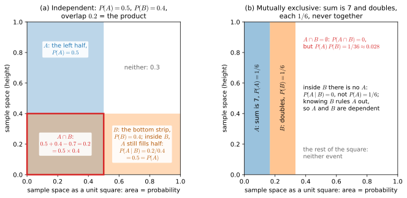
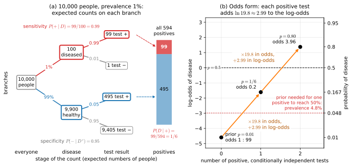
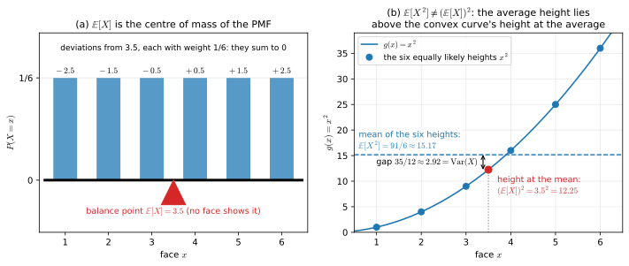
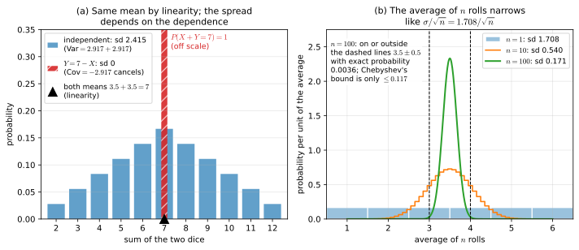
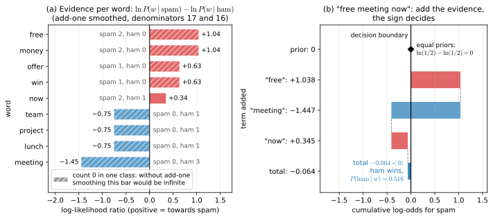

# Module 07 — Probability Foundations

> After this module you can turn a vague "how likely is it?" into a precise calculation, update that number correctly when new evidence arrives, and read every probabilistic object in an ML paper — distribution, expectation, variance, likelihood — as a concrete recipe you could implement in NumPy.

## Why this matters for ML and AI

Every machine-learning system is a machine for acting under uncertainty. A spam filter never *knows* that a message is spam; it computes a probability and acts on it. A large language model is, quite literally, a conditional probability distribution: its final softmax layer outputs $P(\text{next token} \mid \text{previous tokens})$ over a vocabulary of roughly 100,000 tokens, and "sampling with temperature" is sampling from a reshaped version of that distribution. Image classifiers output a probability per class, diffusion models draw samples from a learned distribution, and a reinforcement-learning agent picks the action with the highest *expected* return.

The training objectives are probabilistic too. Cross-entropy loss is the negative log of the probability the model assigns to the correct label, and minimising it is maximum-likelihood estimation ([Module 11](../../part-4-statistics/11-likelihood-and-bayesian-inference/README.md)). The loss you minimise is an *expectation* over the data distribution that you can only estimate by a sample average — the empirical risk. Mini-batch stochastic gradient descent is a Monte Carlo estimate of the true gradient, and the *variance* of that estimate is what decides how large a batch and how small a learning rate you need. Dropout, data augmentation, Bayesian optimisation, variational autoencoders: all of them are assembled from the objects introduced here.

Finally, judging a system is probability. "The test is 99% accurate" is routinely misread as "a positive result means a 99% chance of disease" — the base-rate fallacy. The same mistake makes a fraud-detection alert, a medical-imaging model or an A/B-test winner look far better than it is. This module gives you the vocabulary (sample space, event, conditional probability, random variable, expectation, variance), the rules (the axioms, total probability, Bayes' theorem, linearity, LOTUS, Chebyshev) and one tool (simulation) that make all such claims checkable.

## Learning objectives

After working through this module you will be able to:

- Translate a word problem into a sample space, events and probabilities, and compute with the axioms, complements and inclusion–exclusion.
- Compute conditional probabilities, apply the multiplication rule, the chain rule and the law of total probability on a probability tree and in symbols, and tell independence apart from mutual exclusivity and from conditional independence.
- Derive Bayes' theorem, use the prior/likelihood/posterior/evidence vocabulary, and update sequentially in odds form.
- Explain the base-rate fallacy with a natural-frequency table and compute PPV and NPV for any sensitivity, specificity and prevalence.
- Define random variables, PMFs, PDFs, CDFs and quantiles, sample from any distribution by inverting its CDF, and derive and apply the change-of-variables formula for a transformed random variable.
- Compute expectations with LOTUS, exploit linearity of expectation (even for dependent variables) and use indicator variables.
- Compute variances and standard deviations, derive and apply the scaling and sum rules (including the covariance term and the $\sigma/\sqrt{n}$ law for averages), standardise variables, and bound tail probabilities with Markov's and Chebyshev's inequalities.
- Estimate probabilities and expectations by Monte Carlo simulation and quantify their $1/\sqrt{n}$ error.
- Build a naive Bayes spam classifier with Laplace smoothing, in log space, directly from Bayes' theorem and conditional independence.

## Prerequisites

This is the first module of Part III and does not depend on Parts I–II. You need sets and set notation ($\cup, \cap, A^c$), finite sums ($\sum$), basic integrals ($\int$), logarithms and exponentials, and comfort with Python and NumPy. If you want to refresh derivatives and integrals, see [Module 04 — Differential calculus](../../part-2-calculus-and-optimization/04-differential-calculus/README.md). Vectors ([Module 01](../../part-1-linear-algebra/01-vectors-and-geometry/README.md)) appear only in Section 9, where a message becomes a vector of word counts. Later modules build directly on this one: [Module 08](../08-distributions-and-limit-theorems/README.md) catalogues the named distributions, [Module 09](../09-multivariate-probability/README.md) handles several random variables at once, and [Module 14](../../part-5-learning-theory/14-information-theory/README.md) turns probabilities into bits.

## 1. Why probability is the language of ML

**Intuition.** Uncertainty enters a learning system in three places. The *data* are noisy (a sensor drifts, a photo is blurred). The *labels* are noisy (two radiologists disagree on 10–20% of borderline mammograms). The *model* is uncertain because it was fitted to a finite sample and would have come out differently with a different sample. Probability theory is the single calculus that handles all three with the same handful of rules, which is why you can read a paper on protein folding and a paper on ad-click prediction and find the same symbols.

There are two ways to *read* a statement such as $P(\text{rain tomorrow}) = 0.3$. The **frequentist** reading: among a long run of days with conditions like today's, about 30% turn out wet. The **Bayesian** reading: 0.3 is a degree of belief, the price at which you would be indifferent between buying and selling a ticket that pays 1 if it rains. The two camps agree on every rule in this module (the axioms do not care how you interpret them); they differ on *what* may carry a probability — a Bayesian is happy to write $P(\theta)$ for a model parameter, a frequentist treats $\theta$ as fixed and puts probabilities only on data. Machine learning uses both readings without embarrassment: test-set accuracy is a frequentist estimate, a prior over weights is Bayesian.

**Definition.** A forecaster (or classifier) that outputs probabilities is **calibrated** if, among all cases where it says "$p$", a fraction $p$ actually occur. Calibration is the bridge between the two readings: a belief of 0.7 is a good belief if it is right 70% of the time.

**Worked example.** A classifier returns confidences $0.9, 0.8, 0.6, 0.95, 0.75$ on five images. If it is calibrated, the *expected* number of correct predictions is the sum $0.9 + 0.8 + 0.6 + 0.95 + 0.75 = 4.0$ (we will justify "expected = sum of probabilities" in Section 6). If only 3 of the 5 were in fact correct, the model is overconfident on this batch; over 500 images the gap between the summed confidences and the hit count becomes decisive evidence rather than noise.

**Real-life example (climate / weather).** A forecast of "70% chance of rain" is a claim about a *reference class*: of all days on which the forecaster has said 70%, roughly seven in ten should be wet. Forecasting services check exactly this — the reliability diagram — and modern numerical weather prediction is reasonably well calibrated for next-day rain, which is why a 70% forecast is worth an umbrella and a 20% forecast is not.

**In ML/AI this is …** the softmax layer: $\text{softmax}(z)_k = e^{z_k}/\sum_j e^{z_j}$ turns raw scores into a probability mass function over classes, `predict_proba` in scikit-learn returns the same object, and *temperature scaling* ($z/T$ before the softmax) is the standard post-hoc fix for a miscalibrated network. An LLM's next-token distribution is the same object with a 100,000-way vocabulary.

## 2. Sample spaces, events, and the axioms

**Intuition.** An experiment produces exactly one *outcome*. The **sample space** $\Omega$ is the set of all outcomes that could occur; an **event** is a subset of $\Omega$ — a question about the outcome that is either true or false. Probability behaves like *area*: it is non-negative, the whole space has area 1, and areas of non-overlapping regions add. Every rule you have ever used about probabilities follows from those three facts.

**Definition (Kolmogorov's axioms).** A probability measure $P$ assigns a number to each event such that

$$P(A) \ge 0, \qquad P(\Omega) = 1, \qquad P\Big(\bigcup_i A_i\Big) = \sum_i P(A_i) \text{ whenever the } A_i \text{ are pairwise disjoint}.$$

Consequences (each a two-line proof from the axioms):

- **Complement:** $A$ and $A^c$ are disjoint with union $\Omega$, so $P(A) + P(A^c) = 1$, i.e. $P(A^c) = 1 - P(A)$. Hence $P(\emptyset) = 0$ and $P(A) \le 1$.
- **Monotonicity:** if $A \subseteq B$ then $B = A \cup (B \setminus A)$ disjointly, so $P(B) = P(A) + P(B \setminus A) \ge P(A)$.
- **Inclusion–exclusion:** $A \cup B = A \cup (B \setminus A)$ and $B = (A \cap B) \cup (B \setminus A)$, both disjoint unions, so $P(A \cup B) = P(A) + P(B) - P(A \cap B)$.
- **Union bound:** dropping the (non-negative) intersection term gives $P(A \cup B) \le P(A) + P(B)$, and in general $P(\bigcup_i A_i) \le \sum_i P(A_i)$.

When all $|\Omega| = N$ outcomes are equally likely, $P(A) = |A|/N$, and probability becomes counting: $n!$ orderings of $n$ items, and $\binom{n}{k} = \frac{n!}{k!\,(n-k)!}$ ways to choose $k$ of them.

**Worked example.** Roll two fair dice: $\Omega = \{1,\dots,6\}^2$ has 36 equally likely outcomes, the cells of the grid in Figure 1(a). Let $A$ = "the sum is 7" $= \{(1,6),(2,5),(3,4),(4,3),(5,2),(6,1)\}$, so $P(A) = 6/36 = 1/6$. Let $B$ = "doubles" $= \{(1,1),\dots,(6,6)\}$, $P(B) = 6/36$. A sum of 7 is odd and doubles are even, so $A \cap B = \emptyset$ and $P(A \cup B) = 12/36 = 1/3$. Let $C$ = "at least one six": its complement "no six" has $5 \times 5 = 25$ outcomes, so $P(C) = 1 - 25/36 = 11/36 \approx 0.306$. With a 52-card deck (Figure 1(b)), $P(\text{ace} \cup \text{heart}) = \frac{4}{52} + \frac{13}{52} - \frac{1}{52} = \frac{16}{52} = \frac{4}{13} \approx 0.308$ — the ace of hearts must not be counted twice. Drawing two cards, there are $\binom{52}{2} = 1326$ hands and $\binom{4}{2} = 6$ pairs of aces, so $P(\text{two aces}) = 6/1326 = 1/221$.

**Figure 1.** (a) The 36 equally likely outcomes of two dice as cells (first die across, second die up), so the probability of an event is its number of cells over 36. The anti-diagonal is $A$, "the sum is 7" (6 cells), and the main diagonal is $B$, "doubles" (6 cells); they share no cell, so plain additivity gives $P(A \cup B) = 12/36 = 1/3$. The hatched L of the top row and right-hand column is $C$, "at least one six": all 36 cells minus the $5 \times 5$ block with no six, $36 - 25 = 11$ cells, so $P(C) = 11/36 \approx 0.306$. It overlaps $A$ in $(1, 6)$ and $(6, 1)$ and $B$ in $(6, 6)$. (b) A 52-card deck as a $4 \times 13$ grid. The aces column (4 cells) and the hearts row (13 cells) cross in a single outlined cell, the ace of hearts, which the sum $4 + 13$ counts twice; inclusion–exclusion subtracts it once, $P(\text{ace} \cup \text{heart}) = (4 + 13 - 1)/52 = 16/52 = 4/13 \approx 0.308$.

**Real-life example (insurance).** A household insurer knows that in a given year $P(\text{car claim}) = 0.12$, $P(\text{home claim}) = 0.05$ and $P(\text{both}) = 0.02$. The probability of at least one claim is $0.12 + 0.05 - 0.02 = 0.15$, and $P(\text{no claim}) = 0.85$. Had the overlap been unknown, the union bound still guarantees at most $0.17$ — a bound you can state without knowing how correlated the two risks are, which is exactly its appeal.

**In ML/AI this is …** the union bound that powers generalisation theory ([Module 15](../../part-5-learning-theory/15-generalization-and-learning-theory/README.md)): $P(\text{some hypothesis in } \mathcal{H} \text{ has a misleading training error}) \le \sum_{h \in \mathcal{H}} P(h \text{ is misleading})$. A softmax output satisfies the first two axioms by construction (non-negative, sums to 1), and a one-hot label is a probability measure that puts all its mass on one outcome.

## 3. Conditional probability and independence

**Intuition.** Conditioning is zooming in. Once you learn that $B$ has happened, $B$ *becomes* the new sample space; the probabilities of outcomes inside $B$ keep their ratios but are rescaled by $1/P(B)$ so that they add up to 1 again. Everything outside $B$ is discarded. Figure 3(b) draws exactly this for the worked example below.

**Definition.** For $P(B) > 0$,

$$P(A \mid B) = \frac{P(A \cap B)}{P(B)}.$$

The numerator keeps the part of $A$ that lies inside $B$; the denominator rescales so that $P(B \mid B) = 1$. For a fixed $B$, $P(\cdot \mid B)$ satisfies all three axioms, so it is a probability measure in its own right, and every rule of Section 2 (complement, inclusion–exclusion, union bound) holds conditionally as well.

*Multiplication and chain rule.* Multiplying the definition by $P(B)$ gives the **multiplication rule** $P(A \cap B) = P(A \mid B)\,P(B)$, and swapping the roles of $A$ and $B$ gives $P(A \cap B) = P(B \mid A)\,P(A)$. Applied twice, $P(A_1 \cap A_2 \cap A_3) = P(A_1 \cap A_2)\,P(A_3 \mid A_1 \cap A_2) = P(A_1)\,P(A_2 \mid A_1)\,P(A_3 \mid A_1 \cap A_2)$, and iterated it is the **chain rule**

$$P(A_1 \cap \dots \cap A_n) = P(A_1)\,P(A_2 \mid A_1)\,P(A_3 \mid A_1 \cap A_2) \cdots P(A_n \mid A_1 \cap \dots \cap A_{n-1}).$$

It needs no independence assumption (only $P(A_1 \cap \dots \cap A_{n-1}) > 0$, so that every conditional is defined) and holds for the events taken in any order. On a probability tree it reads *multiply along a path*: each branch carries the probability of its event given everything above it, and a leaf's probability is the product of the branches leading to it — in the worked example below, $P(D_1 \cap D_2) = 0.04 \times 0.10 = 0.0040$ (Figure 3(a)). For a three-word message, $P(w_1, w_2, w_3) = P(w_1)\,P(w_2 \mid w_1)\,P(w_3 \mid w_1, w_2)$: one conditional per position, which is exactly what an autoregressive language model learns ([Module 17](../../part-6-deep-learning-and-modern-ai/17-mathematics-of-transformers/README.md)).

*Total probability is marginalisation.* If $B_1, \dots, B_n$ partition $\Omega$ (pairwise disjoint, together covering everything) and each $P(B_i) > 0$, the **law of total probability** says

$$P(A) = \sum_{i=1}^{n} P(A \mid B_i)\,P(B_i),$$

which is nothing but additivity applied to the disjoint pieces $A \cap B_i$: their union is $A$, so $P(A) = \sum_i P(A \cap B_i)$, and the multiplication rule rewrites each piece as $P(A \mid B_i)\,P(B_i)$. On the tree it reads *add across leaves*: sum the leaves in which $A$ happens, whatever happened at the earlier stage. Summing out an earlier stage in this way is called **marginalising** it; it produces the evidence $P(E)$ in Bayes' theorem (Section 4), the density of a mixture model, and the marginals of a joint table ([Module 09](../09-multivariate-probability/README.md)).

*Independence: three equivalent tests.* Events are **independent** when $P(A \cap B) = P(A)\,P(B)$. When $P(B) > 0$, dividing by $P(B)$ turns this into $P(A \mid B) = P(A)$, and when $P(A) > 0$, into $P(B \mid A) = P(B)$: learning either event does not move your probability of the other. The product form is taken as the definition because it is symmetric and still makes sense when a probability is 0. Independence carries over to complements, since $P(A \cap B^c) = P(A) - P(A)\,P(B) = P(A)\,P(B^c)$. It is a statement about numbers, not about causes: on two dice, "the first die is even" (probability $1/2$) and "the sum is 7" (probability $1/6$) are independent, because 3 of the 36 cells of Figure 1(a), $(2, 5)$, $(4, 3)$ and $(6, 1)$, lie in both, and $3/36 = 1/12 = \frac12 \times \frac16$. On a tree, independent stages have the same second-stage branches under every first-stage outcome; in the worked example below they are 0.10 under $D_1$ and 0.02 under $D_1^c$, so $D_1$ and $D_2$ are dependent before any arithmetic. To test independence on data, tabulate the two events in a $2 \times 2$ table and compare the proportion in the "both" cell with the product of its row and column proportions — the chi-square test of [Module 12](../../part-4-statistics/12-hypothesis-testing-and-experiments/README.md) makes that comparison formal; on simulated boolean arrays `a` and `b`, compare `np.mean(a & b)` with `np.mean(a) * np.mean(b)`.

*Mutually exclusive is not independent.* Events are **mutually exclusive** when $A \cap B = \emptyset$. The two notions are nearly opposites. Draw the sample space as a unit square with area as probability (Figure 2): independence demands an overlap of area $P(A)\,P(B)$, which is positive whenever both events have positive probability, so independent events with positive probabilities always overlap. Conversely, if two mutually exclusive events both have positive probability, then $P(A \mid B) = 0 \ne P(A)$, so they are strongly *dependent* — knowing one happened tells you the other did not. In Figure 2(a), $P(A) = 0.5$ and $P(B) = 0.4$ overlap in $0.2 = 0.5 \times 0.4$ (self-assessment question 1); in Figure 2(b), Section 2's "sum is 7" and "doubles" each have probability $1/6$ but never occur together, so $P(A \cap B) = 0 \ne 1/36$. Events that are both disjoint and independent satisfy $P(A)\,P(B) = 0$, so at least one of them has probability 0.

**Figure 2.** The sample space as a unit square in which area is probability. (a) Self-assessment question 1: $A$ is the left half, $P(A) = 0.5$, and $B$ the bottom strip, $P(B) = 0.4$. Their outlined overlap has area $0.5 + 0.4 - 0.7 = 0.2 = 0.5 \times 0.4$, so $A$ and $B$ are independent: inside $B$, $A$ still fills half, $P(A \mid B) = 0.2/0.4 = 0.5 = P(A)$; the area outside both is $0.3$. (b) Section 2's dice events "sum is 7" and "doubles" as two side-by-side strips of width $1/6$ that never overlap: $P(A \cap B) = 0$, whereas independence would need $P(A)\,P(B) = 1/36 \approx 0.028$. Inside $B$ there is no $A$ at all, $P(A \mid B) = 0 \ne 1/6$, so these mutually exclusive events are dependent.

*Conditional independence.* $A$ and $B$ are **conditionally independent given $C$** (with $P(C) > 0$) when $P(A \cap B \mid C) = P(A \mid C)\,P(B \mid C)$ — the product rule applied inside the zoomed-in world of $C$. Conditional independence neither implies nor is implied by plain independence:

- *Conditional does not imply plain.* Pick one of two coins at random, one landing heads with probability 0.9 and the other with 0.1, and flip it twice. Given the coin, the two flips are independent. Without knowing the coin, total probability gives $P(H_1) = P(H_2) = 0.5 \times 0.9 + 0.5 \times 0.1 = 0.5$, but $P(H_1 \cap H_2) = 0.5 \times 0.81 + 0.5 \times 0.01 = 0.41 \ne 0.25$, and $P(H_2 \mid H_1) = 0.41/0.5 = 0.82$: a first head is evidence for the heads-biased coin, which makes a second head likelier. The hidden common cause creates the dependence — the situation of "free" and "money" in a spam corpus (Section 9, pitfall 6).
- *Plain does not imply conditional.* Two flips of a fair coin are independent, but given $C$ = "the two flips agree", the first flip determines the second: $P(H_1 \cap H_2 \mid C) = 1/2$, while $P(H_1 \mid C)\,P(H_2 \mid C) = \frac12 \times \frac12 = \frac14$.

To test conditional independence in data, check the product rule separately within each stratum of $C$. It is the assumption behind naive Bayes (Section 9), hidden Markov models and Bayesian networks, and the Markov property of [Module 19](../../part-6-deep-learning-and-modern-ai/19-markov-decision-processes-and-rl/README.md) is one: the future is conditionally independent of the past given the present.

**Worked example (two-stage manufacturing).** A part passes through moulding (stage 1) and finishing (stage 2). Let $D_1$ = "damaged in stage 1", with $P(D_1) = 0.04$. Damaged parts are more fragile, so $P(D_2 \mid D_1) = 0.10$ while $P(D_2 \mid D_1^c) = 0.02$. Draw the tree (Figure 3(a)):

| Branch | Probability |
|---|---|
| $D_1 \cap D_2$ | $0.04 \times 0.10 = 0.0040$ |
| $D_1 \cap D_2^c$ | $0.04 \times 0.90 = 0.0360$ |
| $D_1^c \cap D_2$ | $0.96 \times 0.02 = 0.0192$ |
| $D_1^c \cap D_2^c$ | $0.96 \times 0.98 = 0.9408$ |

The four leaves sum to 1, as they must. Total probability gives $P(D_2) = 0.0040 + 0.0192 = 0.0232$, and the part is defective (damaged at *either* stage) with probability $1 - 0.9408 = 0.0592$. Are $D_1$ and $D_2$ independent? $P(D_1)P(D_2) = 0.04 \times 0.0232 = 0.00093$, but $P(D_1 \cap D_2) = 0.0040$ — more than four times larger, so no. Equivalently $P(D_1 \mid D_2) = 0.0040/0.0232 \approx 0.172$: a part found damaged after finishing is 4.3 times more likely than a random part to have been damaged in moulding. Conditioning on $D_2$ keeps only its two leaves and divides them by $0.0232$, so the other one becomes $P(D_1^c \mid D_2) = 0.0192/0.0232 \approx 0.828$ and the two again sum to 1 (Figure 3(b)).

**Figure 3.** (a) The worked-example tree. Each branch carries a conditional probability, each leaf multiplies the branches on its path (the chain rule), and the four leaves sum to 1. The two thick-bordered leaves are those in which $D_2$ happens; adding them is the law of total probability, $P(D_2) = 0.0040 + 0.0192 = 0.0232$. The stage-2 branches differ under $D_1$ (0.10) and under $D_1^c$ (0.02), which already shows that the stages are dependent. (b) Conditioning as zooming in. The left bar is all parts, drawn to scale: the dotted block $D_2^c$ ($0.9768$) is discarded, and the $D_2$ sliver ($0.0232$) is so thin that its $D_1 \cap D_2$ piece is a hairline. Dividing by $0.0232$ stretches the sliver into the full right bar, $P(D_1 \mid D_2) = 0.0040/0.0232 \approx 0.172$ at the bottom and $P(D_1^c \mid D_2) \approx 0.828$ above it. The dashed line marks $P(D_1) = 0.04$, the value independence would give; the conditional probability is 4.3 times higher.

**Real-life example (manufacturing / e-commerce).** Quality engineers use exactly this tree to decide where to put inspection: the 0.0040 leaf tells them that a tenth of stage-1 damage goes on to compound, so inspecting after moulding is worth more than its share of defects suggests. For the independence-versus-exclusivity confusion, consider an online checkout where a customer pays by card *or* by PayPal. The two events are mutually exclusive, and precisely for that reason they are dependent: observing "card" drives the probability of "PayPal" to zero.

**In ML/AI this is …** the chain rule of probability that an autoregressive language model implements token by token, $P(w_1, \dots, w_T) = \prod_{t=1}^{T} P(w_t \mid w_{<t})$; the conditional-independence assumption inside naive Bayes (Section 9) and hidden Markov models; and the law of total probability as *marginalisation*, e.g. a mixture model $P(x) = \sum_k \pi_k\,P(x \mid \text{component } k)$ or the evidence term in Bayes' theorem.

## 4. Bayes' theorem

**Intuition.** You start with a belief about a hypothesis (the *prior*), you observe evidence, and you ask how the evidence should change the belief. Bayes' theorem is the only consistent way to do it, and it has a built-in corrective: evidence that is *also* fairly likely under the competing hypothesis moves you less than it feels it should. Ignoring that corrective is the single most common probability mistake in medicine, law and ML evaluation.

**Definition and derivation.** Write the multiplication rule both ways, $P(H \cap E) = P(H \mid E)\,P(E) = P(E \mid H)\,P(H)$, and divide by $P(E) > 0$:

$$P(H \mid E) = \frac{P(E \mid H)\,P(H)}{P(E)}, \qquad P(E) = P(E \mid H)\,P(H) + P(E \mid H^c)\,P(H^c).$$

The vocabulary: $P(H)$ is the **prior**, $P(E \mid H)$ the **likelihood** of the evidence under $H$, $P(E)$ the **evidence** (or marginal likelihood, computed by total probability), and $P(H \mid E)$ the **posterior**. Dividing the posterior of $H$ by the posterior of $H^c$ gives the **odds form**, which is the version to use in your head:

$$\underbrace{\frac{P(H \mid E)}{P(H^c \mid E)}}_{\text{posterior odds}} = \underbrace{\frac{P(E \mid H)}{P(E \mid H^c)}}_{\text{likelihood ratio}} \times \underbrace{\frac{P(H)}{P(H^c)}}_{\text{prior odds}}.$$

Odds $o$ and probability $p$ are related by $o = p/(1-p)$ and $p = o/(1+o)$. For several pieces of evidence that are conditionally independent given each hypothesis (given $H$ and given $H^c$), the likelihood ratios simply multiply — **sequential updating**: today's posterior is tomorrow's prior.

**Worked example (the diagnostic test).** A test has **sensitivity** $P(+ \mid D) = 0.99$ and **specificity** $P(- \mid D^c) = 0.95$; the disease has **prevalence** $P(D) = 0.01$. A patient tests positive. The evidence is $P(+) = 0.99 \times 0.01 + 0.05 \times 0.99 = 0.0099 + 0.0495 = 0.0594$, so the **positive predictive value** is

$$P(D \mid +) = \frac{0.0099}{0.0594} = \frac{1}{6} \approx 0.167.$$

A "99% accurate" test leaves a positive patient with a *17%* chance of disease. The natural-frequency table makes it obvious — imagine 10,000 people (Figure 4(a) draws the same counts as a tree):

| | Test $+$ | Test $-$ | Total |
|---|---|---|---|
| Diseased | 99 | 1 | 100 |
| Healthy | 495 | 9,405 | 9,900 |
| Total | 594 | 9,406 | 10,000 |

Of the 594 positives, only 99 are ill: the 5% false-positive rate applied to 9,900 healthy people swamps the 99 true positives. The **negative predictive value** is excellent, $9{,}405/9{,}406 \approx 0.9999$. In odds form: prior odds $1{:}99$, likelihood ratio $0.99/0.05 = 19.8$, posterior odds $19.8/99 = 0.2$, probability $0.2/1.2 = 1/6$. A second, conditionally independent positive test multiplies the odds again: $0.2 \times 19.8 = 3.96$, probability $3.96/4.96 \approx 0.80$. On the log scale every positive test adds the same step, $\ln 19.8 \approx 2.99$, to the log-odds (Figure 4(b)). And the PPV reaches 50% exactly when prior odds $\times\, 19.8 = 1$, i.e. at prevalence $\frac{1-\text{sp}}{\text{se} + 1 - \text{sp}} = 0.05/1.04 \approx 4.8\%$ — which is why screening is targeted at high-risk groups. This misreading of a test result is the **base-rate fallacy**: forgetting that the prior matters.

**Figure 4.** (a) The diagnostic test as expected counts in 10,000 people. The 1% prevalence splits them into 100 diseased and 9,900 healthy; the test then sends 99 of the diseased and 495 of the healthy to "test +". The two conditionals of pitfall 2 have different denominators: the sensitivity $P(+ \mid D) = 99/100 = 0.99$ divides by the diseased box, the PPV $P(D \mid +) = 99/594 = 1/6$ by the bar of all 594 positives, five sixths of which are healthy people. (b) The odds form on a log scale; the left axis gives the log-odds and the right axis the same heights as probabilities. Starting from prior odds $1:99$ (log-odds $-4.60$), each conditionally independent positive test multiplies the odds by the likelihood ratio 19.8, i.e. adds $\ln 19.8 \approx 2.99$: one positive gives odds 0.2 ($p = 1/6$, log-odds $-1.61$), two give odds 3.96 ($p \approx 0.80$, log-odds $1.38$). The dashed line is $p = 0.5$; the dotted line one step below it marks the prior from which a single positive reaches 50%, prevalence $0.05/1.04 \approx 4.8\%$.

**Real-life examples.** *Screening programmes* confirm every positive mammogram or PSA result with a second, more specific test, because the first-stage PPV is low at population prevalence. *Fraud detection*: if 0.1% of transactions are fraudulent and the detector catches 95% of fraud with a 2% false-alarm rate, then $P(\text{fraud} \mid \text{alert}) = \frac{0.95 \times 0.001}{0.95 \times 0.001 + 0.02 \times 0.999} \approx 0.045$ — 95% of alerts are false, and the review team must be sized accordingly. *A/B testing*: suppose 10% of the changes a team tests are real improvements, the test has power 0.8 and significance level 0.05. Then $P(\text{significant}) = 0.8 \times 0.1 + 0.05 \times 0.9 = 0.125$ and $P(\text{real} \mid \text{significant}) = 0.08/0.125 = 0.64$: more than a third of "significant winners" are false positives ([Module 12](../../part-4-statistics/12-hypothesis-testing-and-experiments/README.md)).

**In ML/AI this is …** the Bayesian classifier $P(y \mid x) \propto P(x \mid y)\,P(y)$ (naive Bayes, LDA/QDA, Gaussian mixture responsibilities); the posterior over parameters $P(\theta \mid \text{data}) \propto P(\text{data} \mid \theta)\,P(\theta)$ in [Module 11](../../part-4-statistics/11-likelihood-and-bayesian-inference/README.md), where the log-prior becomes a regulariser; and the reason `precision` (= PPV) and `recall` (= sensitivity) are reported separately from accuracy on imbalanced datasets.

## 5. Random variables

**Intuition.** A random variable is not "a variable that is random"; it is a *measurement* — a fixed rule that attaches a number to every outcome. Roll two dice and record the sum: the rule "add the faces" is the random variable, and its randomness is inherited entirely from the dice. Because the output is a number, you can plot, add, average and compare random variables, which you cannot do with raw outcomes such as "ace of hearts".

**Definition.** A **random variable** is a function $X : \Omega \to \mathbb{R}$. It is **discrete** if it takes countably many values, described by its **probability mass function** $p_X(x) = P(X = x)$ with $p_X \ge 0$ and $\sum_x p_X(x) = 1$. It is **continuous** if there is a **probability density function** $f_X \ge 0$ with $\int_{-\infty}^{\infty} f_X(x)\,dx = 1$ and

$$P(a \le X \le b) = \int_a^b f_X(x)\,dx .$$

*Why a density is not a probability.* For a tiny interval, $P(x \le X \le x + dx) \approx f_X(x)\,dx$: $f_X(x)\,dx$ is the probability of an interval of width $dx$, and $f_X$ itself is probability *per unit of $x$*; only areas under it are probabilities. Three consequences follow. $P(X = x) = 0$ for every single point of a continuous variable, because an interval of width 0 has no area. $f_X(x)$ can exceed 1, and must do so somewhere when $X$ lives on an interval shorter than 1: $\text{Uniform}(0, 0.5)$ has density 2 throughout. And a change of units rescales the density: a length $X$ in metres with density $f_X$ becomes the length $Y = 100X$ in centimetres, with density $f_Y(y) = f_X(y/100)/100$ — the same probability spread over a range a hundred times wider. Figure 5(b) shows densities of 3.33 and 10 over intervals that each carry probability 0.1.

*PMF and PDF side by side.*

| | Discrete: PMF $p_X$ | Continuous: PDF $f_X$ |
|---|---|---|
| $P(X = x)$ | $p_X(x)$, can be positive | $0$ for every $x$ |
| $P(a \le X \le b)$ | $\sum_{a \le x \le b} p_X(x)$ | $\int_a^b f_X(x)\,dx$ |
| Normalisation | $\sum_x p_X(x) = 1$ | $\int f_X(x)\,dx = 1$ |
| Can exceed 1? | no | yes |
| Picture | bar heights | area under a curve |
| From samples | `np.bincount(x) / len(x)` | `np.histogram(x, bins=50, density=True)` |
| In SciPy | `scipy.stats.binom(n, p).pmf(k)` | `scipy.stats.norm(mu, sigma).pdf(x)` |

*The CDF unifies both.* The **cumulative distribution function** $F_X(x) = P(X \le x)$ exists for every random variable. It is non-decreasing, tends to 0 as $x \to -\infty$ and to 1 as $x \to \infty$, is right-continuous, and gives $P(a < X \le b) = F_X(b) - F_X(a)$. For a discrete variable it is a staircase that jumps by $p_X(x)$ at each value $x$, so it matters whether an endpoint is included: for the dice sum of the worked example below, $P(S \le 4) = 6/36$ but $P(S < 4) = 3/36$. For a continuous variable it is continuous, endpoints carry no probability, and $f_X = F_X'$ wherever the derivative exists.

*Quantiles: inverting the CDF.* The **quantile function** is $Q_X(u) = \min\{x : F_X(x) \ge u\}$ for $0 < u < 1$; $Q_X(0.5)$ is the median and $Q_X(0.99)$ the 99th percentile. When $F_X$ is continuous and strictly increasing, $Q_X$ is simply $F_X^{-1}$: read the CDF backwards, as Figure 5(c) does. The "min" covers the other cases. A staircase CDF jumps over most levels, so $F_X(x) = u$ may have no solution — for the dice sum, $F_S(6) = 15/36 < 0.5$ and $F_S(7) = 21/36 > 0.5$, so no value gives exactly 0.5, and the median is the first value at which the CDF reaches 0.5, namely 7 — while a flat stretch of the CDF gives many solutions, of which the min takes the smallest. The quantile function turns uniform random numbers into samples: if $U \sim \text{Uniform}(0, 1)$, then $X = Q_X(U)$ has CDF $F_X$, because $Q_X(u) \le x$ exactly when $u \le F_X(x)$, so $P(Q_X(U) \le x) = P(U \le F_X(x)) = F_X(x)$. This is **inverse-CDF sampling**. In code, `np.quantile(samples, u)` estimates a quantile from data and `scipy.stats.norm.ppf(u)` gives it exactly (SciPy calls $Q_X$ the *percent point function*).

*Change of variables, derived from the CDF.* For a transformation $Y = g(X)$ of a continuous $X$ with $g$ strictly monotone and differentiable, go through the CDF. If $g$ is increasing, $g(X) \le y$ exactly when $X \le g^{-1}(y)$, so $F_Y(y) = F_X\big(g^{-1}(y)\big)$, and differentiating with the chain rule ([Module 04](../../part-2-calculus-and-optimization/04-differential-calculus/README.md)) gives $f_Y(y) = f_X\big(g^{-1}(y)\big)\,\frac{d}{dy}g^{-1}(y)$. If $g$ is decreasing the inequality flips, $F_Y(y) = 1 - F_X\big(g^{-1}(y)\big)$, and differentiating brings a minus sign that cancels the negative derivative of $g^{-1}$. Both cases are the **change-of-variables formula**

$$f_Y(y) = f_X\big(g^{-1}(y)\big)\,\left|\frac{d}{dy} g^{-1}(y)\right| ,$$

the Jacobian factor compensating for how $g$ stretches or squeezes intervals. Probability is conserved, so where $g$ shrinks an interval to $0.3$ of its width the average density on the image is $1/0.3 \approx 3.33$ times the density on the original (in the worked example below, $[0.1, 0.2]$ shrinks onto $[0.01, 0.04]$; Figure 5(a) and (b)). The linear case $Y = aX + b$ with $a \ne 0$ gives $f_Y(y) = f_X\big((y - b)/a\big)/|a|$; the VAE reparameterisation $z = \mu + \sigma\varepsilon$ is this with $a = \sigma$ and $b = \mu$, turning the standard normal density of $\varepsilon$ into that of $\mathcal{N}(\mu, \sigma^2)$. Dropping the Jacobian is the classic error: for $Y = X^2$ with uniform $X$ it would give $f_Y(y) = f_X(\sqrt{y}) = 1$, a uniform $Y$ with median 0.5, whereas the true median is 0.25. (For discrete $X$ there is no Jacobian: $p_Y(y) = \sum_{x : g(x) = y} p_X(x)$, which also works when $g$ is not monotone.) To check a derived density in practice, transform many samples of $X$, draw a `density=True` histogram of $g(X)$ and overlay the formula. With several variables at once, the absolute derivative becomes the absolute determinant of the Jacobian matrix ([Module 04](../../part-2-calculus-and-optimization/04-differential-calculus/README.md)), the version on which normalising flows are built ([Module 18](../../part-6-deep-learning-and-modern-ai/18-sampling-mcmc-and-generative-models/README.md)).

**Worked example.** *Discrete:* the sum $S$ of two dice has PMF $p_S(s) = \frac{6 - |s - 7|}{36}$ for $s = 2, \dots, 12$, so $p_S(2) = 1/36$, $p_S(7) = 6/36$, $p_S(12) = 1/36$. The CDF at 4 is $F_S(4) = (1 + 2 + 3)/36 = 1/6$; since $F_S(6) = 15/36 < 0.5$ and $F_S(7) = 21/36 \ge 0.5$, the median is 7. *Continuous:* let $X \sim \text{Uniform}(0, 1)$, $f_X = 1$ on $[0, 1]$, and $Y = X^2$. Here $g^{-1}(y) = \sqrt{y}$ with derivative $\frac{1}{2\sqrt{y}}$, so $f_Y(y) = \frac{1}{2\sqrt{y}}$ on $(0, 1]$. Check: $\int_0^1 \frac{dy}{2\sqrt{y}} = [\sqrt{y}]_0^1 = 1$. At $y = 0.01$ the density is $5$ — larger than 1, perfectly legal. The CDF is $F_Y(y) = P(X \le \sqrt{y}) = \sqrt{y}$, so $P(0.01 \le Y \le 0.04) = \sqrt{0.04} - \sqrt{0.01} = 0.1$: the probability $0.1$ of $X \in [0.1, 0.2]$ lands on a $y$-interval only $0.03$ wide, where the density of $Y$ averages $0.1/0.03 \approx 3.33$ (Figure 5(a) and (b)). The quantile function is $Q_Y(u) = u^2$: the median of $Y$ is $0.25$, not $0.5$ — squaring pushes mass towards 0 (Figure 5(c)).

**Figure 5.** The transformation $Y = X^2$ of $X \sim \text{Uniform}(0, 1)$. (a) Ten $x$-intervals of width 0.1, each with probability 0.1 (alternately shaded below the $x$-axis), are carried by the parabola onto $y$-intervals (left of the $y$-axis) that bunch up near 0: $[0.1, 0.2]$ is squeezed onto $[0.01, 0.04]$, width 0.03, while $[0.9, 1]$ is stretched onto $[0.81, 1]$, width 0.19. (b) The density of $Y$ as bars over those $y$-intervals. Each bar has area 0.1, so its height is $0.1/\text{width}$: $3.33$ for the squeezed interval, $0.53$ for the stretched one and 10 for the first, $[0, 0.01]$, which is off the scale. The bars are bin averages of the curve $f_Y(y) = 1/(2\sqrt{y})$, so near 0, where the curve is steep, a bar stands above the curve's value at its midpoint (10 against 7.07 for the first bin). The dot is $f_Y(0.01) = 5$, a density above 1 and not a probability. (c) The CDF $F_Y(y) = \sqrt{y}$, with the uniform's $F_X(x) = x$ dashed for reference: reading across from the level 0.5 to the curve and down gives the median $Q_Y(0.5) = 0.5^2 = 0.25$, half the uniform's median 0.5.

**Real-life example (waiting times, incomes, pixels).** The time until the next bus at a stop served every 10 minutes *on average* but irregularly is well modelled by an exponential density $f(t) = \lambda e^{-\lambda t}$ with $\lambda = 0.1$ per minute: $F(t) = 1 - e^{-\lambda t}$, so $P(\text{wait} > 15) = e^{-1.5} \approx 0.22$ and the median wait is $\ln 2 / \lambda \approx 6.9$ minutes, well below the mean of 10 — a skewed density has median $\ne$ mean. Household incomes are roughly *log-normal*: $\log(\text{income})$ is approximately normal, so income itself has the density of $Y = e^X$ with the Jacobian $1/y$ — which is why income histograms have a long right tail. A grayscale image's pixel intensities $\{0, \dots, 255\}$ form a discrete PMF (its histogram); rescaling to $[0, 1]$ by dividing by 255 is a linear transformation of that random variable.

**In ML/AI this is …** the change-of-variables formula at the heart of *normalising flows*, $\log p_X(x) = \log p_Z(f(x)) + \log\left|\det J_f(x)\right|$; the reparameterisation trick of VAEs, $z = \mu + \sigma\varepsilon$ with $\varepsilon \sim \mathcal{N}(0, 1)$, which is a transformation of a random variable; quantile regression and the pinball loss, which target $Q_Y(u \mid x)$ instead of the mean; and inverse-CDF sampling ([Module 18](../../part-6-deep-learning-and-modern-ai/18-sampling-mcmc-and-generative-models/README.md)), which draws $X = Q_X(U)$ from $U \sim \text{Uniform}(0, 1)$ — exactly how `rng.choice` with weights works underneath.

## 6. Expectation

**Intuition.** The expectation is the long-run average value of a random variable: the centre of mass of its distribution, with probabilities as weights. Play a game many times and your average winnings per play settle down to its expectation (the law of large numbers, [Module 08](../08-distributions-and-limit-theorems/README.md)). It is a *single number summary*; it need not be a value $X$ can take, and it can be a poor description of a skewed or two-humped distribution.

**Definition.**

$$\mathbb{E}[X] = \sum_x x\,p_X(x) \quad \text{(discrete)}, \qquad \mathbb{E}[X] = \int_{-\infty}^{\infty} x\,f_X(x)\,dx \quad \text{(continuous)},$$

whenever the sum or integral converges absolutely. Three facts do almost all the work:

1. **LOTUS** (law of the unconscious statistician): $\mathbb{E}[g(X)] = \sum_x g(x)\,p_X(x)$ or $\int g(x) f_X(x)\,dx$ — you never need the distribution of $g(X)$ itself.
2. **Linearity:** $\mathbb{E}[aX + bY + c] = a\,\mathbb{E}[X] + b\,\mathbb{E}[Y] + c$ for *any* random variables $X, Y$ — dependent or not, nothing about independence is assumed. (The proof is one line: the sum defining the expectation is linear.)
3. **Indicators:** for an event $A$ define $\mathbf{1}_A = 1$ if $A$ occurs and $0$ otherwise; then $\mathbb{E}[\mathbf{1}_A] = 1 \cdot P(A) + 0 \cdot P(A^c) = P(A)$. Probabilities *are* expectations, so every rule for expectations applies to them.

What linearity does **not** give you: $\mathbb{E}[g(X)] \ne g(\mathbb{E}[X])$ in general ($\mathbb{E}[X^2] \ne (\mathbb{E}[X])^2$, $\mathbb{E}[1/X] \ne 1/\mathbb{E}[X]$), and $\mathbb{E}[XY] = \mathbb{E}[X]\,\mathbb{E}[Y]$ is guaranteed only under independence. More precisely, it holds exactly when $X$ and $Y$ are *uncorrelated*, $\operatorname{Cov}(X, Y) = \mathbb{E}[XY] - \mathbb{E}[X]\,\mathbb{E}[Y] = 0$ (Section 7, [Module 09](../09-multivariate-probability/README.md)), which dependent variables can satisfy by accident: for $X$ uniform on $\{-1, 0, 1\}$ and $Y = X^2$, $\mathbb{E}[XY] = \mathbb{E}[X^3] = 0 = \mathbb{E}[X]\,\mathbb{E}[Y]$.

**Worked example.** One fair die: $\mathbb{E}[X] = \frac{1 + 2 + \dots + 6}{6} = 3.5$, a value no die shows but the point at which the PMF balances (Figure 6(a)). By LOTUS, $\mathbb{E}[X^2] = \frac{1 + 4 + 9 + 16 + 25 + 36}{6} = \frac{91}{6} \approx 15.17$, whereas $(\mathbb{E}[X])^2 = 12.25$ (Figure 6(b)). Two dice: the sum has expectation $3.5 + 3.5 = 7$ by linearity — no need for the PMF of Section 5, and the same answer would hold if the dice were glued together. Dependence check: let $Y = 7 - X$ (completely determined by $X$); then $\mathbb{E}[X + Y] = \mathbb{E}[7] = 7 = 3.5 + 3.5$, as linearity promises. *A game with negative expectation:* pay USD 1 to roll a die, win USD 5 on a six. Net gain $G$ is $+4$ with probability $1/6$ and $-1$ with probability $5/6$: $\mathbb{E}[G] = \frac{4}{6} - \frac{5}{6} = -\frac{1}{6} \approx -0.17$ per play; in 600 plays you expect to lose about USD 100 — which is how casinos work (a European roulette bet on red has $\mathbb{E} = -1/37$ per unit). *Indicator trick:* among $n = 23$ people, let $\mathbf{1}_{ij}$ indicate that persons $i$ and $j$ share a birthday. The expected number of sharing pairs is $\sum_{i<j} \mathbb{E}[\mathbf{1}_{ij}] = \binom{23}{2} \cdot \frac{1}{365} = \frac{253}{365} \approx 0.69$, even though the 253 indicators are not independent: any two of them are, but if person $i$ shares a birthday with $j$ and with $k$, then $j$ and $k$ must share one too.

**Figure 6.** (a) The PMF of a fair die as six bars of weight $1/6$ on a lever. It balances at $\mathbb{E}[X] = 3.5$, the point at which the deviations $-2.5, -1.5, \dots, +2.5$, each weighted by $1/6$, sum to zero — a balance point that no face shows. (b) The six equally likely values of $X^2$ as points on the parabola $g(x) = x^2$. Their mean, the dashed line, is $\mathbb{E}[X^2] = 91/6 \approx 15.17$; the curve's height at the mean is $(\mathbb{E}[X])^2 = 3.5^2 = 12.25$. Because the parabola is convex, the average of its heights lies above its height at the average (Jensen's inequality, pitfall 4), and the gap $35/12 \approx 2.92$ is exactly $\operatorname{Var}(X)$, as Section 7's shortcut formula says.

**Real-life example (insurance and e-commerce).** An insurer prices a motor policy as the expected claim plus a loading. If a customer has a 0.88 chance of no claim, 0.10 of a USD 2,000 claim and 0.02 of a USD 20,000 total loss, the expected claim is $0 + 200 + 400 = \text{USD } 600$; a premium of USD 700 covers costs and profit on average, and by linearity the expected total payout over 10,000 such policies is exactly USD 6 million no matter how claims are correlated. (Whether the *variance* of that total is tolerable is Section 7's question.) In e-commerce, the expected revenue of showing a product is $P(\text{purchase}) \times \text{price}$, so a 2% conversion at USD 300 (expected USD 6) beats a 5% conversion at USD 100 (expected USD 5).

**In ML/AI this is …** the *risk* $R(\theta) = \mathbb{E}_{(x, y) \sim \mathcal{D}}[\ell(f_\theta(x), y)]$ that every training loop minimises: you cannot compute the expectation over the unknown data distribution, so you minimise the sample average, the *empirical risk*. A mini-batch gradient is an unbiased estimate of $\nabla_\theta R$ by linearity (the expectation of the batch average is the full expectation); the expected return $\mathbb{E}[\sum_t \gamma^t r_t]$ is what a reinforcement-learning agent maximises ([Module 19](../../part-6-deep-learning-and-modern-ai/19-markov-decision-processes-and-rl/README.md)); and inverted dropout multiplies activations by $1/(1 - p)$ precisely so that their expectation is unchanged.

## 7. Variance and standard deviation

**Intuition.** Two investments with the same expected return are not the same investment: one may wobble by 1% a year, the other by 40%. Variance measures the spread of a distribution around its mean as the *average squared deviation*; its square root, the standard deviation, is back in the original units and is the natural yardstick for "how far from typical" a value is.

**Definition.** With $\mu = \mathbb{E}[X]$,

$$\operatorname{Var}(X) = \mathbb{E}\big[(X - \mu)^2\big] = \mathbb{E}[X^2] - \mu^2, \qquad \sigma_X = \sqrt{\operatorname{Var}(X)} .$$

*Why squared deviations.* The plain average deviation is useless: $\mathbb{E}[X - \mu] = \mathbb{E}[X] - \mu = 0$ for every distribution, because the deviations above and below the mean balance (Figure 6(a)). A sign-free measure is needed, and the square is preferred to the absolute value because it expands algebraically — which is what yields the shortcut and the sum rule below — while the square root afterwards restores the original units.

*Shortcut and scaling.* The shortcut follows from linearity: $\mathbb{E}[X^2 - 2\mu X + \mu^2] = \mathbb{E}[X^2] - 2\mu^2 + \mu^2$; for a die it is the gap $35/12$ drawn in Figure 6(b). **Scaling**: $aX + b - (a\mu + b) = a(X - \mu)$, so $\operatorname{Var}(aX + b) = a^2 \operatorname{Var}(X)$ — shifting does nothing, and scaling by $a$ scales the standard deviation by $|a|$.

*Deriving the sum rule.* Expand the squared deviation of a sum,

$$(X + Y - \mu_X - \mu_Y)^2 = (X - \mu_X)^2 + (Y - \mu_Y)^2 + 2(X - \mu_X)(Y - \mu_Y),$$

and take expectations term by term:

$$\operatorname{Var}(X + Y) = \operatorname{Var}(X) + \operatorname{Var}(Y) + 2\operatorname{Cov}(X, Y), \qquad \operatorname{Cov}(X, Y) = \mathbb{E}\big[(X - \mu_X)(Y - \mu_Y)\big] = \mathbb{E}[XY] - \mu_X\mu_Y .$$

The **covariance**, treated in full in [Module 09](../09-multivariate-probability/README.md), is the cross term: positive when $X$ and $Y$ tend to lie on the same side of their means, negative when they tend to lie on opposite sides. For *independent* variables $\mathbb{E}[(X - \mu_X)(Y - \mu_Y)] = \mathbb{E}[X - \mu_X]\,\mathbb{E}[Y - \mu_Y] = 0$, and variances simply add. Linearity fixes the mean of a sum whatever the dependence; the covariance decides its spread. Figure 7(a) shows two sums from the worked example below, both with mean 7: two independent dice, variance $2.917 + 2.917 = 5.833$, and the pair $X$, $7 - X$, variance 0. A positive covariance makes a sum *more* variable than independence would — the crash in the finance example below.

*Sum versus average of $n$ independent copies.* For independent $X_1, \dots, X_n$, each with variance $\sigma^2$, the sum rule gives $\operatorname{Var}(X_1 + \dots + X_n) = n\sigma^2$: the standard deviation of a total *grows* like $\sqrt{n}\,\sigma$. The average $\bar{X}_n$ is the total times $1/n$, and the scaling rule divides the variance by $n^2$: $\operatorname{Var}(\bar{X}_n) = n\sigma^2/n^2 = \sigma^2/n$, so the standard deviation of an average *shrinks* like $\sigma/\sqrt{n}$. For a die ($\sigma \approx 1.708$) the total of 100 rolls has standard deviation $17.1$ and their average $0.171$; the average of $n = 1, 10, 100, 10{,}000$ rolls has standard deviation $1.708$, $0.540$, $0.171$, $0.0171$ (Figure 7(b) draws the first three). This one rule sets the error of a Monte Carlo estimate (Section 8), the noise of a mini-batch gradient (case study 3) and the rate in the law of large numbers ([Module 08](../08-distributions-and-limit-theorems/README.md)). To check it, simulate many averages of $n$ rolls and compare their standard deviation with $1.708/\sqrt{n}$.

*Standardisation.* $Z = (X - \mu)/\sigma$ has mean 0 and variance 1 (the scaling rule with $a = 1/\sigma$, $b = -\mu/\sigma$); $z$ measures distance from the mean in standard deviations.

*Markov and Chebyshev.* **Markov's inequality**: for $Y \ge 0$ and $a > 0$, $P(Y \ge a) \le \mathbb{E}[Y]/a$. Proof: $Y \ge a\,\mathbf{1}_{\{Y \ge a\}}$ at every outcome, and taking expectations gives $\mathbb{E}[Y] \ge a\,P(Y \ge a)$. In words: if more than a fraction $\mathbb{E}[Y]/a$ of the probability sat at or above $a$, that mass alone would pull the mean above $\mathbb{E}[Y]$. **Chebyshev's inequality**: for any $k > 0$,

$$P\big(|X - \mu| \ge k\sigma\big) \le \frac{1}{k^2},$$

valid for *every* distribution with finite, non-zero variance. Proof: apply Markov's inequality to $Y = (X - \mu)^2$ with $a = k^2\sigma^2$. The bound says nothing for $k \le 1$, is attained exactly, for $k = 3$, by the three-point distribution of self-assessment question 8 (for any $k \ge 1$, put mass $1/(2k^2)$ at each of $\mu \pm k\sigma$ and the rest at $\mu$), and is usually loose — the worked example below finds it about 30 times too pessimistic for a die average. Its strength is that it needs nothing but the variance; for averages of bounded independent variables, Hoeffding's inequality ([Module 15](../../part-5-learning-theory/15-generalization-and-learning-theory/README.md)) gives tail bounds that shrink exponentially in $n$ instead of like $1/n$.

*In practice.* `np.var(x)` and `np.std(x)` use the population formula, dividing by $n$ (`ddof=0`); `ddof=1` divides by $n - 1$ and gives an unbiased estimate of the variance from a sample, for reasons explained in [Module 10](../../part-4-statistics/10-estimation-and-sampling/README.md). scikit-learn's `StandardScaler` standardises each feature with the `ddof=0` standard deviation.

**Worked example.** One die: $\operatorname{Var}(X) = \frac{91}{6} - 3.5^2 = \frac{91}{6} - \frac{49}{4} = \frac{35}{12} \approx 2.917$, so $\sigma \approx 1.708$. Two independent dice: $\operatorname{Var}(S) = 35/6 \approx 5.83$, $\sigma_S \approx 2.415$. Dependent case $Y = 7 - X$: $\operatorname{Var}(X + Y) = \operatorname{Var}(7) = 0$, far from $2.917 + 2.917$ — the covariance is $\operatorname{Cov}(X, Y) = -2.917$, so the term $2\operatorname{Cov}(X, Y) = -5.833$ cancels the two variances exactly (Figure 7(a)). A face of 6 is $z = (6 - 3.5)/1.708 \approx 1.46$ standard deviations above the mean. Chebyshev with $k = 2$ promises $P(|X - 3.5| \ge 3.42) \le 0.25$; the true probability is 0, which shows how loose the bound can be. For the die *average* over $n = 100$ rolls, $\sigma_{\bar{X}} = 1.708/10 = 0.171$, and Chebyshev guarantees $P(|\bar{X} - 3.5| \ge 0.5) \le (0.171/0.5)^2 \approx 0.117$ without any appeal to the normal distribution. The exact probability, computed from the distribution of the total of 100 rolls, is about $0.0036$ — roughly 30 times smaller than the bound (Figure 7(b)).

**Figure 7.** (a) Same mean, different spread. The bars are the exact distribution of the sum of two independent dice, a triangle from 2 to 12 with standard deviation $\sqrt{35/6} \approx 2.415$: the two variances $2.917 + 2.917$ add because the covariance is 0. The hatched spike is the dependent pair $X$ and $Y = 7 - X$, whose sum is 7 with probability 1 (off the scale): the covariance $-2.917$ enters twice and cancels both variances. Both sums have mean $3.5 + 3.5 = 7$ (triangle marker), because linearity needs no independence. (b) The exact distribution of the average of $n$ die rolls as a density (probability divided by the spacing $1/n$ between possible averages): pale bars for $n = 1$ (standard deviation 1.708), a step line for $n = 10$ (0.540) and a smooth curve for $n = 100$ (0.171), narrowing like $1.708/\sqrt{n}$. For $n = 100$ the probability on or outside the dashed lines $3.5 \pm 0.5$, $P(\lvert \bar{X} - 3.5 \rvert \ge 0.5)$, is $0.0036$ ($0.0006$ of it sits exactly on the lines, at averages 3.0 and 4.0), while Chebyshev guarantees only $\le 0.117$.

**Real-life example (finance and manufacturing).** Two uncorrelated assets each have annual return standard deviation 20%. A 50/50 portfolio has variance $0.25 \times 0.04 + 0.25 \times 0.04 = 0.02$, i.e. standard deviation 14.1% — diversification *is* the sum rule with zero covariance, and it fails exactly when covariances turn positive in a crash. On a production line filling 500 g packets, the filling machine has $\sigma = 4$ g. A "six-sigma" process places the specification limits $6\sigma = 24$ g from the target; Chebyshev alone guarantees that at most $1/36 \approx 2.8\%$ of packets fall outside $\pm 6\sigma$ *for any shape of fill distribution*, while the normal model promises about two per billion — the gap between a distribution-free bound and a parametric assumption.

**In ML/AI this is …** the variance of the mini-batch gradient, $\operatorname{Var}(\hat g_B) = \operatorname{Var}(g_{\text{single}})/B$ for batch size $B$ (the $\sigma^2/n$ rule), which is why larger batches tolerate larger learning rates; `StandardScaler`, which applies $z = (x - \mu)/\sigma$ feature by feature; batch normalisation, which standardises activations inside the network ([Module 16](../../part-6-deep-learning-and-modern-ai/16-neural-networks-from-scratch/README.md)); Xavier/He initialisation, which chooses weight variances so that activation variance neither explodes nor vanishes across layers; and the $\sqrt{d_k}$ in attention, which rescales dot products whose variance grows like $d_k$ ([Module 17](../../part-6-deep-learning-and-modern-ai/17-mathematics-of-transformers/README.md)).

## 8. Simulation as a tool for thinking

**Intuition.** If you can write a program that *plays* the random experiment, you can estimate any probability or expectation by playing it many times and counting. Simulation is the probabilist's calculator: it does not replace the mathematics, but it checks it, it handles problems with no closed form, and — most valuable of all — it forces you to state the model precisely, because code cannot be vague.

**Definition.** A **Monte Carlo estimate** of $\theta = \mathbb{E}[g(X)]$ from independent samples $X_1, \dots, X_n$ is

$$\hat\theta_n = \frac{1}{n}\sum_{i=1}^{n} g(X_i), \qquad \mathbb{E}[\hat\theta_n] = \theta, \qquad \operatorname{sd}(\hat\theta_n) = \frac{\sigma_g}{\sqrt{n}} ,$$

by linearity (unbiased) and the sum rule for independent variables. A probability is the case $g = \mathbf{1}_A$, where $\sigma_g^2 = p(1 - p) \le 1/4$, so the standard error of an estimated probability is at most $\frac{1}{2\sqrt{n}}$. The $1/\sqrt{n}$ rate, derived in Section 7 and drawn for die averages in Figure 7(b), is the practical content of the law of large numbers and the central limit theorem ([Module 08](../08-distributions-and-limit-theorems/README.md)): one more decimal place of accuracy costs 100 times more samples.

**Worked example (birthday problem, exactly and by simulation).** The probability that 23 people all have different birthdays (365 equally likely days) is $\prod_{i=0}^{22} \frac{365 - i}{365} \approx 0.4927$, so $P(\text{at least one shared}) \approx 0.507$. A simulation with $n = 10{,}000$ groups has standard error $\sqrt{0.507 \times 0.493 / 10{,}000} \approx 0.005$, so it will typically land in $0.497$–$0.517$; the lesson notebook does exactly this. *Monty Hall:* you pick one of three doors, the host (who knows where the car is) opens a different door showing a goat, and offers a switch. The car is behind your first door with probability $1/3$ regardless of what the host does afterwards, so switching wins with probability $2/3$. Readers who distrust the argument can run the game $100{,}000$ times in a dozen lines of code and watch $0.667 \pm 0.0015$ appear. *Estimating $\pi$:* throw $n$ uniform points into the unit square; the fraction inside the quarter circle estimates $\pi/4$, with standard error $\sqrt{(\pi/4)(1 - \pi/4)/n} \approx 0.41/\sqrt{n}$, so the error of $\hat\pi$ is about $1.64/\sqrt{n}$: $n = 10^4$ gives roughly $\pm 0.016$.

**Real-life example (risk analysis).** A construction project consists of tasks with uncertain durations and dependencies; the completion date is a complicated function (longest path through a graph) of many random variables with no tractable closed form. Planners therefore simulate: sample every task duration from its distribution, compute the finish date, repeat 10,000 times, and read off $P(\text{on time})$ and the 90th percentile of the completion time — the number that goes into the contract. The same machinery prices path-dependent financial derivatives, sizes hospital bed capacity for an epidemic, and estimates flood return periods. This module's mini-project builds such a model.

**In ML/AI this is …** stochastic gradient descent itself (the mini-batch gradient is a Monte Carlo estimate of the full gradient); Monte Carlo dropout and ensembles for predictive uncertainty; the REINFORCE policy-gradient estimator in RL, whose notorious variance is exactly $\sigma_g^2/n$ with a large $\sigma_g$; the single-sample Monte Carlo estimate of the ELBO in a VAE; and Monte Carlo tree search in game-playing systems.

## 9. A first probabilistic classifier: naive Bayes

**Intuition.** To decide whether a message is spam, compare how probable its words are under "spam" versus "ham", weighted by how common each class is to begin with. Looking at the whole message jointly is hopeless — the number of possible messages is astronomical — so naive Bayes makes one bold assumption: *given the class, the words are independent of each other*. The assumption is false (the word "free" makes "offer" more likely in spam), yet the classifier works remarkably well, because it only needs to get the *ranking* of the two posteriors right, not their exact values.

**Definition.** For a message $w = (w_1, \dots, w_m)$ (its words, with repetition) and class $c \in \{\text{spam}, \text{ham}\}$, Bayes' theorem plus conditional independence gives

$$P(c \mid w) \propto P(c)\prod_{j=1}^{m} P(w_j \mid c), \qquad \hat c = \arg\max_c \Big[\log P(c) + \sum_{j=1}^{m} \log P(w_j \mid c)\Big].$$

The denominator $P(w)$ is the same for both classes and is dropped. Working with *logarithms* avoids underflow: 100 word probabilities of order $10^{-3}$ multiply to $10^{-300}$, which is at the edge of double precision, whereas their logs add to a comfortable $-690$. The class prior is estimated by class frequencies, and the word probabilities by **Laplace (add-one) smoothing** over a vocabulary of size $V$:

$$\hat P(w \mid c) = \frac{\text{count}(w, c) + 1}{\text{total words in class } c + V} ,$$

so that a word never seen in one class gets a small positive probability instead of zero — a single zero would veto the class no matter what the other words say. (Add-$\alpha$ smoothing with $\alpha < 1$ is the same idea with a weaker pseudo-count; in Bayesian terms it is the posterior mean under a symmetric Dirichlet prior, [Module 11](../../part-4-statistics/11-likelihood-and-bayesian-inference/README.md).)

**Worked example.** Training set: three spam messages — "free money now", "free offer now", "win money" — and three ham messages — "team meeting now", "project meeting", "lunch meeting". Priors: $P(\text{spam}) = P(\text{ham}) = 1/2$. Vocabulary ($V = 9$ words): free, money, now, offer, win, team, meeting, project, lunch. Spam has 8 word tokens (free 2, money 2, now 2, offer 1, win 1), ham has 7 (meeting 3, now 1, team 1, project 1, lunch 1). Smoothed probabilities: $P(\text{free} \mid \text{spam}) = \frac{2 + 1}{8 + 9} = \frac{3}{17}$, $P(\text{now} \mid \text{spam}) = \frac{3}{17}$, $P(\text{meeting} \mid \text{spam}) = \frac{0 + 1}{17} = \frac{1}{17}$; $P(\text{free} \mid \text{ham}) = \frac{0 + 1}{7 + 9} = \frac{1}{16}$, $P(\text{now} \mid \text{ham}) = \frac{2}{16}$, $P(\text{meeting} \mid \text{ham}) = \frac{4}{16}$. Classify "free meeting now":

$$\text{spam: } \tfrac12 \cdot \tfrac{3}{17} \cdot \tfrac{1}{17} \cdot \tfrac{3}{17} = \tfrac{9}{9826} \approx 9.2 \times 10^{-4}, \qquad \text{ham: } \tfrac12 \cdot \tfrac{1}{16} \cdot \tfrac{4}{16} \cdot \tfrac{2}{16} = \tfrac{8}{8192} \approx 9.8 \times 10^{-4}.$$

Ham wins narrowly, with posterior $P(\text{ham} \mid w) = 9.77/(9.16 + 9.77) \approx 0.52$ after normalising. In log space: spam $= \ln\frac12 + \ln\frac{3}{17} + \ln\frac{1}{17} + \ln\frac{3}{17} \approx -0.693 - 1.735 - 2.833 - 1.735 = -6.996$, ham $= \ln\frac12 + \ln\frac{1}{16} + \ln\frac{4}{16} + \ln\frac{2}{16} \approx -0.693 - 2.773 - 1.386 - 2.079 = -6.931$; the larger (less negative) log-score wins. Equivalently, subtract the two log-scores word by word: the equal priors cancel, and each word contributes its log-likelihood ratio $\ln\frac{P(w \mid \text{spam})}{P(w \mid \text{ham})}$ — $\ln\frac{48}{17} \approx +1.038$ for "free", $\ln\frac{4}{17} \approx -1.447$ for "meeting" and $\ln\frac{24}{17} \approx +0.345$ for "now" — which sum to $-0.064 < 0$, so ham wins (Figure 8(b)). This is the odds form of Section 4 in log space, one likelihood ratio per word. The single word "meeting" (3 ham occurrences vs 0 spam, smoothed counts 4 against 1) outweighs "free" (2 spam vs 0 ham, 3 against 1), and "now" (3 against 2 for spam) almost makes up the difference. What tips the balance is ham's smaller token count: the denominators 16 against 17 add $\ln\frac{16}{17} \approx -0.061$ towards ham for every word, $-0.182$ over the three, and with equal denominators the sum would be $\ln 3 - \ln 4 + \ln\frac{3}{2} = \ln\frac{9}{8} \approx +0.118$ and spam would win. Without smoothing, $P(\text{meeting} \mid \text{spam})$ and $P(\text{free} \mid \text{ham})$ would both be 0 and *both* scores $-\infty$: the veto problem in its purest form.

**Figure 8.** (a) The evidence each vocabulary word carries: its add-one-smoothed log-likelihood ratio $\ln P(w \mid \text{spam}) - \ln P(w \mid \text{ham})$, with denominators 17 and 16. Bars to the right push towards spam ("free" and "money" $+1.04$, "offer" and "win" $+0.63$, "now" $+0.34$), bars to the left towards ham ("team", "project" and "lunch" $-0.75$, "meeting" $-1.45$); the raw counts are written beside each bar. The eight hatched bars belong to words with a zero count in one class, which without smoothing would be infinitely long — the veto problem. (b) Classifying "free meeting now" as a running sum of log-odds for spam: the equal priors contribute 0, then "free" adds $+1.038$, "meeting" $-1.447$ and "now" $+0.345$, ending at $-0.064$, just on the ham side of the decision boundary, with $P(\text{ham} \mid w) = 0.516$. (Subtracting the three-decimal log-scores in the text gives $-0.065$; the exact difference is $-0.064$.)

**Real-life example (NLP).** The first large-scale spam filters (Paul Graham's "A Plan for Spam", 2002) were essentially this classifier with a few thousand words; naive Bayes still ships in email clients and is the standard baseline for text classification because it trains in one pass over the data, handles a 100,000-word vocabulary with a count table, and is interpretable: the per-word log-likelihood ratios $\log\frac{P(w \mid \text{spam})}{P(w \mid \text{ham})}$ (Figure 8(a)) tell you exactly why a message was flagged.

**In ML/AI this is …** `sklearn.naive_bayes.MultinomialNB` (with `alpha` as the smoothing pseudo-count); the log-sum-exp trick and the use of log-probabilities throughout deep learning (`log_softmax`, `CrossEntropyLoss`, log-likelihoods in language-model evaluation); and the first instance of a *generative classifier* — model $P(x \mid y)$ and $P(y)$, then invert with Bayes — as opposed to a *discriminative* one such as logistic regression that models $P(y \mid x)$ directly ([Module 13](../../part-5-learning-theory/13-linear-models-and-regularization/README.md)).

## Common pitfalls and misconceptions

1. **"Independent" and "mutually exclusive" are the same thing.** → They are nearly opposites: mutually exclusive events with positive probability are maximally dependent, since observing one rules out the other. → Test independence with $P(A \cap B) = P(A)P(B)$, never with "they cannot both happen" (Figure 2).
2. **$P(A \mid B) = P(B \mid A)$.** → Confusing the two is the base-rate fallacy: $P(+ \mid D) = 0.99$ while $P(D \mid +) = 0.17$ in Section 4. → Write both conditionals out, and use a 10,000-person frequency table when in doubt (Figure 4(a)).
3. **A density value is a probability.** → $f_X(x)$ can be 5 or 1,000; only $\int_a^b f_X$ is a probability, and $P(X = x) = 0$ for continuous $X$ (Figure 5(b)). → Ask "probability of *which interval*?" before reading a density.
4. **$\mathbb{E}[g(X)] = g(\mathbb{E}[X])$.** → False unless $g$ is affine: $\mathbb{E}[X^2] = 15.17 \ne 12.25$ for a die (Figure 6(b)); $\mathbb{E}[1/X] \ne 1/\mathbb{E}[X]$. → Use LOTUS; for convex $g$, Jensen's inequality says $\mathbb{E}[g(X)] \ge g(\mathbb{E}[X])$ ([Module 14](../../part-5-learning-theory/14-information-theory/README.md)).
5. **Linearity of expectation needs independence.** → It does not: $\mathbb{E}[X + Y] = \mathbb{E}[X] + \mathbb{E}[Y]$ always. It is *variances* that need zero covariance (which independence guarantees) to add (Figure 7(a)). → Linearity for means, covariance bookkeeping for variances.
6. **Conditional independence given the class means the features are independent.** → Not so: in the spam corpus, "free" and "money" are strongly correlated overall even if independent within each class — the class induces the correlation, as the two-coin example of Section 3 shows with numbers. → Keep "independent" and "conditionally independent given $C$" as two separate claims.
7. **Monte Carlo error shrinks like $1/n$.** → It shrinks like $1/\sqrt{n}$: ten times the samples buys only a factor $\sqrt{10} \approx 3.2$ in precision, and one more significant digit needs a hundredfold increase (Figure 7(b) shows the narrowing for die averages). → Always report $\hat\theta \pm \hat\sigma/\sqrt{n}$, never the point estimate alone.
8. **Zero counts mean zero probability.** → A word unseen in training spam has not been shown to be impossible in spam; a zero vetoes the class irrespective of all other evidence (the hatched bars of Figure 8(a)). → Smooth (Laplace / add-$\alpha$) and work in log space.

## Real-world case studies

### Case study 1: a cancer-screening programme and the base-rate problem

A national programme screens 100,000 women aged 50–69 for breast cancer. Realistic figures: prevalence of detectable cancer at a screening round about 0.8%, mammography sensitivity about 85%, specificity about 93%. Expected counts: $800$ women have cancer, of whom $0.85 \times 800 = 680$ test positive and $120$ are missed; $99{,}200$ do not, of whom $0.07 \times 99{,}200 = 6{,}944$ test positive anyway. Total positives: $7{,}624$. Positive predictive value: $680 / 7{,}624 \approx 8.9\%$ — more than nine in ten women called back for further tests do not have cancer. The negative predictive value is $92{,}256 / 92{,}376 \approx 99.87\%$. In odds form the likelihood ratio of a positive mammogram is $0.85 / 0.07 \approx 12.1$; multiplying the prior odds $800 : 99{,}200 \approx 0.0081$ gives posterior odds $0.098$, probability $8.9\%$. A follow-up biopsy with likelihood ratio around 50 lifts those odds to $4.9$, probability $83\%$: the two-stage design exists *because* of Bayes' theorem. The same arithmetic explains why a positive result in a 30-year-old (prevalence perhaps 0.1%) is far weaker evidence — PPV around $1.2\%$ — and why guidelines do not recommend routine screening at that age. For an ML engineer the lesson is identical: a model with 85% recall and 7% false-positive rate has a precision that depends entirely on the class balance of the deployment population, not of the test set.

### Case study 2: sizing a fraud-review team

A payment processor handles 2,000,000 transactions a day; 0.1% ($2{,}000$) are fraudulent. A model flags transactions for human review with recall $0.90$ and false-positive rate $0.015$. Daily alerts: true positives $1{,}800$, false positives $0.015 \times 1{,}998{,}000 = 29{,}970$, total $31{,}770$ — PPV $5.7\%$. If an analyst reviews 150 alerts per day, the team needs $212$ analysts. Tightening the threshold to false-positive rate $0.005$ at recall $0.80$ changes the picture: $1{,}600 + 9{,}990 = 11{,}590$ alerts, PPV $13.8\%$, $78$ analysts, but 200 more frauds slip through per day. Now use expectation to decide. Suppose a missed fraud costs USD 400 on average and an analyst-day costs USD 300. Loose threshold: $200 \times 400 = \text{USD } 80{,}000$ in missed fraud plus $212 \times 300 = \text{USD } 63{,}600$ in review, total USD 143,600 per day. Tight threshold: $400 \times 400 = \text{USD } 160{,}000$ plus $78 \times 300 = \text{USD } 23{,}400$, total USD 183,400. The loose threshold wins by about USD 40,000 a day despite its miserable PPV, because the expected cost — not the precision — is the quantity to minimise. Everything here is total probability (counting alerts), Bayes (PPV) and linearity of expectation (summing costs). Every quarter the fraud rate drifts, the prior changes, and the same spreadsheet has to be rerun — which is why the threshold should be a decision computed from the current base rate, not a constant in the code.

### Case study 3: mini-batch size and gradient noise

A network is trained on a dataset of 50,000 examples; for a fixed parameter vector the per-example gradient of the loss along one coordinate has mean $\mu = -0.020$ and standard deviation $\sigma = 0.80$ across the data. The mini-batch gradient $\hat g_B$ is the average of $B$ independent draws (sampling with replacement is independent; without replacement is close enough at this scale), so $\mathbb{E}[\hat g_B] = \mu$ by linearity and $\operatorname{sd}(\hat g_B) = 0.80 / \sqrt{B}$. With $B = 16$ that is $0.20$, ten times the signal — the sign of the estimated gradient is wrong a large fraction of the time, and SGD proceeds as a biased random walk. With $B = 256$, $\operatorname{sd} = 0.05$, still 2.5 times the signal; with $B = 4{,}096$, $0.0125$, and the step is now mostly signal. Chebyshev guarantees, for any gradient distribution, that $P(|\hat g_B - \mu| \ge 0.05)$ is at most $(0.8/\sqrt{B})^2 / 0.05^2 = 256 / B$ — vacuous below $B = 256$, informative above. The cost side is linear in $B$, the noise reduction is only $1/\sqrt{B}$: quadrupling the batch halves the noise, which is the quantitative reason behind the "linear scaling rule" (scale the learning rate with the batch size, up to a point) and behind the observation that beyond a critical batch size extra examples per step are wasted. The same $\sigma/\sqrt{n}$ logic sets the number of samples needed to estimate a model's test accuracy to a given precision: for accuracy near 0.9, a test set of $n = 1{,}000$ gives standard error $\sqrt{0.9 \times 0.1 / 1{,}000} \approx 0.0095$, so two models differing by half a percentage point cannot be distinguished on it.

## Where this shows up in ML, DL and AI

| Concept | Where it appears | Why it matters |
|---|---|---|
| Probability as output | softmax layer, `predict_proba`, LLM next-token distribution | Decisions need calibrated uncertainty, not just an argmax |
| Axioms / union bound | PAC generalisation bounds ([Module 15](../../part-5-learning-theory/15-generalization-and-learning-theory/README.md)) | Bounds the chance that *any* hypothesis is misleading |
| Chain rule of probability | autoregressive models, $P(w_{1:T}) = \prod_t P(w_t \mid w_{<t})$ | Factorises an intractable joint into learnable conditionals |
| Law of total probability | mixture models, marginal likelihood, Bayes' denominator | Marginalising out latent variables |
| Conditional independence | naive Bayes, HMMs, Bayesian networks | Makes high-dimensional joints tractable |
| Bayes' theorem | generative classifiers, posterior over parameters, Bayesian optimisation | Converts likelihoods into the probability you actually need |
| Base-rate fallacy | precision vs recall on imbalanced data | PPV depends on deployment prevalence, not test-set balance |
| PMF / PDF / CDF | categorical outputs, density estimation, quantile regression | The objects models learn and sample from |
| Inverse-CDF sampling | `rng.choice` with weights, sampling a token from a softmax, `scipy.stats` `.ppf` | Turns uniform random numbers into draws from any distribution |
| Change of variables | normalising flows, reparameterisation trick | Exact likelihoods of transformed variables |
| Expectation | risk / expected loss, expected return in RL | The quantity optimised; estimated by averages |
| Linearity + indicators | unbiased mini-batch gradients, dropout scaling, expected counts | Gets exact answers without full distributions |
| Variance, $\sigma/\sqrt{n}$ | gradient noise vs batch size, test-set size, ensembles | Governs learning-rate and sample-size choices |
| Standardisation | `StandardScaler`, batch/layer norm, He init, $\sqrt{d_k}$ | Keeps scales comparable and gradients healthy |
| Chebyshev / Markov | concentration bounds, Hoeffding ([Module 15](../../part-5-learning-theory/15-generalization-and-learning-theory/README.md)) | Distribution-free guarantees |
| Monte Carlo | SGD, MC dropout, REINFORCE, ELBO estimates, MCTS | Turns expectations into computable averages |
| Log probabilities | `log_softmax`, cross-entropy, perplexity, log-sum-exp | Numerical stability over long products |
| Laplace smoothing | `MultinomialNB(alpha=1)`, n-gram language models | No zero probabilities for unseen events |

## Cheat sheet

| Name | Formula / fact |
|---|---|
| Axioms | $P(A) \ge 0$; $P(\Omega) = 1$; $P(\bigcup A_i) = \sum P(A_i)$ for disjoint $A_i$ |
| Complement, inclusion–exclusion | $P(A^c) = 1 - P(A)$; $P(A \cup B) = P(A) + P(B) - P(A \cap B)$ |
| Union bound | $P(\bigcup_i A_i) \le \sum_i P(A_i)$ |
| Counting | $n!$ permutations; $\binom{n}{k} = \frac{n!}{k!(n-k)!}$ combinations |
| Conditional probability | $P(A \mid B) = P(A \cap B)/P(B)$ |
| Multiplication / chain rule | $P(A \cap B) = P(A \mid B)P(B)$; $P(A_1 \cdots A_n) = \prod_i P(A_i \mid A_1 \cdots A_{i-1})$ |
| Total probability | $P(A) = \sum_i P(A \mid B_i)P(B_i)$ for a partition $\{B_i\}$ |
| Independence | $P(A \cap B) = P(A)P(B)$; conditional: $P(AB \mid C) = P(A \mid C)P(B \mid C)$ |
| Bayes | $P(H \mid E) = \frac{P(E \mid H)P(H)}{P(E)}$; odds form: posterior odds $=$ LR $\times$ prior odds |
| PPV, NPV | $\text{PPV} = \frac{\text{se}\cdot\pi}{\text{se}\cdot\pi + (1-\text{sp})(1-\pi)}$; PPV $= 0.5$ at $\pi = \frac{1-\text{sp}}{\text{se}+1-\text{sp}}$ |
| PMF / PDF / CDF | $p(x) = P(X = x)$; $P(a \le X \le b) = \int_a^b f$; $F(x) = P(X \le x)$, $f = F'$ |
| Quantile | $Q(u) = \min\{x : F(x) \ge u\}$; $X = Q(U)$ with $U \sim \text{Unif}(0,1)$ has CDF $F$ |
| Change of variables | $F_Y(y) = F_X(g^{-1}(y))$ for strictly increasing $g$; $f_Y(y) = f_X(g^{-1}(y))\,\lvert (g^{-1})'(y) \rvert$ for strictly monotone, differentiable $g$ |
| Expectation, LOTUS | $\mathbb{E}[g(X)] = \sum g(x)p(x)$ or $\int g(x)f(x)\,dx$ |
| Linearity | $\mathbb{E}[aX + bY + c] = a\mathbb{E}[X] + b\mathbb{E}[Y] + c$, always |
| Indicator | $\mathbb{E}[\mathbf{1}_A] = P(A)$ |
| Variance | $\operatorname{Var}(X) = \mathbb{E}[X^2] - \mu^2$; $\operatorname{Var}(aX + b) = a^2\operatorname{Var}(X)$ |
| Covariance | $\operatorname{Cov}(X, Y) = \mathbb{E}[(X - \mu_X)(Y - \mu_Y)] = \mathbb{E}[XY] - \mathbb{E}[X]\mathbb{E}[Y]$; 0 under independence, but 0 does not imply independence |
| Variance of a sum | $\operatorname{Var}(X + Y) = \operatorname{Var}X + \operatorname{Var}Y + 2\operatorname{Cov}(X, Y)$; for $n$ independent copies the total has variance $n\sigma^2$ and $\operatorname{Var}(\bar X_n) = \sigma^2/n$ |
| Standardisation | $Z = (X - \mu)/\sigma$ has mean 0, variance 1 |
| Markov, Chebyshev | $P(Y \ge a) \le \mathbb{E}[Y]/a$ ($Y \ge 0$); $P(\lvert X - \mu\rvert \ge k\sigma) \le 1/k^2$ |
| Monte Carlo | $\hat\theta_n = \frac1n\sum g(X_i)$; $\operatorname{sd} = \sigma_g/\sqrt{n}$; for a probability $\le \frac{1}{2\sqrt n}$ |
| Naive Bayes | $\hat c = \arg\max_c \big[\log P(c) + \sum_j \log P(w_j \mid c)\big]$, $\hat P(w \mid c) = \frac{n_{wc} + 1}{n_c + V}$ |

## Self-assessment

1. **Two events have $P(A) = 0.5$, $P(B) = 0.4$ and $P(A \cup B) = 0.7$. Are they independent? Mutually exclusive?**
   

Answer

   Inclusion–exclusion gives $P(A \cap B) = 0.5 + 0.4 - 0.7 = 0.2 = 0.5 \times 0.4$, so they are independent. They are not mutually exclusive, since $P(A \cap B) \ne 0$. Note that independent events with positive probabilities can never be mutually exclusive. Figure 2(a) draws these numbers as areas.

   

2. **Why does a test with 99% sensitivity and 95% specificity give a PPV of only 17% at 1% prevalence? What would raise the PPV most: sensitivity 99.9% or specificity 99%?**
   

Answer

   The 5% false-positive rate acts on the 99% of people who are healthy, producing 495 false positives per 10,000 against 99 true positives. Raising sensitivity to 99.9% barely changes the numerator (99 → 99.9); raising specificity to 99% cuts false positives to 99, lifting the PPV to about 50%. At low prevalence, specificity dominates.

   

3. **A continuous random variable has $f_X(2) = 3$. What is $P(X = 2)$, and what does the 3 mean?**
   

Answer

   $P(X = 2) = 0$ for any continuous variable. The density 3 means that a small interval of width $dx$ around 2 has probability about $3\,dx$: the variable is three times "denser" there than where $f = 1$. Densities can exceed 1; only their integrals are probabilities.

   

4. **State the law of total probability and explain in one sentence why it is just additivity.**
   

Answer

   For a partition $B_1, \dots, B_n$ of $\Omega$, $P(A) = \sum_i P(A \mid B_i)P(B_i)$. The sets $A \cap B_i$ are disjoint and their union is $A$, so additivity gives $P(A) = \sum_i P(A \cap B_i)$, and the multiplication rule rewrites each term as $P(A \mid B_i)P(B_i)$.

   

5. **You know $\mathbb{E}[X] = 2$ and $\mathbb{E}[Y] = 5$ but nothing about their dependence. What is $\mathbb{E}[3X - Y + 1]$? What can you say about $\operatorname{Var}(X + Y)$?**
   

Answer

   By linearity $\mathbb{E}[3X - Y + 1] = 6 - 5 + 1 = 2$, no matter how $X$ and $Y$ depend on each other. About the variance you can say nothing without the covariance: $\operatorname{Var}(X + Y) = \operatorname{Var}X + \operatorname{Var}Y + 2\operatorname{Cov}(X, Y)$, which could be anywhere from $(\sigma_X - \sigma_Y)^2$ to $(\sigma_X + \sigma_Y)^2$.

   

6. **$X \sim \text{Uniform}(0, 1)$ and $Y = -\ln X$. Find the density of $Y$.**
   

Answer

   $g(x) = -\ln x$ is strictly decreasing with inverse $x = e^{-y}$, derivative $-e^{-y}$. Hence $f_Y(y) = f_X(e^{-y})\,\lvert -e^{-y} \rvert = e^{-y}$ for $y > 0$: the exponential distribution with rate 1. This is inverse-CDF sampling in disguise, since $-\ln(1 - U)$ and $-\ln U$ have the same distribution.

   

7. **A Monte Carlo estimate of a probability near 0.5 uses $n = 2{,}500$ samples. What is its standard error, and how many samples would halve it?**
   

Answer

   $\sqrt{0.5 \times 0.5 / 2{,}500} = 0.5/50 = 0.01$. Halving the error requires four times the samples, $n = 10{,}000$, because the error decreases like $1/\sqrt{n}$.

   

8. **Chebyshev says $P(\lvert X - \mu\rvert \ge 3\sigma) \le 1/9 \approx 0.11$, yet for a normal distribution the probability is about 0.0027. Is Chebyshev wrong?**
   

Answer

   No — it is a bound that holds for *every* distribution with finite, non-zero variance, including nasty ones. A three-point distribution with mass $1/18$ at each of $\mu - 3\sigma$ and $\mu + 3\sigma$ (so $1/9$ in total) and $8/9$ at $\mu$ has variance exactly $2 \times \frac{1}{18} \times 9\sigma^2 = \sigma^2$ and $P(\lvert X - \mu\rvert \ge 3\sigma) = 1/9$: for it the bound is attained. The normal is a very well-behaved special case. The price of a distribution-free guarantee is looseness.

   

9. **Why does naive Bayes work in log space, and why is smoothing necessary even if you work in log space?**
   

Answer

   Products of hundreds of probabilities underflow to 0 in floating point; sums of their logarithms do not. Smoothing addresses a different problem: a word never seen in a class has estimated probability 0, so $\log 0 = -\infty$ vetoes that class regardless of the other words. Add-one smoothing gives every word a small positive probability in every class.

   

10. **Your spam filter's features "free" and "money" are conditionally independent given the class. Does that mean they are independent?**
    

Answer

    No. Marginally, both are much more common in spam, so seeing "free" raises the probability that the message is spam and hence that "money" appears too: $P(\text{money} \mid \text{free}) > P(\text{money})$. Conditioning on the class removes exactly this shared cause. Conditional independence given $C$ and marginal independence are separate properties; neither implies the other.

    

11. **$X$ is uniform on $\{-1, 0, 1\}$ and $Y = X^2$. Are $X$ and $Y$ independent? Is $\mathbb{E}[XY] = \mathbb{E}[X]\,\mathbb{E}[Y]$? What is $\operatorname{Var}(X + Y)$?**
    

Answer

    They are not independent: $Y$ is a function of $X$, and for instance $P(Y = 0 \mid X = 0) = 1 \ne P(Y = 0) = 1/3$. Yet $\mathbb{E}[XY] = \mathbb{E}[X^3] = (-1 + 0 + 1)/3 = 0 = \mathbb{E}[X]\,\mathbb{E}[Y]$, so $\operatorname{Cov}(X, Y) = 0$: they are uncorrelated. The sum rule needs only the zero covariance: $\operatorname{Var}(X) = 2/3$, $\operatorname{Var}(Y) = \mathbb{E}[X^4] - (2/3)^2 = 2/3 - 4/9 = 2/9$, so $\operatorname{Var}(X + Y) = 2/3 + 2/9 = 8/9$. Directly: $X + Y$ takes the values $0, 0, 2$ with probability $1/3$ each, mean $2/3$, $\mathbb{E}[(X + Y)^2] = 4/3$, variance $4/3 - 4/9 = 8/9$. Uncorrelated is weaker than independent, and it is all that the sum rule needs.

    

12. **A fair die is rolled 400 times. What are the mean and standard deviation of the total, and of the average? What happens to the two standard deviations when the number of rolls is quadrupled?**
    

Answer

    Total: mean $400 \times 3.5 = 1{,}400$, variance $400 \times 35/12$, standard deviation $\sqrt{400} \times 1.708 \approx 34.2$. Average: mean $3.5$, standard deviation $1.708/\sqrt{400} \approx 0.085$. With 1,600 rolls the total's standard deviation doubles (to about $68.3$) while the average's halves (to about $0.043$): a total's spread grows like $\sqrt{n}$, an average's shrinks like $1/\sqrt{n}$, because dividing the total by $n$ divides its variance by $n^2$.

    

## Further reading

- Joseph K. Blitzstein and Jessica Hwang, *Introduction to Probability*, 2nd ed. (CRC Press, 2019) — the most readable rigorous introduction; free online at probabilitybook.net, with the companion Harvard Stat 110 lecture videos.
- Dimitri P. Bertsekas and John N. Tsitsiklis, *Introduction to Probability*, 2nd ed. (Athena Scientific, 2008) — compact, precise, excellent problems; MIT 6.041 lectures are based on it.
- Sheldon Ross, *A First Course in Probability*, 10th ed. (Pearson, 2019) — a classic with hundreds of worked examples.
- Christopher M. Bishop, *Pattern Recognition and Machine Learning* (Springer, 2006), Chapter 1 and Section 2.1 — probability theory written for ML, free from the author's website.
- Kevin P. Murphy, *Probabilistic Machine Learning: An Introduction* (MIT Press, 2022), Chapters 2–4 — the modern reference; free PDF at probml.github.io.
- Marc Peter Deisenroth, A. Aldo Faisal and Cheng Soon Ong, *Mathematics for Machine Learning* (Cambridge University Press, 2020), Chapter 6 — free at mml-book.com.
- Gerd Gigerenzer, *Calculated Risks* (Simon & Schuster, 2002) — natural frequencies and the base-rate fallacy in medicine and law.
- Paul Graham, "A Plan for Spam" (2002), paulgraham.com/spam.html — the essay that popularised Bayesian spam filtering.
- David J. C. MacKay, *Information Theory, Inference, and Learning Algorithms* (Cambridge University Press, 2003), Chapters 2–3 — free online; a Bayesian's view of the same material.
- Grinstead and Snell, *Introduction to Probability* (AMS, 1997) — free, with many simulation exercises.

## What's in the notebooks

**`lesson.ipynb`** walks through the module in code: simulating dice and coins to watch relative frequencies settle on probabilities; checking inclusion–exclusion on two dice; the two-stage manufacturing tree, the law of total probability, and a picture of all 10,000 parts that shows conditioning on $D_2$ as throwing away every part without stage-2 damage; the diagnostic-test example as a 10,000-person table, sequential updating in odds form plotted on the probability and the log-odds scale, and a plot of PPV against prevalence; a Monty Hall simulation; the PMF and CDF of the dice sum, and the density, CDF and change of variables for $Y = X^2$, with ten equal-probability strips showing why the density blows up near 0; linearity of expectation checked on dependent variables; variance rules, with the joint distributions of three pairs of dice and the distributions of their sums, histograms of the average of $n$ dice narrowing like $\sigma/\sqrt{n}$, and Chebyshev's bound versus the exact tail probabilities; a Monte Carlo estimate of $\pi$ with its $1/\sqrt{n}$ error curve and a simulation of the birthday problem against the exact product formula; and a bag-of-words naive Bayes spam filter with Laplace smoothing on a 12-message corpus, computed step by step in log space, traced word by word as a running log-odds total, and compared with `MultinomialNB`.

**`exercises.ipynb`** has eleven exercises with instant self-checks: compound-event probabilities with two dice and cards; total probability for a three-supplier defect problem; a conceptual question on independence versus mutual exclusivity; PPV from sensitivity, specificity and prevalence, the prevalence at which PPV reaches a target, and the posterior after two positive tests; the birthday problem exactly and by simulation; PMF/expectation/variance functions for a tabulated discrete distribution; an inverse-CDF sampler; a change-of-variables check for $Y = X^3$; Monte Carlo estimates with their standard errors; a naive Bayes classifier with smoothing applied to new messages; and a mini-project that builds a Monte Carlo risk model of a small project schedule with a dependency, estimating the probability of finishing on time and a 90% completion time. `solutions.ipynb` contains reference implementations with explanations.
