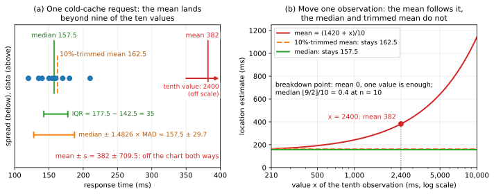
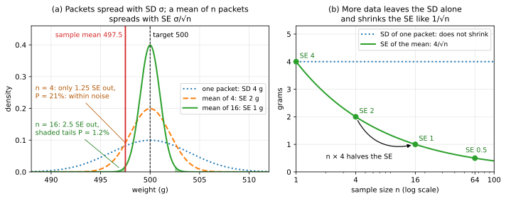

# Module 10 — Estimation and Sampling

> After this module you can take any number computed from data — a mean, a conversion rate, a test-set accuracy — say how far it is likely to be from the truth, put an honest interval around it, and work out how much data you would need to pin it down to a required precision.

## Why this matters for ML and AI

Every number you report about a model is a *statistic computed from a sample*. "Top-1 accuracy 76.3%" is the proportion of 50,000 ImageNet validation images that one particular sample of images happened to get right; a 70.4 on a 14,000-question benchmark is a sample proportion; the lift in an A/B test is a difference of two sample means. Each has a standard error, and whether a 0.4-point improvement on a leaderboard is progress or noise is a question this module answers with a formula. Public leaderboards that reshuffle when the private test set is revealed, "state-of-the-art" claims that evaporate under a different random seed, and models that look great on a validation set drawn from the wrong population are all failures of estimation, not of modelling.

Training itself is estimation. The loss you minimise is the *empirical* risk, a sample average that estimates the expected loss over the data distribution; the mini-batch gradient is an estimator of the full gradient with a variance you can write down; a model fitted to $n$ points is a random variable whose spread across hypothetical training sets is the "variance" in the bias–variance decomposition ([Module 13](../../part-5-learning-theory/13-linear-models-and-regularization/README.md)). Regularisation is deliberately biased estimation that wins on mean squared error — an idea that was a scandal in statistics in 1956 (Stein's paradox) and is now routine. Random forests are literally bootstrap aggregation. Early stopping, cross-validation and the very existence of a held-out test set are all answers to questions about sampling distributions.

Finally, the data you learn from is a sample of *something*, and if it is not a random sample of the thing you deploy on, no amount of data will save you. Loan-default models trained only on approved applicants, medical models validated on volunteers who are healthier than patients, polls that reach the wrong households: the mathematics of selection bias is simple and merciless, and the only real protection is randomness in how the sample is collected. This module gives you the concepts (estimator, bias, variance, standard error, sampling distribution, confidence interval, bootstrap) and the habits (always report an interval, always ask how the sample was drawn, always plan the sample size) that make quantitative claims about models trustworthy.

## Learning objectives

After working through this module you will be able to:

- Distinguish population from sample, parameter from statistic, and explain why randomness in *how* the sample is drawn is what makes inference valid — and why selection bias does not shrink with more data; write that bias as a reweighting of the population and repair it by inverse-probability weighting when the inclusion probabilities are known.
- Compute location and spread statistics by hand (mean, median, trimmed mean, variance with $n$ and $n-1$, quantiles, IQR, MAD) and choose robust ones when the data have heavy tails.
- Treat an estimator as a random variable; define and compute bias, variance and mean squared error; derive $\text{MSE} = \text{bias}^2 + \text{variance}$; explain consistency and relative efficiency.
- Prove why the sample variance divides by $n-1$, and explain why a biased estimator can nevertheless have lower MSE (shrinkage, James–Stein).
- Derive the standard error $\sigma/\sqrt{n}$ of a mean and $\sqrt{p(1-p)/n}$ of a proportion, estimate them from data, and connect them to the central limit theorem.
- Derive a confidence interval from a pivot; build and *correctly interpret* $z$-, $t$-, Wald and Wilson confidence intervals; explain when the Wald interval fails and run a coverage experiment to prove it.
- State the bootstrap principle (real world versus bootstrap world) and implement the bootstrap from scratch; obtain standard errors and percentile intervals for statistics with no formula (median, ratio, correlation, F1), and recognise the cases where the bootstrap breaks.
- Solve for the sample size needed to estimate a mean, a proportion or a model's accuracy to a given precision.
- Put standard errors and confidence intervals on model metrics, compare two models on the same test set with a *paired* analysis, and quantify the optimism of picking the best of several seeds.

## Prerequisites

You need [Module 07 — Probability foundations](../../part-3-probability/07-probability-foundations/README.md) (random variables, expectation, variance, the $\sigma^2/n$ rule for averages, Chebyshev, Monte Carlo) and [Module 08 — Distributions and limit theorems](../../part-3-probability/08-distributions-and-limit-theorems/README.md) (Bernoulli/Binomial, Normal, the law of large numbers and especially the central limit theorem, which this module uses on almost every page; the Student-$t$ distribution appears in Section 5). [Module 09](../../part-3-probability/09-multivariate-probability/README.md) is helpful for the correlation example in the bootstrap section. Later modules build directly on this one: [Module 11](../11-likelihood-and-bayesian-inference/README.md) asks *which* estimator to use (maximum likelihood) and gives the Bayesian reading of intervals, [Module 12](../12-hypothesis-testing-and-experiments/README.md) turns standard errors into tests and compares models properly, and [Module 15](../../part-5-learning-theory/15-generalization-and-learning-theory/README.md) replaces the CLT approximations with finite-sample concentration bounds.

## 1. Statistics asks the inverse question: populations, samples and the data-generating process

**Intuition.** Probability runs forward: *given* a distribution, what data will we see? Statistics runs backward: *given* data, what distribution produced it? The unknown object is the **population** — or, more honestly, the **data-generating process**, since in most ML problems there is no finite list of all possible images or sentences, only a mechanism that produces them. A **sample** is the finite set of draws you actually get. The fundamental trick of statistics is this: if the sample was drawn *at random*, then any number you compute from it is a random variable with a probability distribution you can analyse, and you can say how far it is likely to be from the truth. If the sample was *not* drawn at random — if some units were more likely to end up in it than others — no such statement is possible, and the error does not shrink as the sample grows.

**Definition.** A **parameter** $\theta$ is a fixed, unknown number describing the population: its mean $\mu$, variance $\sigma^2$, a proportion $p$, a median, a correlation. A **statistic** is any function $T(X_1, \dots, X_n)$ of the sample alone — the sample mean $\bar{X}_n = \frac{1}{n}\sum_{i=1}^n X_i$, the sample median, the largest value. An **estimator** is a statistic used to guess a parameter, written $\hat{\theta}$; the number it produces on one particular dataset is the **estimate**.

| | Population (or process) | Sample |
|---|---|---|
| What it is | everything you want to know about | the $n$ draws you actually have |
| The number describing it | a **parameter**: $\mu$, $\sigma^2$, $p$ | a **statistic**: $\bar{X}_n$, $s^2$, $\hat{p}$ |
| Status | fixed and unknown | computed from the data, different for each sample |

The same word "mean" names both $\mu$ and $\bar{X}_n$; the bar or hat is the whole difference, and losing sight of it causes most of the misreadings in this module.

*A statistic is a random variable.* Before the sample is drawn the $X_i$ are random, so $T(X_1, \dots, X_n)$ is random too; afterwards you hold one number. The distribution of $T$ over all the samples that could have been drawn is its **sampling distribution**, and inference means reasoning about that distribution from the single draw you have: if it is centred on $\theta$ with a small spread, your one number is probably close to $\theta$. The worked example below writes a sampling distribution out completely (Figure 1(a)); Section 4 treats the usual case, where it cannot be listed.

*Random samples.* An **i.i.d. sample** consists of random variables $X_1, \dots, X_n$ that are independent and identically distributed with the population distribution. For a finite population of $N$ units, a **simple random sample** gives every subset of size $n$ the same probability; sampling *without* replacement from it introduces a slight dependence, so the variance of the sample mean becomes

$$\operatorname{Var}(\bar{X}_n) = \frac{\sigma^2}{n}\,\frac{N-n}{N-1},$$

where $\sigma^2$ is the population variance (divisor $N$) and the second factor is the **finite population correction**, which is 1 for $n = 1$, 0 for $n = N$ (a census has no sampling error) and negligible when $n \ll N$.

*What randomness buys.* A random sample makes $\mathbb{E}[\bar{X}_n] = \mu$ a theorem rather than a hope. Each draw, taken on its own, is a uniformly chosen unit of the population (also without replacement, where the dependence only links the draws to one another), so $\mathbb{E}[X_i] = \mu$ and linearity gives $\mathbb{E}[\bar{X}_n] = \frac{1}{n}\sum_i \mathbb{E}[X_i] = \mu$, whatever the population looks like. In a simple random sample every unit is included with the known probability $n/N$; in the worked example below, each of the five workers appears in 4 of the 10 samples, which is $2/5$ of them. If you do not know how units got into the sample you cannot write this expectation down at all, which is why "how was the sample drawn?" comes before every other question.

*What dependence costs.* $\operatorname{Var}(\bar{X}_n) = \sigma^2/n$ needs uncorrelated draws. If every pair of draws has correlation $\rho$, the covariances in the variance of the sum ([Module 07](../../part-3-probability/07-probability-foundations/README.md)) add $n(n-1)\rho\sigma^2$, and dividing by $n^2$ gives

$$\operatorname{Var}(\bar{X}_n) = \frac{\sigma^2}{n}\big(1 + (n-1)\rho\big) = \rho\sigma^2 + \frac{(1-\rho)\sigma^2}{n}.$$

The finite population correction is the special case $\rho = -1/(N-1)$: slightly negative correlation, slightly smaller variance. Positive correlation is the dangerous direction, as with draws that share a common disturbance (one scanner, one hospital, one outage). A hundred draws with $\rho = 0.05$ have variance $0.0595\,\sigma^2$, six times $\sigma^2/100$, and are worth only $n/(1 + (n-1)\rho) \approx 17$ independent draws; the second form shows that the variance never falls below $\rho\sigma^2$, however large $n$ becomes. The same effect is why resampling individual observations fails on time series and grouped data in Section 6.

*Selection bias as reweighting.* **Selection bias** arises whenever the probability of a unit entering the sample depends on the quantity being measured: *survivorship bias* (only entities that survived are present), *non-response bias* (people who answer differ from those who do not), *self-selection*, *convenience samples*. Suppose a unit with value $x$ enters the sample with probability $r(x)$. Then the sample is a random sample not of the population but of a reweighted population in which each value counts in proportion to $r$, and

$$\mathbb{E}[X \mid \text{included}] = \frac{\mathbb{E}[r(X)\,X]}{\mathbb{E}[r(X)]}, \qquad \text{bias} = \frac{\mathbb{E}[r(X)\,X]}{\mathbb{E}[r(X)]} - \mathbb{E}[X] = \frac{\operatorname{Cov}(r(X), X)}{\mathbb{E}[r(X)]}.$$

For groups $g$ with population share $\pi_g$, value $x_g$ and response rate $r_g$, the first expression reads $\sum_g \pi_g r_g x_g / \sum_g \pi_g r_g$. Two consequences follow. The bias vanishes exactly when inclusion is uncorrelated with the value, so a 5% response rate that is the same for everyone costs precision but no bias. And $n$ does not appear in the formula, so more data cannot reduce it (Figure 1(c), pitfall 2).

**Worked example.** Population: five warehouse workers who packed $\{2, 4, 4, 6, 9\}$ orders in an hour. Population mean $\mu = 25/5 = 5$; population variance $\sigma^2 = \frac{9 + 1 + 1 + 1 + 16}{5} = 5.6$. Draw a simple random sample of $n = 2$ without replacement: there are $\binom{5}{2} = 10$ equally likely samples with means $3, 3, 4, 5.5, 4, 5, 6.5, 5, 6.5, 7.5$. Their average is $50/10 = 5 = \mu$ — the sample mean is unbiased — and their variance is $\frac{1}{10}\sum(\bar{x} - 5)^2 = \frac{4 + 4 + 1 + 0.25 + 1 + 0 + 2.25 + 0 + 2.25 + 6.25}{10} = 2.1$, exactly $\frac{5.6}{2} \cdot \frac{5-2}{5-1} = 2.8 \times 0.75 = 2.1$. This list of ten means *is* the sampling distribution of $\bar{X}_2$, written out in full (Figure 1(a)); Section 4 is about what it looks like when you cannot enumerate it.

Now a biased sample. An app has 70% casual users (2 hours/month) and 30% engaged users (20 hours/month), so the true mean usage is $0.7 \times 2 + 0.3 \times 20 = 7.4$ hours. You email a survey; casual users respond with probability 0.10, engaged users with 0.40. Among respondents the engaged share is $\frac{0.3 \times 0.4}{0.7 \times 0.1 + 0.3 \times 0.4} = \frac{0.12}{0.19} \approx 0.63$, and the respondent mean is $\frac{0.07 \times 2 + 0.12 \times 20}{0.19} \approx 13.4$ hours — 81% too high. The bias formula gives the same excess: $\operatorname{Cov}(r, X)/\mathbb{E}[r] = (2.54 - 0.19 \times 7.4)/0.19 = 1.134/0.19 = 5.97$ hours, which is $13.37 - 7.4$. Mailing ten times as many people yields ten times as many respondents and *exactly the same* 13.4: the bias is a property of the mechanism, not of the sample size (Figure 1(b) shows the mechanism, Figure 1(c) the sample size doing nothing).


**Figure 1.** (a) The five workers as dots and, below them, the exact sampling distribution of $\bar{X}_2$: the ten equally likely samples give 3, 4, 5 and 6.5 with probability 0.2 each and 5.5 and 7.5 with probability 0.1 each. Its mean is $\mu = 5$, so the statistic is centred on the parameter, and its variance is $2.1 = (5.6/2) \times (3/4)$, well below the $5.6$ of a single worker. (b) The survey's mechanism. Response rates of 10% and 40% turn the population shares 0.70 and 0.30 into 0.07 and 0.12, of total 0.19, so the 30% engaged users become 63.2% of the respondents and the mean moves from 7.4 to 13.4 hours, 81% too high. (c) The estimate against the number of respondents on a log scale, from 190 (1,000 mailed at the 19% response rate) to 190,000 (a million mailed). The shaded bands are $\pm 1.96$ SE from the formula, not a simulation, using the standard deviations of the two-point mixtures (8.68 hours among respondents, 8.25 hours among all users). The respondents' band narrows from $\pm 1.2$ to $\pm 0.04$ hours around 13.4, while the gap of 6.0 hours to a random sample's 7.4 hours is the same at every $n$.

*Detecting and repairing it.* Compare the sample with anything you know about the population: usage logs say 30% of users are engaged, the respondents are 63% engaged, and that alarm sounds before any hours are read. If the response rates are known or can be estimated, **inverse-probability weighting** gives each respondent the weight $1/r$, here 10 and 2.5, and undoes the reweighting: $\frac{0.07 \times 10 \times 2 + 0.12 \times 2.5 \times 20}{0.07 \times 10 + 0.12 \times 2.5} = \frac{1.4 + 6}{0.7 + 0.3} = 7.4$ hours, the truth. It costs precision, because unequal weights reduce the effective sample size to $(\sum_i w_i)^2 / \sum_i w_i^2$, here 68% of the responses, so 190 respondents count as about 129. And it repairs only what you measured: if heavier users *within* the engaged group still answer more often, the reweighted mean remains too high. The complete defence lies in the design: randomise who is asked and follow up a random subsample of the non-respondents. Randomised allocation is the subject of [Module 12](../12-hypothesis-testing-and-experiments/README.md), and the i.i.d. assumption is the price of every generalisation bound in [Module 15](../../part-5-learning-theory/15-generalization-and-learning-theory/README.md).

**Real-life example (polls and clinical cohorts).** In 1936 the *Literary Digest* mailed about ten million ballots, received 2.4 million back and predicted that Landon would beat Roosevelt 57–43. Roosevelt won with 61% of the popular vote. Two mechanisms were at work: the mailing list (car and telephone owners, wealthier than average in the Depression) and non-response (Landon supporters were far more likely to return the ballot). George Gallup, with a sample of about 50,000 chosen to be representative, called the result correctly — about a fiftieth of the Digest's returned ballots, drawn properly. In medicine the *healthy-volunteer effect* means people who enrol in cohort studies are healthier than the population they are meant to represent, which is why randomised trials randomise *allocation* and why screening-programme results from volunteers overstate benefits. In finance, databases of mutual-fund returns that drop funds which closed overstate the average historical return — estimates of this survivorship bias run from about half a point to a point and a half per year — because the funds that disappeared were, by and large, the ones that did badly.

**In ML/AI this is …** the i.i.d. assumption behind every train/test split: `train_test_split(shuffle=True, stratify=y)` is a simple random sample (stratified by class) from your dataset, and the held-out error estimates the deployment error *only if the dataset itself is a random sample of what you will deploy on*. Selection bias is the mechanism behind dataset shift and "reject inference" in credit scoring (default labels exist only for applicants who were approved), behind medical imaging models that fail on scanners or hospitals absent from training, and behind the gap between a benchmark score and real-world usefulness when the benchmark questions were written by a different population than the users.

## 2. Descriptive statistics done right

**Intuition.** Before you estimate anything, you summarise the sample: where is it centred, how spread out is it, what shape does it have? The standard summaries — mean and standard deviation — are the right ones for roughly symmetric, light-tailed data and badly misleading otherwise: a single extreme value drags the mean arbitrarily far and inflates the standard deviation without limit. **Robust** statistics are designed so that a bounded fraction of corrupted observations has a bounded effect, and the fraction they can withstand is their **breakdown point**.

**Definition.** For a sample $x_1, \dots, x_n$ with sorted values $x_{(1)} \le \dots \le x_{(n)}$:

- **Mean** $\bar{x} = \frac{1}{n}\sum x_i$; **median** $= x_{((n+1)/2)}$ for odd $n$, the average of the two middle values for even $n$; **mode** = the most frequent value (for continuous data, the peak of a histogram or density estimate).
- **$\alpha$-trimmed mean**: discard the smallest and largest $\lfloor \alpha n \rfloor$ values and average the rest; $\alpha = 0$ gives the mean, $\alpha \to 0.5$ the median.
- **Variance**: $s_n^2 = \frac{1}{n}\sum (x_i - \bar{x})^2$ (the *plug-in* or population-style estimate, `ddof=0`) and $s^2 = \frac{1}{n-1}\sum (x_i - \bar{x})^2$ (the *unbiased* sample variance, `ddof=1`; Section 3 proves why). **Standard deviation** $s = \sqrt{s^2}$.
- **Quantiles**: the $q$-quantile is a value below which a fraction $q$ of the data lies; software interpolates between order statistics (NumPy's default is linear interpolation). The **interquartile range** $\text{IQR} = Q_{0.75} - Q_{0.25}$ and the **median absolute deviation** $\text{MAD} = \operatorname{median}_i\,\lvert x_i - \operatorname{median}(x)\rvert$ are robust spread measures; for normal data $1.4826 \times \text{MAD} \approx \sigma$ and $\text{IQR} \approx 1.349\,\sigma$.
- **Breakdown point**: the largest fraction of observations that can be moved to $\pm\infty$ without carrying the statistic to $\pm\infty$ with them. Mean and standard deviation: $0$ (one point is enough to break them). Median and MAD: $\lfloor (n-1)/2 \rfloor / n$, which tends to $50\%$. $\alpha$-trimmed mean: $\alpha$.
- **Shape**: the **histogram** (counts in bins), a **kernel density estimate** $\hat{f}(x) = \frac{1}{nh}\sum_i K\!\left(\frac{x - x_i}{h}\right)$ (a smoothed histogram with bandwidth $h$), and the **empirical CDF** $\hat{F}_n(x) = \frac{1}{n}\sum_i \mathbf{1}[x_i \le x]$, a staircase that climbs $1/n$ at each data point and needs no bins or bandwidth at all.

**Worked example.** Ten API response times in milliseconds: $120, 135, 140, 150, 155, 160, 170, 180, 210, 2400$ — nine ordinary requests and one that hit a cold cache. Mean: $3820/10 = 382$ ms, a value larger than nine of the ten observations. Median: average of the 5th and 6th values, $(155 + 160)/2 = 157.5$ ms. 10%-trimmed mean: drop 120 and 2400, average the remaining eight: $1300/8 = 162.5$ ms. Standard deviation $s$ (divisor 9): $709.5$ ms, driven almost entirely by one point. Quartiles by linear interpolation: $Q_{0.25} = 142.5$, $Q_{0.75} = 177.5$, so $\text{IQR} = 35$ ms. MAD: the absolute deviations from 157.5 are $37.5, 22.5, 17.5, 7.5, 2.5, 2.5, 12.5, 22.5, 52.5, 2242.5$, whose median is $(17.5 + 22.5)/2 = 20$ ms, so $1.4826 \times 20 \approx 29.7$ ms. Without the outlier the nine clean values have mean $157.8$ and $s = 26.7$: the median, trimmed mean and scaled MAD all landed close to the clean values; the mean and $s$ did not (Figure 2(a)). Note that the median would survive three more such outliers (four of the ten values; its finite-sample breakdown point is $\lfloor (n-1)/2 \rfloor / n$, approaching 50%); the mean survived none (Figure 2(b)).



**Figure 2.** (a) The ten response times on an axis from 100 to 400 ms; the tenth value, 2400 ms, is off the scale to the right. The median 157.5 and the 10%-trimmed mean 162.5 sit among the nine ordinary values, while the mean 382 lies beyond all nine. Below them are the two robust spreads, $\text{IQR} = 177.5 - 142.5 = 35$ ms and median $\pm\, 1.4826 \times \text{MAD} = 157.5 \pm 29.7$ ms; the mean $\pm\, s$ band, $382 \pm 709.5$ ms, runs off the chart both ways. The nine clean values alone have mean 157.8 and $s = 26.7$. (b) Moving only the tenth observation from 210 to 10,000 ms. The mean $(1420 + x)/10$ follows it from 163 to 1,142 ms, passing 382 at $x = 2400$, with no limit if $x$ grows further; the median and the trimmed mean do not move at all, because 2400 and 10,000 are both simply "the largest value". This is the breakdown point at work: 0 for the mean, $\lfloor 9/2 \rfloor / 10 = 0.4$ for the median at $n = 10$.

**Real-life example (salaries and latency).** Reported "average salaries" are almost always means and almost always exceed what most people earn: nine employees earning 38–75 thousand and one executive on 420 thousand have a mean of 90.1 thousand and a median of 53.5 thousand. National statistics offices publish median household income for exactly this reason. Service-level objectives for web systems are written in quantiles — "p95 latency under 300 ms" — because the mean is dominated by rare slow requests and tells users nothing about their typical experience, while the p99 tells the operations team about the tail that pages them at night.

**In ML/AI this is …** `df.describe()` as the first thing you run on a feature table; `StandardScaler` (mean and standard deviation, the `ddof=0` one; breakdown point 0, so a single corrupt value can rescale a whole feature) versus `RobustScaler` (median and IQR); winsorising or clipping targets before regression; reporting the *median* over random seeds when a few runs diverge; p95/p99 inference latency in a serving dashboard; and a classic trap: `np.var` and `np.std` default to `ddof=0` while `pandas` `Series.var()` and `Series.std()` default to `ddof=1`, so the same column gives two different numbers in two libraries.

## 3. Estimators and their properties

**Intuition.** An estimator is a *recipe*, not a number. Feed it a random sample and it returns a random output; repeat the experiment and you get a different estimate. So an estimator has a distribution, and you judge it the way you judge any random guess at a fixed target: is it centred on the target (bias), how much does it scatter (variance), and what is its typical squared miss (mean squared error)? The surprising lesson of this section is that *being centred on the target is not sacred*: an estimator that aims slightly off but scatters much less can be closer on average, and that is the principle behind every regulariser in machine learning.

**Definition.** For an estimator $\hat{\theta}$ of a parameter $\theta$:

$$\operatorname{Bias}(\hat{\theta}) = \mathbb{E}[\hat{\theta}] - \theta, \qquad \operatorname{Var}(\hat{\theta}) = \mathbb{E}\big[(\hat{\theta} - \mathbb{E}[\hat{\theta}])^2\big], \qquad \operatorname{MSE}(\hat{\theta}) = \mathbb{E}\big[(\hat{\theta} - \theta)^2\big].$$

**Decomposition.** Write $\hat{\theta} - \theta = (\hat{\theta} - \mathbb{E}\hat{\theta}) + (\mathbb{E}\hat{\theta} - \theta)$, square and take expectations. The cross term is $2(\mathbb{E}\hat{\theta} - \theta)\,\mathbb{E}[\hat{\theta} - \mathbb{E}\hat{\theta}] = 0$ because the second factor is the expectation of a centred variable, so

$$\operatorname{MSE}(\hat{\theta}) = \operatorname{Var}(\hat{\theta}) + \operatorname{Bias}(\hat{\theta})^2 .$$

$\hat{\theta}$ is **unbiased** if its bias is 0 for every $\theta$. It is **consistent** if $\hat{\theta}_n \xrightarrow{p} \theta$ as $n \to \infty$; a sufficient condition is that both bias and variance go to 0 (then MSE $\to 0$, and Chebyshev finishes the argument). Among unbiased estimators the one with the smallest variance is **efficient**; the **relative efficiency** of $\hat{\theta}_1$ to $\hat{\theta}_2$ is $\operatorname{Var}(\hat{\theta}_2)/\operatorname{Var}(\hat{\theta}_1)$, which tells you how many more samples the worse estimator needs for the same precision. ([Module 11](../11-likelihood-and-bayesian-inference/README.md) gives the Cramér–Rao lower bound on the variance of any unbiased estimator.)

**Why $n - 1$.** Expand $\sum_i (X_i - \bar{X})^2 = \sum_i (X_i - \mu)^2 - n(\bar{X} - \mu)^2$ (add and subtract $\mu$; the cross term is $-2(\bar{X} - \mu)\sum_i (X_i - \mu) = -2n(\bar{X} - \mu)^2$). Taking expectations, $\mathbb{E}\sum_i (X_i - \mu)^2 = n\sigma^2$ and $\mathbb{E}[n(\bar{X} - \mu)^2] = n \cdot \sigma^2/n = \sigma^2$, so $\mathbb{E}\sum_i (X_i - \bar{X})^2 = (n-1)\sigma^2$. The deviations from $\bar{X}$ are systematically smaller than the deviations from $\mu$, because $\bar{X}$ was chosen to minimise them; dividing by $n - 1$ instead of $n$ exactly undoes the shortfall. (Equivalently: the $n$ deviations satisfy one linear constraint, $\sum(X_i - \bar{X}) = 0$, and so carry $n - 1$ *degrees of freedom*.) Note that $s^2$ is unbiased for $\sigma^2$ but $s$ is *not* unbiased for $\sigma$: by Jensen's inequality $\mathbb{E}[s] \le \sqrt{\mathbb{E}[s^2]} = \sigma$.

**Worked example.** *Mean versus median.* For $n$ i.i.d. draws from $\mathcal{N}(\mu, \sigma^2)$ both are unbiased for $\mu$. $\operatorname{Var}(\bar{X}) = \sigma^2/n$, while for large $n$ the sample median has variance $\frac{1}{4 f(\mu)^2 n} = \frac{\pi\sigma^2}{2n} \approx 1.57\,\sigma^2/n$ (here $f(\mu) = 1/(\sigma\sqrt{2\pi})$ is the density at the centre). The median needs 57% more data for the same precision on normal data. For the heavy-tailed Laplace distribution the picture flips: $\operatorname{Var}(\bar{X}) = 2b^2/n$ but the median's variance is $b^2/n$ — the median is twice as efficient — and for the Cauchy distribution the mean does not converge at all while the median behaves perfectly well. Which estimator is better depends on the tails of the population.

*Three variance estimators.* Take $n = 10$ normal observations with $\sigma^2 = 1$ and consider $\hat{\sigma}^2_c = c\sum_i (X_i - \bar{X})^2$. Since $\sum_i (X_i - \bar{X})^2 \sim \sigma^2\chi^2_{9}$ has mean 9 and variance 18:

| Divisor | $c$ | Bias | Variance | MSE |
|---|---|---|---|---|
| $n - 1 = 9$ | $1/9$ | $0$ | $18/81 = 0.222$ | $0.222$ |
| $n = 10$ | $1/10$ | $-0.100$ | $18/100 = 0.180$ | $0.180 + 0.010 = 0.190$ |
| $n + 1 = 11$ | $1/11$ | $-0.182$ | $18/121 = 0.149$ | $0.149 + 0.033 = 0.182$ |

The unbiased estimator has the *largest* MSE of the three; dividing by $n + 1$ minimises MSE among this family (Figure 3(a)). Shrinking an estimate toward zero trades a little bias for a larger reduction in variance.

*Shrinkage in many dimensions.* Observe $X \sim \mathcal{N}(\theta, I_p)$, a single noisy vector measurement of $p$ unknown means (think: the batting averages of $p$ players, the effects of $p$ ads). The obvious estimator is $\hat{\theta} = X$, unbiased with total MSE $\mathbb{E}\lVert X - \theta\rVert^2 = p$. The **James–Stein estimator** $\hat{\theta}_{\text{JS}} = \left(1 - \frac{p-2}{\lVert X\rVert^2}\right) X$ pulls every coordinate toward zero by a common factor and has strictly smaller total MSE *for every* $\theta$ whenever $p \ge 3$. In a simulation with $p = 10$ and $\lVert\theta\rVert^2 \approx 10$ the MSE falls from 10 to about 6; with $\lVert\theta\rVert^2 \approx 27$ it still falls to about 8. The gain is largest when the true means are close to the shrinkage target and vanishes as they move away, but it never becomes a loss (Figure 3(c)).

**Real-life example (manufacturing / measurement).** Two scales for weighing 1-gram pharmaceutical doses. Scale A is cheap: it reads 0.5 g too high on average (bias 0.5) but is very repeatable (SD 0.1 g). Scale B is calibrated (bias 0) but noisier (SD 1 g). For a *single* weighing, $\text{MSE}_A = 0.1^2 + 0.5^2 = 0.26$ and $\text{MSE}_B = 1.0$: the biased scale is closer on average. Average 100 weighings and the picture reverses: $\text{MSE}_A = 0.01/100 + 0.25 = 0.2501$, $\text{MSE}_B = 1/100 = 0.01$. Variance averages away; bias does not (Figure 3(b)). This is the content of consistency, and it is why a biased-but-stable estimator is a good choice for small samples and a poor one for large ones — precisely the regime-dependence of regularisation strength.


**Figure 3.** (a) The table's three variance estimators as stacked bars (variance in solid blue, squared bias hatched on top), for $n = 10$ normal draws with $\sigma^2 = 1$. As the divisor grows from 9 to 11 the bias moves from 0 to $-0.182$, the variance falls from 0.222 to 0.149 and the totals are 0.222, 0.190 and 0.182: the unbiased estimator is the worst of the three. (b) The two scales on log–log axes, with MSE against the number of weighings averaged. Scale A (bias 0.5, SD 0.1) starts lower, at 0.26 against 1.0, but stays near its squared bias of 0.25, ending at 0.2501; scale B (bias 0, SD 1) falls like $1/m$ to 0.01. They cross at $m = 0.99/0.25 = 3.96$, so B wins from four weighings on. (c) The exact James–Stein risk for $p = 10$, $p - (p-2)^2\,\mathbb{E}[1/\chi^2_p(\lVert\theta\rVert^2)]$, computed from its series and not by simulation. It is 2 at $\theta = 0$, 6.2 at $\lVert\theta\rVert^2 = 10$ and 8.1 at $\lVert\theta\rVert^2 = 27$, and it stays below the flat line at 10, the risk of the unbiased $X$, for every $\theta$. The horizontal axis is $\lVert\theta\rVert^2$, as in the text above; the lesson's plot uses $\lVert\theta\rVert$.

**In ML/AI this is …** the bias–variance decomposition of prediction error, which is this section's identity applied to a model's prediction at a point ([Module 13](../../part-5-learning-theory/13-linear-models-and-regularization/README.md)); ridge regression and weight decay, which are James–Stein's descendants (shrink the coefficients toward zero, accept bias, reduce variance); the empirical risk, which is an unbiased estimator of the true risk for a *fixed* model but optimistically biased for the model you *selected* by minimising it — the reason the training loss is not an estimate of anything useful and a separate validation set is ([Module 15](../../part-5-learning-theory/15-generalization-and-learning-theory/README.md)); and the `ddof` argument of `np.var`, which selects between the first two rows of the table above.

## 4. Sampling distributions and the standard error

**Intuition.** Imagine repeating your whole study — collect $n$ fresh observations, compute the statistic — thousands of times and drawing a histogram of the results. That histogram is the **sampling distribution** of the statistic. You only ever see one draw from it, but probability theory tells you its shape and width, and its width is the honest measure of how uncertain your single estimate is. For the sample mean the central limit theorem says the shape is approximately normal and the width is $\sigma/\sqrt{n}$ — regardless of the population's shape, as long as it has a finite variance.

**Definition.** The **standard error** of an estimator is the standard deviation of its sampling distribution: $\operatorname{SE}(\hat{\theta}) = \sqrt{\operatorname{Var}(\hat{\theta})}$. For the mean of $n$ i.i.d. observations with variance $\sigma^2$,

$$\operatorname{SE}(\bar{X}_n) = \frac{\sigma}{\sqrt{n}}, \qquad \widehat{\operatorname{SE}}(\bar{X}_n) = \frac{s}{\sqrt{n}},$$

the second form plugging in the sample standard deviation when $\sigma$ is unknown. If the population is normal, $\bar{X}_n \sim \mathcal{N}(\mu, \sigma^2/n)$ *exactly*; otherwise the CLT gives $\frac{\bar{X}_n - \mu}{\sigma/\sqrt{n}} \xrightarrow{d} \mathcal{N}(0, 1)$, which is an excellent approximation for $n$ of a few dozen unless the population is very skewed or heavy-tailed. For a **proportion**, with $X \sim \mathrm{Bin}(n, p)$ successes and $\hat{p} = X/n$,

$$\mathbb{E}[\hat{p}] = p, \qquad \operatorname{SE}(\hat{p}) = \sqrt{\frac{p(1-p)}{n}} \le \frac{1}{2\sqrt{n}}, \qquad \widehat{\operatorname{SE}}(\hat{p}) = \sqrt{\frac{\hat{p}(1-\hat{p})}{n}},$$

and the normal approximation is adequate when $np$ and $n(1-p)$ are both at least about 10. Keep standard error and standard deviation apart: $s$ describes the spread of *individual observations* and does not shrink with $n$; $s/\sqrt{n}$ describes the uncertainty of the *mean* and shrinks like $1/\sqrt{n}$ (Figure 4(b)).

**Worked example.** A poll asks $n = 1{,}000$ voters and finds $\hat{p} = 0.52$ for candidate A. $\widehat{\operatorname{SE}} = \sqrt{0.52 \times 0.48/1000} = 0.0158$, so "A at 52% ± 3 points" — the famous margin of error of a thousand-person poll is $1.96 \times 0.0158 \approx 0.031$. But the headline question is the *lead*, $2\hat{p} - 1 = 0.04$, whose SE is $2 \times 0.0158 = 0.0316$, i.e. ± 6.2 points: a 52–48 lead is barely more than one standard error from a tie. Second example: a filling machine has $\sigma = 4$ g; a quality inspector weighs $n = 16$ packets and finds $\bar{x} = 497.5$ g against a 500 g target. $\operatorname{SE} = 4/\sqrt{16} = 1$ g, so the sample mean is 2.5 standard errors below target — a shift unlikely to be sampling noise (the probability of $|\bar{X} - 500| \ge 2.5$ under a correctly set machine is about 1.2%). Had she weighed 4 packets, $\operatorname{SE} = 2$ g and the same reading would be only 1.25 SE out, well within noise (Figure 4(a)).



**Figure 4.** The filling machine. (a) The target 500 g, the reading 497.5 g and three densities: one packet (SD 4 g), the mean of 4 packets (SE 2 g) and the mean of 16 packets (SE 1 g). The same reading is 1.25 SE out for $n = 4$, with $P(\lvert \bar{X} - 500 \rvert \ge 2.5) = 21\%$, and 2.5 SE out for $n = 16$, where the shaded tails have probability 1.2%. Nothing about the machine or the reading changes between the two; only the width of the sampling distribution does. (b) As $n$ grows from 1 to 100 the SD of a packet stays at 4 g, while the SE of the mean follows $4/\sqrt{n}$ through 4, 2, 1 and 0.5 g at $n = 1, 4, 16, 64$: each fourfold increase in data halves it. The poll is the same picture with other numbers: SE 0.0158 for $\hat{p} = 0.52$ and 0.0316 for the lead.

**Real-life example (measurement repeatability).** Laboratories characterise an assay by its *repeatability*: measure the same sample 20 times, compute $s$. If $s = 3$ units, a single measurement has uncertainty 3, the mean of 4 replicates has SE 1.5, and the mean of 9 has SE 1 — which is why protocols specify triplicates, and why "run it a few more times" buys less than people hope: halving the SE costs four times the work. The same arithmetic is behind the margin of error that pollsters print, the "±" on a physics measurement, and the error bars on any bar chart worth looking at.

**In ML/AI this is …** the standard error of a test-set accuracy, $\sqrt{\hat{a}(1-\hat{a})/n}$ (Section 8); the error bars on a learning curve; `scipy.stats.sem`; the SE of a mini-batch gradient, $\sigma_g/\sqrt{B}$, which decides how the learning rate should scale with batch size; and the "mean ± SE over 5 seeds" convention in papers — where, as Section 5 explains, the multiplier for a 95% interval from 5 runs is 2.78, not 1.96.

## 5. Confidence intervals

**Intuition.** A point estimate without an interval is a guess without a stated precision. A confidence interval is a *procedure* — a rule that turns data into an interval — designed so that, over repeated samples, the interval it produces captures the true parameter a stated fraction of the time, say 95%. The probability belongs to the procedure, not to any one interval: once you have computed $[9.63, 10.47]$, the parameter either is in it or is not, and nothing random remains. What "95%" tells you is that you are using a method that is wrong one time in twenty. This is the correct reading and it is less satisfying than the one people want ("there is a 95% chance $\mu$ is in here"); [Module 11](../11-likelihood-and-bayesian-inference/README.md) shows what you have to assume to earn the satisfying reading.

**Definition.** A random interval $[L, U]$ computed from the data is a $(1-\alpha)$ **confidence interval** for $\theta$ if

$$P_\theta\big(L \le \theta \le U\big) \ge 1 - \alpha \quad \text{for every value of } \theta .$$

The left-hand side, as a function of the true $\theta$, is the **coverage probability**; a good interval has coverage close to $1 - \alpha$ everywhere, not just on average.

*Where the $z$-interval comes from: the pivot.* A **pivot** is a function of the data and the parameter whose distribution does not depend on the parameter. For a mean, $(\bar{X}_n - \mu)/(\sigma/\sqrt{n})$ is $\mathcal{N}(0, 1)$, exactly for normal data and approximately by the CLT, so

$$P\left(-1.96 \le \frac{\bar{X}_n - \mu}{\sigma/\sqrt{n}} \le 1.96\right) = 0.95 .$$

Multiply through by $\sigma/\sqrt{n}$ and rearrange until $\mu$ stands alone in the middle. This describes the same event in other words, so its probability is still 0.95:

$$P\left(\bar{X}_n - 1.96\frac{\sigma}{\sqrt{n}} \le \mu \le \bar{X}_n + 1.96\frac{\sigma}{\sqrt{n}}\right) = 0.95 .$$

For the inspector of Section 4 ($n = 16$, $\sigma = 4$, $\bar{x} = 497.5$) this gives $497.5 \pm 1.96 = [495.5, 499.5]$, which excludes 500: her conclusion, restated as an interval.

*Why the probability belongs to the procedure.* In the last display the random objects are the endpoints, and $\mu$ stays fixed. Once the data are in, the endpoints are numbers and nothing random remains; Figure 5(a) shows fifty intervals of this kind (with the $t$ multiplier of the list below), of which three are wrong, and nothing in a single interval tells you which kind you hold. To read one interval, take its position as the estimate and its width as the precision; the values inside are those the data do not contradict at this level, which is exactly how [Module 12](../12-hypothesis-testing-and-experiments/README.md) turns intervals into tests.

Standard constructions, with $z_{\alpha/2}$ the $1 - \alpha/2$ quantile of $\mathcal{N}(0,1)$ ($1.960$ for 95%, $2.576$ for 99%):

- **$z$-interval for a mean** (variance known, or $n$ large): $\bar{x} \pm z_{\alpha/2}\,\sigma/\sqrt{n}$. Its width is proportional to $1/\sqrt{n}$, so four times the data halves the width.
- **$t$-interval** (variance estimated, normal population): $\bar{x} \pm t_{n-1,\,\alpha/2}\,s/\sqrt{n}$, where $t_{n-1}$ is Student's $t$ distribution with $n - 1$ degrees of freedom. It accounts for the extra uncertainty in $s$: $t_{4} = 2.776$, $t_{9} = 2.262$, $t_{29} = 2.045$, $t_{99} = 1.984$, approaching 1.960. Using $z$ with a small-sample $s$ gives intervals that are too narrow: at $n = 4$ the "95%" $z$-interval with $s$ covers only about 85.5% of the time.
- **Wald interval for a proportion**: $\hat{p} \pm z_{\alpha/2}\sqrt{\hat{p}(1-\hat{p})/n}$. Simple and widely taught, and badly behaved: its coverage dips far below nominal for small $n$ or $p$ near 0 or 1, it can extend below 0 or above 1, and when $\hat{p} = 0$ or $1$ its width is exactly zero — it claims certainty on the basis of having seen no events.
- **Wilson (score) interval**: instead of plugging $\hat{p}$ into the standard error, keep the unknown $p$ in it and solve $\lvert\hat{p} - p\rvert \le z\sqrt{p(1-p)/n}$ for $p$. Squaring gives a quadratic whose roots are

$$\frac{\hat{p} + \frac{z^2}{2n}}{1 + \frac{z^2}{n}} \;\pm\; \frac{z}{1 + \frac{z^2}{n}}\sqrt{\frac{\hat{p}(1-\hat{p})}{n} + \frac{z^2}{4n^2}} .$$

The centre is pulled from $\hat{p}$ toward $1/2$ (for 95%, roughly as if two successes and two failures were added — the Agresti–Coull rule of thumb), the interval never leaves $[0, 1]$, and at $\hat{p} = 0$ its upper limit is $\frac{z^2}{n + z^2} \approx 3.84/(n + 3.84)$, close to the **rule of three**: after $n$ trials with no events, a 95% upper bound on the event probability is about $3/n$. For $p = 0.05$ the exact coverage of the two intervals is: $n = 20$, Wald 0.64 vs Wilson 0.92; $n = 100$, Wald 0.88 vs Wilson 0.97; $n = 500$, Wald 0.93 vs Wilson 0.95. The Wald curve is not a steady climb but a sawtooth, because the count of events can only take whole values: it first touches 95% at $n = 127$, keeps falling back, averages about 0.94 for $n$ between 500 and 1,000, and is still 0.942 at $n = 1{,}000$ (Figure 6(c)). (The Clopper–Pearson "exact" interval inverts the binomial test; it never under-covers but is conservative.)

*Why $t$ and not $z$.* Replace $\sigma$ by $s$ and the pivot becomes $(\bar{X}_n - \mu)/(s/\sqrt{n})$. For normal data, $(n-1)s^2/\sigma^2 \sim \chi^2_{n-1}$ independently of $\bar{X}_n$, and dividing a standard normal by $\sqrt{\chi^2_{n-1}/(n-1)}$ is the definition of $t_{n-1}$. A sample whose $s$ happens to be small inflates the ratio, so the tails are heavier and a larger multiplier is needed for the same 95%: Figure 5(c) shows that $\pm 1.96$ captures only 85.5% of $t_3$, which needs $\pm 3.18$. The excess of $t$ over $z$ is 42% at $n = 5$ (2.776, the multiplier for five seeds) and 4.3% at $n = 30$ (2.045). The $t$-interval repairs the estimation of $\sigma$, not the population's shape: for skewed log-normal data ($\sigma = 1$ on the log scale) at $n = 30$ a simulated "95%" $t$-interval covers only 88%.

*Why Wald breaks and Wilson does not.* Both start from the pivot $(\hat{p} - p)/\sqrt{p(1-p)/n} \approx \mathcal{N}(0, 1)$. Wald replaces $p$ by $\hat{p}$ inside the SE and then rearranges; Wilson leaves $p$ there and solves the inequality for it (Figure 6(a)). Wald's SE is therefore computed from the same $\hat{p}$ the interval is centred on, so for $p < 1/2$ a sample whose $\hat{p}$ fell short also gets too small an SE, and at $\hat{p} = 0$ none at all. At $p = 0.05$ and $n = 20$, a sample with no events occurs with probability $0.95^{20} = 0.358$ and every such interval misses, which on its own caps the coverage at 0.642 (the exact value is 0.639).

*Other levels and one-sided bounds.* Change the multiplier: 1.645 for a two-sided 90% interval, 2.576 for 99%. A one-sided 95% bound puts all of the 5% on one side and also uses 1.645, so it is less demanding than the lower end of a two-sided 95% interval, and a report must say which it means. In Case study 2, 141 correct out of 150 has a two-sided Wilson lower limit of 0.890 and a one-sided one of 0.8996; here both fall short of 0.90, and the second only just.

*How to compute and check in practice.* `scipy.stats.t.interval(0.95, df=n-1, loc=xbar, scale=s/np.sqrt(n))` and `scipy.stats.binomtest(k, n).proportion_ci(0.95, method="wilson")` reproduce the examples below. To test any interval procedure, run a coverage simulation, as the lesson does: generate many samples from a known truth, build the interval on each and count how often it contains the truth. If you need a guarantee that holds for any distribution on $[0, 1]$, Hoeffding's inequality ([Module 15](../../part-5-learning-theory/15-generalization-and-learning-theory/README.md)) gives the half-width $\sqrt{\ln(2/\alpha)/(2n)}$, at a price: $\pm 9.6$ points at $n = 200$, against Wilson's $\pm 3.0$ for the inspection below.

**Worked example.** *A $t$-interval.* Four replicate measurements of a drug concentration: $9.8, 10.4, 10.1, 9.9$ mg/l. $\bar{x} = 40.2/4 = 10.05$; deviations $-0.25, 0.35, 0.05, -0.15$; $s^2 = \frac{0.0625 + 0.1225 + 0.0025 + 0.0225}{3} = 0.07$; $s = 0.2646$; $\widehat{\operatorname{SE}} = 0.2646/2 = 0.1323$. With $t_{3,\,0.025} = 3.182$ the 95% interval is $10.05 \pm 0.42 = [9.63, 10.47]$. The $z$-version would be $10.05 \pm 0.26 = [9.79, 10.31]$, 38% narrower and, as noted, a "95%" interval that covers 85.5% of the time (Figure 5(b)).


**Figure 5.** Fifty samples of $n = 4$ simulated from $\mathcal{N}(10, 0.2646^2)$ with seed 28, so that $\sigma$ equals the worked example's $s$; the counts of misses are this one run's, not exact rates. (a) The 95% $t$-intervals, with black dots at the sample means and the misses thicker, red and flagged by a triangle: 3 of the 50 miss $\mu = 10$, against 2.5 expected. Each interval either contains the dashed line or does not; the 95% is the long-run fraction of intervals that do (here 47 of 50). (b) The same samples with the multiplier 1.96 in place of 3.182, so every interval is 38% narrower: 7 miss, against the 7.2 expected from a coverage of 85.5%. (c) The reason: with $s$ in place of $\sigma$, $(\bar{x} - \mu)/(s/\sqrt{n})$ follows the heavier-tailed $t_3$ and not $\mathcal{N}(0, 1)$. The shaded area between $\pm 1.96$ is only 0.855, and $t_3$ needs $\pm 3.18$ to reach 0.95.

*Wald versus Wilson.* An inspection finds $k = 9$ defective units among $n = 200$: $\hat{p} = 0.045$. Wald: $\widehat{\operatorname{SE}} = \sqrt{0.045 \times 0.955/200} = 0.01466$, interval $0.045 \pm 0.0287 = [0.016, 0.074]$. Wilson with $z^2 = 3.8415$: centre $\frac{0.045 + 3.8415/400}{1 + 3.8415/200} = \frac{0.0546}{1.0192} = 0.0536$; half-width $\frac{1.96}{1.0192}\sqrt{0.000215 + 0.000024} = 1.923 \times 0.01546 = 0.0297$; interval $[0.024, 0.083]$. The Wilson interval is shifted toward $1/2$ and asymmetric about $\hat{p}$, which is right: with only 9 events the uncertainty upward is larger than downward. For $k = 0$ out of $n = 20$, Wald gives $[0, 0]$ while Wilson gives $[0, 0.161]$ — the honest answer that twenty clean trials cannot rule out a 10% defect rate (Figure 6(b)).


**Figure 6.** (a) The geometry of the two intervals. The shaded band is $p \pm 1.96\sqrt{p(1-p)/200}$ around the diagonal: the values of $\hat{p}$ a true $p$ makes plausible. The red line is the observed $\hat{p} = 9/200$, and the true values whose band contains it run between its two crossings, which are the roots of the quadratic and so the Wilson limits $[0.024, 0.083]$. Wald instead borrows the band's height at $\hat{p}$, $\pm 0.0287$, and lays it off symmetrically, giving $[0.016, 0.074]$. (b) Three cases, with a black tick at $\hat{p}$. At 9/200 the two intervals differ modestly; at 0/20 Wald collapses to the dot $[0, 0]$ while Wilson gives $[0, 0.161]$, near the rule of three's $3/20$; at 2/150 Wald reaches into the impossible negative strip, $[-0.005, 0.032]$, while Wilson gives $[0.004, 0.047]$. (c) The coverage at $p = 0.05$ for every integer $n$ from 10 to 1,000, computed exactly from the binomial and not simulated, with the nominal 0.95 dashed. Wald (square markers) has 0.64, 0.88 and 0.93 at $n = 20, 100, 500$; Wilson (round markers) has 0.92, 0.97 and 0.95. Both are jagged because the count of events is discrete, but Wilson stays close to nominal while Wald falls far short at small $n$.

**Real-life example (e-commerce).** A landing-page variant gets 2 conversions from 150 visitors, $\hat{p} = 1.33\%$. The Wald interval is $[-0.5\%, 3.2\%]$ — a negative lower bound for a probability, the clearest possible sign that the formula is being used outside its range. Wilson gives $[0.37\%, 4.7\%]$. The width matters commercially: a true rate of 0.37% and one of 4.7% differ by a factor of nearly thirteen in revenue, so the experiment has not yet learned anything actionable, and Section 7 tells you how many visitors it would take to.

**In ML/AI this is …** the error bars that serious benchmark reports attach to every score (evaluation harnesses for language models increasingly print a standard error per task); `scipy.stats.t.interval` and `statsmodels.stats.proportion.proportion_confint(method="wilson")`; the reason a Bayesian *credible* interval ([Module 11](../11-likelihood-and-bayesian-inference/README.md)) is what most people *think* a confidence interval is; and the distinction between a confidence interval for a *parameter* (the mean house price) and a *prediction* interval for a new *observation* (the price of this house), which is wider and does not shrink to zero with $n$ — conformal prediction is the modern, distribution-free way to produce the latter for any model.

## 6. The bootstrap

**Intuition.** The standard error formulas above exist for the mean and for a proportion. For a median, a 95th percentile, a ratio of two means, a correlation, an AUC or an F1 score there is no clean formula, or only an asymptotic one that is poor at realistic $n$. The bootstrap sidesteps the mathematics with a computer: the sample is your best available stand-in for the population, so *resample from the sample* — draw $n$ values with replacement, compute the statistic, repeat a few thousand times — and the spread of the results mimics the sampling distribution you cannot observe. It is the **plug-in principle**: whatever you would like to do with the unknown population distribution $F$, do with the empirical distribution $\hat{F}_n$ instead.

**Definition.** Given a sample $x_1, \dots, x_n$ and a statistic $T$, a **bootstrap sample** $x^{*}_1, \dots, x^{*}_n$ is drawn i.i.d. from the empirical distribution $\hat{F}_n$ — i.e. with replacement from the original data, so that each original value appears $0, 1, 2, \dots$ times. Compute $T^{*}_b$ for $b = 1, \dots, B$ (typically $B = 1{,}000$–$10{,}000$). Then

$$\widehat{\operatorname{SE}}_{\text{boot}}(T) = \sqrt{\frac{1}{B-1}\sum_{b=1}^{B}\big(T^{*}_b - \bar{T}^{*}\big)^2}, \qquad \text{percentile CI: } \big[\,T^{*}_{(\alpha/2)},\; T^{*}_{(1-\alpha/2)}\,\big],$$

the latter being the empirical quantiles of the $B$ replicates. The **parametric bootstrap** fits a model to the data and resamples from the fitted model instead of from $\hat{F}_n$, which helps when $n$ is small and the model is trustworthy. Two facts about resampling: there are $\binom{2n-1}{n}$ distinct bootstrap samples (126 for $n = 5$, about $9 \times 10^4$ for $n = 10$), and each bootstrap sample omits on average a fraction $(1 - 1/n)^n \to 1/e \approx 36.8\%$ of the original observations.

*The two worlds.* The logic is a correspondence between what happened and what you can repeat:

| | Real world | Bootstrap world |
|---|---|---|
| Distribution | $F$, unknown | $\hat{F}_n$, known: it is the sample |
| Data | $x_1, \dots, x_n$ drawn from $F$ | $x^{*}_1, \dots, x^{*}_n$ drawn from $\hat{F}_n$ |
| Estimate | $T(x)$ | $T(x^{*})$ |
| What is being estimated | $\theta$ | $T(x)$ |
| Error | $T(x) - \theta$: distribution unknown | $T(x^{*}) - T(x)$: can be simulated |

The **bootstrap principle** is that the distribution of $T(x^{*}) - T(x)$, which you can simulate, approximates the distribution of $T(x) - \theta$, which you cannot. The standard error, a bias estimate $\bar{T}^{*} - T(x)$ and the intervals all follow by substitution. Notice what this does not offer: the replicates centre near $T(x)$ and not near $\theta$, so the bootstrap tells you how far off you are likely to be, not in which direction this particular estimate erred (the bias estimate describes only the average tendency), and it does not improve the estimate.

*The algorithm.* Four lines are the whole computation, and the sample itself is never changed:

```python
idx = rng.integers(0, n, size=(B, n))        # B rows of n indices, with replacement
T_star = np.median(x[idx], axis=1)           # the statistic on each row
se = T_star.std(ddof=1)                      # bootstrap standard error
lo, hi = np.percentile(T_star, [2.5, 97.5])  # 95% percentile interval
```

*Why with replacement, and why $n$.* Drawing i.i.d. from $\hat{F}_n$ *is* drawing with replacement: at every draw each value has probability $1/n$, whatever came before. Drawing $n$ values without replacement would return the original sample every time, with zero spread. The resample size must be $n$ because a statistic's spread depends on the size of the sample it is computed from. For the $\{1, 3, 5\}$ example below, resamples of size 3 give variance $8/9$, the plug-in $s_n^2/n$ (Figure 7(a)); resamples of size 30 would give $8/90$, an SE $\sqrt{10} \approx 3.2$ times too small. Larger resamples create precision that the data do not contain.

*How many resamples.* Two errors are stacked: the sampling error of your $n$ values, which the bootstrap reports and cannot reduce, and the Monte Carlo error of using a finite $B$, which you can make negligible. For roughly normal replicates the Monte Carlo error of a bootstrap SE is about $\text{SE}/\sqrt{2B}$, so 2.2% at $B = 1{,}000$ and 1% at $B = 5{,}000$; the median's SE for the latencies of the worked example reads 5.21, 5.14, 5.16 and 5.13 ms at $B = 1{,}000$, $5{,}000$, $10{,}000$ and $50{,}000$. Percentile endpoints rest on the few replicates in the tails, so use $B = 10{,}000$ for a 95% interval, and even then a statistic that sits on a few order statistics stays lumpy: the lower endpoint for the p95 of the same data reads 284 ms at $B = 2{,}000$, 290 at $B = 10{,}000$ and 285 at $B = 50{,}000$, and deserves no more than two significant figures. Past that point, more resamples only polish a Monte Carlo error that is already small beside the sampling error; only more data helps.

*Which interval.* The percentile interval reads the quantiles of $T^{*}$ directly. The **basic** (pivot) interval $[2\hat{\theta} - T^{*}_{(1-\alpha/2)},\; 2\hat{\theta} - T^{*}_{(\alpha/2)}]$ is the literal substitution from the table: it reflects the replicates through the estimate. The **BCa** (bias-corrected and accelerated) interval, the default of `scipy.stats.bootstrap`, adjusts which quantiles it reads so as to correct for bias and skew. They agree when the replicates are symmetric and part company when they are skewed: for the p95 of the latencies (Figure 7(b)) they give $[290, 356]$, $[312, 379]$ and $[298, 372]$ ms. Reflection is not automatically an improvement. In a simulation of 1,000 samples of 200 from the same log-normal population, whose true p95 is 402 ms, the three covered about 93%, 83% and 95% of the time, so use the percentile interval as the quick default and BCa when the replicates are skewed. (All three miss 402 ms on this particular sample: it is one of the unlucky ones that a 95% procedure must sometimes produce.) A bootstrap histogram is itself informative: its width is the SE, and its asymmetry is the skew of the statistic.

*Checks in practice.* Bootstrap the mean first and compare with $s/\sqrt{n}$ (6.16 against 6.14 ms on the latencies); a mismatch means a bug. Resample the independent unit: pairs for a correlation ([Module 09](../../part-3-probability/09-multivariate-probability/README.md)), patients and not images, users and not messages, days or blocks for a time series. Remember that the bootstrap inherits the sample's flaws: resampling Section 1's survey responses reproduces 13.4 hours with a narrow interval around the wrong value. Its most visible uses in ML are bagging ([Module 13](../../part-5-learning-theory/13-linear-models-and-regularization/README.md)), with its 36.8% of out-of-bag examples, and the paired bootstrap for comparing models ([Module 12](../12-hypothesis-testing-and-experiments/README.md)).

**When it fails.** (i) *Extreme statistics*: for the sample maximum, the bootstrap maximum equals the original maximum with probability $1 - (1 - 1/n)^n \approx 0.63$, so the bootstrap distribution is a spike that looks nothing like the true sampling distribution (Figure 7(c)). The same problem affects very high quantiles with modest $n$. (ii) *Tiny samples*: with $n = 5$ the empirical distribution is a poor stand-in for anything. (iii) *Dependence*: resampling individual observations from a time series or from grouped data (several images per patient, several messages per user) destroys the correlation structure and understates the variance; use block or cluster bootstraps that resample whole blocks or groups. (iv) *Infinite variance* or statistics on the boundary of the parameter space.

**Worked example.** Sample $\{1, 3, 5\}$, statistic the mean. There are $3^3 = 27$ equally likely ordered bootstrap samples; their means range from 1 (draw $1, 1, 1$) to 5 (Figure 7(a)). The bootstrap distribution of the mean has mean $3$ and variance $8/9 \approx 0.889$ — exactly $s_n^2/n$ with the plug-in variance $s_n^2 = \frac{4 + 0 + 4}{3} = 8/3$. In other words, for the mean the bootstrap *recomputes* the plug-in formula $\hat{\sigma}/\sqrt{n}$ (with divisor $n$, not $n-1$) by brute force, which is reassuring and useless; its value is that the same brute force works when there is no formula. For the median of the lesson's 200 log-normal response times (median 138.7 ms), the bootstrap gives $\widehat{\operatorname{SE}} \approx 5.2$ ms and a 95% percentile interval of about $[128, 148]$ ms; for the 95th percentile (334 ms) the interval is roughly $[290, 356]$ ms — wide, because a 95th percentile is determined by the ten largest of 200 values (Figure 7(b)).


**Figure 7.** (a) The whole bootstrap distribution of the mean of $\{1, 3, 5\}$: the 27 resamples give the means $1, 5/3, 7/3, 3, 11/3, 13/3, 5$ with counts $1, 3, 6, 7, 6, 3, 1$. Its mean is 3 and its variance $8/9 = (8/3)/3$, the plug-in formula $s_n^2/n$. (b) 10,000 resamples of the lesson's 200 latencies, on one axis. The bootstrap medians around 138.7 ms have SE 5.2 ms and interval $[128.2, 148.4]$; the bootstrap 95th percentiles around 334.3 ms have SE 18.6 ms and interval $[290.0, 356.4]$ (printed for this run; Section 6 explains why the lower end is good to about two figures), 3.6 times as uncertain. The bars are densities of area 1, with narrower bins for the median than for the p95. The p95 histogram is lumpy because its replicates sit on a few order statistics. (c) A failure, on a sample of $n = 50$ uniforms drawn for this figure, whose maximum is 0.9735. The panel has two vertical axes. The blue curve, on the left axis, is the density $50x^{49}$ of the maximum of a fresh sample, which lies above 0.9735 with probability 0.74 (shaded; this number belongs to this sample, and over repeated samples it averages 1/2). The red stems, on the right axis, are the exact bootstrap probabilities of the five largest observations, 0.636, 0.234, 0.085, 0.030 and 0.010. In all, 63.6% of bootstrap maxima equal the sample maximum and none exceeds it, so the bootstrap puts no probability at all on a region that holds a fresh sample's maximum half the time on average, and 74% of the time for this sample.

**Real-life example (finance / operations).** An insurer's *loss ratio* is total claims paid divided by total premiums collected — a ratio of two sums, whose variance has no simple exact formula because numerator and denominator are correlated across policies. Resampling policies with replacement gives a bootstrap interval in a dozen lines of code. A marketing team's *cost per conversion* (total spend over total conversions) is the same kind of ratio; bootstrapping the daily records answers "is the change from USD 41 to USD 37 real?" without any distributional assumptions. In both cases the bootstrap also exposes skew: the interval for a ratio is typically asymmetric, with the long tail on the side where the denominator is small.

**In ML/AI this is …** the confidence interval for a test-set accuracy, AUC, F1 or BLEU score obtained by resampling the test *examples* (Section 8) — the only honest error bar for a metric with no closed-form SE; **bagging** (bootstrap aggregating, [Module 13](../../part-5-learning-theory/13-linear-models-and-regularization/README.md)), where each tree in a random forest is trained on a bootstrap sample of the training set and the $\approx 37\%$ of examples left out of each tree provide the free *out-of-bag* error estimate; bootstrapped ensembles as a source of uncertainty estimates in deep learning and in exploration for reinforcement learning (bootstrapped DQN); and the paired bootstrap used to compare two systems on the same test set in NLP evaluation.

## 7. Sample-size planning

**Intuition.** The standard error formulas run in both directions. Forward: given $n$, how precise is my estimate? Backward: given the precision I need, how large must $n$ be? Because the SE shrinks like $1/\sqrt{n}$, the cost of precision grows like $1/e^2$: halving the margin of error quadruples the sample, and one more decimal place costs a hundredfold.

**Definition.** To estimate a parameter with a $(1 - \alpha)$ interval of half-width at most $e$ (the **margin of error**):

$$\text{mean: } n \ge \left(\frac{z_{\alpha/2}\,\sigma}{e}\right)^2, \qquad \text{proportion: } n \ge \frac{z_{\alpha/2}^2\,p(1-p)}{e^2} \le \frac{z_{\alpha/2}^2}{4e^2},$$

where $\sigma$ or $p$ is a planning guess from a pilot study or the literature; for a proportion with no guess, $p = 1/2$ is the worst case. Always round *up*. For a model's accuracy $a$ the second formula applies with $p = a$. Two refinements: the formulas assume the CLT approximation, which is fine for the $n$ they produce provided $np$ and $n(1-p)$ both come out at least about 10 (Section 4), and not otherwise; and if you want an interval that is *distribution-free* rather than approximate, Hoeffding's inequality ([Module 15](../../part-5-learning-theory/15-generalization-and-learning-theory/README.md)) for variables in $[0, 1]$ gives $n \ge \frac{\ln(2/\alpha)}{2e^2}$, which is about twice the worst-case ($p = 1/2$) CLT answer and many times larger when $p$ is far from $1/2$.

**Worked example.** *A mean.* You want the average delivery time to ± 2 minutes with 95% confidence; a pilot suggests $\sigma \approx 15$ minutes. $n = (1.96 \times 15/2)^2 = 14.7^2 = 216.1 \to 217$ deliveries. For ± 1 minute, $n = 865$. *A proportion.* A 95% margin of ± 3 points with no prior guess: $n = 1.96^2 \times 0.25/0.03^2 = 0.9604/0.0009 = 1067.1 \to 1{,}068$ — the reason national polls interview about a thousand people. For ± 1 point, $9{,}604$. For the landing page of Section 5 (true rate near 2%) to ± 1 point: $1.96^2 \times 0.02 \times 0.98/0.0001 \approx 753$ visitors *per variant*. *Model accuracy.* To estimate an accuracy near 90% to ± 1 percentage point you need $1.96^2 \times 0.09/0.0001 = 3{,}458$ test images; ± 2 points, 865; ± 0.5 points, 13,830. Hoeffding for ± 3 points at 95%: $\ln 40/(2 \times 0.0009) = 2{,}050$, versus 1,068 from the CLT.

| Accuracy near | ± 5 pts | ± 2 pts | ± 1 pt | ± 0.5 pt |
|---|---|---|---|---|
| 0.50 | 385 | 2,401 | 9,604 | 38,415 |
| 0.70 | 323 | 2,017 | 8,068 | 32,269 |
| 0.90 | 139 | 865 | 3,458 | 13,830 |
| 0.95 | 73 | 457 | 1,825 | 7,299 |
| 0.99 | 16 | 96 | 381 | 1,522 |

Test-set sizes for a 95% interval of the stated half-width. Near 50% accuracy — the regime of hard benchmarks — a 1-point claim needs nearly ten thousand examples. Entries with fewer than about 10 expected errors (the first three columns of the 0.99 row and the ± 5 column of the 0.95 row) are formula values only: 16/16 has the Wilson interval $[0.806, 1]$, nowhere near ± 5 points, so plan such cases with Wilson or Clopper–Pearson.

**Real-life example (survey design and model evaluation).** A regulator requires a diagnostic device's accuracy to be reported with a 95% interval no wider than ± 3 points; the manufacturer expects about 92% accuracy, so $n = 1.96^2 \times 0.92 \times 0.08/0.0009 = 314.2 \to 315$ patients — but if the device's *sensitivity* must be reported to the same precision and only 20% of patients have the disease, the positives drive the budget: 315 positives need about 1,575 patients. In ML the same logic sets the size of a labelling budget: a team that can afford 500 expert labels for a medical-imaging test set should know *before* labelling that an accuracy near 90% will carry a ± 2.6-point interval (near 50%, ± 4.4 points), and that two models within 3 points of each other will be indistinguishable on it.

**In ML/AI this is …** how many test images or prompts you need before a benchmark number means anything — a 100-prompt evaluation of a language model has a margin of error of roughly ± 10 points; the size of the validation set that early stopping or hyper-parameter search is allowed to trust; the number of random seeds needed to report a difference between training recipes; and the sample-size calculation behind an A/B test, which [Module 12](../12-hypothesis-testing-and-experiments/README.md) extends from "estimate to ± e" to "detect a difference of δ with power $1 - \beta$".

## 8. Estimating model performance is estimation

**Intuition.** A test-set accuracy is a sample proportion: each test example is a Bernoulli trial (correct or not) and the accuracy is the fraction of successes. Everything in Sections 4–7 applies verbatim, and in particular every accuracy carries a standard error of $\sqrt{a(1-a)/n}$ that nobody prints. Two further points are specific to ML. First, two models evaluated on the *same* test set are not independent — they tend to get the same easy examples right and the same hard ones wrong — so the difference between them is far more precisely estimated than the two accuracies separately, provided you analyse it as *paired* data. Second, selecting the best of several noisy numbers (seeds, checkpoints, hyper-parameter settings, models on a leaderboard) produces a number that is biased upward, by an amount you can compute.

**Definition.** With $c_i \in \{0, 1\}$ indicating whether example $i$ is classified correctly, $\hat{a} = \frac{1}{n}\sum_i c_i$ and $\widehat{\operatorname{SE}}(\hat{a}) = \sqrt{\hat{a}(1-\hat{a})/n}$; the Wilson interval applies. For two models A and B on the same $n$ examples, let $n_{10}$ be the number of examples A gets right and B wrong, $n_{01}$ the reverse. The accuracy difference is $\hat{d} = (n_{10} - n_{01})/n$, and since $d_i = c_i^A - c_i^B \in \{-1, 0, 1\}$,

$$\widehat{\operatorname{SE}}_{\text{paired}}(\hat{d}) = \sqrt{\frac{1}{n}\left(\frac{n_{10} + n_{01}}{n} - \hat{d}^{\,2}\right)},$$

which depends only on the examples where the models *disagree*. The unpaired formula $\sqrt{\hat{a}_A(1-\hat{a}_A)/n + \hat{a}_B(1-\hat{a}_B)/n}$ ignores the correlation and is typically much too large. For $K$-fold cross-validation the $K$ fold scores are averages over overlapping training sets, so they are positively correlated and their sample standard deviation divided by $\sqrt{K}$ *understates* the true uncertainty of the CV estimate; there is no unbiased estimator of its variance. Finally, if $k$ candidate numbers are each equal to the truth plus independent $\mathcal{N}(0, \sigma^2)$ noise, the expected excess of the maximum over the truth is $\sigma$ times about $0.85, 1.16, 1.54, 2.25$ for $k = 3, 5, 10, 50$.

**Worked example.** Model A scores 712/1000 and model B 701/1000 on a benchmark. Separately: $\widehat{\operatorname{SE}}_A = \sqrt{0.712 \times 0.288/1000} = 0.0143$, $\widehat{\operatorname{SE}}_B = 0.0145$; the unpaired SE of the difference is $\sqrt{0.0143^2 + 0.0145^2} = 0.0204$, and the 1.1-point gap is half a standard error — nothing. Now look at the examples: A right and B wrong on $n_{10} = 96$, B right and A wrong on $n_{01} = 85$ (they agree on 819). $\hat{d} = 11/1000 = 0.011$ and $\widehat{\operatorname{SE}}_{\text{paired}} = \sqrt{(0.181 - 0.000121)/1000} = 0.0134$; 95% interval $[-0.015, 0.037]$. Still inconclusive, but note the paired SE is a third smaller than the unpaired one, and if the models disagreed on fewer examples it would be smaller still (Figure 8(a) and (b)). To get the paired SE down to 0.004 — enough to call a 1-point difference — you would need $n \approx 0.181/0.004^2 \approx 11{,}300$ examples. *Seeds:* five training runs give accuracies $83.1, 84.0, 82.7, 83.5, 84.4$. Mean $83.54$, $s = 0.68$, $\widehat{\operatorname{SE}} = 0.30$. Reporting the best run, $84.4$, overstates the recipe's typical performance by $0.86$ points — about $1.3\,s$, in line with the expected maximum of five noisy draws ($1.16\,\sigma$; Figure 8(c)).


**Figure 8.** (a) All 1,000 questions as a mosaic, with column widths for model A (712 right, 288 wrong) and heights for model B within each column: both right 616, both wrong 203, A right and B wrong 96, B right and A wrong 85. Only the two hatched cells, 181 questions, can move the difference; the 819 agreements cancel. (b) One gap of 1.1 points and three 95% intervals: unpaired formula, SE 2.04, $[-2.9, +5.1]$; paired with 96 vs 85, SE 1.34, $[-1.5, +3.7]$; and the hypothetical 13 vs 2 of self-assessment question 7, SE 0.39, $[+0.3, +1.9]$, the only one to exclude 0. The precision comes from how little the models disagree, not from the gap: at the observed 18.1% disagreement rate (96 vs 85) an SE of 0.4 needs about 11,300 questions. (c) The expected excess of the maximum of $k$ equal candidates, in units of $\sigma$: 0.85, 1.16, 1.54 and 2.25 at $k = 3, 5, 10, 50$, rising ever more slowly with $k$. For the five seeds ($s = 0.68$) it predicts $+0.79$ points, and the best seed was $+0.86$; for 50 leaderboard entries with SE 0.73 it predicts $+1.6$ points.

**Real-life example (leaderboards).** Data-science competitions score submissions on a *public* test set during the contest and a *private* one at the end. With a public set of 3,000 rows and accuracies near 80%, the SE of a public score is $\sqrt{0.16/3000} \approx 0.73$ points; teams separated by less than a point on the public board are statistically tied, and when the private set (SE $\approx 0.48$ points on 7,000 rows) is revealed, the ordering reshuffles — the famous "shake-up". Teams that selected their final submission as the best of 50 public scores suffer most: their public score was inflated by roughly $2.25 \times 0.73 \approx 1.6$ points of selection bias that the private set does not reward.

**In ML/AI this is …** `cross_val_score` returning $K$ fold scores whose standard deviation you should report but not divide by $\sqrt{K}$ as if the folds were independent; McNemar's test and the paired bootstrap for comparing classifiers on one test set ([Module 12](../12-hypothesis-testing-and-experiments/README.md)); the clustered standard errors needed when a benchmark has many questions per passage or many frames per video; the practice of reporting mean ± SE over several seeds with the seed count stated; and the single most useful habit this module can give you — never report a model metric without an $n$ and an interval.

## Common pitfalls and misconceptions

1. **"There is a 95% probability that $\mu$ lies in $[9.63, 10.47]$."** → The parameter is fixed and the interval, once computed, is fixed; nothing is random any more. The 95% describes the long-run success rate of the *procedure* (Figure 5(a)). → Say "this interval was produced by a method that captures the true value 95% of the time"; if you want a probability statement about $\theta$ itself, you need a prior and a credible interval ([Module 11](../11-likelihood-and-bayesian-inference/README.md)).
2. **"More data will fix the bias in how it was collected."** → Selection bias is a property of the sampling *mechanism*. The survey example of Section 1 is 81% too high at $n = 190$ and at $n = 190{,}000$; the sampling error shrinks, the bias stays (Figure 1(c)). → Fix the mechanism (randomise, reweight by known response rates, collect a genuinely random subsample), not the sample size.
3. **Standard deviation and standard error are interchangeable.** → $s$ measures the spread of individual observations and does not shrink with $n$; $s/\sqrt{n}$ measures the uncertainty of the mean and does. Error bars labelled "±SD" and "±SE" on the same data differ by a factor $\sqrt{n}$ (Figure 4(b)). → Always say which one you plotted, and use SE (or a CI) when the claim is about a mean.
4. **`np.var(x)` is the sample variance.** → NumPy's default `ddof=0` divides by $n$, which is biased low by the factor $(n-1)/n$; pandas defaults to `ddof=1`. With $n = 5$ the two differ by 25%. → Pass `ddof=1` explicitly when you mean the unbiased estimator, and know that for MSE the biased one is actually better.
5. **Using the Wald interval for rare events or small $n$.** → With $\hat{p} = 0$ it has zero width; with $p = 0.05$ and $n = 100$ its "95%" coverage is 88%; it can produce negative probabilities (Figure 6(b) and (c)). → Use Wilson (or Clopper–Pearson); remember the rule of three for zero events.
6. **The bootstrap works for any statistic and any data.** → It fails for the maximum and extreme quantiles (the bootstrap distribution collapses onto the sample extreme, Figure 7(c)), for very small $n$, and for dependent data (time series, several observations per user) unless you resample blocks or groups. → Check that the statistic is smooth in the data and that the resampling unit is the independent unit.
7. **Comparing two models with unpaired standard errors — or reporting the best of $k$ seeds.** → Models evaluated on the same test set are strongly correlated; the paired SE based on disagreements is the right one and can be several times smaller (Figure 8(b)). The maximum of $k$ noisy scores is biased upward by about $1.5\,\sigma$ for $k = 10$ (Figure 8(c)). → Analyse per-example differences; report the mean (or median) over seeds with the count, and never select on the test set.
8. **"$s$ is unbiased for $\sigma$."** → Only $s^2$ is unbiased for $\sigma^2$; the square root is concave, so Jensen gives $\mathbb{E}[s] < \sigma$ (by about 3% at $n = 10$ for normal data). → Harmless in practice, but do not claim unbiasedness for $s$ or for any nonlinear function of an unbiased estimator.

## Real-world case studies

### Case study 1: certifying a latency SLO with the bootstrap

A payments API must meet a service-level objective of "95th-percentile latency below 300 ms". An engineer samples 200 requests from one hour; latencies are right-skewed (a log-normal shape is typical): sample mean 158.7 ms, median 138.7 ms, 95th percentile 334.3 ms, and standard deviation 86.9 ms. The mean has a formula-based standard error of $86.9/\sqrt{200} = 6.1$ ms and a 95% $t$-interval of $[146.6, 170.8]$ ms. The median and the p95 have no such formula, so she bootstraps: 10,000 resamples of the 200 values give, for the median, a bootstrap SE of 5.2 ms and a percentile interval of $[128.2, 148.4]$ ms; for the mean, a bootstrap SE of 6.2 ms and interval $[146.9, 171.0]$ ms, agreeing with the $t$-interval almost exactly, which is the sanity check that the resampling code is correct. For the p95 the bootstrap SE is 18.6 ms and the interval $[290.0, 356.4]$ ms (for this run of resamples; the lower end moves between about 284 and 290 with the seed). Three conclusions follow. First, the point estimate 334 ms is above the 300 ms target, but the interval reaches down to 290 ms: the hour's data neither certify nor clearly falsify the SLO, and reporting "p95 = 334 ms" without the interval would overstate what is known. (The BCa interval of Section 6, about $[298, 372]$ ms, only just reaches the target, so the evidence of a breach is stronger than the percentile interval suggests.) Second, the uncertainty of the p95 is about 3.6 times that of the median (Figure 7(b)), because a 95th percentile of 200 values is determined by the ten largest observations — a tail estimate is a small-sample estimate hiding inside a large sample. Third, because the SE of a quantile also falls like $1/\sqrt{n}$, bringing the p95 interval down to ± 10 ms would need roughly $200 \times (36/10)^2 \approx 2{,}600$ requests, and a dependable SLO monitor should aggregate at least that many per window. A final caution: requests within one hour are not independent (bursts, a slow upstream service), so a block bootstrap over, say, one-minute windows would give wider and more honest intervals.

### Case study 2: validating a diagnostic classifier for a regulator

A model that flags skin lesions as malignant or benign is evaluated on a held-out set of 150 biopsied lesions and gets 141 correct, $\hat{a} = 0.94$. The Wald interval is $0.94 \pm 1.96\sqrt{0.94 \times 0.06/150} = [0.902, 0.978]$, the Wilson interval $[0.890, 0.968]$ and Clopper–Pearson $[0.889, 0.972]$. The regulator's criterion is that the *lower* 95% bound exceed 90%; Wald passes, the two better intervals fail, and the two better intervals are right — at $p = 0.94$ and $n = 150$ the Wald interval's actual coverage is 94%, acceptable, but its lower bound is systematically too optimistic in exactly the region that matters (Figure 6(a) shows the mechanism at the other end of the range). To have a Wilson lower bound above 0.90 at the same observed rate, the team needs about 220 lesions (207/220 correct gives $[0.9015, 0.965]$). Accuracy, however, is not the clinically relevant quantity: sensitivity (the recall on malignant lesions) is estimated only from the positives, and with a 20% prevalence there are only 30 of them. Even a perfect 30/30 has Wilson interval $[0.886, 1.0]$, and 27/30 gives $[0.744, 0.965]$ — far too wide to support any claim about missed cancers. The sample size must be planned for the *rarer class*: to put a ± 3-point interval on a sensitivity near 90% requires about 385 malignant lesions, hence roughly 1,900 biopsied patients at this prevalence, or an enriched test set with a deliberate oversampling of positives (which is legitimate for sensitivity and specificity, since each is conditional on the true class, but would bias an overall accuracy estimate). Finally, selection matters as much as size: if the 150 lesions came from one teaching hospital's dermatology clinic, they are a convenience sample of referred, unusual cases — *spectrum bias* — and the 94% says little about a primary-care population where most lesions are obviously benign and the hard cases are rarer. Random sampling from the intended deployment population, stratified by site, is the only estimate the regulator should accept.

### Case study 3: is the new model actually better?

A team fine-tunes a language model and evaluates on a 1,000-question benchmark: the new model scores 71.2%, the baseline 70.1%. Separately, each score has $\widehat{\operatorname{SE}} \approx 1.4$ points, so the unpaired SE of the difference is 2.0 points and the 1.1-point gain is well inside noise. The team then does the right thing and looks per question: the new model is right where the baseline is wrong on 96 questions, the reverse on 85, and they agree on the other 819. The paired SE is $\sqrt{(181/1000 - 0.011^2)/1000} = 1.34$ points — a third smaller than the unpaired figure, but the 95% interval $[-1.5, +3.7]$ still contains zero (Figure 8(b)). The analysis also says what it would take: with the same disagreement rate, bringing the paired SE down to 0.4 points — so that a 1-point difference is two and a half standard errors — needs about 11,300 questions; the benchmark cannot support claims at the resolution the team is making. Meanwhile, another engineer has trained the new recipe with five seeds and obtained $83.1, 84.0, 82.7, 83.5, 84.4$ on a different task; the mean is $83.5 \pm 0.3$ (SE), and the best seed, 84.4, is $1.3\,s$ above the mean — in line with the expected maximum of five noisy draws ($1.16\,\sigma$ above the truth). Reporting 84.4 as "our result" would build 0.9 points of pure selection bias into the paper. The same effect, scaled up, is why a leaderboard with 50 entries whose true abilities are all equal will still show a "winner" about $2.25\,\sigma$ above the pack — on a 1,000-question benchmark, 3.3 points of nothing. The honest report is: mean over seeds with SE and seed count; paired comparison with an interval; and, for a leaderboard, the number of questions beside every score so readers can compute the SE themselves.

## Where this shows up in ML, DL and AI

| Concept | Where it appears | Why it matters |
|---|---|---|
| Random sample vs convenience sample | `train_test_split(shuffle=True)`, dataset shift, reject inference | Held-out error estimates deployment error only for a random sample of the deployment distribution |
| Selection / survivorship bias | training on approved loans, volunteer cohorts, benchmark leakage | Bias that no amount of data removes |
| Inverse-probability weighting | off-policy evaluation, propensity scores, importance-weighted losses under covariate shift | Undoes known selection at the cost of a smaller effective sample |
| Correlated draws | many frames per video, many questions per passage, several images per patient | Effective sample size $n/(1 + (n-1)\rho)$, far below $n$ |
| Robust statistics | `RobustScaler`, median over seeds, clipping, p95/p99 latency | Heavy tails and outliers break mean and SD |
| `ddof` | `np.var(ddof=0)` vs pandas `ddof=1`, batch-norm statistics | Off by $(n-1)/n$ silently |
| Bias / variance / MSE | bias–variance decomposition of prediction error ([Module 13](../../part-5-learning-theory/13-linear-models-and-regularization/README.md)) | The framework for every regularisation decision |
| Shrinkage (James–Stein) | ridge, weight decay, early stopping, Bayesian priors | Biased estimators with lower MSE |
| Empirical risk as estimator | training loss vs validation loss ([Module 15](../../part-5-learning-theory/15-generalization-and-learning-theory/README.md)) | Optimistic bias after model selection |
| Standard error $\sigma/\sqrt{n}$ | mini-batch gradient noise, error bars over seeds, `scipy.stats.sem` | Sets batch size, learning rate, seed count |
| Sampling distribution of a proportion | test accuracy $\pm \sqrt{a(1-a)/n}$ | Every accuracy has an SE nobody prints |
| $t$ vs $z$ | 5 seeds need $t_4 = 2.78$, not 1.96 | Small-sample intervals from $z$ are too narrow |
| Wald vs Wilson | CIs on accuracy, conversion rates, rare error rates | Wald fails near 0/1 and for small $n$ |
| Bootstrap | CIs for AUC/F1/BLEU, bagging, random forests, OOB error, bootstrapped DQN | Error bars without formulas; ensembles |
| Bootstrap failure modes | time series, grouped data, extreme quantiles | Block/cluster bootstrap; distrust tail estimates |
| Sample-size planning | test-set and labelling budgets, number of prompts, A/B test sizing ([Module 12](../12-hypothesis-testing-and-experiments/README.md)) | Precision costs $1/e^2$ |
| Paired comparison | McNemar, paired bootstrap, per-example differences | Same test set → correlated errors → smaller SE |
| Max of $k$ noisy estimates | best seed, best checkpoint, leaderboard winner | Selection bias of $\approx 1.5\sigma$ at $k = 10$ |
| CV variance | `cross_val_score` fold scores | Folds are correlated; naive SE understates |

## Cheat sheet

| Name | Formula / fact |
|---|---|
| Estimator, estimate | $\hat{\theta} = T(X_1, \dots, X_n)$ is a random variable; its realised value is the estimate |
| Finite population correction | $\operatorname{Var}(\bar{X}) = \frac{\sigma^2}{n}\cdot\frac{N-n}{N-1}$ (sampling without replacement) |
| Correlated draws | $\operatorname{Var}(\bar{X}) = \frac{\sigma^2}{n}\big(1 + (n-1)\rho\big)$; effective sample size $n/(1 + (n-1)\rho)$ |
| Selection bias | $\mathbb{E}[X \mid \text{included}] - \mathbb{E}[X] = \operatorname{Cov}(r(X), X)/\mathbb{E}[r(X)]$; no $n$ in it |
| Inverse-probability weighting | weight each unit by $1/r$; effective sample size $(\sum_i w_i)^2/\sum_i w_i^2$ |
| Sample variance | $s^2 = \frac{1}{n-1}\sum(x_i - \bar{x})^2$ unbiased; $s_n^2$ with divisor $n$ has bias $-\sigma^2/n$ |
| Why $n-1$ | $\mathbb{E}\sum(X_i - \bar{X})^2 = n\sigma^2 - n\operatorname{Var}(\bar{X}) = (n-1)\sigma^2$ |
| Robust spread | $1.4826 \times \text{MAD} \approx \sigma$; $\text{IQR} \approx 1.349\,\sigma$ (normal data) |
| Breakdown points | mean, SD: $0$; median, MAD: $\lfloor (n-1)/2 \rfloor / n \to 0.5$; $\alpha$-trimmed mean: $\alpha$ |
| ECDF | $\hat{F}_n(x) = \frac{1}{n}\sum \mathbf{1}[x_i \le x]$ |
| MSE decomposition | $\operatorname{MSE} = \operatorname{Var}(\hat{\theta}) + \operatorname{Bias}(\hat{\theta})^2$ |
| Consistency | $\hat{\theta}_n \xrightarrow{p} \theta$; sufficient: bias $\to 0$ and variance $\to 0$ |
| Mean vs median (normal) | $\operatorname{Var}(\bar{X}) = \sigma^2/n$; $\operatorname{Var}(\text{median}) \approx \pi\sigma^2/(2n)$; efficiency $2/\pi \approx 0.64$ |
| James–Stein | $\hat{\theta}_{\text{JS}} = \big(1 - \frac{p-2}{\lVert X\rVert^2}\big)X$ beats $X$ in total MSE for all $\theta$ when $p \ge 3$ |
| Standard error of a mean | $\sigma/\sqrt{n}$, estimated by $s/\sqrt{n}$ |
| Standard error of a proportion | $\sqrt{p(1-p)/n} \le 1/(2\sqrt{n})$ |
| Pivot | $(\bar{X} - \mu)/(\sigma/\sqrt{n}) \sim \mathcal{N}(0, 1)$; with $s$ for $\sigma$, $t_{n-1}$ (normal data); rearrange around $\mu$ to get the interval |
| Multipliers | two-sided 90%: 1.645; 95%: 1.960; 99%: 2.576; one-sided 95%: 1.645 |
| $z$-interval, $t$-interval | $\bar{x} \pm z_{\alpha/2}\sigma/\sqrt{n}$; $\bar{x} \pm t_{n-1,\alpha/2}\,s/\sqrt{n}$; $t_4 = 2.776$, $t_9 = 2.262$, $t_{29} = 2.045$ |
| Wald interval | $\hat{p} \pm z\sqrt{\hat{p}(1-\hat{p})/n}$ — avoid for small $n$ or $p$ near 0, 1 |
| Wilson interval | $\frac{\hat{p} + z^2/2n}{1 + z^2/n} \pm \frac{z}{1 + z^2/n}\sqrt{\frac{\hat{p}(1-\hat{p})}{n} + \frac{z^2}{4n^2}}$ |
| Rule of three | 0 events in $n$ trials $\Rightarrow$ 95% upper bound $\approx 3/n$ |
| Coverage | $P_\theta(L \le \theta \le U) \ge 1 - \alpha$ for all $\theta$ — a property of the procedure |
| Bootstrap principle | the distribution of $T(x^{*}) - T(x)$ approximates that of $T(x) - \theta$ |
| Bootstrap SE and percentile CI | resample $n$ with replacement $B$ times; $\operatorname{sd}(T^*_b)$; $[T^*_{(\alpha/2)}, T^*_{(1-\alpha/2)}]$ |
| Bootstrap facts | $\binom{2n-1}{n}$ distinct resamples; each omits $\approx 1/e = 36.8\%$ of the data; Monte Carlo error of the SE $\approx \text{SE}/\sqrt{2B}$ |
| Sample size, mean | $n \ge (z_{\alpha/2}\sigma/e)^2$ |
| Sample size, proportion | $n \ge z_{\alpha/2}^2\,p(1-p)/e^2$; worst case $z^2/(4e^2)$: ± 3 pts → 1,068; ± 1 pt → 9,604 |
| Hoeffding sample size | $n \ge \ln(2/\alpha)/(2e^2)$, distribution-free |
| Paired accuracy difference | $\hat{d} = (n_{10} - n_{01})/n$; $\widehat{\operatorname{SE}} = \sqrt{\big(\tfrac{n_{10} + n_{01}}{n} - \hat{d}^2\big)/n}$ |
| Expected max of $k$ noisy scores | $\approx 0.85\sigma, 1.16\sigma, 1.54\sigma, 2.25\sigma$ above truth for $k = 3, 5, 10, 50$ |

## Self-assessment

1. **A 95% confidence interval for a conversion rate is $[2.1\%, 3.4\%]$. A colleague says "so there's a 95% chance the true rate is between 2.1% and 3.4%". What is right and wrong about this?**
   <details><summary>Answer</summary>

   Wrong as a probability statement about the fixed, unknown rate: once computed, the interval either contains it or not. Right in spirit if read as "this interval came from a procedure that captures the true rate in 95% of repeated samples". To make the colleague's sentence literally true you need a prior over the rate and a Bayesian credible interval (Module 11); with a flat prior the two intervals are numerically close here, which is why the misreading usually does little harm — but not for small $n$ or strong prior knowledge.

   </details>
2. **A poll of 1,000 people gives a margin of error of ± 3 points. How many people would be needed for ± 1 point? Does the answer depend on the size of the country?**
   <details><summary>Answer</summary>

   The margin scales like $1/\sqrt{n}$, so a third of the margin needs nine times the sample: about 9,600. It does not depend on the population size as long as the sample is a small fraction of it — the finite population correction $(N-n)/(N-1)$ is essentially 1 for a country. What matters is that the sample is *random*; a biased sample of 2.4 million is worse than a random one of 1,000.

   </details>
3. **Why does the sample variance divide by $n - 1$? Is $s$ then an unbiased estimator of $\sigma$?**
   <details><summary>Answer</summary>

   Because $\sum(X_i - \bar{X})^2 = \sum(X_i - \mu)^2 - n(\bar{X} - \mu)^2$ has expectation $n\sigma^2 - \sigma^2 = (n-1)\sigma^2$: deviations from the sample mean are systematically smaller than deviations from the true mean, since $\bar{X}$ minimises them. Dividing by $n - 1$ makes $s^2$ unbiased for $\sigma^2$. $s$ is *not* unbiased for $\sigma$: the square root is concave, so Jensen's inequality gives $\mathbb{E}[s] < \sqrt{\mathbb{E}[s^2]} = \sigma$.

   </details>
4. **You observe 0 failures in 40 trials. What do the Wald and Wilson 95% intervals say, and which should you believe?**
   <details><summary>Answer</summary>

   Wald: $\hat{p} = 0$, $\widehat{\operatorname{SE}} = 0$, interval $[0, 0]$ — a claim of certainty from 40 observations, obviously wrong. Wilson: lower limit 0, upper limit $z^2/(n + z^2) = 3.84/43.84 \approx 0.088$; the rule of three gives $3/40 = 0.075$. Believe Wilson: forty clean trials are consistent with a failure rate of up to about 8–9%.

   </details>
5. **Why does the bootstrap fail for the sample maximum?**
   <details><summary>Answer</summary>

   A bootstrap resample contains the original maximum with probability $1 - (1 - 1/n)^n \approx 0.63$, so about 63% of bootstrap maxima equal the sample maximum exactly and the rest are smaller. The bootstrap distribution is a spike at one value with a left tail, while for a continuous population the true sampling distribution of the maximum is smooth and can exceed the observed maximum (with probability 0.74 for the sample of Figure 7(c)), which no bootstrap maximum can do. The plug-in principle breaks because the maximum depends on the extreme tail of $F$, where $\hat{F}_n$ is a terrible approximation.

   </details>
6. **A dataset of 400 measurements has standard deviation 20. What is the standard error of the mean? If you collect 1,600 measurements, what happens to the standard deviation, and what to the standard error?**
   <details><summary>Answer</summary>

   $\operatorname{SE} = 20/\sqrt{400} = 1$. The standard deviation estimates a population property and stays near 20 (it does not shrink); the standard error becomes $20/\sqrt{1600} = 0.5$. Four times the data, half the uncertainty about the mean.

   </details>
7. **Two classifiers score 71.2% and 70.1% on the same 1,000 test examples. What single additional piece of information do you need to judge whether the difference is real, and why?**
   <details><summary>Answer</summary>

   The disagreement counts $n_{10}$ and $n_{01}$ (how often each is right where the other is wrong). The paired SE $\sqrt{((n_{10} + n_{01})/n - \hat{d}^2)/n}$ depends only on the disagreements; if the two models disagree on 181 examples it is 1.34 points and the gap is inconclusive, but if they disagree on only 15 examples (13 vs 2) the same 1.1-point gap has SE 0.39 and is clearly real. The unpaired SE (about 2.0 points) ignores the correlation between models and is too pessimistic whenever their errors are positively correlated, which is essentially always the case on a shared test set, since both models get the same easy items right and the same hard ones wrong.

   </details>
8. **An online survey about customer satisfaction gets 50,000 responses, a 4% response rate. Why might its estimate be worse than a random telephone sample of 800 completed interviews with a 60% response rate?**
   <details><summary>Answer</summary>

   The sampling error of 50,000 responses is tiny (SE around 0.2 points), but if dissatisfied customers are two or three times more likely to respond, the estimate is biased by many points, and this bias is unchanged by the sample size. The telephone sample has SE about 1.8 points but, with a high response rate from a random frame, far less selection bias. Mean squared error is bias² plus variance; a huge biased sample has almost nothing but the bias² term.

   </details>
9. **Give an example of an estimator that is biased yet has lower MSE than the standard unbiased one, and explain where the gain comes from.**
   <details><summary>Answer</summary>

   The variance estimator with divisor $n + 1$ (or $n$) instead of $n - 1$: for normal data with $n = 10$ its MSE is 0.182 (0.190) versus 0.222 for the unbiased $s^2$. Shrinking toward zero introduces a small bias but reduces the variance by more than the squared bias. The same mechanism makes James–Stein beat the sample mean vector for $p \ge 3$ and makes ridge regression beat OLS in prediction error.

   </details>
10. **You train a model with 10 random seeds and report the best test accuracy. Roughly how optimistic is that number, and what should you report instead?**
    <details><summary>Answer</summary>

    If the seed-to-seed standard deviation is $\sigma$, the expected maximum of 10 noisy scores is about $1.54\,\sigma$ above the typical performance; with $\sigma = 0.7$ points that is over a point of pure selection. Report the mean (or median) over seeds with its standard error and the number of seeds, and if the best seed must be chosen, select it on a validation set and report its score on a *separate* test set.

    </details>
11. **A service has 80% free users (1 hour a month) and 20% paying users (11 hours a month). A survey is answered by 5% of free users and 25% of paying users. Compute the true mean, the respondents' mean, the bias and the inverse-probability-weighted estimate. What does the weighting assume?**
    <details><summary>Answer</summary>

    True mean: $0.8 \times 1 + 0.2 \times 11 = 3.0$ hours. Respondents are $0.8 \times 0.05 = 0.04$ and $0.2 \times 0.25 = 0.05$ of the users, of total 0.09, so their mean is $(0.04 \times 1 + 0.05 \times 11)/0.09 = 0.59/0.09 = 6.56$ hours. The bias is 3.56 hours, which agrees with $\operatorname{Cov}(r, X)/\mathbb{E}[r] = (0.59 - 0.09 \times 3)/0.09$. With weights $1/0.05 = 20$ and $1/0.25 = 4$ the estimate is $(0.04 \times 20 \times 1 + 0.05 \times 4 \times 11)/(0.04 \times 20 + 0.05 \times 4) = 3.0/1 = 3.0$ hours, the truth. This assumes that the response rates are right and that, within each group, answering is unrelated to usage; a larger mailing would not help with either.

    </details>
12. **Derive a 90% interval for a mean from the pivot, with $\sigma = 10$ known, $n = 25$ and $\bar{x} = 72$. In your derivation, which quantities are random?**
    <details><summary>Answer</summary>

    $(\bar{X} - \mu)/(\sigma/\sqrt{n}) \sim \mathcal{N}(0, 1)$, so $P(-1.645 \le (\bar{X} - \mu)/2 \le 1.645) = 0.90$ with $\sigma/\sqrt{n} = 2$. Rearranging gives $P(\bar{X} - 3.29 \le \mu \le \bar{X} + 3.29) = 0.90$, and the interval is $72 \pm 3.29 = [68.71, 75.29]$. In the probability statement only $\bar{X}$, and hence the endpoints, is random; $\mu$ is fixed. After plugging in 72, nothing random is left, so the 90% describes the procedure and not this interval.

    </details>
13. **A colleague bootstraps by drawing $10n$ values with replacement from a sample of size $n$, "to get more data". Another draws $n$ values without replacement. What does each get wrong, using the sample $\{1, 3, 5\}$ and the mean as the example?**
    <details><summary>Answer</summary>

    The correct resample size 3 gives variance $8/9$ and SE $0.943$, the plug-in $s_n/\sqrt{n}$. Resamples of size 30 give variance $(8/3)/30 = 8/90$ and SE $0.298$, which is $\sqrt{10} \approx 3.2$ times too small: the bootstrap would be describing a study ten times larger than the one you ran. Drawing 3 values without replacement returns $\{1, 3, 5\}$ every time, so the mean is always 3 and the SE is 0.

    </details>

## Further reading

- Larry Wasserman, *All of Statistics: A Concise Course in Statistical Inference* (Springer, 2004), Chapters 6–9 — models, point estimation, the empirical CDF and the bootstrap, in exactly the spirit of this module.
- Bradley Efron and Robert J. Tibshirani, *An Introduction to the Bootstrap* (Chapman & Hall, 1993) — the standard reference, by the bootstrap's inventor; Chapters 1–6 and 12–14 cover everything used here.
- Bradley Efron and Trevor Hastie, *Computer Age Statistical Inference* (Cambridge University Press, 2016) — free PDF from the authors; Chapters 1–2 and 10–11 on frequentist inference, the bootstrap and bootstrap intervals, Chapter 7 on James–Stein.
- George Casella and Roger L. Berger, *Statistical Inference*, 2nd ed. (Duxbury, 2002), Chapters 7 and 9 — point estimation and interval estimation with full proofs.
- Lawrence D. Brown, T. Tony Cai and Anirban DasGupta, "Interval Estimation for a Binomial Proportion", *Statistical Science* 16(2), 2001 — the definitive study of why the Wald interval fails and what to use instead.
- Alan Agresti and Brent A. Coull, "Approximate Is Better than 'Exact' for Interval Estimation of Binomial Proportions", *The American Statistician* 52(2), 1998 — the "add two successes and two failures" rule.
- Bradley Efron and Carl Morris, "Stein's Paradox in Statistics", *Scientific American* 236(5), 1977 — the baseball-averages exposition of shrinkage.
- Tim C. Hesterberg, "What Teachers Should Know About the Bootstrap", *The American Statistician* 69(4), 2015 — free on arXiv (1411.5279); clear on when the bootstrap works and when it does not.
- Thomas G. Dietterich, "Approximate Statistical Tests for Comparing Supervised Classification Learning Algorithms", *Neural Computation* 10(7), 1998 — paired comparisons of classifiers, McNemar's test and the problems with cross-validation.
- Yoshua Bengio and Yves Grandvalet, "No Unbiased Estimator of the Variance of K-Fold Cross-Validation", *Journal of Machine Learning Research* 5, 2004.
- Leo Breiman, "Bagging Predictors", *Machine Learning* 24, 1996 — the bootstrap becomes an ensemble method.
- Peverill Squire, "Why the 1936 Literary Digest Poll Failed", *Public Opinion Quarterly* 52(1), 1988 — the sampling-frame and non-response autopsy.

## What's in the notebooks

**`lesson.ipynb`** walks through the module in code: enumerating every sample of size 2 from a five-unit population to see the sampling distribution of the mean written out, with the finite population correction, plotted beside the population and the with-replacement version; a simulated user survey where response depends on usage, showing that the bias does not shrink as the sample grows; the response-time example with mean, median, trimmed mean, both variances, quantiles, IQR and MAD computed from scratch and checked against NumPy and SciPy, then 200 latencies with a histogram, a from-scratch KDE checked against SciPy and an ECDF compared with the true CDF, then a single observation slid from 100 ms to 10,000 ms to show which location and spread summaries follow it; the sampling distributions of the mean and the median for normal and Laplace data and their variance ratio against $\pi/2$; the bias–variance–MSE table for the three variance estimators by simulation, matching the $\chi^2$ theory, with the MSE drawn as a curve against the divisor, plus a James–Stein demonstration; the standard error shrinking like $1/\sqrt{n}$ for a mean and a proportion, and the running standard deviation and standard error of the latencies on one plot; a coverage experiment with 10,000 intervals ($z$ with known $\sigma$, $t$, and $z$ with $s$), a picture of the first hundred, and the same experiment repeated across $n$ next to the exact $z$-with-$s$ coverage; the exact coverage of Wald versus Wilson intervals for $p = 0.05$ and $p = 0.5$ as a function of $n$; the bootstrap from scratch for the median and the 95th percentile of latencies and for a correlation coefficient (with a picture of one resample of the pairs), a comparison of the latency intervals with the known truth, and its failure on the sample maximum; sample-size curves for a mean, a proportion and a model's accuracy; and, on `load_breast_cancer`, a nearest-centroid classifier whose test accuracy gets a formula SE, a Wilson interval and a bootstrap interval, a paired versus unpaired comparison with a weaker classifier, and a simulation of how much the best of $k$ seeds flatters you.

**`exercises.ipynb`** has eleven exercises with instant self-checks: descriptive statistics from scratch (mean, median, both variances, MAD, trimmed mean); a variance function with `ddof` and a simulation that measures its bias; the standard error, a $z$-interval and a $t$-interval for a given dataset; the Wilson interval; a coverage simulation for $t$- and $z$-intervals; a general bootstrap percentile-interval function tested on a median; sample-size formulas for a mean and a proportion; a conceptual question on interpreting intervals and on when the median beats the mean; a bias–variance–MSE decomposition by simulation for arbitrary estimators; a paired comparison of two classifiers' accuracies; and a mini-project that evaluates two classifiers on a held-out half of `load_breast_cancer`, bootstraps intervals for accuracy and F1, runs the paired analysis, and decides how large a test set would be needed for a ± 2-point claim. `solutions.ipynb` contains reference implementations with explanations.
