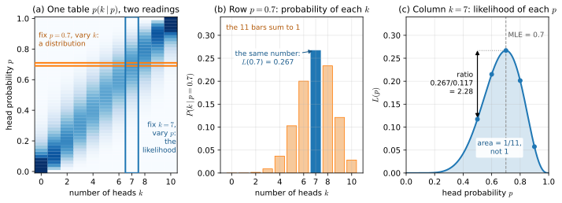
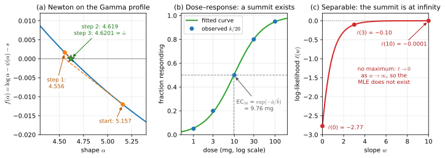
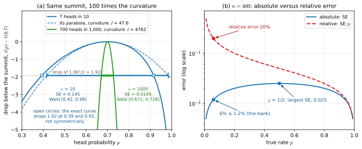
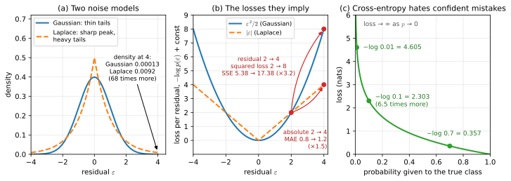
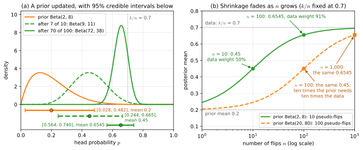
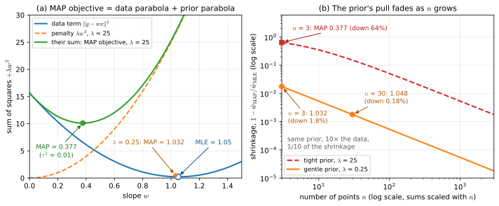
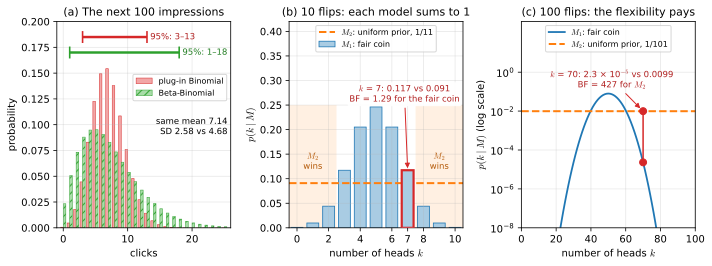

# Module 11 — Likelihood and Bayesian Inference

> After this module you can read any loss function and name the probability model hiding inside it, fit a model's parameters by maximum likelihood with honest error bars, and turn a prior plus data into a posterior that answers the question you actually have — "how likely is it that B beats A?" — instead of a proxy for it.

## Why this matters for ML and AI

Every training loop you have ever run was doing statistics whether you knew it or not. Minimising mean squared error is maximum-likelihood estimation under Gaussian noise; minimising cross-entropy is maximum-likelihood estimation of the labels under a Bernoulli or categorical model. A large language model is trained by making the training text as probable as possible under the model, token by token, and the number reported on its training curve — the loss in nats per token — is a negative log-likelihood. The `weight_decay` argument of AdamW acts like a Gaussian prior on the weights, and the fitted model behaves like a maximum-a-posteriori estimate. Dropping the word "likelihood" from this story does not make it go away; it only makes the design choices invisible. Once you can see them, questions such as "why does my regression blow up on outliers?" (the Gaussian assumption) or "why should regularisation strength depend on dataset size?" (the prior competes with $n$ data terms) have clean answers.

The Bayesian half of the module is just as practical. Thompson sampling, which decides in real time which ad, headline or treatment to show, draws a sample from a Beta posterior per option and plays the winner. Bayesian optimisation tunes hyperparameters by maintaining a posterior over the unknown objective. Gaussian-process regression, the Kalman filter and Bayesian A/B testing are all the same move — prior times likelihood, normalise — applied to different parameters. The Pfizer–BioNTech COVID-19 vaccine trial was analysed with a Beta prior and a posterior probability as its primary success criterion, and we reproduce that calculation here. Laplace smoothing in naive Bayes, label smoothing in classifiers, shrinkage in target encoders: all of them are posterior means in disguise.

The third theme is uncertainty about the fitted parameters themselves. The Fisher information — the curvature of the log-likelihood at its peak — tells you how precisely the data pin down a parameter, gives you standard errors and confidence intervals for free, and reappears in deep learning as the metric of natural-gradient descent and as the importance weights of elastic weight consolidation. Knowing it lets you say not just "the conversion rate is 5%" but "5% ± 1.2%", and not just "B converts better" but "B converts better with probability 0.97 and the expected cost of being wrong is 0.008 percentage points".

## Learning objectives

After working through this module you will be able to:

- Write down the likelihood and log-likelihood of an i.i.d. sample for any named distribution and explain why the likelihood is not a probability distribution over the parameter.
- Derive closed-form maximum-likelihood estimators for the Bernoulli, Poisson, Normal and Exponential models, and use the invariance property to obtain MLEs of transformed parameters.
- Maximise a log-likelihood numerically with gradient ascent, Newton's method or `scipy.optimize.minimize`, recognise non-identifiability and local optima, and reparameterise to respect constraints.
- Compute the Fisher information, derive standard errors and Wald confidence intervals from it, state what the Cramér–Rao bound promises, and get the standard errors and correlations of several parameters by inverting the observed information matrix.
- Derive MSE, MAE, binary cross-entropy, categorical cross-entropy and the Poisson loss as negative log-likelihoods, and explain the link to KL divergence.
- Apply Bayes' theorem to parameters, compute posteriors with discrete and conjugate priors (Beta–Binomial, Gamma–Poisson, Normal–Normal), and interpret credible intervals correctly.
- Justify the posterior mean, median and mode as the answers to three different loss functions, and show how much the choice of prior moves a posterior when the data are weak.
- Show that MAP estimation with a Gaussian prior is ridge regression with $\lambda = \sigma^2/\tau^2$, and with a Laplace prior is the lasso.
- Compute posterior predictive distributions, explain why they are wider than plug-in predictions, use marginal likelihoods to compare models, and derive the BIC from the Laplace approximation.
- Run a Bayesian A/B test by Monte Carlo and apply empirical-Bayes shrinkage to many small, related estimates.

## Prerequisites

You need Bayes' theorem, random variables, PMFs/PDFs and expectations from [Module 07 — Probability foundations](../../part-3-probability/07-probability-foundations/README.md); the Bernoulli, Binomial, Poisson, Exponential, Normal, Gamma and Beta distributions from [Module 08](../../part-3-probability/08-distributions-and-limit-theorems/README.md) (recall their PMFs/PDFs, means and variances); and the vocabulary of estimators, bias, variance, standard errors and confidence intervals from [Module 10 — Estimation and sampling](../10-estimation-and-sampling/README.md). The mechanics of maximisation — derivatives, gradients, Hessians and Newton's method — come from [Module 04](../../part-2-calculus-and-optimization/04-differential-calculus/README.md) and [Module 05](../../part-2-calculus-and-optimization/05-optimization/README.md); Section 3 reuses the logistic-regression gradient from there. Later modules build directly on this one: [Module 12](../12-hypothesis-testing-and-experiments/README.md) contrasts the Bayesian A/B test with the frequentist one, [Module 13](../../part-5-learning-theory/13-linear-models-and-regularization/README.md) develops the Bayesian view of ridge regression in full, [Module 14](../../part-5-learning-theory/14-information-theory/README.md) turns cross-entropy into KL divergence, and [Module 18](../../part-6-deep-learning-and-modern-ai/18-sampling-mcmc-and-generative-models/README.md) handles posteriors that have no closed form.

## 1. The likelihood function

**Intuition.** The same formula $p(x \mid \theta)$ can be read in two directions. Fix the parameter $\theta$ and let the data $x$ vary: you get a probability distribution over possible observations — this is how [Module 08](../../part-3-probability/08-distributions-and-limit-theorems/README.md) used it. Now fix the data you actually observed and let $\theta$ vary: you get the **likelihood**, a score for each candidate parameter saying how well it explains what you saw. A parameter value under which your data would have been very improbable scores low; one under which your data were typical scores high. Estimation is reading the likelihood; Bayesian inference is combining it with what you believed before. Figure 1(a) draws both readings of one table.

**Definition.** For observations $x_1, \dots, x_n$ from a model with density or mass function $p(x \mid \theta)$, the likelihood function is

$$L(\theta) = p(x_1, \dots, x_n \mid \theta) \stackrel{\text{i.i.d.}}{=} \prod_{i=1}^{n} p(x_i \mid \theta), \qquad \ell(\theta) = \log L(\theta) = \sum_{i=1}^{n} \log p(x_i \mid \theta).$$

The **log-likelihood** $\ell$ turns the product into a sum, which is easier to differentiate and does not underflow (a product of 1,000 probabilities of order $0.1$ is $10^{-1000}$, below the smallest double). Because only comparisons between parameter values matter, any factor that does not depend on $\theta$ can be dropped from $L$ (or subtracted from $\ell$), and two parameter values are compared through the **likelihood ratio** $L(\theta_1)/L(\theta_2)$. The likelihood is **not** a probability distribution over $\theta$: it need not integrate to 1 over $\theta$, and $L(\theta_1) = 2L(\theta_2)$ does not mean "$\theta_1$ is twice as probable" — making that statement requires a prior (Section 6).

**Worked example.** You flip a coin 10 times and see 7 heads. Under a Binomial model with unknown head probability $p$,

$$L(p) = \binom{10}{7} p^7 (1 - p)^3 = 120\, p^7 (1 - p)^3 .$$

| $p$ | 0.5 | 0.6 | 0.7 | 0.8 | 0.9 |
|---|---|---|---|---|---|
| $L(p)$ | 0.117 | 0.215 | 0.267 | 0.201 | 0.057 |
| $\ell(p) = \log L(p)$ | −2.144 | −1.537 | −1.321 | −1.603 | −2.858 |

The curve peaks at $p = 0.7$, where $L = 0.267$. The data favour $0.7$ over a fair coin by a likelihood ratio of $0.267/0.117 = 2.28$ — a real but weak preference. Check that this is not a distribution over $p$: $\int_0^1 120\, p^7 (1-p)^3\, dp = 120 \cdot \frac{7!\,3!}{11!} = \frac{1}{11}$, not 1. (Without the constant $\binom{10}{7}$ the integral would be $1/1320$ — the constant changes the integral and not the shape, which is why it is irrelevant.) Figure 1(c) draws this curve, its area and the ratio; Figure 1(b) shows that the same $0.267$ is also one bar of a genuine distribution over $k$.

**Figure 1.** One table, two readings, for 10 flips. (a) The Binomial$(10, p)$ probabilities $p(k \mid p)$ as shades of blue, with the number of heads $k$ across and $p$ up. The orange row fixes $p = 0.7$ and lets $k$ vary; the blue column fixes $k = 7$ and lets $p$ vary. (b) The row is a probability distribution over $k$: its 11 bars sum to 1. (c) The column is the likelihood $L(p) = 120\,p^7(1-p)^3$, with the guide's five table values as dots. It peaks at the MLE, $0.7$; the arrow at $p = 0.5$ is the likelihood ratio $0.267/0.117 = 2.28$; and the shaded area is $1/11$, not 1, so it is not a distribution over $p$. Notice that the solid bar in (b) and the summit in (c) are one and the same number, $0.267$.

**Real-life example (sport).** A basketball player makes 7 of 10 free throws in a game. A commentator calls her "a 70% shooter"; her career average is 50%. The likelihood ratio of 2.28 says the game's evidence is modest: a true 50% shooter produces 7-of-10 games about $11.7\%$ of the time, a true 70% shooter about $26.7\%$ of the time. A 7-for-10 night is weak evidence of a hot hand; 70-for-100 would be a different story, because the likelihood ratio of 70/100 under $0.7$ versus $0.5$ is $(1.4)^{70}(0.6)^{30} \approx 3.7 \times 10^{3}$.

**In ML/AI this is …** what a model's forward pass computes. A classifier's output $p(y \mid x, \theta)$, evaluated at the *true* label and logged, is one term of $\ell(\theta)$; the training loss is $-\ell(\theta)/n$. The `logprobs` returned by language-model APIs are per-token log-likelihood terms; `GaussianMixture.score` in scikit-learn returns the average log-likelihood; `log_prob` in probabilistic programming libraries is this function. Everything in Sections 2–5 is about making $\ell$ large.

## 2. Maximum likelihood estimation — analytic

**Intuition.** If the likelihood scores parameters by how well they explain the data, the obvious estimate is the parameter with the highest score: the **maximum likelihood estimate (MLE)**. Geometrically you are standing on the log-likelihood hill and walking to its summit. When the hill is smooth, the summit is where the slope is zero, and for the classic distributions that equation can be solved by hand. The results are mostly the "obvious" formulas — sample mean, sample proportion — which is reassuring, with one famous exception for the variance.

**Definition.** The MLE is $\hat\theta = \arg\max_\theta \ell(\theta)$. The derivative of the log-likelihood, $s(\theta) = \partial \ell / \partial \theta$, is called the **score**; at an interior maximum $s(\hat\theta) = 0$ and $\ell''(\hat\theta) < 0$. Four derivations, each three lines:

- **Bernoulli / Binomial** ($k$ successes in $n$ trials): $\ell(p) = k \log p + (n - k)\log(1 - p)$, so $s(p) = \frac{k}{p} - \frac{n - k}{1 - p} = 0 \Rightarrow k(1 - p) = (n - k)p \Rightarrow \hat p = k/n$.
- **Poisson** (counts $x_i$): $\ell(\lambda) = \sum_i x_i \log\lambda - n\lambda - \sum_i \log x_i!$, so $s(\lambda) = \frac{\sum x_i}{\lambda} - n = 0 \Rightarrow \hat\lambda = \bar x$.
- **Exponential** (waiting times $x_i$, rate $\lambda$): $\ell(\lambda) = n\log\lambda - \lambda\sum_i x_i$, so $\hat\lambda = n/\sum x_i = 1/\bar x$.
- **Normal** (unknown $\mu, \sigma^2$): $\ell(\mu, \sigma^2) = -\frac{n}{2}\log(2\pi\sigma^2) - \frac{1}{2\sigma^2}\sum_i (x_i - \mu)^2$. Setting $\partial\ell/\partial\mu = \frac{1}{\sigma^2}\sum(x_i - \mu) = 0$ gives $\hat\mu = \bar x$; setting $\partial\ell/\partial\sigma^2 = -\frac{n}{2\sigma^2} + \frac{1}{2\sigma^4}\sum(x_i - \bar x)^2 = 0$ gives

$$\hat\sigma^2 = \frac{1}{n}\sum_{i=1}^{n}(x_i - \bar x)^2 .$$

That divisor is $n$, not $n - 1$: the MLE of the variance is **biased**, $\mathbb{E}[\hat\sigma^2] = \frac{n-1}{n}\sigma^2$ ([Module 10](../10-estimation-and-sampling/README.md)). Maximum likelihood optimises fit to the observed sample, and the sample mean is closer to the sample than the true mean is, so the spread around it is systematically underestimated. An identity makes this exact: for any centre $c$, $\sum_i (x_i - c)^2 = \sum_i (x_i - \bar x)^2 + n(c - \bar x)^2$. Put $c = \mu$ and take expectations: the left side is $n\sigma^2$ and the last term is $n\,\operatorname{Var}(\bar x) = \sigma^2$, so $\mathbb{E}[n\hat\sigma^2] = (n - 1)\sigma^2$. The bias vanishes as $n \to \infty$ and is tiny next to the standard deviation of the estimate for large $n$ (the bias is of order $1/n$, the standard deviation of order $1/\sqrt{n}$), which is why MLE tolerates it.

**Invariance.** If $\hat\theta$ is the MLE of $\theta$, then $g(\hat\theta)$ is the MLE of $g(\theta)$ for any function $g$. For one-to-one $g$ the reason is that re-labelling the parameter axis does not move the summit; for other $g$, the likelihood of a value of $g$ is taken as the largest $L(\theta)$ among the $\theta$ that map to it. The MLE of the mean waiting time $1/\lambda$ is $\bar x$; the MLE of $\sigma$ is $\sqrt{\hat\sigma^2}$; the MLE of the odds $p/(1 - p)$ is $k/(n - k)$. Invariance does *not* preserve unbiasedness: $\hat\sigma^2$ is biased, and $\sqrt{\hat\sigma^2}$ is biased differently.

**Worked example.** Five measurements $x = (2.1, 3.4, 1.9, 4.0, 2.6)$. The mean is $\bar x = 14.0/5 = 2.8$. Deviations $(-0.7, 0.6, -0.9, 1.2, -0.2)$, squares $(0.49, 0.36, 0.81, 1.44, 0.04)$, sum $3.14$ (about any other centre the sum is larger, $3.14 + 5(c - 2.8)^2$, for example $3.34$ at $c = 3.0$). Hence $\hat\sigma^2 = 3.14/5 = 0.628$ and $\hat\sigma = 0.792$, whereas the unbiased sample variance is $s^2 = 3.14/4 = 0.785$. A call centre logs $3, 5, 2, 4, 6, 4$ calls in six consecutive hours: $\hat\lambda = 24/6 = 4.0$ calls per hour. Four repair times of $2.0, 0.5, 1.5, 4.0$ hours under an Exponential model: $\bar x = 2.0$, so $\hat\lambda = 0.5$ per hour, and by invariance the MLE of $P(\text{repair} > 3\text{ h}) = e^{-3\hat\lambda} = e^{-1.5} = 0.223$.

**Real-life example (manufacturing).** A plant inspects 400 parts from a new line and finds 12 defective: $\hat p = 12/400 = 0.03$. The same plant's maintenance desk receives on average $\hat\lambda = 4$ calls per hour (the six-hour log above). Under the Poisson model the probability of more than 6 calls in an hour is $1 - F(6; 4) = 0.111$, so a single technician who can handle 6 calls an hour is overwhelmed about one hour in nine — a staffing decision that rests on a one-line MLE. Section 4 adds the error bars that both numbers need.

**In ML/AI this is …** `np.mean` and `np.var` with the default `ddof=0`, which are the Normal MLEs; the per-class means and variances that `sklearn.naive_bayes.GaussianNB` stores; the class prior $\hat P(c) = n_c/n$ and the raw-count word probabilities of naive Bayes ([Module 07](../../part-3-probability/07-probability-foundations/README.md)), both MLEs of categorical distributions (the *smoothed* counts of Module 07 are the posterior means of Section 7, not MLEs); the counts-divided-by-counts estimates in $n$-gram language models; and the M-step of the EM algorithm for Gaussian mixtures, which is exactly these closed forms with each point weighted by its cluster responsibility.

## 3. Maximum likelihood estimation — numerical

**Intuition.** Most interesting models have no closed-form summit: the score equation mixes the parameter with transcendental functions, or there are thousands of parameters coupled through a network. The log-likelihood is still a function you can evaluate and differentiate, so you climb it numerically — gradient ascent, Newton's method, or a quasi-Newton routine from `scipy.optimize`. Three things can go wrong on the way up: the hill can have several summits (local optima), it can have a flat ridge along which every point is equally good (non-identifiability), or the summit can be at infinity (separable data in logistic regression).

**Definition.** Numerical MLE minimises the **negative log-likelihood** $\text{NLL}(\theta) = -\ell(\theta)$ with any optimiser from [Module 05](../../part-2-calculus-and-optimization/05-optimization/README.md): gradient descent $\theta_{t+1} = \theta_t - \eta\,\nabla\text{NLL}(\theta_t)$, or Newton's method $\theta_{t+1} = \theta_t - H^{-1}\nabla\text{NLL}(\theta_t)$ with $H$ the Hessian. Constrained parameters are handled by **reparameterising**: optimise $\log\sigma$ instead of $\sigma$, $\log\alpha$ instead of a Gamma shape, so that every real number is admissible. A model is **identifiable** if $\theta \ne \theta'$ implies $p(\cdot \mid \theta) \ne p(\cdot \mid \theta')$; otherwise the likelihood is flat along the set of equivalent parameters (observing only $\mu_1 + \mu_2$ cannot separate $\mu_1$ from $\mu_2$; permuting the components of a mixture leaves the likelihood unchanged). Convergence of an optimiser certifies a *stationary point*, not the global MLE; for multimodal likelihoods (mixtures, neural networks) the standard remedy is multiple random restarts.

**Worked example (Gamma shape).** Fit a Gamma$(\alpha, \beta)$ (shape $\alpha$, rate $\beta$) to $x = (1.2, 2.5, 0.8, 3.1, 1.9)$. The log-likelihood is

$$\ell(\alpha, \beta) = n\alpha\log\beta - n\log\Gamma(\alpha) + (\alpha - 1)\sum_i \log x_i - \beta\sum_i x_i .$$

The $\beta$ equation has a closed form: $\partial\ell/\partial\beta = n\alpha/\beta - \sum x_i = 0 \Rightarrow \hat\beta = \hat\alpha/\bar x$. Substituting it back (the **profile likelihood**) and differentiating in $\alpha$ gives $\log\alpha - \psi(\alpha) = \log\bar x - \frac{1}{n}\sum\log x_i$, where $\psi = \Gamma'/\Gamma$ is the digamma function — no closed form. Here $\bar x = 1.9$, $\log\bar x = 0.6419$, $\frac{1}{n}\sum\log x_i = 0.5297$, so the right-hand side is $s = 0.1121$. Newton's method on $f(\alpha) = \log\alpha - \psi(\alpha) - s$ with $f'(\alpha) = 1/\alpha - \psi'(\alpha)$, started from the method-of-moments value $\alpha_0 = \bar x^2/\hat\sigma^2 = 3.61/0.70 = 5.157$:

| iteration | $\alpha$ | $f(\alpha)$ |
|---|---|---|
| 0 | 5.157 | −0.01203 |
| 1 | 4.556 | +0.00164 |
| 2 | 4.619 | +0.00002 |
| 3 | 4.6201 | $5 \times 10^{-9}$ |

Figure 2(a) draws these steps: each one follows the tangent to the zero line. So $\hat\alpha = 4.620$ and $\hat\beta = 4.620/1.9 = 2.432$. `scipy.stats.gamma.fit(x, floc=0)` returns shape $4.620$ and scale $0.4112 = 1/2.432$ — the same answer by a general-purpose optimiser. The lesson notebook also minimises the two-parameter NLL directly in $(\log\alpha, \log\beta)$ with `scipy.optimize.minimize` and draws the likelihood surface.

**Real-life example (healthcare — dose–response).** In a toxicology study, 20 animals per group receive doses of $1, 3, 10, 30, 100$ mg and $1, 4, 10, 16, 19$ respond. The standard model is logistic in log-dose: $P(\text{response} \mid d) = \sigma(a + b\log d)$ with $\sigma(z) = 1/(1 + e^{-z})$. The log-likelihood $\sum_g [k_g \log p_g + (20 - k_g)\log(1 - p_g)]$ has no closed-form maximum; BFGS from $(a, b) = (0, 1)$ converges to $\hat a = -2.836$, $\hat b = 1.245$. By invariance the MLE of the dose giving a 50% response is $\text{EC}_{50} = e^{-\hat a/\hat b} = 9.76$ mg — the number that goes into the safety report (Figure 2(b)). Now imagine a smaller study where every low-dose animal survives and every high-dose animal responds: the groups are **separable**, and the likelihood keeps increasing as $b \to \infty$ (with four points at $x = \pm1, \pm2$ and $y = 0, 0, 1, 1$, $\ell(w)$ for $p = \sigma(wx)$ rises from $-2.77$ at $w = 0$ to $-0.10$ at $w = 3$ to $-0.0001$ at $w = 10$ and never peaks; Figure 2(c)). The MLE does not exist; a prior (Section 8) restores a finite answer.

**Figure 2.** What climbing the likelihood looks like when no closed form exists. (a) Newton's method on $f(\alpha) = \log\alpha - \psi(\alpha) - s$: from the start $5.157$ the tangent reaches zero at $4.556$, the next at $4.619$ and the next at $4.6201 = \hat\alpha$; the last two are indistinguishable at this scale, so they share the star. (b) The dose–response data on a log-dose axis, with the fitted logistic curve: this hill has a summit, and the curve crosses one half at $\text{EC}_{50} = 9.76$ mg. (c) The four separable points: $\ell(w)$ rises from $-2.77$ at $w = 0$ through $-0.10$ at $w = 3$ to $-0.0001$ at $w = 10$ and only approaches 0. Notice that (c) has no summit at all: any optimiser "converges" here only because the slope gets small.

**In ML/AI this is …** training itself: stochastic gradient descent on cross-entropy is numerical MLE with mini-batch gradient estimates ([Module 06](../../part-2-calculus-and-optimization/06-autodiff-and-backpropagation/README.md)). `sklearn.linear_model.LogisticRegression` minimises the (penalised) Bernoulli NLL with L-BFGS by default; `GaussianMixture` and hidden Markov models use EM, an ascent method that never decreases the likelihood; and the separable-data divergence is exactly why unpenalised logistic regression is a bad default and why `LogisticRegression` ships with `C=1.0`.

## 4. Properties of the MLE: Fisher information and standard errors

**Intuition.** A sharply peaked log-likelihood means the data pin the parameter down precisely: move $\theta$ a little away from $\hat\theta$ and the data become much less probable. A flat log-likelihood means many parameter values explain the data about equally well. The **Fisher information** measures that curvature, and its inverse is the variance you should attach to the MLE. The more data, the sharper the peak — the information adds up across independent observations — and the standard error shrinks like $1/\sqrt{n}$, the rate you met in [Module 10](../10-estimation-and-sampling/README.md). Figure 3(a) draws two such peaks.

**Definition.** For one observation with log-density $\log p(X \mid \theta)$, the **Fisher information** is

$$i(\theta) = \operatorname{Var}\big[\tfrac{\partial}{\partial\theta}\log p(X \mid \theta)\big] = -\,\mathbb{E}\Big[\tfrac{\partial^2}{\partial\theta^2}\log p(X \mid \theta)\Big],$$

(the two forms agree under standard regularity conditions; the score has mean zero at the true $\theta$). For $n$ i.i.d. observations the information is $I_n(\theta) = n\,i(\theta)$. Under those regularity conditions the MLE is **consistent** ($\hat\theta \to \theta_0$), **asymptotically normal**,

$$\sqrt{n}\,(\hat\theta - \theta_0) \xrightarrow{d} \mathcal{N}\!\big(0,\, 1/i(\theta_0)\big), \qquad \text{so} \qquad \operatorname{SE}(\hat\theta) \approx \frac{1}{\sqrt{n\,i(\hat\theta)}} = \frac{1}{\sqrt{I_n(\hat\theta)}},$$

and **efficient**: the **Cramér–Rao lower bound** says every unbiased estimator $T$ satisfies $\operatorname{Var}(T) \ge 1/I_n(\theta)$, and the MLE attains this bound asymptotically. In practice one uses the **observed information** $J(\hat\theta) = -\ell''(\hat\theta)$, the curvature actually measured at the summit, in place of $I_n(\hat\theta)$. A **Wald confidence interval** is then $\hat\theta \pm z_{\alpha/2}\operatorname{SE}(\hat\theta)$, with $z_{0.025} = 1.96$.

*Why the score has mean zero, and why the two forms agree.* The density integrates to 1 for every $\theta$. Differentiating $\int p(x \mid \theta)\,dx = 1$ under the integral sign and writing $\partial_\theta p = p\,\partial_\theta\log p$ gives $\mathbb{E}[\partial_\theta\log p] = 0$, so at the true $\theta$ the variance of the score is the mean of its square. Differentiating once more gives $\mathbb{E}[\partial^2_\theta\log p] + \mathbb{E}[(\partial_\theta\log p)^2] = 0$, which is exactly the equality of the two forms of $i(\theta)$. Bernoulli check: the score of one trial is $\frac{x}{p} - \frac{1 - x}{1 - p}$, with expectation $1 - 1 = 0$. Differentiating under the integral is what the regularity conditions license.

*Curvature is precision.* Expand $\ell$ about the summit, where the slope is zero ([Module 04](../../part-2-calculus-and-optimization/04-differential-calculus/README.md)): $\ell(\theta) \approx \ell(\hat\theta) - \frac12 J(\hat\theta)(\theta - \hat\theta)^2$. Up to a constant, the right-hand side is the logarithm of a Gaussian in $\theta$ with variance $1/J$, which is why an inverse curvature can be read as a variance, and it is the Laplace approximation of the "In ML/AI" paragraph below. This parabola has fallen by $z^2/2$ at a distance $z/\sqrt{J} = z\operatorname{SE}$ from the summit, so the 95% Wald interval is a horizontal cut through the parabola $1.96^2/2 = 1.92$ below its top.

*Information adds.* $\ell$ is a sum of $n$ independent terms, so its expected curvature is $n\,i(\theta)$: double the data, double the curvature, and divide the standard error by $\sqrt 2$.

*Observed versus expected information.* $J(\hat\theta)$ uses the data at hand, $I_n(\hat\theta)$ the model's average over datasets; both estimate the same curvature, and in many models they coincide. For the Poisson, $J = \sum_i x_i/\hat\lambda^2 = n/\hat\lambda = I_n(\hat\lambda)$, because $\sum_i x_i = n\hat\lambda$ (the call centre of Section 2: $24/16 = 6/4 = 1.5$). For the Gamma below, the second derivatives contain no data at all, so the two are equal. They differ in general: for a Cauchy location, $p(x \mid \theta) = 1/[\pi(1 + (x - \theta)^2)]$, the information per observation is $i = \frac12$, yet $x = (-1, 0, 1)$ has $\hat\theta = 0$ with $J = 2$ against $I_3 = 1.5$. Numerical software usually reports the observed form, because a Hessian of the NLL is all it needs.

**Worked example (Bernoulli).** $\log p(x \mid p) = x\log p + (1 - x)\log(1 - p)$. Second derivative: $-\frac{x}{p^2} - \frac{1 - x}{(1 - p)^2}$. Taking the expectation with $\mathbb{E}[x] = p$: $-\frac{p}{p^2} - \frac{1 - p}{(1 - p)^2} = -\frac{1}{p} - \frac{1}{1 - p} = -\frac{1}{p(1 - p)}$. Hence

$$i(p) = \frac{1}{p(1 - p)}, \qquad I_n(p) = \frac{n}{p(1 - p)}, \qquad \operatorname{SE}(\hat p) = \sqrt{\frac{\hat p(1 - \hat p)}{n}} .$$

For 7 heads in 10: $\operatorname{SE} = \sqrt{0.21/10} = 0.145$ and the 95% Wald interval is $0.70 \pm 0.284 = [0.42, 0.98]$ — nearly useless. For 700 in 1,000: $\operatorname{SE} = 0.0145$, interval $[0.672, 0.728]$. The observed information at $\hat p = 0.7$ is $\frac{7}{0.49} + \frac{3}{0.09} = 14.29 + 33.33 = 47.6$, identical to $I_n(\hat p) = 10/0.21 = 47.6$ — for the Bernoulli the two coincide. Finally, $\operatorname{Var}(\hat p) = p(1 - p)/n$ equals the Cramér–Rao bound *exactly*, so the sample proportion is the best unbiased estimator at every $n$, not only asymptotically. The same recipe gives $i(\lambda) = 1/\lambda$ for the Poisson ($\operatorname{SE} = \sqrt{\hat\lambda/n}$) and $i(\mu) = 1/\sigma^2$ for the Normal mean ($\operatorname{SE} = \sigma/\sqrt{n}$, the formula you already know). The lesson notebook repeats a Bernoulli experiment 5,000 times and shows the empirical standard deviation of $\hat p$ landing on $1/\sqrt{n\,i(p)}$.

Figure 3(a) puts these numbers on one axis. The parabola of curvature $47.6$ has fallen by $1.92$ at $0.70 \pm 1.96/\sqrt{47.6} = 0.70 \pm 0.284$, the Wald interval. The exact curve is asymmetric and has fallen by $1.92$ at $0.39$ and $0.92$; that range is the **likelihood-ratio interval**, the values of $p$ that a likelihood-ratio test at about the 5% level would not reject (twice the drop is approximately $\chi^2_1$ at the true $p$ for large $n$, and its 95% point is $3.84 = 1.96^2$; [Module 12](../12-hypothesis-testing-and-experiments/README.md) meets this test through the Neyman–Pearson lemma), and it follows the curve's shape where Wald's $0.98$ does not. A hundred times the data (700 in 1,000) multiplies the curvature by 100, from $47.6$ to $4{,}762$, and divides the standard error by 10, from $0.145$ to $0.0145$.

**Worked example (several parameters).** With a parameter vector, $\ell''$ becomes the Hessian: $J = -\nabla^2\ell(\hat\theta)$, $\operatorname{Cov}(\hat\theta) \approx J^{-1}$, $\operatorname{SE}_j = \sqrt{[J^{-1}]_{jj}}$, and the off-diagonal entries of $J^{-1}$ give the correlations between the estimates. For the Gamma fit of Section 3 ($n = 5$, $\hat\alpha = 4.620$, $\hat\beta = 2.432$), differentiating $\ell(\alpha, \beta)$ twice gives

$$J = \begin{pmatrix} n\psi'(\hat\alpha) & -n/\hat\beta \\ -n/\hat\beta & n\hat\alpha/\hat\beta^2 \end{pmatrix} = \begin{pmatrix} 1.208 & -2.056 \\ -2.056 & 3.907 \end{pmatrix}, \qquad J^{-1} = \begin{pmatrix} 7.97 & 4.19 \\ 4.19 & 2.46 \end{pmatrix}.$$

So $\operatorname{SE}(\hat\alpha) = 2.82$, $\operatorname{SE}(\hat\beta) = 1.57$, and the correlation is $4.19/(2.82 \times 1.57) \approx 0.95$. Five points pin down neither parameter. The Wald interval for $\alpha$, $4.62 \pm 5.53$, even reaches below zero; applying it on the log scale of Section 3, with $\operatorname{SE}(\log\hat\alpha) = 2.82/4.62 = 0.611$, gives the admissible $[1.39, 15.3]$. The long diagonal ridge in the lesson notebook's contour plot is this correlation: raise $\alpha$ and $\beta$ together and the fit barely changes.

*Computing it in practice.* Use the analytic second derivative when there is one; otherwise take a central-difference Hessian of the NLL at the optimum, which reproduces the matrix above to five significant figures. BFGS's `res.hess_inv` is only a rough estimate built up along the optimiser's path, so do not quote standard errors from it. `statsmodels`' `cov_params()` does the inversion for you. A network with $d$ weights has a Hessian with $d^2$ entries, which is why diagonal Fisher, K-FAC and last-layer Laplace approximations exist.

*When the recipe fails.* If the support depends on the parameter, the regularity conditions break: for Uniform$(0, \theta)$ the MLE $\max x_i$ is not asymptotically normal and the $1/\sqrt{n}$ rate is replaced by $1/n$. At a boundary, $\hat p = 0$ gives $\operatorname{SE} = 0$ and a zero-width interval that claims certainty; for $p = 0.05$ and $n = 40$ that happens with probability $0.95^{40} = 0.13$. Small samples miss the advertised coverage: the exact coverage of the nominal 95% Wald interval is 87% at $p = 0.05$, $n = 40$ and 84% at $p = 0.3$, $n = 10$ (the lesson's smallest case). On a non-identifiable ridge (Section 3), $J$ is singular and cannot be inverted at all. For the boundary and small-sample cases use the likelihood-ratio interval or the exact posterior of Section 6. With a parameter-dependent support the $1.92$ cut is miscalibrated as well (for Uniform$(0, \theta)$ it covers only $1 - e^{-1.92} = 85\%$ at every $n$), so use the exact distribution of $\max x_i$ or the posterior. On a ridge the data cannot separate the parameters at all, and only a prior or a constraint can.

**Real-life example (finance).** A bank observes 24 defaults among 400 loans of a new product: $\hat p = 0.06$, $\operatorname{SE} = \sqrt{0.06 \times 0.94/400} = 0.0119$, 95% interval $[0.037, 0.083]$. The capital the regulator requires scales with the default rate, so the difference between planning for 3.7% and 8.3% is large; a model that reported only "6%" would hide a factor-of-two uncertainty. Note also where information is cheap and dear: $p(1 - p)$ is largest at $p = 0.5$, so rates near one half are the hardest to estimate in absolute terms, while rare events are easy in absolute terms and hard in *relative* terms ($\operatorname{SE}/\hat p \approx 1/\sqrt{np}$ for small $p$). Figure 3(b) draws both for $n = 400$.

**Figure 3.** Curvature and precision. (a) The drop below the summit, $\ell(p) - \ell(0.7)$, for 7 heads in 10 (blue, with its parabola of curvature $J = 47.6$ dashed) and for 700 in 1,000 (green, $J = 4{,}762$): the same summit, 100 times the curvature. The capped bars are the Wald intervals $[0.42, 0.98]$ and $[0.672, 0.728]$; they lie where the *parabola*, not the exact curve, has dropped $1.96^2/2 = 1.92$. The open circles mark where the exact 7-in-10 curve drops $1.92$, at $0.39$ and $0.92$, and they are not symmetric about $0.7$. (b) At $n = 400$, the standard error (solid) and the relative error $\operatorname{SE}/p$ (dashed) against the true rate, on a log axis. The bank's $6\% \pm 1.2\%$ has a small absolute error, less than half the largest SE of $0.025$ at $p = 1/2$, but a relative error of 20%.

**In ML/AI this is …** the `std err` column of any regression summary (`statsmodels` inverts the observed information); the Fisher information matrix that **natural-gradient descent** uses as its metric, $\theta \leftarrow \theta - \eta\,F^{-1}\nabla\text{NLL}$, and that K-FAC approximates for neural networks; the diagonal Fisher that **elastic weight consolidation** uses to decide which weights a network may change when it learns a new task without forgetting the old one; and the precision matrix of the **Laplace approximation** $p(\theta \mid \mathcal{D}) \approx \mathcal{N}(\hat\theta, J(\hat\theta)^{-1})$, the cheapest route to Bayesian uncertainty for a trained network.

## 5. MLE gives you your loss functions

**Intuition.** A loss function is a belief about noise. Choosing mean squared error says "the errors are Gaussian"; choosing absolute error says "they are heavy-tailed, like a Laplace distribution"; choosing cross-entropy says "the labels are draws from a Bernoulli or categorical distribution whose probabilities my model outputs". None of these are arbitrary engineering conventions — each is the negative log-likelihood of a specific model, and once you see that, the behaviour of the loss (sensitivity to outliers, the shape of its gradient) follows from the distribution. Figure 4 draws the correspondence.

**Definition and derivations.** Let a model with parameters $w$ produce a prediction $f(x_i; w)$ for input $x_i$, and let the data be independent given the inputs. Then $\text{NLL}(w) = -\sum_i \log p(y_i \mid f(x_i; w))$, and:

- **Gaussian noise ⇒ squared error.** $y_i = f(x_i; w) + \varepsilon_i$, $\varepsilon_i \sim \mathcal{N}(0, \sigma^2)$: $\text{NLL} = \frac{n}{2}\log(2\pi\sigma^2) + \frac{1}{2\sigma^2}\sum_i (y_i - f(x_i; w))^2$. The first term and the factor $1/2\sigma^2$ do not depend on $w$, so $\arg\min_w \text{NLL} = \arg\min_w \sum_i (y_i - f(x_i; w))^2$: **least squares / MSE**.
- **Laplace noise ⇒ absolute error.** $p(\varepsilon) = \frac{1}{2b}e^{-|\varepsilon|/b}$: $\text{NLL} = n\log 2b + \frac{1}{b}\sum_i |y_i - f(x_i; w)|$, so the argmin is the **MAE**. The MLE of a location under Laplace noise is the median, which is why MAE is robust.
- **Bernoulli labels ⇒ binary cross-entropy.** $y_i \in \{0, 1\}$, $p_i = \sigma(f(x_i; w))$, $p(y_i \mid p_i) = p_i^{y_i}(1 - p_i)^{1 - y_i}$: $\text{NLL} = -\sum_i [y_i\log p_i + (1 - y_i)\log(1 - p_i)]$ — **BCE**.
- **Categorical labels ⇒ cross-entropy.** $p_i = \text{softmax}(f(x_i; w))$, $p(y_i \mid p_i) = p_{i, y_i}$: $\text{NLL} = -\sum_i \log p_{i, y_i}$ — the **cross-entropy with one-hot targets**. Its gradient with respect to the logits is $p_i - \mathbf{e}_{y_i}$, the famous $p - y$ ([Module 16](../../part-6-deep-learning-and-modern-ai/16-neural-networks-from-scratch/README.md)).
- **Poisson counts ⇒ Poisson loss.** $\lambda_i = e^{f(x_i; w)}$: $\text{NLL} = \sum_i [\lambda_i - y_i\log\lambda_i + \log y_i!]$, whose $w$-dependent part $\sum_i[\lambda_i - y_i \log\lambda_i]$ is the **Poisson loss** (half the Poisson deviance up to a constant).

Hence the sentence to remember: **minimising cross-entropy is maximising the likelihood of the labels.** A preview of [Module 14](../../part-5-learning-theory/14-information-theory/README.md): writing the empirical label distribution as $q$, the cross-entropy decomposes as $H(q, p) = H(q) + \mathrm{KL}(q \,\|\, p)$, and $H(q)$ does not depend on the model, so minimising cross-entropy also minimises the KL divergence from the data distribution to the model. As $n \to \infty$ the MLE converges to the parameter that minimises $\mathrm{KL}(p_{\text{data}} \,\|\, p_\theta)$ — the best approximation to reality inside the model family, even when reality is outside it.

**Worked example.** Residuals $r = (0.5, -1.0, 0.2, 2.0, -0.3)$ from a regression. Squares $(0.25, 1.00, 0.04, 4.00, 0.09)$, SSE $= 5.38$, MSE $= 1.076$; absolute values sum to $4.0$, MAE $= 0.8$. The Gaussian NLL with $\sigma = 1$ is $\frac{5}{2}\log 2\pi + \frac{5.38}{2} = 4.595 + 2.690 = 7.285$; the Laplace NLL with $b = 1$ is $5\log 2 + 4.0 = 7.466$. Now turn the $2.0$ into an outlier of $4.0$: SSE jumps to $17.38$ (3.2 times), MAE only to $1.2$ (1.5 times) — the Gaussian model's thin tails (Figure 4(a)) make a large residual "nearly impossible" and the loss punishes it quadratically. For classification, a model that assigns $0.7$ to the correct class pays $-\log 0.7 = 0.357$; one that assigns $0.1$ pays $-\log 0.1 = 2.303$, 6.5 times more, and the penalty goes to infinity as the probability goes to zero: cross-entropy hates confident mistakes. With three classes, $p = (0.2, 0.7, 0.1)$ and true class 2 (one-hot $y = (0, 1, 0)$), the loss is again $0.357$ and the logit gradient is $p - y = (0.2, -0.3, 0.1)$: push the true logit up, the others down, in proportion to how wrong they are. Figure 4(b) shows the outlier's two jumps and Figure 4(c) the classification penalty.

**Figure 4.** A loss is a noise model. (a) The Gaussian $\mathcal{N}(0, 1)$ and Laplace $(b = 1)$ densities used for the NLLs above. At a residual of 4 the Laplace density is $0.0092$ against the Gaussian's $0.00013$, 68 times larger, which is what "heavy tails" means. (b) The per-residual losses $\varepsilon^2/2$ and $|\varepsilon|$, which meet at the origin and cross at $(\pm 2, 2)$. Turning the residual $2$ into $4$ takes the squared loss from 2 to 8 and the absolute loss only from 2 to 4; over the five residuals, SSE goes from $5.38$ to $17.38$ (3.2 times) and MAE from $0.8$ to $1.2$ (1.5 times). (c) Cross-entropy $-\log p$ against the probability given to the true class: $0.357$ at $0.7$, $2.303$ at $0.1$ (6.5 times more), $4.605$ at $0.01$, and on to infinity as $p \to 0$.

**Real-life example (computer vision).** An ImageNet classifier is a 1,000-way categorical model; its training objective is the categorical NLL averaged over 1.28 million images, and "top-1 accuracy" is a *different* metric computed afterwards. The choice of likelihood shapes the model's behaviour: an image model trained with squared error on one-hot targets learns far more slowly, because the gradient $p - y$ of the cross-entropy stays large while the model is wrong, whereas the squared-error gradient through a softmax vanishes when the softmax saturates. Conversely, a depth-estimation network trained with squared error produces blurry edges, because under Gaussian noise the optimal prediction at an ambiguous pixel is the *mean* of the plausible depths; switching to absolute error (Laplace) yields the median and sharper boundaries.

**In ML/AI this is …** the one-to-one correspondence `MSELoss` ↔ Gaussian, `L1Loss` ↔ Laplace, `BCEWithLogitsLoss` ↔ Bernoulli, `CrossEntropyLoss` ↔ categorical, `PoissonNLLLoss` ↔ Poisson in PyTorch, and `sklearn.metrics.log_loss`, which is the Bernoulli/categorical NLL per example. A language model's pretraining loss is the categorical NLL per token; its **perplexity** is $\exp(\text{mean NLL})$ ([Module 14](../../part-5-learning-theory/14-information-theory/README.md)). The Huber loss is the NLL of a density that is Gaussian in the middle and Laplace in the tails.

## 6. Bayesian inference: prior, likelihood, posterior, evidence

**Intuition.** Maximum likelihood answers "which parameter best explains the data?" with a single number. Often you want more: *how sure* are you, and what did you know *before*? Bayesian inference treats the parameter as uncertain, describes that uncertainty with a probability distribution (the **prior**), and uses the likelihood to update it into the **posterior**. The posterior is the full answer. Point estimates, intervals and predictions are all read off it. The price is that you must write down a prior; the payoff is that every question becomes a probability calculation.

**Definition.** Bayes' theorem ([Module 07](../../part-3-probability/07-probability-foundations/README.md)) applied to a parameter:

$$p(\theta \mid \mathcal{D}) = \frac{p(\mathcal{D} \mid \theta)\,p(\theta)}{p(\mathcal{D})}, \qquad p(\mathcal{D}) = \int p(\mathcal{D} \mid \theta)\,p(\theta)\,d\theta ,$$

or in words, **posterior ∝ likelihood × prior**. The denominator $p(\mathcal{D})$ — the **evidence** or **marginal likelihood** — is the probability of the data averaged over the prior; it does not depend on $\theta$ and only normalises the posterior, but it becomes central for comparing models (Section 9). Point summaries of the posterior are decisions (derived after the worked example): the **posterior mean** minimises expected squared error, the **posterior median** minimises expected absolute error, and the **posterior mode** (the **MAP** estimate, Section 8) is what you report if only exactly right counts. A 95% **credible interval** $[a, b]$ satisfies $P(a \le \theta \le b \mid \mathcal{D}) = 0.95$: given *these* data, the parameter lies in the interval with probability 0.95. A 95% **confidence interval** ([Module 10](../10-estimation-and-sampling/README.md)) is a *procedure* that captures the true parameter in 95% of repeated samples; once you have computed a particular interval, the parameter is either in it or not, and no probability attaches to that one interval. The two often nearly coincide numerically for large $n$ and flat priors, but they answer different questions, and only the credible interval answers the one most people ask.

**Worked example (discrete prior, then continuous).** A new ad has an unknown click-through rate $p$. Suppose from experience it is one of three values with prior probabilities $P(p = 0.02) = 0.25$, $P(p = 0.05) = 0.50$, $P(p = 0.10) = 0.25$. It is shown 40 times and clicked twice. Likelihoods $\binom{40}{2}p^2(1 - p)^{38}$: $0.1448, 0.2777, 0.1423$. Prior × likelihood: $0.0362, 0.1388, 0.0356$; the evidence is their sum, $0.2106$; dividing gives the posterior $(0.172, 0.659, 0.169)$ and a posterior mean of $0.0533$ (Figure 5(a)). The data have modestly sharpened belief in 5% and said little about 2% versus 10%, because $40$ impressions carry little information at these rates. With a continuous uniform prior on $[0, 1]$ the posterior is $\propto p^2(1 - p)^{38}$, a Beta$(3, 39)$ distribution (Section 7): mean $3/42 = 0.0714$, mode $2/40 = 0.05$ (the MLE), median $0.0647$, 95% credible interval $[0.015, 0.165]$, and $P(p > 0.10 \mid \mathcal{D}) = 0.209$. Compare the Wald interval of Section 4: $0.05 \pm 1.96\sqrt{0.05 \times 0.95/40} = [-0.018, 0.118]$, which includes negative rates — the asymptotic approximation has not kicked in at $n = 40$, while the posterior is exact. Figure 5(b) sets the two side by side.

**Figure 5.** The Bayesian update for 2 clicks in 40. (a) Three hypotheses: prior $(0.25, 0.50, 0.25)$, likelihood (diamonds) $(0.1448, 0.2777, 0.1423)$ and posterior $(0.172, 0.659, 0.169)$. Multiply prior by likelihood, add up to get the evidence $0.2106$, and divide by it. (b) With a uniform prior (dashed, at height 1) the posterior is Beta$(3, 39)$. The shading is the 95% credible interval $[0.015, 0.165]$, the hatched tail is $P(p > 0.10 \mid \mathcal{D}) = 0.209$, and the vertical lines mark the mode $0.05$ (the MLE), the median $0.0647$ and the mean $0.0714$. Below the axis is the Wald interval $[-0.018, 0.118]$: notice that it reaches into rates that are impossible, while the posterior cannot.

*Point summaries are decisions.* Suppose you must report one number $a$ and pay a loss for missing $\theta$. Squared loss: $\mathbb{E}[(\theta - a)^2 \mid \mathcal{D}] = \operatorname{Var}(\theta \mid \mathcal{D}) + (\mathbb{E}[\theta \mid \mathcal{D}] - a)^2$, smallest at the mean. Absolute loss: $\frac{d}{da}\mathbb{E}[|\theta - a| \mid \mathcal{D}] = P(\theta < a \mid \mathcal{D}) - P(\theta > a \mid \mathcal{D})$, zero at the median. A loss that pays only for being within a vanishing tolerance of $\theta$ selects the highest density, the mode. For Beta$(3, 39)$:

| report $a$ | mode $0.05$ | median $0.0647$ | mean $0.0714$ |
|---|---|---|---|
| expected squared error | 0.00200 | 0.00159 | **0.00154** |
| expected absolute error | 0.0327 | **0.0304** | 0.0308 |

A skewed posterior pulls the three apart (Figure 5(b)); a symmetric one, such as the Normal–Normal of Section 7, makes them coincide.

*Credible versus confidence, on the same data.* The credible interval $[0.015, 0.165]$ is a statement about this ad's $p$, given these data and this prior. The Wald interval $[-0.018, 0.118]$ is one output of a procedure advertised to cover the truth in 95% of repeated samples, and at $n = 40$ even that falls short: if $p = 0.05$ its exact coverage is 87%. Credible intervals also come in more than one kind. The equal-tailed one above leaves 2.5% in each tail; the **highest-posterior-density** interval, the shortest one containing 95%, is $[0.008, 0.149]$, of width about $0.14$ against $0.15$ and shifted left because the posterior is skewed. Say which you report.

*Where the prior comes from.* Three common choices, and what each does to 2 clicks in 40:

| prior | posterior | mean | $P(p > 0.10 \mid \mathcal{D})$ |
|---|---|---|---|
| uniform on $p$, Beta$(1, 1)$ | Beta$(3, 39)$ | 0.071 | 0.209 |
| Jeffreys, Beta$(\tfrac12, \tfrac12)$, invariant under reparameterisation | Beta$(2.5, 38.5)$ | 0.061 | 0.142 |
| uniform on the log-odds, Beta$(0, 0)$ (improper) | Beta$(2, 38)$ | 0.050 | 0.088 |

"Flat" depends on the scale (Pitfall 4): flat in $p$ is not flat in $\log\frac{p}{1 - p}$. Here the choice changes the second decimal of the mean and more than halves the tail probability. With the 120 conversions in 2,400 visitors of Section 10, the three means are $0.0504$, $0.0502$ and $0.0500$. The prior matters exactly when the data are weak, which is when it most needs stating; weak priors such as the Beta$(0.7, 1)$ of Case study 1 are the practical compromise.

*Computing the posterior in practice.* (i) A grid for one or two parameters: the same arithmetic as the three-point prior with more points, which is what the lesson notebook does with 1,000 values of $p$ to match Beta$(3, 39)$. (ii) Conjugacy (Section 7), when the prior and likelihood allow it. (iii) The Laplace approximation $\mathcal{N}(\hat\theta, J^{-1})$ of Section 4. For the coin of Section 1 with a uniform prior, matching the Gaussian's height at the summit gives the evidence $0.267\sqrt{2\pi/47.6} = 0.097$ against the exact $1/11 = 0.091$. (iv) Markov chain Monte Carlo and variational inference when none of these applies ([Module 18](../../part-6-deep-learning-and-modern-ai/18-sampling-mcmc-and-generative-models/README.md)).

*Today's posterior is tomorrow's prior.* The likelihood is a product, so updating in batches or one observation at a time gives the same answer. Starting from Beta$(3, 39)$ and seeing 1 click in 60 more impressions gives Beta$(4, 98)$, exactly what 3 clicks in 100 gives from the uniform prior. Section 7 relies on this fact.

**Real-life example (e-commerce).** With two clicks in forty impressions, the MLE says 5% and the Wald interval says "somewhere between −2% and 12%". A marketing team must decide whether to keep the ad live, pause it, or buy more impressions. The posterior gives the numbers the decision needs: a 21% chance the rate exceeds 10%, a 2.4% chance it is below 1.5%, and — via Section 9 — an expected $7.1$ clicks from the next 100 impressions with a 95% predictive range of $1$ to $18$. If the break-even rate is 4%, the posterior probability $P(p > 0.04 \mid \mathcal{D}) \approx 0.775$ can be weighed directly against the cost of more impressions.

**In ML/AI this is …** the posterior over weights in Bayesian neural networks and the Laplace approximation to it; Gaussian-process regression ([Module 09](../../part-3-probability/09-multivariate-probability/README.md)), which is Bayesian inference with a Gaussian prior over functions; Bayesian optimisation of hyperparameters, which keeps a posterior over the validation objective and samples where it is most promising; Thompson sampling in [Module 19](../../part-6-deep-learning-and-modern-ai/19-markov-decision-processes-and-rl/README.md), which acts by drawing from the posterior; and the variational autoencoder's ELBO ([Module 18](../../part-6-deep-learning-and-modern-ai/18-sampling-mcmc-and-generative-models/README.md)), which is a lower bound on the log-evidence $\log p(\mathcal{D})$ because the exact integral is intractable.

## 7. Conjugate priors: Beta–Binomial, Gamma–Poisson, Normal–Normal

**Intuition.** For a few likelihood families there is a matching prior family such that the posterior is in the same family, with parameters that are simple functions of the data. Updating then costs a few additions; no integral is ever computed. These **conjugate** pairs are worth knowing by heart because they make the Bayesian machinery concrete: the prior's parameters behave like **pseudo-counts** — observations you pretend to have seen before the data arrived — and the posterior mean is a weighted average of the prior guess and the sample estimate, with the data's weight growing with $n$. This is **shrinkage**: small samples are pulled toward the prior, large samples barely move.

**Definition.** Three pairs, with their posterior means written as weighted averages:

| Likelihood | Conjugate prior | Posterior | Posterior mean |
|---|---|---|---|
| Binomial, $k$ successes in $n$ | $p \sim \text{Beta}(a, b)$ | $\text{Beta}(a + k,\; b + n - k)$ | $\frac{a + k}{a + b + n} = \frac{n}{a + b + n}\cdot\frac{k}{n} + \frac{a + b}{a + b + n}\cdot\frac{a}{a + b}$ |
| Poisson, counts summing to $S$ over $n$ periods | $\lambda \sim \text{Gamma}(\alpha, \beta)$ (shape, rate) | $\text{Gamma}(\alpha + S,\; \beta + n)$ | $\frac{\alpha + S}{\beta + n} = \frac{n}{\beta + n}\,\bar x + \frac{\beta}{\beta + n}\,\frac{\alpha}{\beta}$ |
| Normal with known $\sigma^2$, $n$ observations with mean $\bar x$ | $\mu \sim \mathcal{N}(\mu_0, \tau^2)$ | $\mathcal{N}(\mu_n, \sigma_n^2)$ | $\mu_n = \frac{\mu_0/\tau^2 + n\bar x/\sigma^2}{1/\tau^2 + n/\sigma^2}$, $\;\frac{1}{\sigma_n^2} = \frac{1}{\tau^2} + \frac{n}{\sigma^2}$ |

The Beta–Binomial case is one line of algebra: $p^{a-1}(1-p)^{b-1} \times p^k(1-p)^{n-k} = p^{a+k-1}(1-p)^{b+n-k-1}$, which is the Beta$(a + k, b + n - k)$ kernel. A Beta$(a, b)$ prior acts like $a$ prior successes and $b$ prior failures; a Gamma$(\alpha, \beta)$ prior like $\alpha$ events observed over $\beta$ periods. In the Normal case **precisions add** ($1/\sigma_n^2 = 1/\tau^2 + n/\sigma^2$) and the posterior mean is a **precision-weighted average** of prior mean and sample mean. Two facts are worth keeping. **Sequential equals batch**, for every conjugate pair: updating after each observation and feeding the posterior in as the next prior ends at the same posterior as one update with all the data, because the likelihood factorises. **Laplace smoothing** $\frac{\text{count} + 1}{n + V}$ ([Module 07](../../part-3-probability/07-probability-foundations/README.md)) is the *posterior mean* under a uniform Beta$(1, 1)$ prior (Dirichlet$(1, \dots, 1)$ for $V$ categories) — not the MAP, which under Beta$(1, 1)$ is just the raw frequency $k/n$; add-one smoothing is the MAP only under Beta$(2, 2)$.

**Worked example.** *Beta–Binomial.* Prior Beta$(2, 8)$: mean $0.2$, worth 10 pseudo-flips. Observe 7 heads in 10: posterior Beta$(9, 11)$, mean $9/20 = 0.45 = \frac{10}{20}(0.7) + \frac{10}{20}(0.2)$ — halfway between data and prior, because they carry equal weight. After 70 heads in 100: Beta$(72, 38)$, mean $72/110 = 0.6545 = \frac{100}{110}(0.7) + \frac{10}{110}(0.2)$; the prior has 9% of the say. The 95% credible intervals narrow from $[0.028, 0.482]$ (prior) to $[0.244, 0.665]$ to $[0.564, 0.740]$ (Figure 6(a)), and the pull of the prior fades as $n$ grows (Figure 6(b)). *Gamma–Poisson.* Prior Gamma$(2, 1)$ for a call rate (mean 2 per hour, one hour of pseudo-data); 24 calls in 6 hours give Gamma$(26, 7)$: mean $26/7 = 3.714 = \frac{6}{7}(4.0) + \frac{1}{7}(2.0)$, standard deviation $\sqrt{26}/7 = 0.728$. *Normal–Normal.* A furnace controller's prior for the true temperature is $\mathcal{N}(100, 10^2)$ (precision $0.01$); four readings with sensor noise $\sigma = 4$ average $108$ (precision $n/\sigma^2 = 4/16 = 0.25$). Posterior precision $0.26$, variance $3.85$, standard deviation $1.96$; posterior mean $(0.01 \times 100 + 0.25 \times 108)/0.26 = 107.7$. The data carry $0.25/0.26 = 96\%$ of the weight because the sensor is far more precise than the prior.

**Figure 6.** Conjugate updating as pseudo-counts. (a) The prior Beta$(2, 8)$, then Beta$(9, 11)$ after 7 of 10 and Beta$(72, 38)$ after 70 of 100, with the data proportion $k/n = 0.7$ dotted. Below the axis are the 95% credible intervals and means: $[0.028, 0.482]$, mean $0.2$; $[0.244, 0.665]$, mean $0.45$; $[0.564, 0.740]$, mean $0.6545$. (b) The posterior mean against $n$ with $k/n$ held at $0.7$. Under Beta$(2, 8)$, the prior of this section, the mean is $0.45$ at $n = 10$ (data weight 50%) and $0.6545$ at $n = 100$ (data weight 91%). The dashed curve uses Beta$(20, 80)$, the stronger prior of self-assessment Question 7, with the same mean but ten times the pseudo-counts. Notice that it reaches the same $0.45$ only at $n = 100$ and the same $0.6545$ only at $n = 1{,}000$: ten times the prior needs ten times the data.

**Real-life example (healthcare).** A hospital must report complication rates per surgeon. Surgeon A has 2 complications in 15 operations — a raw rate of 13.3%, nearly three times the hospital-wide 5%. Reporting 13.3% would be unfair: with 15 cases the standard error is 9 percentage points. A Beta$(5, 95)$ prior encodes the hospital rate as 100 pseudo-operations; the posterior is Beta$(7, 108)$ with mean $7/115 = 6.1\%$. A surgeon with 20 complications in 150 operations gets Beta$(25, 225)$, mean $10.0\%$ against a raw $13.3\%$ — the same raw rate, far less shrinkage, because 150 cases outweigh 100 pseudo-cases. This is the logic of every league table that adjusts for small denominators.

**In ML/AI this is …** `MultinomialNB(alpha=…)`, whose smoothing parameter is a Dirichlet pseudo-count; add-$k$ smoothing in $n$-gram language models; the per-arm Beta posteriors of Thompson sampling ([Module 19](../../part-6-deep-learning-and-modern-ai/19-markov-decision-processes-and-rl/README.md)), updated with exactly the $a + k, b + n - k$ rule after every pull; the measurement update of the Kalman filter ([Module 09](../../part-3-probability/09-multivariate-probability/README.md)), which is the Normal–Normal precision-weighted average in matrix form; and Bayesian linear regression, where a Gaussian prior on the weights is conjugate to Gaussian noise and the posterior mean is the ridge solution (Section 8 and [Module 13](../../part-5-learning-theory/13-linear-models-and-regularization/README.md)).

## 8. MAP estimation and regularisation

**Intuition.** If you want a single parameter vector rather than a full posterior — because you will deploy one network, not a distribution of them — the natural choice is the posterior mode. Taking logarithms, the mode maximises log-likelihood *plus* log-prior. The log-prior is a function of the parameters alone that rewards values the prior considers plausible: it is a **penalty term**. Every regulariser you have met is the log of some prior, and every prior you can write down is a regulariser. This also explains how strong the penalty should be and why the answer depends on how much data you have.

**Definition.** The **maximum a posteriori** estimate is

$$\hat\theta_{\text{MAP}} = \arg\max_\theta \big[\ell(\theta) + \log p(\theta)\big] = \arg\min_\theta \big[\text{NLL}(\theta) - \log p(\theta)\big].$$

Take linear regression $y = Xw + \varepsilon$ with Gaussian noise $\varepsilon_i \sim \mathcal{N}(0, \sigma^2)$ and an independent **Gaussian prior** $w_j \sim \mathcal{N}(0, \tau^2)$ on each weight. Then $-\log p(\mathcal{D}, w) = \frac{1}{2\sigma^2}\|y - Xw\|^2 + \frac{1}{2\tau^2}\|w\|^2 + \text{const}$. Multiplying by $2\sigma^2$ (which does not move the argmin):

$$\hat w_{\text{MAP}} = \arg\min_w \Big[\|y - Xw\|^2 + \lambda\|w\|^2\Big], \qquad \lambda = \frac{\sigma^2}{\tau^2},$$

which is **ridge regression** with closed form $\hat w = (X^\top X + \lambda I)^{-1}X^\top y$. The ratio is intuitive: noisy data ($\sigma^2$ large) or a tight prior ($\tau^2$ small) both call for more shrinkage. With a **Laplace prior** $p(w_j) \propto e^{-|w_j|/b}$ the penalty becomes $\frac{2\sigma^2}{b}\|w\|_1$ — the **lasso**, whose solutions are sparse because the Laplace density has a sharp peak at zero. **Weight decay** is the same thing seen from the optimiser: the gradient of $\frac{\lambda}{2}\|w\|^2$ is $\lambda w$ (added to the NLL itself this $\lambda$ is $1/\tau^2$; it equals $\sigma^2/\tau^2$ only when the loss is $\frac12\|y - Xw\|^2$), so each SGD step becomes $w \leftarrow (1 - \eta\lambda)w - \eta\nabla\text{NLL}$, shrinking the weights by a constant factor — a Gaussian prior applied one step at a time. Finally, **the prior's influence fades with data**: the data term is a sum of $n$ contributions and grows with $n$, the penalty does not. If your code divides the loss by $n$ (a *mean* loss), the penalty that corresponds to a fixed prior is $\lambda/n$, and a regularisation constant tuned on 1,000 examples is ten times too strong for 10,000. (`sklearn.linear_model.Ridge(alpha)` uses the sum form, so `alpha` is $\lambda = \sigma^2/\tau^2$ directly; `LogisticRegression(C)` minimises $\frac{1}{2}\|w\|^2 + C\sum_i \text{loss}_i$, so $C = 1/\lambda$.)

**Worked example.** Three points $x = (1, 2, 3)$, $y = (1.0, 2.5, 2.9)$, model $y = wx$ with no intercept. $\sum x^2 = 14$, $\sum xy = 1.0 + 5.0 + 8.7 = 14.7$, so the MLE/OLS slope is $14.7/14 = 1.05$. Suppose the noise variance is $\sigma^2 = 0.25$ and the prior on $w$ is $\mathcal{N}(0, \tau^2)$ with $\tau^2 = 1$: $\lambda = 0.25$ and $\hat w_{\text{MAP}} = 14.7/14.25 = 1.032$, a gentle pull toward zero. With a much tighter prior $\tau^2 = 0.01$: $\lambda = 25$ and $\hat w_{\text{MAP}} = 14.7/39 = 0.377$ — the prior now dominates three noisy points (Figure 7(a)). Because everything is Gaussian the full posterior is available too: precision $14/0.25 + 1/1 = 57$, so $\sigma_{\text{post}} = 1/\sqrt{57} = 0.132$ and the posterior mean equals the MAP, $1.032$. Now imagine ten times the data with the same sums scaled by ten ($\sum x^2 = 140$, $\sum xy = 147$) and the same prior: $\hat w_{\text{MAP}} = 147/140.25 = 1.048$, within 0.2% of the MLE. Same prior, ten times the data, one tenth of the shrinkage (Figure 7(b)).

**Figure 7.** MAP is the data term plus the prior's penalty. (a) For the three points, the data term $\|y - wx\|^2$ with its minimum at the MLE $1.05$, the penalty $25w^2$, and their sum, the objective for $\lambda = 25$ ($\tau^2 = 0.01$), whose minimum is the MAP $0.377$. The gentle prior $\lambda = 0.25$ is shown only by its marker at $1.032$, because its sum is almost indistinguishable from the data term. (b) The shrinkage $1 - \hat w_{\text{MAP}}/\hat w_{\text{MLE}}$ against $n$ on log-log axes, with the sums scaled in proportion to $n$. The tight prior starts at 64% at $n = 3$; the gentle prior goes from 1.8% at $n = 3$ (MAP $1.032$) to 0.18% at $n = 30$ (MAP $1.048$). Notice the slope once the shrinkage is small: one decade down per decade right, so the prior's pull fades in proportion to $1/n$.

**Real-life example (NLP).** A text classifier with a bag-of-words vocabulary of 100,000 features is trained on 5,000 labelled documents — far more parameters than examples, so the unpenalised MLE does not exist (perfect separation, Section 3) or fits noise. A Gaussian prior (L2) keeps the weight of every word small unless the data insist, and the rare words seen in two or three documents, which would otherwise acquire huge weights, stay near zero. A Laplace prior (L1) goes further and sets most weights to exactly zero, leaving a few hundred informative words — a sparser, more interpretable model. The $\lambda$ that works for 5,000 documents will be too strong when the corpus grows to 500,000, which is why the regularisation constant must be re-tuned (or scaled by $1/n$) when the data change.

**In ML/AI this is …** the `weight_decay` argument of `torch.optim.SGD` and of AdamW (where the decay is applied *decoupled* from the adaptive gradient scaling precisely so that it keeps acting like a Gaussian prior rather than being divided by the second-moment estimate); `Ridge(alpha)`, `Lasso(alpha)` and `LogisticRegression(C=1/λ)` in scikit-learn; early stopping, which behaves like a Gaussian prior centred at the initialisation; and the reason regularisation hyperparameters are retuned whenever the training set changes size.

## 9. Prediction: the posterior predictive distribution and model comparison

**Intuition.** You rarely care about the parameter for its own sake. You care about the next click, the next failure, the next word. The honest prediction accounts for two sources of uncertainty: the randomness of the next observation given the parameter, and your uncertainty about the parameter. Plugging the MLE into the model keeps only the first and is therefore overconfident — sometimes absurdly so, as when zero failures in twenty trials yields a predicted failure probability of exactly zero. Averaging the model's predictions over the posterior, rather than over a single point, fixes this. The same averaging, applied to a whole model, yields the marginal likelihood, which automatically penalises needless complexity.

**Definition.** The **posterior predictive distribution** of a new observation is

$$p(x_{\text{new}} \mid \mathcal{D}) = \int p(x_{\text{new}} \mid \theta)\,p(\theta \mid \mathcal{D})\,d\theta ,$$

a mixture of the model's predictions weighted by the posterior. For the Beta–Binomial, the probability that the next trial succeeds is the posterior mean, $\frac{a + k}{a + b + n}$; with the uniform prior $a = b = 1$ this is **Laplace's rule of succession** $\frac{k + 1}{n + 2}$, which never returns 0 or 1. The number of successes in $m$ future trials follows a **Beta-Binomial** distribution with mean $m\bar p$ and variance $m\bar p(1 - \bar p)\cdot\frac{a + b + m}{a + b + 1}$, where $\bar p = \frac{a}{a + b}$ for the posterior's parameters; the last factor exceeds 1 for $m \ge 2$ (at $m = 1$ both are the same Bernoulli), so the predictive is wider than the Binomial$(m, \bar p)$ you would get by plugging in. For the Normal–Normal case the predictive is $\mathcal{N}(\mu_n, \sigma^2 + \sigma_n^2)$: noise variance plus parameter variance. Applying the same integral to a whole model $M$ with its prior gives the **marginal likelihood** $p(\mathcal{D} \mid M) = \int p(\mathcal{D} \mid \theta, M)\,p(\theta \mid M)\,d\theta$ — the evidence of Section 6 — and two models are compared through the **Bayes factor** $\text{BF}_{12} = p(\mathcal{D} \mid M_1)/p(\mathcal{D} \mid M_2)$. A flexible model spreads its prior probability over many possible datasets, so it assigns little to any particular one unless the flexibility is needed: the marginal likelihood is an automatic **Occam's razor**. (The BIC, $-2\ell(\hat\theta) + k\log n$, is a large-$n$ approximation to $-2\log p(\mathcal{D} \mid M)$, derived after the worked example.)

**Worked example.** *Zero failures.* A component passes 20 of 20 stress tests. The MLE of the failure probability is 0; the plug-in prediction is that failure is impossible. With a uniform prior the posterior is Beta$(1, 21)$: the rule of succession gives $P(\text{next fails}) = 1/22 = 0.045$, and the probability of *no* failures in the next 10 tests is $\frac{B(1, 31)}{B(1, 21)} = \frac{21}{31} = 0.677$, not 1. The 95% upper credible bound for the failure rate is $1 - 0.05^{1/21} = 0.133$ — compare the engineer's "rule of three" $3/n = 0.15$ and the exact frequentist bound $1 - 0.05^{1/20} = 0.139$. *Predictive width.* With the Beta$(3, 39)$ posterior of Section 6 and $m = 100$ future impressions, the plug-in Binomial$(100, 0.0714)$ has mean $7.14$ and standard deviation $2.58$ (95% range 3–13 clicks); the Beta-Binomial predictive has the same mean but variance $6.63 \times \frac{142}{43} = 21.9$, standard deviation $4.68$, and a 95% range of 1–18 clicks (Figure 8(a)). The plug-in interval is only 55–60% as wide as it should be, and its variance is less than a third of the correct one. *Bayes factor.* Compare $M_1$: "the coin is fair" against $M_2$: "$p$ is unknown, uniform prior". For 7 heads in 10, $p(\mathcal{D} \mid M_1) = \binom{10}{7}/2^{10} = 0.117$ and $p(\mathcal{D} \mid M_2) = \int_0^1 \binom{10}{7}p^7(1-p)^3\,dp = 1/11 = 0.091$, so $\text{BF}_{12} = 1.29$: the data slightly *favour the fair coin*, even though the MLE is $0.7$, because $M_2$ wasted prior mass on values like $p = 0.1$ that explain the data terribly. For 70 heads in 100, $p(\mathcal{D} \mid M_1) = 2.3 \times 10^{-5}$ versus $p(\mathcal{D} \mid M_2) = 1/101 = 0.0099$, a Bayes factor of 427 in favour of the biased-coin model — now the flexibility earns its keep.

**Figure 8.** Averaging over uncertainty, for a prediction and for a whole model. (a) Clicks in the next 100 impressions: the plug-in Binomial$(100, 0.0714)$ and the Beta-Binomial predictive have the same mean, $7.14$, but standard deviations $2.58$ and $4.68$ and 95% ranges 3–13 and 1–18. (b) Every possible result of 10 flips under $M_1$, the fair coin (bars), and $M_2$, the uniform prior (flat line at $1/11$). Each model's probabilities sum to 1, so $M_1$ gains in the middle and loses in the shaded regions $k \le 2$ and $k \ge 8$. At $k = 7$ it still wins, $0.117$ against $0.091$, a Bayes factor of $1.29$. (c) The same for 100 flips on a log axis, which hides the fact that the curve also sums to 1. At $k = 70$ the fair coin gives $2.3 \times 10^{-5}$ against $1/101 = 0.0099$, a Bayes factor of 427 for $M_2$.

*The evidence is an average, not a maximum.* $p(\mathcal{D} \mid M_2) = \int_0^1 L(p) \cdot 1\,dp = 1/11 = 0.091$ is the mean height of the likelihood curve of Figure 1(c), whose maximum is $0.267$. A model is scored by how well it predicted the data before seeing them, averaged over everything it allowed, not by its best fit afterwards. That is why the MLE and the evidence can disagree: $0.7$ lies inside $M_2$, and $M_2$ still loses.

*Every model has one unit of probability to spend.* For fixed $n$, $\sum_k p(k \mid M) = 1$ for every model. $M_2$ spreads its unit evenly, $1/11$ per outcome. $M_1$ puts 89% of it on $k = 3, \dots, 7$, at $0.117$ to $0.246$ each, so it beats $M_2$ there and loses for $k \le 2$ or $k \ge 8$ (Figure 8(b)). At $n = 100$ the fair coin beats $1/101$ only for $k = 40, \dots, 60$, where it keeps 96.5% of its mass, and 70 heads lies far outside (Figure 8(c)).

*The prior is part of the model.* Change $M_2$'s prior and its evidence changes. For 7 heads in 10, a prior Beta$(20, 20)$ concentrated near $\frac12$ makes $M_2$ almost the same model as $M_1$, and $\text{BF}_{12} = 0.95$. The prior Beta$(0.1, 0.1)$, which piles its mass near 0 and 1, wastes more probability on datasets that did not happen, and $\text{BF}_{12} = 5.75$. For 70 heads in 100, the factor in favour of $M_2$ is 182, 427 and 89 under Beta$(20, 20)$, the uniform prior and Beta$(0.1, 0.1)$. So a posterior forgets its prior as $n$ grows, while a Bayes factor does not. Report the prior with the factor, and never use an improper prior in one: its arbitrary constant would multiply the evidence directly.

*Where the BIC comes from.* Approximate the integral by a Gaussian around the MLE, as in Section 4, for $k$ parameters:

$$p(\mathcal{D} \mid M) \approx L(\hat\theta)\,p(\hat\theta)\,(2\pi)^{k/2}(\det J)^{-1/2}.$$

Since $\det J$ grows like $n^k$, this gives $-2\log p(\mathcal{D} \mid M) = -2\ell(\hat\theta) + k\log n + O(1)$. The first term rewards fit; $k\log n$ is the price of the free parameters. For 7 heads in 10 and $k = 1$, the Laplace value is $0.097$ against the exact $0.091$, while $\text{BIC} = 2.64 + 2.30 = 4.94$ gives the rougher $e^{-\text{BIC}/2} = 0.084$, because it drops the $O(1)$ term. For choosing a model, what counts is the difference of two BICs. Against $M_1$ (no free parameters, $\text{BIC} = 4.29$) the implied Bayes factor is $1.39$ for the fair coin, against the exact $1.29$. For 70 heads in 100 it is $375$ for $M_2$, against the exact $427$. Both reach the exact verdict. Here $375 = 3745/\sqrt{100}$, the likelihood ratio of Section 1 divided by $\sqrt{n}$: by the BIC, one extra parameter must buy a likelihood ratio above $\sqrt{n}$.

*In practice.* Use the log evidence when it is computable (conjugate families; `GaussianProcessRegressor.log_marginal_likelihood` for the Gaussian processes of [Module 09](../../part-3-probability/09-multivariate-probability/README.md)), and BIC or AIC ($-2\ell(\hat\theta) + 2k$) otherwise. Held-out log-likelihood under cross-validation ([Module 15](../../part-5-learning-theory/15-generalization-and-learning-theory/README.md)) is the frequentist cousin that deep learning actually uses, and the ELBO of [Module 18](../../part-6-deep-learning-and-modern-ai/18-sampling-mcmc-and-generative-models/README.md) is a lower bound on $\log p(\mathcal{D})$ optimised as a training objective.

**Real-life example (physics / engineering).** Reliability certification routinely faces the zero-failure problem: a new valve design passes every one of 20 pressure cycles, and the question is what failure rate can be *excluded*. Plugging in $\hat p = 0$ would certify perfection; the Beta$(1, 21)$ posterior says the rate is below 13.3% with 95% probability, and below 1% with probability only $1 - 0.99^{21} = 19\%$. To demonstrate a rate below 1% with 95% confidence one needs about 300 consecutive successes ($1 - 0.05^{1/300} \approx 0.0099$) — the kind of sample-size statement the predictive machinery makes routine, and the reason "zero failures in a small test" is treated with suspicion in aerospace and medical-device standards.

**In ML/AI this is …** Bayesian model averaging, and its practical approximations: **deep ensembles** and **MC dropout** average predictions over several plausible parameter settings and are markedly better calibrated than a single network, which is a plug-in predictor. **Label smoothing** replaces one-hot targets by $(1 - \epsilon)\mathbf{e}_y + \epsilon/K$, a pseudo-count that plays the role of the rule of succession for the output distribution. `GaussianProcessRegressor` in scikit-learn chooses its kernel hyperparameters by maximising the **log marginal likelihood** — Occam's razor in code. The variational **ELBO** of [Module 18](../../part-6-deep-learning-and-modern-ai/18-sampling-mcmc-and-generative-models/README.md) is a lower bound on $\log p(\mathcal{D})$, trained in place of the intractable evidence.

## 10. Application: Bayesian A/B testing and empirical Bayes

**Intuition.** You run two versions of a checkout page and want to know which converts better. The question is "what is the probability that B is better than A, and how much do I lose if I pick wrong?" — a question about parameters, which the Bayesian machinery answers directly: put a Beta posterior on each conversion rate, draw many pairs, and count how often B's draw exceeds A's. The frequentist $p$-value of [Module 12](../12-hypothesis-testing-and-experiments/README.md) answers a different question ("how surprising would data this extreme be if the rates were equal?"), and confusing the two is one of the most common errors in applied statistics. The second idea, **empirical Bayes**, applies when you have many similar small problems at once — twenty stores, a thousand products, ten thousand users: estimate the prior *from the ensemble*, then shrink each unit toward it.

**Definition.** With independent Beta$(a, b)$ priors and $k_A$ conversions in $n_A$ trials for A (likewise B), the posteriors are $p_A \sim \text{Beta}(a + k_A, b + n_A - k_A)$ and $p_B \sim \text{Beta}(a + k_B, b + n_B - k_B)$, and

$$P(p_B > p_A \mid \mathcal{D}) = \iint \mathbf{1}[p_B > p_A]\,p(p_A \mid \mathcal{D})\,p(p_B \mid \mathcal{D})\,dp_A\,dp_B \approx \frac{1}{S}\sum_{s=1}^{S}\mathbf{1}\big[p_B^{(s)} > p_A^{(s)}\big]$$

by Monte Carlo with $S$ posterior draws of each (standard error $\sqrt{P(1 - P)/S}$, [Module 07](../../part-3-probability/07-probability-foundations/README.md)). The **expected loss** of choosing B is $\mathbb{E}[\max(p_A - p_B, 0) \mid \mathcal{D}]$ — the average conversion you forgo if B is in fact worse — and a typical decision rule ships B once this falls below a tolerance. For empirical Bayes with $J$ units having raw rates $\hat p_j = k_j/n_j$, the **method of moments** matches the Beta prior to the ensemble: with $m$ the mean of the $\hat p_j$ and $v$ their variance *after subtracting the average sampling variance* $\overline{\hat p_j(1 - \hat p_j)/n_j}$, set $a + b = \frac{m(1 - m)}{v} - 1$, $a = m(a + b)$, and shrink each unit to $\frac{a + k_j}{a + b + n_j}$. Units with small $n_j$ move a lot, units with large $n_j$ barely move — the hierarchical shrinkage first made famous by Stein's paradox and the James–Stein estimator.

**Worked example.** A: 120 conversions in 2,400 visitors; B: 150 in 2,400. Uniform priors give Beta$(121, 2281)$ and Beta$(151, 2251)$, with means $0.0504$ and $0.0629$ and standard deviations $0.00446$ and $0.00495$. The difference has mean $0.0125$ and standard deviation $\sqrt{0.00446^2 + 0.00495^2} = 0.00667$, so a Normal approximation gives $P(p_B > p_A) \approx \Phi(1.87) = 0.969$; 400,000 Monte Carlo draws give $0.970$. The expected loss of shipping B is $0.00008$ (0.008 percentage points); of keeping A, $0.0126$ (1.26 percentage points) — 160 times larger. The frequentist two-proportion $z$-test on the same data gives $z = 1.88$ and a two-sided $p = 0.060$, "not significant at the 5% level". Both numbers are correct; they answer different questions, and the Bayesian one is the one the product manager asked. For empirical Bayes, suppose twenty stores have mean conversion $m = 0.05$ and, after removing sampling noise, a between-store standard deviation of $0.02$ ($v = 0.0004$): $a + b = 0.05 \times 0.95/0.0004 - 1 = 117.75$, $a = 5.89$, $b = 111.86$. A store with 4 conversions in 20 visits (raw 20%) is shrunk to $\frac{5.89 + 4}{117.75 + 20} = 7.2\%$; a store with 400 in 4,000 (raw 10%) to $\frac{405.89}{4117.75} = 9.9\%$. The first store's spectacular rate was mostly luck; the second's is real.

**Real-life example (insurance).** Actuaries have used this shrinkage for a century under the name **credibility theory**. A fleet policy's premium is $Z \times (\text{the fleet's own claim rate}) + (1 - Z) \times (\text{the book rate})$, and the credibility factor $Z = n/(n + \beta)$ is exactly the Gamma–Poisson data weight of Section 7. With a Gamma$(4, 40)$ prior (mean 0.1 claims per vehicle-year, standard deviation 0.05), a fleet with 1 claim in 2 vehicle-years gets $Z = 2/42 = 0.048$ and a posterior rate of $5/42 = 0.119$ — its alarming raw rate of 0.5 is almost entirely discounted; a fleet with 3 claims in 10 vehicle-years gets $Z = 0.2$ and a rate of $7/50 = 0.14$. The prior's parameters are estimated empirically from the whole portfolio, which makes the method empirical Bayes.

**In ML/AI this is …** **Thompson sampling** ([Module 19](../../part-6-deep-learning-and-modern-ai/19-markov-decision-processes-and-rl/README.md)): draw one sample from each arm's Beta posterior and play the largest — the Monte Carlo estimate of $P(p_B > p_A)$ computed one draw at a time and acted on immediately; the Bayesian experimentation engines behind several commercial A/B platforms, which report "probability to be best" and "expected loss" instead of $p$-values; `sklearn.preprocessing.TargetEncoder`, whose `smooth="auto"` blends each category's mean with the global mean using an empirical-Bayes estimate — exactly the shrinkage above applied to categorical features; and hierarchical or mixed-effects models, where partial pooling across groups is the general form of the same idea.

## Common pitfalls and misconceptions

1. **"The likelihood is the probability of the parameter."** → It is the probability of the *data* viewed as a function of the parameter; it does not integrate to 1 over $\theta$ (Section 1 gives $1/11$). → To make probability statements about $\theta$, multiply by a prior and normalise.
2. **"The MLE of the variance is the sample variance with $n - 1$."** → The MLE divides by $n$ and is biased by the factor $(n - 1)/n$; `np.var` defaults to the MLE, `pandas` to the unbiased version. → Decide which you want and set `ddof` explicitly; remember that invariance of the MLE does not carry unbiasedness along.
3. **"A 95% confidence interval contains the parameter with 95% probability."** → Coverage is a property of the procedure over repeated samples; a particular realised interval either contains $\theta$ or does not. → If you want $P(\theta \in [a, b] \mid \mathcal{D}) = 0.95$, compute a credible interval — and accept that it depends on a prior.
4. **"A flat prior means no assumptions."** → Uniform on $p$ is not uniform on $\log\frac{p}{1 - p}$; flatness depends on the parameterisation. → Say what you are flat in, or use a Jeffreys prior ($\text{Beta}(\tfrac12, \tfrac12)$ for the Bernoulli), which is invariant to reparameterisation; Section 6 shows what each choice does to the same data.
5. **"MAP is the Bayesian answer."** → MAP is one point summary; it discards the posterior's width and, unlike the posterior median or the predictive, moves when you reparameterise (the mode of $p$ and the mode of $\log p$ are different points). → Use MAP for a quick regularised fit; use the posterior or the predictive when uncertainty matters.
6. **"The regularisation strength is a property of the model."** → It is $\sigma^2/\tau^2$ relative to a data term that grows with $n$; the same $\lambda$ is ten times too strong on ten times more data if the loss is a mean. → Re-tune $\lambda$ when the dataset changes, or scale it with $1/n$.
7. **"Plug in the MLE and predict."** → The plug-in predictive ignores parameter uncertainty: it predicts zero failures forever after 20 clean tests and produces intervals barely more than half as wide as they should be (Section 9). → Integrate over the posterior, or at least average over an ensemble.
8. **"$P(B > A) = 1 - p$-value."** → The $p$-value conditions on the hypothesis and asks about data; $P(B > A \mid \mathcal{D})$ conditions on the data and asks about the parameters. With flat priors and a one-sided test the numbers can be close, which makes the confusion durable. → State which conditional you computed.
9. **"The optimiser converged, so I found the MLE."** → You found a stationary point. Mixtures and neural networks have many; non-identifiable models have ridges of them; separable logistic regression has none. → Restart from several initialisations, check the Hessian is negative definite, and add a prior when the likelihood is unbounded.

## Real-world case studies

### Case study 1: the Pfizer–BioNTech vaccine trial as a Beta–Binomial posterior

The pivotal 2020 trial of the BNT162b2 vaccine used a Bayesian primary analysis. Let $\theta$ be the probability that a confirmed COVID-19 case occurred in the vaccinated arm rather than the placebo arm; with equal surveillance time in the two arms, vaccine efficacy is $\text{VE} = 1 - \frac{\theta}{1 - \theta} = \frac{1 - 2\theta}{1 - \theta}$, so $\theta = 0.5$ means no effect and $\theta = 0$ means perfect protection. The pre-specified prior was $\theta \sim \text{Beta}(0.700102, 1)$. Its mean is $0.700102/1.700102 = 0.4118$, which corresponds to $\text{VE} = 0.30$ — the regulatory null hypothesis of "at most 30% efficacy" — and it carries only $0.7 + 1 = 1.7$ pseudo-cases, so it is both pessimistic and weak. The success criterion was $P(\text{VE} > 0.30 \mid \text{data}) > 0.986$, a posterior probability. The published final analysis counted 8 cases among vaccinated participants and 162 among placebo recipients, 170 in all. The posterior is therefore $\text{Beta}(8.700102, 163)$, obtained by adding the counts to the prior parameters — Section 7's rule. Its mean is $8.70/171.7 = 0.0507$, i.e. $\text{VE} \approx 94.7\%$ at the posterior mean of $\theta$; the headline figure of $95.0\%$ is $1 - 8/162$, the ratio-based point estimate. The 2.5% and 97.5% quantiles of the posterior for $\theta$ are $0.0232$ and $0.0880$; mapping them through the monotone transformation gives a 95% credible interval for VE of $[90.3\%, 97.6\%]$ — the interval in the paper. The probability that $\theta < 0.4118$, i.e. $\text{VE} > 30\%$, is indistinguishable from 1 ($> 0.9999$); the criterion was met by an enormous margin. Everything in this analysis is in this module: a conjugate update, a credible interval read off the posterior, invariance under a monotone reparameterisation, and a decision made from a posterior probability rather than a $p$-value. It is also a clean example of a prior chosen to be *conservative*: centred on the null, so that the data must do all the work.

### Case study 2: a language model is a maximum-likelihood estimator

A decoder-only language model assigns a probability to each next token given the preceding ones; a sequence's log-likelihood is the sum of per-token log-probabilities (the chain rule of [Module 07](../../part-3-probability/07-probability-foundations/README.md)). Training minimises the average categorical cross-entropy, $\frac{1}{T}\sum_t -\log p_\theta(w_t \mid w_{<t})$, which is the negative log-likelihood per token — Section 5's categorical case. Suppose a small model assigns probabilities $0.4, 0.1, 0.6, 0.05, 0.3$ to the five correct tokens of a sentence. The per-token losses are $0.916, 2.303, 0.511, 2.996, 1.204$ nats; the total NLL is $7.93$ and the mean is $1.586$ nats per token, so the perplexity is $e^{1.586} = 4.88$: the model is, on average, as uncertain as if it were choosing uniformly among about five tokens. A model that knew nothing and spread its probability uniformly over a 50,000-token vocabulary would score $\ln 50{,}000 = 10.82$ nats per token, perplexity 50,000. The gradient of each term with respect to the logits is $p - \mathbf{e}_{w_t}$, which is what backpropagation pushes through the network; the fourth token, with $p = 0.05$, contributes the largest gradient on its own logit, $-0.95$. Weight decay in AdamW shrinks every weight by a factor $(1 - \eta\lambda)$ at each step, the update that gradient descent on an objective with $\frac{\lambda}{2}\|\theta\|^2$ added would make, so the trained network behaves like a MAP estimate under a Gaussian prior with $\tau^2 = 1/\lambda$ in the loss's units; the standard setting is tiny relative to the trillions of token-level likelihood terms, exactly as Section 8 says it should be. After training, **temperature scaling** fits a single scalar $T$ on a validation set by maximising the likelihood of the labels under $\text{softmax}(z/T)$ — a one-parameter MLE that repairs calibration without changing accuracy — and **label smoothing** during training is the rule-of-succession pseudo-count applied to the targets. Reported scaling laws plot this NLL against compute: the metric that improves smoothly with scale is a log-likelihood.

### Case study 3: ranking products with few reviews

An online store sorts products by average rating. Product P has three reviews, all five stars (mean 5.0); product Q has 200 reviews with mean 4.6. Sorting by raw mean puts P first — on the strength of three opinions. The store-wide mean rating is $m = 3.9$ and the store-wide spread of true product quality is such that about 25 ratings' worth of prior is appropriate (an empirical-Bayes estimate of the kind in Section 10, here applied to a Normal–Normal model with the prior strength expressed as a pseudo-count $C$). The shrunken score is $\frac{C\,m + \sum \text{ratings}}{C + n}$, Section 7's weighted average with $C = 25$: for P, $\frac{25 \times 3.9 + 15}{28} = 4.02$; for Q, $\frac{25 \times 3.9 + 920}{225} = 4.52$. Q now ranks above P, as it should: three five-star ratings are weak evidence that P is better than average, let alone that it is better than a product 200 people rated 4.6. The posterior standard deviation tells the same story — with a within-product rating standard deviation of about 1.0, P's posterior standard deviation is $1/\sqrt{28} \approx 0.19$ and Q's is $1/\sqrt{225} \approx 0.07$, so an interval for P stretches from roughly 3.6 to 4.4 while Q's is 4.4 to 4.7. This is the formula behind IMDb's "weighted rating", behind the "Bayesian average" in library and sports rankings, and behind `TargetEncoder` in scikit-learn. Two practical details follow from the maths. First, $C$ is not a tuning hack: it is $\sigma^2/\tau^2$, the ratio of within-product rating variance to between-product quality variance, and can be estimated from the catalogue (if products truly differ a lot, $\tau^2$ is large and $C$ should be small). Second, shrinkage toward the *global* mean is only one choice of prior; shrinking toward the mean of the product's *category* — a hierarchical prior — is usually better, because a 4.0 for a phone charger means something different from a 4.0 for a novel.

## Where this shows up in ML, DL and AI

| Concept | Where it appears | Why it matters |
|---|---|---|
| Likelihood, log-likelihood | training loss $= -\ell/n$; `logprobs` of LLM APIs; `GaussianMixture.score` | Every loss is a log-likelihood in disguise |
| Analytic MLE | `np.mean`/`np.var(ddof=0)`, `GaussianNB`, naive-Bayes counts, EM M-step | Closed-form fits for the building blocks of larger models |
| Numerical MLE | SGD on cross-entropy, `LogisticRegression` (L-BFGS), EM for mixtures/HMMs | Training is likelihood climbing with mini-batch gradients |
| Identifiability, separability | mixture label switching; separable logistic regression diverging | Explains why priors/regularisation are necessary, not optional |
| Fisher information | natural gradient, K-FAC, EWC, Laplace approximation, `std err` columns | Curvature of $\ell$ = precision of the estimate |
| Observed information matrix | `cov_params()`, Hessian-based standard errors, last-layer Laplace | Standard errors and correlations of many parameters at once |
| Gaussian NLL ⇒ MSE | `MSELoss`, OLS, regression heads | Squared error assumes Gaussian noise; outlier-sensitive |
| Laplace NLL ⇒ MAE | `L1Loss`, robust regression, depth estimation | Median-seeking, robust to heavy tails |
| Bernoulli/categorical NLL ⇒ cross-entropy | `BCEWithLogitsLoss`, `CrossEntropyLoss`, LLM pretraining, perplexity | "Minimising cross-entropy = maximising likelihood of labels"; gradient $p - y$ |
| Poisson NLL | `PoissonNLLLoss`, count regression, insurance claims | Right loss for counts |
| Posterior | Bayesian NNs, GP regression, Bayesian optimisation, VAE evidence | The full answer, not a point |
| Point summaries, choice of prior | reporting a posterior mean or median, uninformative and weak priors | The summary answers a loss; the prior matters when data are weak |
| Conjugate updates | Thompson sampling, Kalman filter, Laplace/add-$\alpha$ smoothing, Bayesian ridge | Updating as arithmetic on pseudo-counts |
| MAP = penalised likelihood | `weight_decay`, `Ridge`, `Lasso`, `LogisticRegression(C)`, early stopping | Regularisers are log-priors; $\lambda = \sigma^2/\tau^2$ |
| Posterior predictive | deep ensembles, MC dropout, label smoothing, rule of succession | Honest, wider predictive intervals |
| Marginal likelihood | GP hyperparameter tuning, BIC, Bayes factors, ELBO | Automatic Occam's razor |
| Bayesian A/B testing | Thompson sampling, "probability to be best", expected loss | Decision-relevant probabilities instead of $p$-values |
| Empirical Bayes / shrinkage | `TargetEncoder(smooth="auto")`, hierarchical models, credibility theory | Borrowing strength across many small problems |

## Cheat sheet

| Name | Formula / fact |
|---|---|
| Likelihood, log-likelihood | $L(\theta) = \prod_i p(x_i \mid \theta)$, $\ell(\theta) = \sum_i \log p(x_i \mid \theta)$; not a density in $\theta$ |
| MLE, score | $\hat\theta = \arg\max\ell$; $s(\theta) = \ell'(\theta)$, $s(\hat\theta) = 0$ |
| Closed forms | Bernoulli $\hat p = k/n$; Poisson $\hat\lambda = \bar x$; Exponential $\hat\lambda = 1/\bar x$; Normal $\hat\mu = \bar x$, $\hat\sigma^2 = \frac1n\sum(x_i - \bar x)^2$ (biased by $\frac{n-1}{n}$) |
| Invariance | MLE of $g(\theta)$ is $g(\hat\theta)$ |
| Gamma MLE | $\hat\beta = \hat\alpha/\bar x$; $\log\hat\alpha - \psi(\hat\alpha) = \log\bar x - \overline{\log x}$ (solve numerically) |
| Fisher information | $i(\theta) = \operatorname{Var}[\partial_\theta\log p] = -\mathbb{E}[\partial^2_\theta\log p]$; $I_n = n\,i$; Bernoulli $\frac{1}{p(1-p)}$, Poisson $\frac{1}{\lambda}$, Normal mean $\frac{1}{\sigma^2}$ |
| Asymptotics, SE, Wald CI | $\sqrt n(\hat\theta - \theta_0) \to \mathcal{N}(0, 1/i)$; $\operatorname{SE} \approx 1/\sqrt{I_n(\hat\theta)}$ or $1/\sqrt{-\ell''(\hat\theta)}$; $\hat\theta \pm 1.96\,\operatorname{SE}$ |
| Curvature picture | $\ell(\theta) \approx \ell(\hat\theta) - \frac12 J(\theta - \hat\theta)^2$; the 95% Wald interval is a cut $1.96^2/2 = 1.92$ below the summit of this parabola |
| Several parameters | $J = -\nabla^2\ell(\hat\theta)$; $\operatorname{Cov}(\hat\theta) \approx J^{-1}$; $\operatorname{SE}_j = \sqrt{[J^{-1}]_{jj}}$ |
| Cramér–Rao | $\operatorname{Var}(T) \ge 1/I_n(\theta)$ for unbiased $T$; MLE attains it asymptotically |
| Losses as NLLs | Gaussian → SSE/MSE; Laplace → MAE; Bernoulli → BCE; categorical → CE (grad $p - y$); Poisson → $\sum[\lambda_i - y_i\log\lambda_i]$ |
| Cross-entropy and KL | $H(q, p) = H(q) + \mathrm{KL}(q\,\Vert\,p)$; MLE minimises $\mathrm{KL}(p_{\text{data}}\,\Vert\,p_\theta)$ as $n \to \infty$ |
| Bayes for parameters | $p(\theta \mid \mathcal{D}) = p(\mathcal{D} \mid \theta)p(\theta)/p(\mathcal{D})$; $p(\mathcal{D}) = \int p(\mathcal{D} \mid \theta)p(\theta)\,d\theta$ |
| Point summaries | Posterior mean: squared loss; median: absolute loss; mode: only exactly right counts |
| Priors for a proportion | Uniform Beta$(1, 1)$; Jeffreys Beta$(\tfrac12, \tfrac12)$; flat on the log-odds Beta$(0, 0)$ (improper) |
| Beta–Binomial | $\text{Beta}(a, b) \to \text{Beta}(a + k, b + n - k)$; mean $\frac{a + k}{a + b + n}$; Laplace smoothing = posterior mean under Beta(1, 1) |
| Gamma–Poisson | $\text{Gamma}(\alpha, \beta) \to \text{Gamma}(\alpha + S, \beta + n)$; mean $\frac{\alpha + S}{\beta + n}$; credibility $Z = \frac{n}{n + \beta}$ |
| Normal–Normal | $\frac{1}{\sigma_n^2} = \frac{1}{\tau^2} + \frac{n}{\sigma^2}$; $\mu_n = \sigma_n^2\big(\frac{\mu_0}{\tau^2} + \frac{n\bar x}{\sigma^2}\big)$ |
| MAP | $\arg\max[\ell(\theta) + \log p(\theta)]$; Gaussian prior → ridge, $\lambda = \sigma^2/\tau^2$; Laplace prior → lasso; weight decay $w \leftarrow (1 - \eta\lambda_{\text{wd}})w - \eta\nabla\text{NLL}$, $\lambda_{\text{wd}} = 1/\tau^2$ |
| Posterior predictive | $p(x_{\text{new}} \mid \mathcal{D}) = \int p(x_{\text{new}} \mid \theta)p(\theta \mid \mathcal{D})\,d\theta$; rule of succession $\frac{k + 1}{n + 2}$; Normal: $\mathcal{N}(\mu_n, \sigma^2 + \sigma_n^2)$ |
| Beta-Binomial predictive variance | $m\bar p(1 - \bar p)\frac{a + b + m}{a + b + 1} \ge m\bar p(1 - \bar p)$ (strict for $m \ge 2$) |
| Bayes factor, BIC | $\text{BF}_{12} = p(\mathcal{D} \mid M_1)/p(\mathcal{D} \mid M_2)$; $\text{BIC} = -2\ell(\hat\theta) + k\log n \approx -2\log p(\mathcal{D} \mid M)$ |
| Laplace approximation of the evidence | $p(\mathcal{D} \mid M) \approx L(\hat\theta)\,p(\hat\theta)\,(2\pi)^{k/2}(\det J)^{-1/2}$ |
| Bayesian A/B | $P(p_B > p_A \mid \mathcal{D}) \approx \frac1S\sum_s \mathbf{1}[p_B^{(s)} > p_A^{(s)}]$; expected loss of B $= \mathbb{E}[\max(p_A - p_B, 0)]$ |
| Empirical Bayes (Beta, moments) | $a + b = \frac{m(1 - m)}{v} - 1$, $a = m(a + b)$, with $v$ = between-unit variance net of sampling noise; shrink to $\frac{a + k_j}{a + b + n_j}$ |

## Self-assessment

1. **You observe 3 successes in 12 trials. Write the likelihood, find the MLE, and explain why $L(0.25)$ is not "the probability that $p = 0.25$".**
   

Answer

   $L(p) = \binom{12}{3}p^3(1-p)^9$, maximised at $\hat p = 3/12 = 0.25$ (set $\frac{3}{p} = \frac{9}{1-p}$). $L(0.25) \approx 0.258$ is the probability of seeing exactly 3 successes *if* $p = 0.25$; it is a statement about the data under a hypothesis. $L$ does not integrate to 1 over $p$ (here $\int_0^1 L = 1/13$), and turning it into a probability over $p$ requires a prior and normalisation.

   

2. **Why is the MLE of the Normal variance biased, and in which direction? Does the bias matter at $n = 10^6$?**
   

Answer

   $\hat\sigma^2$ measures spread around the *sample* mean, which sits closer to the data than the true mean does, so $\mathbb{E}[\hat\sigma^2] = \frac{n-1}{n}\sigma^2$ — too small. At $n = 10^6$ the bias is one part in a million, far below the estimate's standard deviation ($\approx \sigma^2\sqrt{2/n} \approx 0.0014\sigma^2$); it is irrelevant. At $n = 5$ it is 20% and matters.

   

3. **State the invariance property and give an example where it is useful and an example where it misleads.**
   

Answer

   If $\hat\theta$ is the MLE of $\theta$ then $g(\hat\theta)$ is the MLE of $g(\theta)$. Useful: the MLE of $P(X > t)$ under an Exponential model is $e^{-t/\bar x}$ without any new optimisation. Misleading: $\sqrt{\hat\sigma^2}$ is the MLE of $\sigma$, but it is biased even though you might expect "the MLE of the standard deviation" to be a good estimate; invariance preserves maximality, not unbiasedness or any other finite-sample property.

   

4. **The Fisher information for a Bernoulli trial is $1/(p(1-p))$. For which $p$ is a fixed $n$ least informative, and what does that imply for sample sizes in A/B tests?**
   

Answer

   Information is smallest at $p = 0.5$, where $\operatorname{SE}(\hat p) = 0.5/\sqrt n$ is largest. For a rate near 5%, $\operatorname{SE} = \sqrt{0.0475/n} \approx 0.22/\sqrt n$, smaller in absolute terms — but a *relative* precision of 10% needs $\operatorname{SE} = 0.005$, i.e. $n \approx 1{,}900$, versus $n \approx 100$ for a 10% relative precision at $p = 0.5$. Low conversion rates need large samples because the quantity of interest is small.

   

5. **Derive in three lines why minimising MSE is maximum likelihood, and name the assumption that makes MAE the right loss instead.**
   

Answer

   Under $y_i = f(x_i; w) + \varepsilon_i$ with $\varepsilon_i \sim \mathcal{N}(0, \sigma^2)$, $-\ell(w) = \frac{n}{2}\log(2\pi\sigma^2) + \frac{1}{2\sigma^2}\sum_i(y_i - f(x_i; w))^2$. The first term and the factor $1/2\sigma^2$ are constant in $w$, so $\arg\min_w(-\ell) = \arg\min_w\sum_i(y_i - f(x_i;w))^2$. If the noise is Laplace, $p(\varepsilon) \propto e^{-|\varepsilon|/b}$, the same steps give $\sum_i|y_i - f(x_i; w)|$: MAE is MLE under heavy-tailed, double-exponential noise.

   

6. **A colleague reports "the 95% confidence interval for the conversion rate is [4.1%, 5.9%], so there is a 95% chance the rate is in that range." What is wrong, and what calculation would make the sentence correct?**
   

Answer

   A confidence interval's 95% refers to the long-run coverage of the procedure, not to this interval; the rate is fixed and either inside or outside. The sentence is correct for a *credible* interval: with a Beta prior, compute the posterior Beta$(a + k, b + n - k)$ and take its 2.5% and 97.5% quantiles. With a flat prior and $n$ in the thousands the two intervals nearly coincide numerically, but the interpretation changes.

   

7. **A prior Beta$(20, 80)$ is updated with 30 successes in 50 trials. Give the posterior, its mean as a weighted average, and the weight on the data.**
   

Answer

   Posterior Beta$(50, 100)$, mean $50/150 = 1/3$. Weighted form: $\frac{50}{150}\cdot 0.6 + \frac{100}{150}\cdot 0.2 = 0.2 + 0.133 = 0.333$. The data weight is $n/(a + b + n) = 50/150 = 1/3$: the prior "remembers" 100 pseudo-trials and still outweighs 50 real ones.

   

8. **Show that a Gaussian prior with variance $\tau^2$ on the weights and Gaussian noise with variance $\sigma^2$ gives ridge regression, and say what happens to the effective regularisation when the dataset grows tenfold.**
   

Answer

   $-\log p(w \mid \mathcal{D}) = \frac{1}{2\sigma^2}\|y - Xw\|^2 + \frac{1}{2\tau^2}\|w\|^2 + \text{const}$; multiplying by $2\sigma^2$ gives $\|y - Xw\|^2 + \lambda\|w\|^2$ with $\lambda = \sigma^2/\tau^2$. The data term is a sum over $n$ examples and grows tenfold; $\lambda\|w\|^2$ does not. Relative to the data the prior becomes ten times weaker, so the MAP moves toward the MLE — the correct behaviour. If your code uses a *mean* loss, keeping the same prior means dividing $\lambda$ by 10.

   

9. **After zero defects in 50 inspected parts, a manager says the defect rate is zero. Give the Bayesian predictive probability of a defect in the next part (uniform prior) and the 95% upper credible bound for the rate.**
   

Answer

   Posterior Beta$(1, 51)$. Rule of succession: $P(\text{next defective}) = 1/52 \approx 0.019$. The 95% upper bound solves $1 - (1 - p)^{51} = 0.95$, i.e. $p = 1 - 0.05^{1/51} \approx 0.057$; the rule of three gives $3/50 = 0.06$. Zero observed defects is consistent with a rate of 5%.

   

10. **In a Bayesian A/B test, $P(p_B > p_A \mid \mathcal{D}) = 0.97$ while the frequentist $p$-value is 0.06. Are these contradictory? Which should drive the ship/no-ship decision, and what extra quantity would you compute?**
    

Answer

    Not contradictory — they condition on different things. The $p$-value is $P(\text{data at least this extreme} \mid p_A = p_B)$; the posterior probability is $P(p_B > p_A \mid \text{data})$. For a decision, the posterior is the relevant object, but it should be paired with the *expected loss* of each action, $\mathbb{E}[\max(p_A - p_B, 0)]$ for shipping B: a 97% chance of a tiny gain against a 3% chance of a tiny loss is a very different situation from a 97% chance of a tiny gain against a 3% chance of a disaster.

    

11. **A two-parameter fit has observed information matrix $J = \begin{pmatrix} 4 & 2 \\ 2 & 4 \end{pmatrix}$. Give both standard errors and the correlation of the estimates. Why is reading the standard errors as $1/\sqrt{J_{jj}} = 0.5$ wrong?**
    

Answer

    $J^{-1} = \frac{1}{12}\begin{pmatrix} 4 & -2 \\ -2 & 4 \end{pmatrix} = \begin{pmatrix} 1/3 & -1/6 \\ -1/6 & 1/3 \end{pmatrix}$, so each $\operatorname{SE} = \sqrt{1/3} = 0.577$ and the correlation is $(-1/6)/(1/3) = -0.5$. $1/\sqrt{J_{jj}}$ is the standard error you would get if the other parameter were *known*; it ignores the fact that the two trade off along a valley. The right formula takes the diagonal of the inverse, not the inverse of the diagonal.

    

12. **For 2 clicks in 40 with a uniform prior, one analyst reports $0.071$ and another $0.05$; both say they used the posterior. Can both be right? What would each be minimising, and how would a Jeffreys prior change the first number?**
    

Answer

    Yes. The posterior is Beta$(3, 39)$: $0.071$ is its mean, which minimises expected squared error, and $0.05$ its mode, the choice if only exactly right counts. They differ because the posterior is skewed. A Jeffreys prior gives Beta$(2.5, 38.5)$ and a mean of $0.061$: at $n = 40$ the prior moves the second decimal, so it should be reported with the number.

    

13. **Why can 7 heads in 10 favour the fair coin over a uniform-prior model when the MLE is $0.7$? Compute the Bayes factor for 9 heads in 10.**
    

Answer

    The evidence averages the likelihood over the prior instead of taking its maximum, and each model has total probability 1 to spread over the 11 outcomes. The uniform-prior model gives every outcome $1/11 = 0.091$, while the fair coin gives $k = 7$ the larger $0.117$. For $k = 9$ the fair coin gives only $10/1024 = 0.0098$, so the Bayes factor is $0.091/0.0098 = 9.3$ in favour of the uniform-prior model: $k = 9$ lies in the region the fair coin gave up.

    

## Further reading

- Kevin P. Murphy, *Probabilistic Machine Learning: An Introduction* (MIT Press, 2022), Chapter 4 "Statistics" — MLE, Bayesian inference, conjugate priors and empirical Bayes in exactly this module's spirit; free PDF at probml.github.io.
- Christopher M. Bishop, *Pattern Recognition and Machine Learning* (Springer, 2006), Sections 1.2.3–1.2.6, 2.1–2.3 and 3.3 — curve fitting as MLE and MAP, Beta–Binomial and Gaussian conjugacy, Bayesian linear regression.
- David J. C. MacKay, *Information Theory, Inference, and Learning Algorithms* (Cambridge University Press, 2003), Chapters 2–3 and 28 — the Bayesian view, the rule of succession, and model comparison as Occam's razor; free online.
- Larry Wasserman, *All of Statistics* (Springer, 2004), Chapters 9–11 — a compact, rigorous treatment of the MLE, Fisher information, the Cramér–Rao bound and Bayesian inference.
- George Casella and Roger L. Berger, *Statistical Inference*, 2nd ed. (Duxbury, 2002), Chapters 6–7 — the full theory of likelihood and point estimation.
- Andrew Gelman, John B. Carlin, Hal S. Stern, David B. Dunson, Aki Vehtari and Donald B. Rubin, *Bayesian Data Analysis*, 3rd ed. (CRC Press, 2013), Chapters 1–3 and 5 — the standard reference; hierarchical models and the Beta-Binomial predictive; free PDF from the authors.
- Richard McElreath, *Statistical Rethinking*, 2nd ed. (CRC Press, 2020) — the most readable introduction to Bayesian modelling, with grid-approximation posteriors like Section 6's.
- Bradley Efron and Trevor Hastie, *Computer Age Statistical Inference* (Cambridge University Press, 2016), Chapters 4–6 — Fisherian inference and empirical Bayes side by side; free PDF from the authors.
- Bradley Efron and Carl Morris, "Stein's Paradox in Statistics", *Scientific American* 236(5), 1977 — the classic exposition of shrinkage with baseball batting averages.
- Fernando P. Polack et al., "Safety and Efficacy of the BNT162b2 mRNA Covid-19 Vaccine", *New England Journal of Medicine* 383, 2020 — the trial of Case study 1, including the Beta prior in the statistical-analysis section and supplementary protocol.
- Ian Goodfellow, Yoshua Bengio and Aaron Courville, *Deep Learning* (MIT Press, 2016), Sections 5.5–5.6 — maximum likelihood, MAP and their role as the source of deep-learning loss functions; free at deeplearningbook.org.

## What's in the notebooks

**`lesson.ipynb`** walks through the module in code: the likelihood and log-likelihood curves for 7 heads in 10 flips and a numerical check that the likelihood integrates to $1/11$; the analytic Normal, Poisson and Exponential MLEs compared with `scipy.optimize.minimize` on the negative log-likelihood; the Gamma shape MLE by Newton's method on the profile likelihood, by two-parameter BFGS in log-parameters, and by `scipy.stats.gamma.fit`, with a contour plot of the log-likelihood surface and the inverse Fisher matrix read as standard errors and a correlation; a 5,000-repeat simulation showing the standard deviation of the Bernoulli and Poisson MLEs matching $1/\sqrt{n\,i(\theta)}$, with Wald-interval coverage, log-likelihood curves for 7, 70 and 700 heads showing curvature setting the standard error, and the exact Wald coverage against $n$ for $p = 0.3$ and $p = 0.05$; a demonstration that the argmin of the Gaussian NLL and of the MSE coincide for a linear model at three assumed noise levels, binary cross-entropy built from the Bernoulli likelihood, and logistic regression trained by gradient ascent on the log-likelihood and verified against `LogisticRegression`, with plots of the Gaussian and Laplace outlier penalties and of the cross-entropy cost $-\log p$; the click-through-rate posterior with a three-point prior, drawn as prior, likelihood and posterior bars, and on a grid, compared with the exact Beta$(3, 39)$ and the Wald interval; a Beta–Binomial panel (prior → posterior after 5, 20 and 100 observations), a sequential-equals-batch check, the flip-by-flip posterior mean with its 95% band, four priors converging over 1,000 flips, and the Normal–Normal precision-weighted update; MAP with a Gaussian prior on a degree-9 polynomial fit, shown to equal `Ridge(alpha=σ²/τ²)` as $\tau$ varies, with a sweep of $\lambda$ against training error, error against the truth and $\|w\|$; the posterior predictive versus the plug-in Binomial for future clicks and the zero-failure rule of succession; and a Bayesian A/B test with Monte Carlo $P(p_B > p_A)$, expected loss and the frequentist $p$-value side by side.

**`exercises.ipynb`** has twelve exercises with instant self-checks: the Bernoulli log-likelihood and its maximiser; the Exponential MLE with an invariance-based tail probability; Fisher information and a Wald interval for the Poisson rate; the numerical Gamma MLE checked against `scipy.stats.gamma.fit`; binary and categorical cross-entropy derived from the Bernoulli and categorical likelihoods, with the $p - y$ gradient; Beta posterior parameters, posterior mean and a credible interval; the Normal–Normal posterior; the MAP–ridge equivalence $\lambda = \sigma^2/\tau^2$ verified against `Ridge`; a conceptual question on credible versus confidence intervals; the posterior predictive for future trials versus the plug-in Binomial; a Monte Carlo Bayesian A/B test with expected loss; and a mini-project applying empirical-Bayes shrinkage to the conversion rates of 20 synthetic stores and comparing the mean squared error of raw and shrunken estimates against the true rates. `solutions.ipynb` contains reference implementations with explanations.
