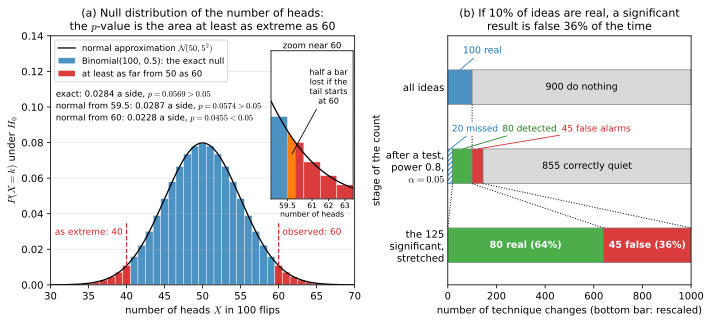
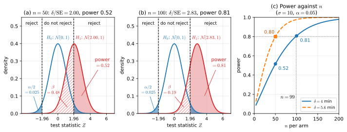
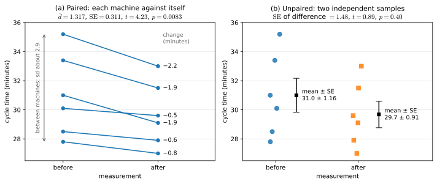

# Module 12 — Hypothesis Testing and Experiments

> After this module you can turn "is the new thing actually better?" into a test with a known false-alarm rate, size an experiment so that it can detect the effect you care about, and recognise when a "significant" result — in a clinical trial, an A/B test or a model leaderboard — is noise dressed up as discovery.

## Why this matters for ML and AI

Almost every claim in machine learning is a comparison under noise. A paper reports that its model beats the previous best by 0.4 accuracy points; a product team reports that the new ranking model lifted click-through by 1.2%; a pharmaceutical company reports that a drug reduced relapses from 30% to 20%. Each number was computed from a finite sample — a test set, two weeks of traffic, a few hundred patients — and would have come out differently with a different sample. Hypothesis testing is the discipline that asks, before you celebrate, *how differently?* Microsoft, Netflix, Booking.com and Amazon each run thousands of randomised experiments a year, and the people who built those platforms report that most ideas do not move the metric they were meant to move; without a statistical gate, a company would ship noise as fast as it ships improvements.

The same machinery guards the scientific side of ML. When you tune hyperparameters on a validation set, you are performing many comparisons and keeping the best — a textbook multiple-comparisons problem whose consequence (the chosen configuration's validation score is optimistically biased) is why a separate test set exists. When you compare two models on the same cross-validation folds, the per-fold scores are paired and correlated, which changes which test is valid. When you look at a running A/B test every day and stop as soon as it "hits significance", you inflate the false-positive rate several-fold — and early stopping on a validation curve is the same optional stopping in disguise. Deep reinforcement learning became famous for results that flipped with the random seed; the fix was not a better algorithm but more seeds and a proper test.

Finally, testing is where statistics meets decisions and ethics. A clinical trial that is too small to detect a real benefit wastes patients' participation; a trial that stops the first time the p-value dips below 0.05 fools its sponsors; a dashboard with twenty metrics will show a "significant" change in one of them by chance in two out of three experiments. This module gives you the logic (null, statistic, p-value, error rates, power), the standard tests (z, t, Welch, paired, chi-square, permutation, Mann–Whitney, McNemar), the corrections (Bonferroni, Holm, Benjamini–Hochberg, group-sequential boundaries) and the design principles (randomisation, blocking, pre-registration, power analysis) that make a comparison trustworthy — and it ends by applying all of them to the question "is my model really better?".

## Learning objectives

After working through this module you will be able to:

- State a null and alternative hypothesis, choose a test statistic, derive or simulate its null distribution, and compute an exact or approximate p-value — and explain precisely what that p-value does and does not mean.
- Show why a p-value is uniform under the null, use that fact to check a test or a pipeline by simulation, and explain why tests on discrete data are conservative.
- Distinguish type I and type II errors, read power as an area under the alternative, compute it analytically for a z-test, say how each of its four knobs moves it, plan the sample size or minimum detectable effect for an experiment, and explain why low power inflates significant estimates.
- Carry out one-sample, Welch two-sample and paired t-tests by hand and in `scipy.stats`, report Cohen's $d$ and a confidence interval alongside the p-value, and explain why pairing increases power.
- Test proportions and contingency tables with the two-proportion z-test, Pearson's chi-square test and Fisher's exact test, including expected counts and degrees of freedom.
- Implement a permutation test and a Mann–Whitney U test from scratch and say when they are preferable to t-tests.
- Use the duality between confidence intervals and tests, and set up an equivalence (TOST) or non-inferiority test with a pre-specified margin.
- Control the family-wise error rate with Bonferroni and Holm and the false discovery rate with Benjamini–Hochberg, and recognise p-hacking and the garden of forking paths.
- Design a randomised experiment: randomisation, control, blinding, blocking, A/A tests, guardrail metrics, and sample-size planning from power.
- Quantify how peeking at a running test inflates the false-positive rate and describe the group-sequential and Bayesian alternatives.
- Compare two machine-learning models properly with repeated cross-validation, the Nadeau–Bengio correction and McNemar's test, derive that correction from the correlation between resamples, explain why repeating cross-validation has a ceiling, and recognise when a benchmark difference is within noise.

## Prerequisites

You need the named distributions and the central limit theorem from [Module 08 — Distributions and limit theorems](../../part-3-probability/08-distributions-and-limit-theorems/README.md) (Binomial, Normal, Student-t, chi-square, and why a sample mean is approximately normal), sampling distributions, standard errors and confidence intervals from [Module 10 — Estimation and sampling](../10-estimation-and-sampling/README.md), and the likelihood and Bayesian vocabulary of [Module 11 — Likelihood and Bayesian inference](../11-likelihood-and-bayesian-inference/README.md) (we contrast p-values with posteriors and use Beta posteriors for Bayesian A/B testing). Bayes' theorem and the base-rate fallacy from [Module 07](../../part-3-probability/07-probability-foundations/README.md) explain why "significant" results are often false, and Simpson's paradox from [Module 09](../../part-3-probability/09-multivariate-probability/README.md) is the reason randomisation exists. Later modules lean on this one: [Module 13](../../part-5-learning-theory/13-linear-models-and-regularization/README.md) reads regression coefficients as t-statistics, [Module 15](../../part-5-learning-theory/15-generalization-and-learning-theory/README.md) explains the validation-set selection bias we meet in Section 7, and [Module 19](../../part-6-deep-learning-and-modern-ai/19-markov-decision-processes-and-rl/README.md) treats bandits — the adaptive experiments that Section 9 points towards.

## 1. The logic of a test: null, alternative, statistic, p-value

**Intuition.** A hypothesis test is an argument by contradiction conducted in the presence of noise. You provisionally adopt the dull explanation — the coin is fair, the drug does nothing, the two models are equally accurate — and ask: *if that were true, how surprising would data like mine be?* If the answer is "very surprising", you drop the dull explanation. The courtroom analogy is exact in every detail that matters. The defendant (the null hypothesis) is presumed innocent; the prosecution must produce evidence that would be very unlikely if the defendant were innocent; the verdict "not guilty" does not mean "proven innocent", only "not enough evidence"; and the jury can make two different mistakes — convicting an innocent person or acquitting a guilty one. Note what the court never computes: the probability that the defendant is innocent. Neither does a p-value.

**Definition.** The **null hypothesis** $H_0$ is the default claim, usually "no effect" or "no difference"; the **alternative** $H_1$ is what you hope to show. A **test statistic** $T$ is a number computed from the data that measures departure from $H_0$, chosen so that its **null distribution** — the sampling distribution of $T$ when $H_0$ is true — is known exactly or approximately. Writing $t_{\text{obs}}$ for its observed value, the **p-value** is

$$p = P_{H_0}\big(T \ge t_{\text{obs}}\big) \quad \text{(one-sided, large } T \text{ means evidence against } H_0\text{)}, \qquad p = P_{H_0}\big(|T| \ge |t_{\text{obs}}|\big) \quad \text{(two-sided)},$$

the probability, *computed assuming $H_0$*, of a result at least as extreme as the one observed. You fix a **significance level** $\alpha$ (conventionally $0.05$) *before* seeing the data and **reject** $H_0$ when $p \le \alpha$; equivalently, you reject when $t_{\text{obs}}$ falls in a **rejection region** $R$ with $P_{H_0}(T \in R) = \alpha$. Four things a p-value is **not**: it is not $P(H_0 \mid \text{data})$; it is not the probability that the result "is due to chance"; it is not the probability that a replication would succeed; and $1 - p$ is not the probability that $H_1$ is true. It is a statement about the data given the hypothesis, never the reverse — to get the reverse you need a prior and Bayes' theorem (Module 11).

One fact organises everything that follows. If $T$ is continuous with null CDF $F_0$, then under $H_0$ the (one-sided) p-value $p = 1 - F_0(T)$ is **uniformly distributed on $[0, 1]$**. Hence $P_{H_0}(p \le \alpha) = \alpha$: the false-alarm rate of the procedure is exactly $\alpha$ by construction.

*Why the p-value is uniform.* Take $F_0$ strictly increasing, so that it has an inverse. Then

$$P_{H_0}(p \le \alpha) = P_{H_0}\big(F_0(T) \ge 1 - \alpha\big) = P_{H_0}\big(T \ge F_0^{-1}(1 - \alpha)\big) = 1 - F_0\big(F_0^{-1}(1 - \alpha)\big) = \alpha.$$

In words: rejecting when $p \le \alpha$ *is* rejecting when $T$ exceeds the $(1 - \alpha)$-quantile of its null distribution, and by the definition of a quantile a fraction $\alpha$ of null draws do that. Equivalently, $F_0(T) \sim \text{Uniform}(0, 1)$. This is the *probability integral transform*, which is inverse-CDF sampling ([Module 07](../../part-3-probability/07-probability-foundations/README.md)) run backwards. A two-sided p-value is the same statement applied to the statistic $|T|$.

*What uniform looks like.* A p-value is a statistic like any other, so it has a sampling distribution ([Module 10](../10-estimation-and-sampling/README.md)). Across many experiments in which $H_0$ holds, its histogram is flat: 5% of the p-values fall below $0.05$, 5% between $0.05$ and $0.10$, 5% above $0.95$. This flat line is the standard check of a test or a pipeline: simulate data under $H_0$ or run A/A tests (Section 8), histogram the p-values and look. A bump near 0 means more false alarms than $\alpha$ promises, usually because the standard error is too small or the observations are less independent than the test assumes. A bump near 1 means that the test is conservative. The lesson's 20,000 simulated t-tests draw the flat histogram and print the fraction below $\alpha$.

*Under the alternative.* The histogram tilts towards 0, and the area to the left of $\alpha$ is the power (Section 2): at power $0.8$ in a two-sided z-test, 80% of the p-values land below $0.05$ and 59% below $0.01$. The shape of this *p-curve* across a published literature is one way to detect p-hacking (Simonsohn, Nelson and Simmons, 2014; Section 7): real effects make it fall away steeply from 0, whereas analyses nudged over the line make it pile up just below $0.05$.

*Discrete statistics.* For a binomial count the p-value can take only a few values, so its null distribution is a staircase rather than a straight line. For the coin of the worked example below, $p$ is one of the numbers $P_{H_0}(|X - 50| \ge c)$: $0.0886$ for $c = 9$, $0.0569$ for $c = 10$, $0.0352$ for $c = 11$, and so on, with nothing in between. So $P_{H_0}(p \le 0.05) = 0.0352$, not $0.05$. At each attainable value $v$ we still have $P_{H_0}(p \le v) = v$, and between those values the probability does not change, so in general $P_{H_0}(p \le \alpha) \le \alpha$: the test is *conservative*, keeping its promise without using all of it. That is why the exact rule of the worked example has size $0.035$, and why Fisher's exact test (Section 4) is conservative. The *mid-p* value counts only half the probability of the observed outcome, $0.0352 + \tfrac12(0.0569 - 0.0352) = 0.0460$ for 60 heads, and trades the guarantee for less conservatism: the rule "reject if mid-p $\le 0.05$" has true size $0.0569$ here.

*Where it is used later.* Benjamini–Hochberg (Section 7) works because $m_0$ uniform null p-values put an expected $m_0 t$ of them below any threshold $t$. Peeking (Section 9) is this fact failing: the smallest p-value over 20 looks is not uniform, and it falls below $0.05$ about a quarter of the time.

**Worked example (is a coin fair after 60 heads in 100 flips?).** $H_0: \theta = 0.5$ against $H_1: \theta \ne 0.5$, with $T = X$, the number of heads. Under $H_0$, $X \sim \text{Binomial}(100, 0.5)$: mean $50$, standard deviation $\sqrt{100 \times 0.25} = 5$. The exact upper tail is

$$P_{H_0}(X \ge 60) = \sum_{k=60}^{100} \binom{100}{k} 2^{-100} = 0.0284,$$

and by symmetry the two-sided p-value is $2 \times 0.0284 = 0.0569$. The normal approximation gives $z = (60 - 50)/5 = 2.00$ and $p = 2\,(1 - \Phi(2)) = 0.0455$; with the continuity correction, $z = (59.5 - 50)/5 = 1.90$ and $p = 0.0574$, very close to the exact answer. Figure 1(a) draws all three: the bar at 60 starts at 59.5, so a normal tail that starts at 60 leaves out half a bar, which is what the correction repairs. At $\alpha = 0.05$ the exact test does *not* reject, while the uncorrected approximation would — approximations matter precisely at the boundary. Because $X$ is discrete, no rejection region has size exactly $0.05$: the region $|X - 50| \ge 10$ has size $0.0569$ (too big), so the exact level-0.05 rule is "reject if $X \le 39$ or $X \ge 61$", whose true size is $0.0352$. The honest report is "60/100 heads, two-sided exact $p = 0.057$", not a verdict.

**Real-life example (sport).** A tennis player who has won 50% of second-serve points all season switches technique and wins 60 of the next 100. The coach sees proof; the p-value of $0.057$ says that a 50% server produces a run this lopsided, in one direction or the other, about once in every 18 blocks of 100 points by luck alone. The claim is not refuted — it is merely not yet demonstrated, and Section 2 will show that 100 points is far too few to tell a 60% server from a 50% one reliably. Now add the base-rate lesson of Module 07: if only 10% of technique changes genuinely help, and tests have power $0.8$ at $\alpha = 0.05$, then among all "significant" improvements the fraction that are real is $\frac{0.8 \times 0.1}{0.8 \times 0.1 + 0.05 \times 0.9} = 0.64$ — so more than a third of the results that clear $p \le 0.05$ are changes that did nothing, as Figure 1(b) counts out. That is why $p$ is not $P(H_0 \mid \text{data})$.

**Figure 1.** What a p-value is (a) and what it is not (b). (a) The exact null for the coin, Binomial(100, 0.5), with the normal approximation $\mathcal N(50, 5^2)$ on the bar tops. The p-value is the red area: every outcome at least as far from 50 as the observed 60, so $k \ge 60$ or $k \le 40$, which is $0.0284$ a side and $p = 0.0569$ in all. The three-line list compares the two normal tails: from 59.5 it gives $p = 0.0574$, close to the exact value, and from 60 it gives $p = 0.0455$, on the wrong side of $0.05$. The inset shows why the second is too small: the bar at 60 starts at 59.5, so a tail that starts at 60 loses the orange slice, half a bar. (b) The base-rate calculation as counts: 1,000 technique changes, of which 100 are real (top bar). A test with power $0.8$ at $\alpha = 0.05$ misses 20 of the real ones (hatched), detects 80 (green), raises 45 false alarms among the other 900 (red) and stays correctly quiet on the remaining 855. Stretching the 125 significant results to full width (dotted lines) gives the bottom bar: 80 real (64%) and 45 false (36%). Every test kept its false-alarm rate at 5%, yet 36% of the significant results are false, because $P(\text{significant} \mid H_0)$ and $P(H_0 \mid \text{significant})$ are different numbers.

**In ML/AI this is …** the champion–challenger evaluation of a deployed model (null: the challenger is no better; statistic: the metric difference on held-out traffic); the drift monitor that compares a feature's distribution in production with its training distribution using a two-sample Kolmogorov–Smirnov test (`scipy.stats.ks_2samp`) and raises an alert at $p < 0.01$; and `sklearn.model_selection.permutation_test_score`, which asks whether a model's cross-validated score is surprising under the null that labels carry no information (Section 5).

## 2. Errors and power

**Intuition.** A test is a decision rule, and every decision rule has two failure modes: crying wolf (rejecting a true null) and missing the wolf (keeping a false null). You can make either one rare by shifting the threshold, but only at the expense of the other — unless you collect more data, which shrinks both. **Power** is the probability of catching a real effect of a given size; an experiment with low power is a coin flip dressed as science, and "we found no significant difference" from such an experiment carries almost no information.

**Definition.** With a fixed rule, the four possible outcomes are

| | $H_0$ true | $H_1$ true |
|---|---|---|
| Reject $H_0$ | **Type I error**, probability $\alpha$ (false positive) | Correct detection, probability $1 - \beta$ = **power** (true positive) |
| Do not reject | Correct, probability $1 - \alpha$ (true negative) | **Type II error**, probability $\beta$ (false negative) |

Power depends on four knobs: the true **effect size** $\delta$, the noise $\sigma$, the sample size $n$ and the level $\alpha$. For the two-sample z-test of means with known $\sigma$, $n$ per arm and a two-sided level $\alpha$, the difference of sample means has standard error $\text{SE} = \sigma\sqrt{2/n}$ and the statistic $Z = (\bar X_1 - \bar X_2)/\text{SE}$ is $\mathcal N(\delta/\text{SE}, 1)$ under $H_1$. We reject when $|Z| > z_{1-\alpha/2}$, so

$$1 - \beta = \Phi\!\left(\frac{\delta}{\sigma\sqrt{2/n}} - z_{1-\alpha/2}\right) + \Phi\!\left(-\frac{\delta}{\sigma\sqrt{2/n}} - z_{1-\alpha/2}\right) \approx \Phi\!\left(\frac{\delta}{\sigma\sqrt{2/n}} - z_{1-\alpha/2}\right),$$

where $\Phi$ is the standard normal CDF and the second term (rejecting in the wrong direction) is negligible unless the effect is tiny. Setting the main term equal to $1 - \beta$ gives $\delta/\text{SE} = z_{1-\alpha/2} + z_{1-\beta}$ and hence the two formulas every experimenter memorises:

$$n_{\text{per arm}} = \frac{2\,(z_{1-\alpha/2} + z_{1-\beta})^2\,\sigma^2}{\delta^2}, \qquad \delta_{\min} = (z_{1-\alpha/2} + z_{1-\beta})\,\sigma\sqrt{2/n}.$$

$\delta_{\min}$ is the **minimum detectable effect** (MDE) at the chosen power. For $\alpha = 0.05$ and power $0.8$, $z_{0.975} + z_{0.8} = 1.960 + 0.842 = 2.802$ and $(2.802)^2 \approx 7.85$: so $n \approx 15.7\,\sigma^2/\delta^2$ per arm.

*Where the standard error comes from.* Each sample mean has variance $\sigma^2/n$ ([Module 10](../10-estimation-and-sampling/README.md)), and the variances of independent quantities add, so $\operatorname{Var}(\bar X_1 - \bar X_2) = 2\sigma^2/n$ and $\text{SE} = \sigma\sqrt{2/n}$. The difference has mean 0 under $H_0$ and mean $\delta$ under $H_1$. Dividing by SE gives variance 1 in both cases and moves the mean to $\mu = \delta/\text{SE}$ under $H_1$: two unit-variance curves, one centred on 0 and one on $\mu$, which is the picture in Figure 2(a).

*Reading power off the picture.* Power is the area of the $H_1$ curve inside the rejection region. Writing $z$ for $z_{1-\alpha/2}$ and standardising, $P(Z > z) = P(Z - \mu > z - \mu) = 1 - \Phi(z - \mu) = \Phi(\mu - z)$, the main term of the formula. The other side gives $P(Z < -z) = \Phi(-z - \mu)$, the second term. The area between the two lines is $\beta$. Since the curve is centred on $\mu$, power is about $0.5$ when $\mu = z$: an effect that sits right on the line is detected half the time.

*The four knobs.* Each one acts through $\mu$ or through the line. Starting from the worked example below ($\delta = 4$, $\sigma = 10$, $n = 50$, $\alpha = 0.05$, so $\mu = 2$ and power $0.52$):

- *Effect $\delta$.* A larger effect slides the $H_1$ curve to the right: $\delta = 8$ gives $\mu = 4$ and power $0.98$.
- *Noise $\sigma$.* More noise slides it back: $\sigma = 20$ gives $\mu = 1$ and power $0.17$, while $\sigma = 5$ gives $\mu = 4$ and power $0.98$. Reducing variance (pairing in Section 3, blocking in Section 8) is therefore worth as much as collecting more data.
- *Sample size $n$.* More data shrinks SE: $n = 200$ gives $\mu = 4$ and power $0.98$.
- *Level $\alpha$.* A larger $\alpha$ moves the line towards the centre, so power and false alarms rise together: $\alpha = 0.10$ (line at $1.645$) gives power $0.64$, and $\alpha = 0.01$ (line at $2.576$) gives $0.28$. This is the trade-off in the table above. The other three knobs raise power without paying in false alarms.

*The square-root law.* Since $\mu = \delta\sqrt{n}/(\sigma\sqrt{2})$, it is the signal-to-noise ratio $\mu$ that grows with $\sqrt{n}$, not power itself, which is $\Phi$ of it and levels off at 1. Quadrupling $n$ doubles $\mu$, which is why doubling $\delta$, halving $\sigma$ and quadrupling $n$ all gave the same power above. Setting $\mu = z_{1-\alpha/2} + z_{1-\beta}$ and solving for $n$ gives the memorised formula, in which $\delta$ appears squared: halve the effect you want to detect and the sample quadruples ($98.1$ per arm for $\delta = 4$, $392.4$ for $\delta = 2$). The same cost of precision drives the interval widths of [Module 10](../10-estimation-and-sampling/README.md) (Section 7) and the test-set sizes of [Module 15](../../part-5-learning-theory/15-generalization-and-learning-theory/README.md) (Section 10).

*Where $0.842$ comes from.* $z_{0.8} = \Phi^{-1}(0.8) = 0.842$ is the point with 80% of a standard normal to its left. For 80% power, the line at $1.96$ must leave $\beta = 20\%$ of the $H_1$ curve on its left, so the line sits $0.842$ below the curve's centre: $\mu = 1.96 + 0.842$. For 90% power use $z_{0.9} = 1.282$. The multiplier becomes $(1.96 + 1.282)^2 = 10.5$ instead of $7.85$, so a third more data, $n \approx 21\,\sigma^2/\delta^2$.

*In practice.* With `from scipy.stats import norm`, power is `norm.cdf(mu - norm.ppf(0.975)) + norm.cdf(-mu - norm.ppf(0.975))` for `mu = delta / se`; the lesson's `power_two_sample_z`, `n_per_arm` and `mde` wrap the three formulas. For proportions, $\sigma^2$ becomes $\theta(1 - \theta)$ in each arm (Section 8, Case study 1). Then confirm by simulation, as the lesson's `simulated_power` does: generate 5,000 experiments at the planned $n$ and count rejections, which pins a power near $0.8$ down to about $\pm 0.01$ ($2\sqrt{0.8 \times 0.2/5000} = 0.011$). A slip in the formula, such as a forgotten factor of 2 in SE, is invisible otherwise.

**Worked example.** Two production lines, $\sigma = 10$ minutes, and we care about a difference of $\delta = 4$ minutes. With $n = 50$ per arm, $\text{SE} = 10\sqrt{2/50} = 2.0$, $\delta/\text{SE} = 2.0$, and power $= \Phi(2.0 - 1.96) + \Phi(-2.0 - 1.96) = \Phi(0.04) + \Phi(-3.96) = 0.516 + 0.00004 \approx 0.52$: a real 4-minute improvement is detected only half the time (Figure 2(a)). With $n = 100$, $\text{SE} = 1.414$, $\delta/\text{SE} = 2.83$, power $= \Phi(0.87) = 0.81$ (Figure 2(b)). The required $n$ for 80% power is $2 \times 7.85 \times 100 / 16 = 98.1$, so 99 per arm. Conversely, with $n = 50$ fixed the MDE is $2.802 \times 2.0 = 5.6$ minutes. Figure 2(c) marks both answers. For the coin of Section 1 with the exact rule "reject if $X \le 39$ or $X \ge 61$" ($\alpha = 0.035$): if the coin really lands heads 60% of the time, power $= P_{0.6}(X \ge 61) + P_{0.6}(X \le 39) = 0.46$ — a 60/40 coin escapes detection more often than not with 100 flips. The normal-approximation formula $(1.96\sqrt{0.25} + 0.842\sqrt{0.24})^2/0.1^2$ says that about 194 flips are needed for 80% power, and the exact test's granularity pushes this to roughly 210, the point from which its power stays above $0.8$. A 70/30 coin is caught with power $0.98$ at 100 flips.

**Figure 2.** Power as an area, for the two production lines ($\sigma = 10$, $\delta = 4$). (a) $n = 50$: $\text{SE} = 2.0$, so $Z$ is $\mathcal N(0, 1)$ under $H_0$ (blue) and $\mathcal N(2.00, 1)$ under $H_1$ (red). The dashed lines at $\pm 1.96$ separate "reject" from "do not reject". The blue tails are $\alpha/2 = 0.025$ each, the solid red fill beyond $1.96$ is the power $0.52$, and the red hatching between the lines is $\beta = 0.48$. The line cuts the red curve almost at its peak, which is why the power is close to a half. The wrong-direction lobe $\Phi(-3.96) = 0.00004$ is too small to see. (b) $n = 100$: $H_0$ is unchanged, but SE has fallen to $1.414$, so $H_1$ has slid right to $\mathcal N(2.83, 1)$: power $0.81$, $\beta = 0.19$. (c) Power against $n$ per arm. The solid curve for $\delta = 4$ passes through the dots at $0.52$ and $0.81$ and crosses the dotted $0.8$ line at $n = 99$. The dashed curve for $\delta = 5.6$, the MDE at $n = 50$, reaches $0.80$ at $n = 50$ (the square).

*What low power does to an estimate.* Two things go wrong in an underpowered study. "Not significant" is close to uninformative (pitfall 2), because at power $0.52$ a real effect is missed almost half the time. And a significant estimate is biased upwards, because only estimates beyond $1.96\,\text{SE}$ get called significant. In Figure 2(a) these are the red-filled part of the $H_1$ curve, whose mean is $\mu + \varphi(1.96 - \mu)/\Phi(\mu - 1.96) = 2.77$ instead of $\mu = 2$, where $\varphi$ is the standard normal density. In minutes, the average significant estimate at $n = 50$ is $2.77 \times 2.0 = 5.5$, overstating the true 4 by 39%. At $n = 100$ it is $3.17 \times 1.414 = 4.5$, an overstatement of 12%. This is the *winner's curse* that the next example meets in published trials.

**Real-life example (clinical trials and A/B tests).** Suppose a new therapy raises the response rate from 20% to 30%. A trial with 60 patients per arm has power of only about $0.24$ at $\alpha = 0.05$; roughly 294 per arm are needed for 80% (Section 8 gives the proportion version of the sample-size formula; Case study 1 works this trial through). Underpowered trials are common — a well-known 2013 survey of neuroscience studies estimated a median power around 20% — and they are doubly harmful: they usually miss real effects, and when they do "find" something, the estimated effect is inflated because only lucky, large estimates cross the threshold (the *winner's curse*). The A/B-test version: with 2,000 users per arm and a 5% baseline conversion, the MDE at 80% power is $2.802\sqrt{2 \times 0.05 \times 0.95/2000} \approx 0.019$, i.e. 1.9 percentage points or a 39% relative lift. A test like that "finding nothing" about a 10% relative improvement has found nothing about anything.

**In ML/AI this is …** the ROC curve, which is literally a plot of power (true-positive rate) against $\alpha$ (false-positive rate) as the decision threshold sweeps through every possible rejection region; the Neyman–Pearson lemma, which says that for a simple null against a simple alternative (two fully specified distributions) the likelihood-ratio test is the most powerful test at every $\alpha$ — the reason the Bayes-optimal classifier thresholds the likelihood ratio (or the posterior) and why no other scoring of the same features can have a better ROC; and test-set sizing: to detect a 1-percentage-point accuracy difference between two models near 90% accuracy with *unpaired* test sets you need $2 \times 7.85 \times 0.09/0.0001 \approx 14{,}000$ examples per model, which is why Section 10 insists on paired comparisons.

## 3. One-sample and two-sample tests for means

**Intuition.** The z-test assumes you know the noise level $\sigma$; in practice you estimate it from the same small sample, and that estimate is itself noisy. Student's t-distribution is the honest correction: it has heavier tails than the normal, so the same statistic needs to be a little larger to count as surprising, and the correction fades as $n$ grows. Two further design facts dominate practice: when two groups may have different variances, Welch's version is the safe default; and when each measurement in one group has a natural partner in the other (the same patient before and after, the same fold for two models), analysing the *differences* removes the shared variation and can increase power enormously.

**Definition.** For a sample $x_1, \dots, x_n$ with mean $\bar x$ and sample variance $s^2 = \frac{1}{n-1}\sum_i (x_i - \bar x)^2$, the **one-sample t-test** of $H_0: \mu = \mu_0$ uses

$$t = \frac{\bar x - \mu_0}{s/\sqrt n} \sim t_{n-1} \ \text{ under } H_0 \text{ (for normal data)},$$

where $t_\nu$ denotes Student's distribution with $\nu$ degrees of freedom; its 97.5% quantile is $2.571$ for $\nu = 5$, $2.042$ for $\nu = 30$ and tends to $1.960$ as $\nu \to \infty$. For two independent samples, **Welch's t-test** uses

$$t = \frac{\bar x_1 - \bar x_2}{\sqrt{s_1^2/n_1 + s_2^2/n_2}}, \qquad \nu = \frac{\left(s_1^2/n_1 + s_2^2/n_2\right)^2}{\dfrac{(s_1^2/n_1)^2}{n_1 - 1} + \dfrac{(s_2^2/n_2)^2}{n_2 - 1}}$$

(the Welch–Satterthwaite degrees of freedom). The older **Student two-sample test** pools the variances, $s_p^2 = \frac{(n_1 - 1)s_1^2 + (n_2 - 1)s_2^2}{n_1 + n_2 - 2}$, uses $t = (\bar x_1 - \bar x_2)/(s_p\sqrt{1/n_1 + 1/n_2})$ with $\nu = n_1 + n_2 - 2$, and is only valid when the two population variances are equal; with unequal variances *and* unequal sample sizes its real type I error can be far from $\alpha$, while Welch's test loses almost nothing when the variances happen to be equal — hence the recommendation to use Welch by default (`scipy.stats.ttest_ind(..., equal_var=False)`). The **paired t-test** forms differences $d_i = x_i - y_i$ and applies the one-sample test to them: $t = \bar d/(s_d/\sqrt n)$ with $\nu = n - 1$. Pairing helps because $\operatorname{Var}(\bar x - \bar y) = (\sigma_x^2 + \sigma_y^2 - 2\rho\,\sigma_x\sigma_y)/n$; a positive correlation $\rho$ between partners subtracts from the variance, whereas the unpaired analysis has no covariance term to subtract. Finally, the p-value conflates effect and sample size — for equal $n$ per group, $t = d\sqrt{n/2}$ — so always report the standardised effect size **Cohen's $d$** $= (\bar x_1 - \bar x_2)/s_p$ (rules of thumb: $0.2$ small, $0.5$ medium, $0.8$ large) and a confidence interval $(\bar x_1 - \bar x_2) \pm t_{1-\alpha/2,\nu}\,\text{SE}$. Assumptions: independent observations within and between groups, and approximately normal data or $n$ large enough for the CLT; the t-test is robust to moderate non-normality for $n \gtrsim 30$ per group but not to heavy tails and outliers (Section 5 has the remedy).

**Worked example (does the new process reduce cycle time?).** Cycle times in minutes. Old process ($n_1 = 8$): $52, 48, 55, 50, 53, 49, 51, 54$, so $\bar x_1 = 51.5$, $s_1^2 = 6.0$. New process ($n_2 = 6$): $47, 50, 44, 49, 46, 48$, so $\bar x_2 = 47.33$, $s_2^2 = 4.667$. Then $\text{SE} = \sqrt{6/8 + 4.667/6} = \sqrt{0.750 + 0.778} = 1.236$, $t = 4.167/1.236 = 3.37$, and

$$\nu = \frac{1.528^2}{0.750^2/7 + 0.778^2/5} = \frac{2.335}{0.0804 + 0.1210} = 11.6, \qquad p = 2\,P(t_{11.6} \ge 3.37) = 0.0058.$$

The 95% confidence interval is $4.17 \pm 2.187 \times 1.236 = [1.46,\ 6.87]$ minutes, and Cohen's $d = 4.167/2.333 = 1.79$ with $s_p = \sqrt{(7 \times 6 + 5 \times 4.667)/12} = 2.333$ — a large effect. (Student's pooled test gives $t = 3.31$, $\nu = 12$, $p = 0.0063$: nearly identical here because the variances are similar.) Now a *paired* design: six machines measured before and after a maintenance change, before $= 31.0, 28.5, 35.2, 30.1, 27.8, 33.4$ and after $= 29.1, 27.9, 33.0, 29.6, 27.0, 31.5$. The differences are $1.9, 0.6, 2.2, 0.5, 0.8, 1.9$ with $\bar d = 1.317$, $s_d = 0.763$, $\text{SE} = 0.763/\sqrt 6 = 0.311$, so $t = 4.23$ on $\nu = 5$ and $p = 0.0083$. Feeding the same twelve numbers into an *unpaired* Welch test gives $t = 0.89$, $p = 0.40$: the machine-to-machine spread (about 2.9 minutes) swamps the within-machine change, and only pairing — the before/after correlation is $0.98$ — removes it. Figure 3 sets the two analyses side by side.

**Figure 3.** The same twelve numbers analysed two ways. (a) Paired: six lines, one per machine, each falling from its before value to its after value, with the change printed at the right-hand end ($-0.5$ to $-2.2$ minutes). The machines start anywhere from 27.8 to 35.2 minutes (sd about 2.9), yet the test looks only at the changes, which vary far less ($s_d = 0.763$): $\bar d = 1.317$, $\text{SE} = 0.311$, $t = 4.23$, $p = 0.0083$. (b) Unpaired: the lines are gone, and the same values form two overlapping clouds with mean $\pm$ SE bars of $31.0 \pm 1.16$ and $29.7 \pm 0.91$. The gap between the means is the same $1.317$, but its standard error is now $\sqrt{1.165^2 + 0.913^2} = 1.48$, nearly five times as large, giving $t = 0.89$, $p = 0.40$. The covariance term of the paired-variance formula accounts for the difference: out of $s_x^2 + s_y^2 = 8.140 + 5.006$ it removes $2 r s_x s_y = 12.564$, leaving $0.582$, and $\sqrt{0.582/6} = 0.311$.

**Real-life example (manufacturing).** A plant trials a new fixture on a subset of its presses. The Welch result above would be reported as "the new process is 4.2 minutes faster per cycle (95% CI 1.5 to 6.9 minutes; $d = 1.8$; $p = 0.006$)" — effect, uncertainty and verdict together. The paired version is the standard design for any intervention on existing equipment, patients or users: measure each unit before and after, and let each unit be its own control. Its weakness is also visible: if something *else* changed between the before and after measurements (a season, a new operator), the paired design cannot separate it from the intervention — only a randomised control group can (Section 8).

**In ML/AI this is …** `scipy.stats.ttest_rel(scores_a, scores_b)` on the per-fold cross-validation scores of two models — the folds are shared, so the scores are paired and positively correlated, and the paired test is the right starting point (with the caveat of Section 10 that the folds are not independent); the $t$-statistic $\hat\beta_j/\widehat{\text{SE}}(\hat\beta_j)$ printed next to every regression coefficient in a statistics package, which tests $H_0: \beta_j = 0$ ([Module 13](../../part-5-learning-theory/13-linear-models-and-regularization/README.md)); and the error bars over random seeds that any credible deep-learning result carries.

## 4. Tests for proportions and categorical data

**Intuition.** Conversion rates, click rates, response rates, side-effect rates, error rates: a huge share of applied testing concerns proportions, i.e. means of 0/1 variables. The binomial variance $\theta(1 - \theta)$ is known once $\theta$ is, so the tests are z-tests with no separate variance to estimate. When the outcome has more than two categories, or you want to know whether two categorical variables are related at all, the chi-square test compares the counts you observed with the counts you would expect under independence.

**Definition.** For two independent samples with $x_1$ successes in $n_1$ trials and $x_2$ in $n_2$, let $\hat\theta_i = x_i/n_i$ and the pooled rate $\bar\theta = (x_1 + x_2)/(n_1 + n_2)$. The **two-proportion z-test** of $H_0: \theta_1 = \theta_2$ uses

$$z = \frac{\hat\theta_2 - \hat\theta_1}{\sqrt{\bar\theta(1 - \bar\theta)\left(\frac{1}{n_1} + \frac{1}{n_2}\right)}} \ \stackrel{H_0}{\approx}\ \mathcal N(0, 1),$$

pooling because under $H_0$ both samples share one rate; the confidence interval for $\theta_2 - \theta_1$ instead uses the unpooled standard error $\sqrt{\hat\theta_1(1 - \hat\theta_1)/n_1 + \hat\theta_2(1 - \hat\theta_2)/n_2}$. For an $r \times c$ contingency table with observed counts $O_{ij}$, row totals $R_i$, column totals $C_j$ and grand total $N$, **Pearson's chi-square test of independence** compares the observed counts with the counts expected if row and column variables were independent:

$$E_{ij} = \frac{R_i\,C_j}{N}, \qquad \chi^2 = \sum_{i,j} \frac{(O_{ij} - E_{ij})^2}{E_{ij}} \ \stackrel{H_0}{\approx}\ \chi^2_{(r-1)(c-1)} .$$

The degrees of freedom count the free cells once the margins are fixed. For a $2 \times 2$ table, $\chi^2 = z^2$ exactly — the two tests are the same test — and the 5% critical value is $\chi^2_{1,0.95} = 3.841 = 1.96^2$. The approximation needs expected counts of roughly 5 or more in every cell; for small tables use **Fisher's exact test**, which conditions on the margins and computes the hypergeometric probability of tables at least as extreme (`scipy.stats.fisher_exact`). Yates's continuity correction (subtracting $0.5$ from each $|O - E|$) makes the chi-square test more conservative in small samples.

**Worked example (conversion by variant).** Variant A: $200$ conversions in $4{,}000$ visitors ($5.0\%$); variant B: $240$ in $4{,}000$ ($6.0\%$). Pooled rate $\bar\theta = 440/8000 = 0.055$, so $\text{SE}_0 = \sqrt{0.055 \times 0.945 \times (2/4000)} = 0.00510$ and $z = 0.010/0.00510 = 1.96$, two-sided $p = 0.0498$. As a $2 \times 2$ table (rows A, B; columns converted, not), each row has total 4,000 and the columns total 440 and 7,560, so every expected count is $E = 220$ or $3{,}780$:

$$\chi^2 = \frac{(200 - 220)^2}{220} + \frac{(3800 - 3780)^2}{3780} + \frac{(240 - 220)^2}{220} + \frac{(3760 - 3780)^2}{3780} = 1.818 + 0.106 + 1.818 + 0.106 = 3.85 = z^2 \ \text{ (with } z = 1.962\text{)},$$

with 1 degree of freedom and the same $p = 0.0498$. The 95% interval for the lift is $0.010 \pm 1.96 \times 0.00510 = [0.00001,\ 0.0200]$ — it excludes zero by a hair, as the duality of Section 6 predicts when a test and an interval share a standard error. Here the pooled and unpooled values both round to $0.00510$, so the two agree. The scientifically honest summary is "a lift of 1.0 percentage point, between essentially 0 and 2.0 points".

**Real-life example (side effects by treatment arm).** In a trial, 30 of 200 treated patients report nausea against 18 of 200 on placebo (15% vs 9%). Expected counts under independence are $24$ and $176$ per row; $\chi^2 = 2 \times 36/24 + 2 \times 36/176 = 3.00 + 0.41 = 3.41$, $p = 0.065$; with Yates's correction $\chi^2 = 2.86$, $p = 0.091$; Fisher's exact test gives $p = 0.090$. None reaches $0.05$ — yet the 95% interval for the excess rate, $0.06 \pm 1.96 \times 0.0324 = [-0.3,\ 12.3]$ percentage points, is compatible with a clinically important doubling of nausea. A safety analysis that stops at "not significant" has misread the evidence; safety signals are a setting where the asymmetry of errors argues for a larger $\alpha$ or, better, for reporting intervals.

**In ML/AI this is …** the two-proportion z-test comparing the error rates of two classifiers evaluated on *different* test sets (on the same test set, use McNemar — Section 10); `sklearn.feature_selection.chi2`, which scores each non-negative feature by a chi-square statistic against the class labels; fairness audits, which test whether a model's error rate is independent of a protected attribute with exactly this contingency table; and label-shift checks that compare class proportions between training data and production with a chi-square goodness-of-fit test.

## 5. Nonparametric and resampling tests

**Intuition.** The permutation test is the cleanest idea in statistics. If the treatment did nothing, the labels "A" and "B" are just names stuck on exchangeable observations — so shuffle the labels, recompute your statistic, and repeat. The spread of recomputed statistics *is* the null distribution, obtained with no normality assumption, no formula and no table, for *any* statistic you care to define (a difference of means, of medians, of trimmed means, an AUC). Rank-based tests such as Mann–Whitney are permutation tests on the ranks, and the bootstrap gives you confidence intervals and tests for statistics with no tractable sampling distribution.

**Definition.** Let $T$ be any statistic of two samples $A$ (size $n_1$) and $B$ (size $n_2$), and suppose $H_0$ says the two samples come from the same distribution. Then all $\binom{n_1 + n_2}{n_1}$ ways of splitting the pooled data into groups of sizes $n_1$ and $n_2$ are equally likely under $H_0$, and the **exact permutation p-value** is the fraction of splits whose statistic is at least as extreme as the observed one. When enumeration is infeasible, draw $B$ random permutations and use the Monte Carlo estimate

$$\hat p = \frac{1 + \#\{b : T^{(b)} \ge t_{\text{obs}}\}}{B + 1},$$

where the $+1$ counts the observed arrangement itself and keeps the test valid (it never produces $\hat p = 0$). The **Mann–Whitney U test** (equivalently the Wilcoxon rank-sum test) uses the statistic $U = \sum_{i}\sum_{j}\big[\mathbf 1(a_i > b_j) + \tfrac12 \mathbf 1(a_i = b_j)\big]$, the number of cross-pairs in which $A$ beats $B$; under $H_0$ it has mean $n_1 n_2/2$ and, without ties, variance $n_1 n_2 (n_1 + n_2 + 1)/12$, and it tests whether $P(A > B) = 1/2$ — a shift of the whole distribution rather than of the mean specifically. For normal data it has about 95% of the t-test's efficiency ($3/\pi$ asymptotically); for heavy-tailed data it is far better. A **bootstrap test** for a difference of means shifts each sample to the common pooled mean, resamples *within* each group with replacement, and reads the p-value off the resampled statistics; more commonly one simply forms a bootstrap confidence interval for the difference (Module 10) and checks whether it covers 0. The subtle distinction: the permutation test assumes exchangeability under $H_0$ (identical distributions), while the bootstrap targets the specific parameter.

**Worked example.** $A = \{12, 15, 11\}$, $B = \{9, 8, 10\}$; $t_{\text{obs}} = \bar a - \bar b = 12.67 - 9.00 = 3.67$. There are $\binom{6}{3} = 20$ splits of the six numbers into two groups of three. Listing them (Figure 4(a) plots all twenty), the differences of means range from $-3.67$ to $3.67$, and only the observed split achieves $3.67$ or more, so the one-sided exact p-value is $1/20 = 0.05$ and the two-sided p-value (splits with $|T| \ge 3.67$: the observed one and its mirror image) is $2/20 = 0.10$. Note the granularity: with three observations per group the smallest possible two-sided p-value is $0.10$, so "significance at 5%" is unattainable no matter how the data look. In general, with $n$ observations in each of two groups the floor is $2/\binom{2n}{n}$, which first drops below $0.05$ at $n = 4$ ($2/70 = 0.029$; Figure 4(b)). Mann–Whitney: every one of the $9$ cross-pairs has the $A$ value larger, so $U = 9$ (its maximum), and the exact two-sided p-value is again $2/20 = 0.10$. Welch's t-test on the same six numbers returns $p = 0.074$ — a number that leans on the normality of three points and should not be preferred.

**Figure 4.** (a) The difference of means for each of the 20 splits of $\{8, 9, 10, 11, 12, 15\}$ into two groups of three, one dot per split. Only 12 values occur, from $-3.67$ to $3.67$. The observed split $\{12, 15, 11\}$ vs $\{9, 8, 10\}$ is the filled dot at the right-hand extreme, and its mirror image, the same split with the labels swapped, is the ring at the left. The exact p-values can be counted off: one dot of 20 at or beyond $3.67$ gives $p = 1/20$ one-sided, and two dots of 20 with $|T| \ge 3.67$ give $p = 2/20$ two-sided. (b) How low a two-sided p-value can go with $n$ observations in each group. Each bar hangs from 1 down to the smallest attainable value, $2/\binom{2n}{n}$, on a log axis. For $n = 2$ and $n = 3$ (hatched) the bar stops above the dashed $\alpha = 0.05$ line: at $n = 3$, the worked example, the floor is $0.10$, so no data could reach significance at 5%. From $n = 4$ ($2/70 = 0.0286$) the bars cross the line, and by $n = 8$ the floor is $0.000155$.

**Real-life example (e-commerce revenue and insurance claims).** Revenue per user in an online experiment is typically 95% zeros plus a long right tail of occasional large orders; the sample mean of such data is dominated by a handful of users, and with a few thousand users per arm the t-test's normal approximation can be poor. A permutation test on the difference of means asks exactly the right question ("would shuffling the labels often produce a gap this large?") with no distributional assumption, and because any statistic is allowed you can test a *trimmed* mean or the median instead — but say in advance which one, because the choice is part of the hypothesis. Insurance claim severities, hospital lengths of stay and ad revenues have the same shape and the same remedy.

**In ML/AI this is …** `sklearn.model_selection.permutation_test_score`, which shuffles the labels, refits the model and compares the real cross-validated score with the shuffled ones — a permutation test of "the model has learned something"; paired bootstrap resampling of the test set to attach a p-value or interval to a BLEU or ROUGE difference between two NLP systems, the standard method since Koehn (2004); and label-shuffling controls in neuroscience and genomics ML, where decoders are routinely validated against the distribution of scores obtained on permuted labels.

## 6. Confidence intervals and tests are the same thing

**Intuition.** A test answers one yes/no question about one hypothesised value; a confidence interval answers *all* of them at once by listing every value that the data do not reject. An interval therefore contains the verdict (is 0 inside?) *and* the effect size *and* the precision, which is why a result reported as an interval is more useful than one reported as "$p < 0.05$". The duality also rescues you from a common trap: "no significant difference" is not evidence of "no difference" — to claim two things are equivalent you must test *that*, with a margin you specify in advance.

**Definition.** Suppose a level-$\alpha$ test of $H_0: \theta = \theta_0$ rejects exactly when $|\hat\theta - \theta_0| > z_{1-\alpha/2}\,\text{SE}$. Then the set of all $\theta_0$ that are *not* rejected is precisely the interval $\hat\theta \pm z_{1-\alpha/2}\,\text{SE}$ — the $(1 - \alpha)$ confidence interval; Figure 5(a) draws this for the worked example below as the part of a V-shaped curve that lies under a threshold. Hence: **the test rejects at level $\alpha$ if and only if the $(1 - \alpha)$ interval excludes $\theta_0$**, provided both use the same statistic and standard error (this is why the pooled-SE z-test and the unpooled-SE interval of Section 4 can disagree in borderline cases). An **equivalence test** reverses the roles. With a pre-specified margin $\Delta > 0$, $H_0: |\theta| \ge \Delta$ ("the two differ by a meaningful amount") against $H_1: |\theta| < \Delta$. Schuirmann's **two one-sided tests (TOST)** procedure rejects $\theta \le -\Delta$ and $\theta \ge \Delta$ separately, each at level $\alpha$, and declares equivalence only if both reject; by the duality this is the same as requiring the $(1 - 2\alpha)$ confidence interval — a 90% interval for $\alpha = 0.05$ — to lie entirely inside $(-\Delta, \Delta)$. A **non-inferiority test** is the one-sided version: reject $\theta \le -\Delta$ alone, i.e. require the lower end of the interval to exceed $-\Delta$.

**Worked example.** An estimated difference $\hat\theta = 0.5$ with $\text{SE} = 0.8$. The usual test: $z = 0.625$, two-sided $p = 0.53$; the 95% interval $0.5 \pm 1.96 \times 0.8 = [-1.07,\ 2.07]$ covers 0 — consistent, as it must be. Now suppose differences smaller than $\Delta = 2$ are agreed to be unimportant. TOST: the lower test has $z_1 = (0.5 - (-2))/0.8 = 3.125$, $p_1 = 0.0009$; the upper test has $z_2 = (2 - 0.5)/0.8 = 1.875$, $p_2 = 0.030$; both reject at $0.05$, so equivalence within $\pm 2$ is established. Equivalently, the 90% interval $0.5 \pm 1.645 \times 0.8 = [-0.82,\ 1.82]$ sits inside $(-2, 2)$. Had the standard error been $2.0$ instead, the ordinary test would still not reject ($p = 0.80$) *and* TOST would fail ($p_2 = 0.23$; 90% interval $[-2.79,\ 3.79]$): the study is simply inconclusive, which "not significant" alone would have hidden. Figure 5(b) puts the two studies side by side.

**Figure 5.** (a) The statistic $|z| = |0.5 - \theta_0|/0.8$ against the hypothesised value $\theta_0$ is a V with its tip at the estimate $0.5$. Each threshold cuts a chord out of the V, and the $\theta_0$ under the chord are the values the test does not reject: the threshold $1.96$ gives the 95% interval $[-1.07,\ 2.07]$ and $1.645$ gives the 90% interval $[-0.82,\ 1.82]$. The value $\theta_0 = 0$ (dot) has $z = 0.625$, below both thresholds, so it is not rejected and it lies inside both intervals. (b) TOST with the margin $\pm\Delta = \pm 2$ (shaded band). Thick bars are 90% intervals and thin bars 95% intervals, both around $\hat\theta = 0.5$. With $\text{SE} = 0.8$ the 90% interval $[-0.82,\ 1.82]$ fits inside the margin: equivalence is established. With $\text{SE} = 2.0$ the 90% interval $[-2.79,\ 3.79]$ (95%: $[-3.42,\ 4.42]$) sticks out on both sides: inconclusive. Both rows cover 0, so both are "not significant" ($p = 0.53$ and $p = 0.80$), yet only one establishes equivalence; the words "not significant" cannot tell them apart.

**Real-life example (healthcare).** A generic drug is approved on *bioequivalence*: regulators (FDA, EMA) require the 90% confidence interval for the ratio of the generic's to the original's exposure (area under the concentration–time curve and peak concentration) to lie within 80% to 125% — a TOST with a pre-specified margin on the log scale. Non-inferiority trials work the same way for a new antibiotic that is cheaper or safer than the standard: the trial must show that the new drug's cure rate is no more than, say, 10 percentage points worse, and the margin must be justified *before* the data are seen, because a margin chosen afterwards can always be made wide enough to pass.

**In ML/AI this is …** the error bars on a benchmark table, which carry more information than significance stars; the non-inferiority question behind every model-compression decision — "is the 8-bit quantised, pruned or distilled model within 0.5 accuracy points of the original?" is a TOST on paired per-example results, and "the difference was not significant" is not an answer to it; and the confidence intervals over seeds that the reinforcement-learning community adopted after discovering how much results varied between runs.

## 7. Multiple comparisons

**Intuition.** One test at $\alpha = 0.05$ lies to you one time in twenty. Twenty tests at $\alpha = 0.05$ lie to you about once *per experiment*. Whenever you test many hypotheses — many metrics, many subgroups, many hyperparameter settings, a million genetic variants — and then focus on the ones that came out significant, the chance that at least one is a false alarm rises towards certainty. The corrections differ in what they promise: Bonferroni and Holm control the probability of *any* false rejection; Benjamini–Hochberg controls the *proportion* of your discoveries that are false, which is the right currency when you expect many real effects and can tolerate a few mistakes among them.

**Definition.** Among $m$ tests, let $V$ be the number of true nulls rejected (false discoveries) and $R$ the total number of rejections. The **family-wise error rate** is $\text{FWER} = P(V \ge 1)$; for $m$ independent tests at level $\alpha$ under a global null, $\text{FWER} = 1 - (1 - \alpha)^m$: $0.23$ for $m = 5$, $0.40$ for $m = 10$, $0.64$ for $m = 20$, $0.994$ for $m = 100$. The **Bonferroni correction** tests each hypothesis at $\alpha/m$ and controls $\text{FWER} \le \alpha$ for *any* dependence, by the union bound of Module 07. **Holm's step-down** procedure sorts the p-values $p_{(1)} \le \dots \le p_{(m)}$ and compares $p_{(i)}$ with $\alpha/(m - i + 1)$, rejecting in order until the first failure; it has the same guarantee and is uniformly more powerful. The **false discovery rate** is $\text{FDR} = \mathbb E[V/R]$ (with $V/R = 0$ when $R = 0$). The **Benjamini–Hochberg (BH)** procedure at level $q$ finds the largest $k$ with

$$p_{(k)} \le \frac{k}{m}\,q$$

and rejects the $k$ hypotheses with the smallest p-values — *all* of them, including any that individually exceeded their own threshold (it is a step-*up* procedure). It guarantees $\text{FDR} \le \frac{m_0}{m} q \le q$ for independent or positively dependent tests, where $m_0$ is the number of true nulls. Adjusted p-values make the decisions readable: Bonferroni $\tilde p_i = \min(m p_i, 1)$; BH $\tilde p_{(i)} = \min_{j \ge i} \min\!\big(\tfrac{m}{j} p_{(j)}, 1\big)$; reject when $\tilde p \le \alpha$ (or $q$).

**Worked example (ten p-values).** Sorted: $0.001, 0.011, 0.012, 0.019, 0.040, 0.045, 0.200, 0.350, 0.600, 0.900$. Uncorrected at $0.05$: six "significant" results.

| rank $i$ | $p_{(i)}$ | Bonferroni $0.05/10$ | Holm $0.05/(11 - i)$ | BH $0.05\,i/10$ | BH adjusted |
|---|---|---|---|---|---|
| 1 | 0.001 | 0.005 ✓ | 0.0050 ✓ | 0.005 ✓ | 0.010 |
| 2 | 0.011 | ✗ | 0.0056 ✗ (stop) | 0.010 ✗ | 0.040 |
| 3 | 0.012 | ✗ | — | 0.015 ✓ | 0.040 |
| 4 | 0.019 | ✗ | — | 0.020 ✓ | 0.0475 |
| 5 | 0.040 | ✗ | — | 0.025 ✗ | 0.075 |
| 6 | 0.045 | ✗ | — | 0.030 ✗ | 0.075 |
| 7–10 | 0.2–0.9 | ✗ | — | ✗ | 0.286–0.9 |

Bonferroni and Holm each reject only the first hypothesis. BH: the largest $k$ with $p_{(k)} \le 0.005k$ is $k = 4$, so BH rejects the four smallest — including $p_{(2)} = 0.011$, which failed its own threshold $0.010$ but is swept in by the step-up rule, as Figure 6(a) shows. The adjusted BH values confirm it: $0.010, 0.040, 0.040, 0.0475 \le 0.05$, then $0.075 > 0.05$. The expected number of false discoveries among those four is at most about $0.05 \times 4 = 0.2$.

**Figure 6.** (a) The ten sorted p-values against rank, with every threshold on one linear axis, so that BH's $0.05\,i/10$ is a straight line through the origin. Holm's dashed staircase $0.05/(11 - i)$ starts with BH at $0.005$, the height of Bonferroni's flat dotted line, stays below the BH line and meets it again at $0.05$ at rank 10. Rank 1 lies under all three (ringed). Rank 2, $p_{(2)} = 0.011$, lies above Holm's $0.0056$, so Holm stops there, and above BH's $0.010$; but BH looks for the *last* point under its line, which is rank 4 ($0.019 \le 0.020$), and rejects everything up to it (filled dots). Ranks 5 and 6 (hollow) lie above the line though below the uncorrected $0.05$, and ranks 7 to 10 are off the scale, shown as triangles with their values. (b) The chance of at least one false alarm among $m$ independent tests of true nulls. Uncorrected (solid), $1 - 0.95^m$ climbs through $0.23$, $0.40$, $0.64$ and $0.994$ at $m = 5, 10, 20, 100$; with Bonferroni (dashed), $1 - (1 - 0.05/m)^m$ stays flat just under $0.05$.

**Real-life example (genomics and dashboards).** A genome-wide association study tests roughly a million approximately independent variants, so the field adopted the "genome-wide significance" threshold $5 \times 10^{-8}$ — Bonferroni with $m = 10^6$ — after early candidate-gene studies at $p < 0.05$ produced a literature of non-replicating findings. At the other end of the scale, a product dashboard that tracks 20 metrics for every A/B test will show at least one "significant" metric in $64\%$ of experiments in which the change did *nothing* (Figure 6(b)); the fix is to pre-register one primary metric, treat the rest as guardrails with Holm or BH adjustment, and never promote a metric to "primary" after seeing the results. The informal version of the problem — choosing which outcome to analyse, which subgroup to report, which outliers to drop, *after* seeing the data — is the **garden of forking paths** (Gelman and Loken) or **p-hacking** (Simmons, Nelson and Simonsohn showed that a few such choices push the real false-positive rate above 60% while every individual test looks legitimate). **Pre-registration** — writing down hypotheses, metrics, sample size and analysis before data collection — is the design-level cure.

**In ML/AI this is …** hyperparameter search: evaluating $m$ configurations on the same validation set and keeping the best is $m$ comparisons followed by selection, so the winner's validation score is biased upwards by an amount that grows roughly like $\sigma\sqrt{2\ln m}$ for noisy, comparable candidates — the reason a test set must be touched only once ([Module 15](../../part-5-learning-theory/15-generalization-and-learning-theory/README.md)); `sklearn.feature_selection.SelectFdr`, which is Benjamini–Hochberg applied to univariate feature p-values; and public leaderboards, where hundreds of submissions scored on one test set re-enact the dashboard problem at scale.

## 8. Designing experiments

**Intuition.** The hardest part of inference is not computing a p-value but earning the right to interpret a difference as an *effect*. Observational comparisons are haunted by confounders: the users who adopted the new feature differ from those who did not, the patients given the new drug were sicker or healthier, the model evaluated on Tuesday saw different traffic than the one evaluated on Monday. Randomisation cuts every such thread at once, including the ones you have not thought of. Everything else in experimental design — control groups, blinding, blocking, sample-size planning, A/A tests — is about making the randomised comparison as precise and as honest as possible.

**Definition.** In a **randomised controlled experiment**, each unit is assigned to treatment or control by a random mechanism independent of everything about the unit. Consequently the two groups have the same distribution of every covariate — measured or unmeasured — in expectation, and the difference in mean outcomes is an unbiased estimate of the **average treatment effect**; the tests of Sections 3–5 then quantify its uncertainty. **Blocking** or **stratified randomisation** randomises separately within strata of a known, strongly predictive covariate (hospital site, device type, user tenure), which guarantees balance on it and removes its variance from the comparison; **covariate adjustment** (regression on pre-experiment outcomes, known in online experimentation as CUPED) achieves a similar variance reduction after the fact. **Blinding** keeps participants (single) and assessors (double) ignorant of the assignment so that expectations do not leak into outcomes. **Sample size** is fixed in advance from the power formula of Section 2 for the pre-registered primary metric and minimum detectable effect. An **A/A test** — two arms with identical treatment — should reject at rate $\alpha$ and is the standard check that the randomisation and analysis pipeline are sound. Known hazards: **novelty effects** (users react to change itself, so run at least one full weekly cycle and look at the trend), **interference** (one unit's treatment affects another's outcome — in marketplaces, social networks and shared-inventory systems — handled by randomising clusters, regions or time slots), and **sample-ratio mismatch** (unequal arm sizes signalling a broken randomiser). Drug development formalises all this in phases: Phase I tests safety and dosing in tens of volunteers, Phase II looks for a signal of efficacy in hundreds of patients, Phase III is the large, randomised, usually double-blind confirmatory trial with a pre-registered primary endpoint, and Phase IV monitors safety after approval.

**Worked example (what randomisation removes).** A new checkout is rolled out to users who opted in, who happen to be mostly on mobile. Observed data per device:

| | Treatment | Control |
|---|---|---|
| Mobile | 32 / 800 (4.0%) | 6 / 200 (3.0%) |
| Desktop | 20 / 200 (10.0%) | 64 / 800 (8.0%) |
| **Total** | **52 / 1000 (5.2%)** | **70 / 1000 (7.0%)** |

Within *each* device type the new checkout converts better — by 1 point on mobile and 2 points on desktop — yet overall it looks 1.8 points *worse*, because treatment is concentrated among low-converting mobile users. This is Simpson's paradox ([Module 09](../../part-3-probability/09-multivariate-probability/README.md), Section 7, draws the mechanism) produced by confounding. Randomise instead, so that each arm gets 500 mobile and 500 desktop users: treatment converts $500 \times 0.04 + 500 \times 0.10 = 70$ (7.0%) and control $500 \times 0.03 + 500 \times 0.08 = 55$ (5.5%), a $+1.5$-point effect — the correct device-weighted average of the true effects. Now size the experiment for the real question, a 5.0% baseline conversion and a 10% relative lift ($\delta = 0.005$): using the proportion version of the power formula, $n \approx (z_{0.975} + z_{0.8})^2\,[\theta_1(1 - \theta_1) + \theta_2(1 - \theta_2)]/\delta^2 = 7.85 \times (0.0475 + 0.0520)/0.000025 \approx 31{,}200$ per arm, about 62,500 users in total — twelve and a half days at 5,000 visitors a day, so run two full weeks.

**Real-life example (agriculture and e-commerce).** Randomised blocks were invented by Fisher at the Rothamsted agricultural station in the 1920s: fertiliser treatments were randomised *within* blocks of adjacent plots, because soil fertility varies across a field and would otherwise masquerade as a treatment effect. The modern e-commerce experiment is the same design at scale: visitors are hashed into arms by user ID (so the same person always sees the same variant), stratified or adjusted by platform, run for a pre-registered duration with a pre-registered primary metric, checked for sample-ratio mismatch and novelty, and analysed once — as Case study 2 works through in numbers.

**In ML/AI this is …** the random train/test split, which is a designed experiment whose randomness is what makes the test score an unbiased estimate of generalisation error; `StratifiedKFold`, which is blocking on the class label; the seed, which is the randomiser and should be varied rather than fixed when you make claims; interleaving experiments, which compare two rankers by mixing their results in a single list and attributing clicks — a within-user paired design that is far more sensitive than an A/B split; and multi-armed bandits ([Module 19](../../part-6-deep-learning-and-modern-ai/19-markov-decision-processes-and-rl/README.md)), which are experiments that adapt the randomisation as evidence accumulates.

## 9. Peeking and sequential testing

**Intuition.** A test is calibrated for *one* look at the data. If you check a running experiment every day and stop as soon as $p < 0.05$, you give the noise many chances to cross the line, and sooner or later it will — the running statistic is a random walk, and random walks wander. This is optional stopping, and it is the most common way honest people produce false positives. The remedies are either to fix the sample size in advance and look once, or to plan the looks and pay for them with stricter thresholds.

**Definition.** Suppose you take $K$ looks at a growing sample and reject at the first look where $|Z_k| > 1.96$. The successive statistics $Z_1, \dots, Z_K$ are positively correlated (each shares all the data of the previous one), and $P_{H_0}(\text{reject at some look})$ grows with $K$. For equally spaced looks with normal data, Armitage, McPherson and Rowe (1969) computed the inflated type I error: about $0.08$ for 2 looks, $0.14$ for 5, $0.19$ for 10, $0.25$ for 20, $0.32$ for 50 (Figure 7(b)) — and the law of the iterated logarithm guarantees that with unlimited looks a true null is eventually "rejected" with probability 1. **Group-sequential designs** keep the overall level at $\alpha$ by pre-specifying $K$ and the boundaries: Pocock's design uses a constant boundary (for $K = 5$, $|Z_k| > 2.413$ at every look; for $K = 10$, $2.555$), O'Brien–Fleming's uses boundaries that are very strict early and close to $1.96$ at the final look ($|Z_k| > 2.040\sqrt{K/k}$ for $K = 5$, i.e. $4.56$ at the first interim and $2.04$ at the end), and Lan–DeMets **alpha spending** generalises both by specifying how much of $\alpha$ may be spent as a function of the information accrued, so that looks need not be equally spaced. The crude alternative, Bonferroni across looks ($\alpha/K$ per look; for $K = 10$, $|Z| > 2.81$), is valid but wasteful. **Always-valid** or sequential p-values (the mixture sequential probability ratio test popularised for online experiments by Johari and co-authors) are designed so that $P_{H_0}(p_t \le \alpha \text{ for any } t) \le \alpha$: you may look whenever you like. The **Bayesian alternative** ([Module 11](../11-likelihood-and-bayesian-inference/README.md)) reports $P(\theta_B > \theta_A \mid \text{data})$ from Beta posteriors and makes decisions by expected loss; posterior probabilities remain coherent under optional stopping *if the prior is right*, but a rule such as "stop when the posterior probability exceeds 0.95" does not control the frequency with which two identical variants are declared different — it is a different guarantee, not a free lunch.

**Worked example.** An A/B test plans 1,000 users per arm, analysed once: false-positive rate $0.05$. The same test examined after every 50 users per arm — 20 looks — and stopped at the first $p < 0.05$ rejects a true null about $25\%$ of the time, five times the nominal rate (the lesson notebook reproduces this by simulation, and Figure 7(b) plots the rate against the number of looks). Figure 7(a) shows the mechanism: the running statistic of a null experiment wanders, and touching the line once is enough for the naive rule. To keep $\alpha = 0.05$ with 20 planned looks, Pocock's boundary would require $|Z| > 2.67$ at every look; alternatively, stop looking. The price of flexibility is visible at the final look: a design with $K$ interim analyses that reaches the planned sample size without stopping needs a larger $|Z|$ than $1.96$ there (Pocock: $2.41$ for $K = 5$; O'Brien–Fleming: $2.04$; Figure 7(c)), so its power at the final sample size is lower than a single-look test's — which is why clinical trialists favour O'Brien–Fleming, which spends almost nothing early and almost all of $\alpha$ at the end.

**Figure 7.** (a) Six true-null experiments, with a look every 50 users per arm. Each running statistic $Z_k$ wanders. Two of them (red, with dots) cross the dashed $\pm 1.96$, at look 1 ($Z = 2.04$) and at look 4 ($Z = 2.16$); the circles mark where the naive test would stop and declare a winner, and both paths then drift back, ending at $-0.59$ and $0.32$. None reaches the dotted Pocock boundary $\pm 2.67$. Two of six is this one seed's outcome, not a rate; panel (b) gives the rate. (b) The false-positive rate of "stop at the first $|Z_k| > 1.96$" against the number of equally spaced looks $K$ on a log axis: $0.05$, $0.08$, $0.14$, $0.19$, $0.25$ and $0.32$ for $K = 1, 2, 5, 10, 20, 50$, computed by an exact recursion over the looks, not simulated. The dashed line uses Pocock's boundary for each $K$ and stays flat at $0.05$. (c) Three ways to spend $\alpha = 0.05$ over $K = 5$ looks. O'Brien–Fleming's $2.040\sqrt{5/k}$ falls from $4.56$ to $2.04$, ending close to the single-look $1.96$; Pocock is flat at $2.413$; Bonferroni is flat at $2.576$, and its true overall rate is only $0.033$, which is what "valid but wasteful" means.

**Real-life example (clinical trials and dashboards).** Phase III trials are monitored by an independent Data Safety Monitoring Board at pre-planned interim analyses with O'Brien–Fleming-type boundaries, so that a trial can stop early for overwhelming benefit (or for harm or futility) without inflating the error rate; the boundaries are written into the protocol before enrolment begins. Online-experimentation platforms learned the same lesson the hard way: real-time dashboards that update a p-value hourly and a culture of "call it when it's significant" produced winners that evaporated after launch, and the platforms moved to fixed-horizon tests with pre-computed sample sizes or to always-valid sequential methods.

**In ML/AI this is …** early stopping and checkpoint selection on a validation curve, which is optional stopping — the best-of-$K$ validation score is biased upwards, which is harmless for *choosing* a checkpoint but means the chosen checkpoint's validation score is not an unbiased estimate of its test score; repeated evaluation on the test set while you iterate, which is peeking at the only data you promised to look at once; and bandit algorithms ([Module 19](../../part-6-deep-learning-and-modern-ai/19-markov-decision-processes-and-rl/README.md)), the principled way to let accumulating evidence change what you show users next.

## 10. Comparing machine-learning models properly

**Intuition.** "Model B scored 91.3%, model A scored 90.9%, so B is better" is the most common false inference in applied ML. The score depends on which examples landed in the test set, which fold split was drawn, which random seed initialised the weights, and even which GPU kernels ran; rerun with a different seed and A may win. A model comparison is a two-sample problem with a twist: the natural design is *paired* (both models see the same test examples or folds), which helps power, but cross-validation folds share training data, which makes the paired differences correlated and the naive t-test over-confident.

**Definition.** Sources of variance in a score: sampling of the test set (binomial, with standard error $\sqrt{a(1-a)/n}$ for accuracy $a$ on $n$ examples), the train/test split, the training seed (initialisation, data order, dropout), and hardware nondeterminism. Two sound procedures:

*Procedure 1: repeated cross-validation with a corrected paired t-test.* Run $J$ train/test resamplings (e.g. $10 \times 10$-fold cross-validation, $J = 100$), record the per-split score difference $d_j$ with mean $\bar d$ and variance $s_d^2$, and use the **Nadeau–Bengio corrected resampled t-statistic**

$$t = \frac{\bar d}{\sqrt{\left(\dfrac{1}{J} + \dfrac{n_{\text{test}}}{n_{\text{train}}}\right) s_d^2}} ,$$

compared with $t_{J-1}$. The naive paired t-test uses only $s_d^2/J$ and treats the $J$ differences as independent, which they are not, and its real type I error can be several times $\alpha$. The extra term $n_{\text{test}}/n_{\text{train}}$ ($= 1/9$ for 10-fold) pays for the correlation between resamples. Here is where it comes from.

*The model.* Assume that the $J$ differences have a common variance $\sigma^2$ and a common pairwise correlation $\rho$. No pair is independent, because every resample shares training examples with every other.

*The variance of the mean.* Summing the $J$ variances and the $J(J - 1)$ covariances,

$$\operatorname{Var}(\bar d) = \frac{1}{J^2}\big[J\sigma^2 + J(J - 1)\rho\sigma^2\big] = \sigma^2\left(\frac{1 - \rho}{J} + \rho\right).$$

The term $\rho\sigma^2$ does not shrink as $J$ grows, and that is the whole story.

*What the sample variance sees.* The shared component moves all the $d_j$ together, so their spread cannot see it: $\mathbb E[s_d^2] = \sigma^2(1 - \rho)$. Replacing $\sigma^2$ by $s_d^2/(1 - \rho)$ gives the honest estimate

$$\widehat{\operatorname{Var}}(\bar d) = s_d^2\left(\frac{1}{J} + \frac{\rho}{1 - \rho}\right).$$

*Nadeau and Bengio's value for $\rho$.* The correlation cannot be estimated from the $d_j$ themselves, for the reason just given (Bengio and Grandvalet, 2004, proved that no unbiased estimator of the variance of $k$-fold cross-validation exists; see also [Module 10](../10-estimation-and-sampling/README.md), Section 8). So the correction assumes a value, the test fraction $\rho \approx n_{\text{test}}/(n_{\text{test}} + n_{\text{train}})$. Then $\rho/(1 - \rho) = n_{\text{test}}/n_{\text{train}}$, which is the extra term: for 10-fold, $\rho = 0.1$ and the term is $1/9$. So the term is not the correlation itself but $\rho/(1 - \rho)$. If the differences are normal and this $\rho$ is right, the corrected statistic has exactly the $t_{J-1}$ distribution, while the naive statistic is that same variable multiplied by $\sqrt{1 + J\rho/(1 - \rho)}$. With $J = 100$ the factor is $\sqrt{12.1} = 3.5$, and the naive test rejects a true null 57% of the time instead of 5%.

*The effective number of resamples.* Define $J_{\text{eff}} = 1/(1/J + n_{\text{test}}/n_{\text{train}})$, so that the honest variance is $s_d^2/J_{\text{eff}}$: the $J$ correlated differences carry the evidence of $J_{\text{eff}}$ independent ones. For 10-fold, $J = 10$ gives $4.7$, $J = 100$ gives $8.3$ and $J \to \infty$ gives $9$ (Figure 8(b)). More repetitions can never buy more than $n_{\text{train}}/n_{\text{test}}$ independent differences, because they average away the noise of the fold split but not the noise of the one finite dataset. At $J = 100$ the correction multiplies the naive variance by $J/J_{\text{eff}} = 1 + 100/9 = 12.1$, which is the factor of $3.5$ above: it takes $t$ from $3.33$ to $0.96$ in the worked example below.

*How to use it.* Compute the statistic and compare it with $t_{J-1}$. The exercises build it as `nadeau_bengio_t(diffs, n_test, n_train)`, and the lesson applies it to repeated cross-validation on `load_breast_cancer`. Report $\bar d$ with the interval $\bar d \pm t_{0.975,\,J-1}\,s_d/\sqrt{J_{\text{eff}}}$ and the spread over seeds, not only the verdict. When retraining is too expensive for resampling, use McNemar's test (Procedure 2).

*When it fails.* Because $\rho$ is assumed and not estimated, the correction is a heuristic, and it can err in either direction for a particular learner and dataset. It was derived for random train/test splits and is applied to repeated $k$-fold cross-validation by analogy. Dietterich's $5 \times 2$ cross-validation paired t-test is an older alternative built on the same concern, and Bouckaert and Frank (2004) compare the options by how replicable their verdicts are. [Module 15](../../part-5-learning-theory/15-generalization-and-learning-theory/README.md) (Section 10) sets out the evaluation protocol, seeds included, that such comparisons belong in.

*Procedure 2: McNemar's test for two classifiers on one test set.* Cross-tabulate the per-example results: $b$ = examples that A gets right and B wrong, $c$ = the reverse (the concordant counts are irrelevant). Under $H_0$ ("equal error rates"), each discordant example is equally likely to fall either way, so $b \mid b + c \sim \text{Binomial}(b + c, \tfrac12)$: the exact p-value is a two-sided binomial test, and the chi-square approximation with continuity correction is

$$\chi^2 = \frac{(|b - c| - 1)^2}{b + c} \ \stackrel{H_0}{\approx}\ \chi^2_1 .$$

McNemar is the right test when you can afford only one training run per model (large neural networks); it uses the pairing fully. *Many models:* comparing $M$ candidates against a baseline is $M$ tests — use Holm or Bonferroni; comparing algorithms across many datasets, use Demšar's Friedman test with the Nemenyi post-hoc procedure. *Always* report the variance across seeds and splits, not a single number.

**Worked example.** Two classifiers evaluated on the same 1,000 test examples agree on 980; A alone is right on $b = 15$, B alone on $c = 5$ — an accuracy gap of $1.0$ percentage point in A's favour. McNemar: $\chi^2 = (|15 - 5| - 1)^2/20 = 4.05$, $p = 0.044$; exact binomial, $2\,P(\text{Bin}(20, 0.5) \le 5) = 0.041$; without the continuity correction $\chi^2 = 5.0$, $p = 0.025$ (anti-conservative — prefer the exact test). Compare the *unpaired* view: each accuracy has standard error $\sqrt{0.9 \times 0.1/1000} \approx 0.95$ points, so a 1-point gap is about $0.75$ standard errors of the difference ($0.95\sqrt 2 = 1.34$ points) and far from significant; pairing turned the same data into a (borderline) detection by ignoring the 980 examples that carry no information about the *difference* (Figure 8(a)). Now repeated cross-validation: $J = 100$ paired differences with $\bar d = 0.004$ and $s_d = 0.012$. The naive paired t-test gives $t = 0.004/(0.012/\sqrt{100}) = 3.33$, $p = 0.001$ — "highly significant". The corrected statistic is $t = 0.004/\big(0.012\sqrt{1/100 + 1/9}\big) = 0.004/0.00418 = 0.96$, $p = 0.34$: the 100 "independent" differences were worth about eight ($J_{\text{eff}} = 8.3$, Figure 8(b)). The 95% interval tells the same story: $0.004 \pm 1.984 \times 0.00418 = [-0.0043,\ 0.0123]$, that is $-0.43$ to $1.23$ accuracy points.

**Figure 8.** (a) McNemar's null: Binomial(20, 1/2) for the number of the 20 discordant examples won by B. The observed split is $c = 5$ to $b = 15$; the red bars at $k \le 5$ and $k \ge 15$ sum to the exact two-sided $p = 0.041$, and the continuity-corrected chi-square gives $4.05$, $p = 0.044$. The 980 examples on which the models agree are not on the axis at all. (b) The effective number of independent differences $J_{\text{eff}} = 1/(1/J + n_{\text{test}}/n_{\text{train}})$ against the number of resamples $J$ on a log axis. The curve for 10-fold cross-validation (ratio $1/9$) levels off at 9 and the curve for 5-fold (ratio $1/4$) at 4, while the naive view (dashed diagonal) counts $J$ differences as $J$ independent ones. The dot is the worked example: $J = 100$ is worth $8.3$, so the naive $t = 3.33$, $p = 0.001$ becomes $t = 0.96$, $p = 0.34$. Ten times as many resamples would be worth only $8.9$.

**Real-life example (leaderboards).** A leaderboard tracks test accuracy on a fixed set of 10,000 examples; at 95% accuracy the standard error is $\sqrt{0.95 \times 0.05/10000} = 0.22$ points, so the gap between first and third place is routinely within one standard error, and after hundreds of submissions the top entry is a winner's-curse selection as much as a better model. Recht and co-authors (2019) rebuilt ImageNet's test set following the original protocol and found every model's top-1 accuracy dropped by roughly 11 to 14 points — the *ranking* largely survived, the *numbers* did not. Henderson and co-authors (2018) showed that the same deep-RL algorithm run with two different sets of five seeds could produce learning curves that a t-test would call significantly different; and Bouthillier and co-authors (2021) found that across standard benchmarks the variance from seeds and data splits is comparable to the improvements routinely claimed. A "state-of-the-art" claim backed by a single run on a single split is an anecdote.

**In ML/AI this is …** the entire section: `scipy.stats.ttest_rel` on `cross_val_score` outputs *with* the Nadeau–Bengio correction; McNemar on paired predictions when retraining is expensive; Holm or Bonferroni when a table compares many models; mean $\pm$ standard deviation over at least five seeds; and the habit of asking, before believing a 0.3-point improvement, "what is the standard error of that number?".

## Common pitfalls and misconceptions

1. **"$p = 0.03$ means there is a 3% chance the null is true."** → A p-value is $P(\text{data at least this extreme} \mid H_0)$, not $P(H_0 \mid \text{data})$; with a 10% base rate of real effects, a third of "significant" results are false (Section 1, Figure 1(b)). → Interpret p-values as a filter with known false-alarm rate; for a posterior probability, use Bayes with a prior (Module 11).
2. **"Not significant, therefore no effect."** → An underpowered test fails to reject regardless of the truth (Figure 2(a) misses a real effect almost half the time); "absence of evidence is not evidence of absence". → Report the confidence interval and the power or MDE; to claim equivalence, run a TOST with a pre-specified margin (Section 6, Figure 5(b)).
3. **Checking the result daily and stopping when $p < 0.05$.** → Optional stopping inflates the false-positive rate to about 20% with a dozen looks and 25% with twenty (Section 9, Figure 7(b)). → Fix $n$ in advance from a power calculation, or use a group-sequential design or always-valid p-values.
4. **Testing twenty metrics or models and reporting the significant ones.** → With $m = 20$, a true global null produces at least one "discovery" 64% of the time (Section 7, Figure 6(b)). → Pre-register one primary metric; adjust the rest with Holm (FWER) or Benjamini–Hochberg (FDR).
5. **Using Student's pooled t-test, or an unpaired test on paired data.** → Pooled $t$ is unreliable under unequal variances with unequal $n$; an unpaired analysis of before/after data throws away the pairing and can turn $p = 0.008$ into $p = 0.40$ (Section 3, Figure 3). → Use Welch by default; pair whenever the design is paired.
6. **Treating cross-validation folds as independent samples.** → The folds share training data, so the naive paired t-test over 100 resamples can report $p = 0.001$ where the honest value is $0.34$ (Section 10, Figure 8(b)). → Apply the Nadeau–Bengio correction, or use McNemar on a single held-out set, and report variance across seeds.
7. **Confusing statistical with practical significance.** → With a million users, a 0.01% lift is "highly significant" and worthless; with twelve, a huge effect is "not significant". → Always report the effect size (Cohen's $d$, the lift in percentage points) with its interval, and decide against a pre-specified minimum effect that matters.
8. **Treating 0.05 as a cliff: $p = 0.049$ is a discovery, $p = 0.051$ is nothing.** → The evidence in the two cases is practically identical; the threshold is a convention for controlling error rates, not a measure of truth. → Report the actual p-value, the interval and the effect, and remember that a decision rule's value lies in its long-run error rates, not in any single verdict.

## Real-world case studies

### Case study 1: sizing and reading a Phase III trial

A company believes its new therapy raises the 12-month response rate from the standard of care's 20% to 30%. The primary endpoint is pre-registered (response at 12 months), the design is randomised, double-blind and 1:1, and the analysis is a two-proportion z-test at two-sided $\alpha = 0.05$ with 80% power. The sample-size formula for proportions, $n = \big(z_{0.975}\sqrt{2\bar\theta(1 - \bar\theta)} + z_{0.8}\sqrt{\theta_1(1 - \theta_1) + \theta_2(1 - \theta_2)}\big)^2/\delta^2$ with $\bar\theta = 0.25$ and $\delta = 0.10$, gives $n = \big(1.960 \times 0.6124 + 0.842 \times 0.6083\big)^2/0.01 = 293.2$, so 294 patients per arm, about 590 in total. A pilot-sized trial with 60 per arm would have power of only $0.24$; even 200 per arm reaches just $0.64$. Suppose recruitment stops at 200 per arm for budget reasons and the results are 40/200 (20.0%) responses on standard care against 60/200 (30.0%) on the new therapy. Pooled $\bar\theta = 0.25$, $\text{SE}_0 = \sqrt{0.25 \times 0.75 \times 2/200} = 0.0433$, $z = 0.10/0.0433 = 2.31$, $p = 0.021$; the 95% interval for the absolute improvement, using the unpooled standard error $\sqrt{0.2 \times 0.8/200 + 0.3 \times 0.7/200} = 0.0430$, is $0.10 \pm 0.084 = [1.6,\ 18.4]$ percentage points, a relative risk of $1.5$ and a number needed to treat of $1/0.10 = 10$ patients per additional responder. The result is significant, but the interval is wide: the true benefit is compatible with anything from marginal to dramatic, which is exactly what an underpowered trial that happened to succeed looks like — and the point estimate of a borderline-powered success is, on average, inflated (the winner's curse of Section 2). Two further design features would have appeared in the protocol: an interim analysis at 50% enrolment with an O'Brien–Fleming boundary ($|Z| > 2.80$ at the interim, $1.98$ at the end, for $K = 2$), allowing an early stop for overwhelming efficacy without inflating $\alpha$; and a pre-specified list of secondary endpoints (progression, quality of life, adverse events) to be reported with Holm-adjusted p-values, so that the trial cannot be rescued post hoc by whichever secondary endpoint happened to move.

### Case study 2: an e-commerce A/B test from power analysis to decision

A checkout team wants to test a redesigned payment page. Baseline conversion is 5.0%; the smallest lift worth the engineering cost is 10% relative, i.e. $\delta = 0.5$ percentage points; they choose $\alpha = 0.05$ two-sided and power 0.8. From Section 8, $n \approx 7.85 \times (0.0475 + 0.0520)/0.000025 = 31{,}200$ per arm. At 5,000 visitors a day the test needs 12.5 days, so they pre-register a 14-day run (two full weekly cycles, which also lets them inspect novelty effects), a single primary metric (conversion), three guardrail metrics (revenue per visitor, page latency, refund rate, to be tested with Holm's correction), and an A/A test the week before — which rejects at $4.8\%$ across 1,000 bootstrapped pseudo-experiments, confirming the pipeline. Visitors are assigned by hashing user IDs; the daily sample-ratio check never deviates from 50:50 by more than chance. After 14 days (traffic came in a little under forecast, 62,500 visitors in all): control 1,640/31,250 (5.25%), treatment 1,790/31,250 (5.73%). Pooled $\bar\theta = 0.0549$, $\text{SE}_0 = \sqrt{0.0549 \times 0.9451 \times 2/31250} = 0.00182$, $z = 0.0048/0.00182 = 2.63$, $p = 0.008$. The 95% interval for the absolute lift is $0.48 \pm 0.36 = [0.12,\ 0.84]$ percentage points, i.e. a relative lift of $9.1\%$ with an interval of roughly $2\%$ to $16\%$. Revenue per visitor rose insignificantly and latency and refunds were unchanged (all Holm-adjusted $p > 0.3$), so the decision rule — ship if the primary metric is significant and no guardrail is significantly worse — says ship. Two counterfactuals illustrate why the protocol mattered. Had the team peeked daily and stopped at the first $p < 0.05$, their false-positive rate over 14 looks would have been roughly $0.2$ rather than $0.05$ (Section 9, Figure 7(b)), and the results on day 3 — an apparent 20% lift driven by a few hundred conversions — would have been reported as the effect. And had they tested all four metrics as co-primary without adjustment, the chance of at least one spurious "significant" result under no effect would have been $1 - 0.95^4 = 19\%$. The final memo reports the effect size with its interval, the pre-registered design and the guardrails — not just "$p < 0.01$".

### Case study 3: is the new model really better?

A team compares a gradient-boosted model B with the incumbent logistic regression A on a tabular problem. On the single held-out set of 10,000 examples, A scores 91.2% and B 91.5%. Should they switch? The paired per-example results show $b = 280$ examples that A gets right and B wrong, and $c = 310$ the reverse — the 0.3-point gap is $(310 - 280)/10000$. McNemar: $\chi^2 = (|310 - 280| - 1)^2/590 = 1.43$, $p = 0.23$; the exact binomial test gives $p = 0.23$ as well. The two models disagree on 5.9% of examples and split those disagreements 52.5:47.5, which is well within what a fair coin produces over 590 tosses. Next they run $10 \times 10$-fold cross-validation and obtain $J = 100$ paired accuracy differences with mean $\bar d = 0.004$ and standard deviation $s_d = 0.012$. The naive paired t-test says $t = 3.33$, $p = 0.001$; the Nadeau–Bengio correction says $t = 0.004/\big(0.012\sqrt{0.01 + 1/9}\big) = 0.96$, $p = 0.34$. Both analyses agree once done properly: the evidence does not distinguish the models. What *would*? Power analysis on the discordant pairs: McNemar is a binomial test on the $b + c$ discordant examples, so detecting a true 60:40 split with 80% power needs about $(1.96 + 0.84)^2 \times 0.25/0.1^2 \approx 196$ discordant pairs — this test set's 590 are ample, and the observed 52.5:47.5 is simply a small effect, if any. But a 0.3-point accuracy gap at a 5.9% discordance rate corresponds to a split of only $52.5{:}47.5$, and detecting *that* with 80% power needs about $7.85 \times 0.25/0.0254^2 \approx 3{,}000$ discordant pairs, i.e. a test set of roughly 51,000 examples — five times what they have. The team's honest conclusion: "B is not demonstrably better on accuracy; decide on cost, latency and calibration instead" — and if B is adopted for other reasons, report the accuracy as "a paired difference of $0.3$ points, 95% CI $[-0.18,\ 0.78]$", where the standard error of the paired difference is $\sqrt{(b + c)/n^2} \approx 0.24$ points.

## Where this shows up in ML, DL and AI

| Concept | Where it appears | Why it matters |
|---|---|---|
| Null distribution, p-value | champion–challenger tests, drift monitors (`ks_2samp`), significance stars in results tables | Separates real improvements from sampling noise at a known false-alarm rate |
| Uniform null p-values | A/A tests, calibration checks of drift monitors, p-curves, Benjamini–Hochberg | A flat histogram certifies a test or pipeline; a bump near 0 means more false alarms than advertised |
| Type I / type II, power | ROC curve (FPR $=\alpha$, TPR $=$ power), Neyman–Pearson lemma, test-set sizing | Thresholds trade the two errors; likelihood-ratio tests are optimal; sample size decides what is detectable |
| Winner's curse | effect sizes from small studies, A/B lifts at launch, the top of a leaderboard | Selecting on significance overstates the effect, the more so the lower the power |
| Paired t-test | `ttest_rel` on per-fold scores, before/after metrics | Pairing removes shared variation and multiplies power |
| Welch's t-test | comparing metrics across heterogeneous groups | Valid under unequal variances and unequal $n$ |
| Two-proportion z / chi-square | error rates on different test sets, `feature_selection.chi2`, fairness audits, label-shift checks | Tests of 0/1 outcomes and of independence between categorical variables |
| Permutation test | `permutation_test_score`, label-shuffling controls | Exact null distribution for any statistic without normality |
| Bootstrap intervals | BLEU/ROUGE significance, metric error bars | Uncertainty for statistics with no closed-form sampling distribution |
| CI–test duality, TOST | error bars, non-inferiority for compressed or distilled models | Intervals carry verdict, effect and precision; equivalence must be tested, not assumed |
| Multiple comparisons | hyperparameter search, leaderboards, `SelectFdr`, GWAS | Best-of-$m$ selection is biased; FWER/FDR control restores honesty |
| Randomisation and blocking | train/test split, `StratifiedKFold`, seeds, interleaving experiments | Kills confounders; balances known covariates; makes scores unbiased |
| Optional stopping | early stopping, checkpoint selection, repeated test-set use, A/B dashboards | Inflates false positives and biases the reported score upwards |
| Group-sequential / bandits | interim analyses, always-valid p-values, [Module 19](../../part-6-deep-learning-and-modern-ai/19-markov-decision-processes-and-rl/README.md) | Adaptive experiments with controlled error |
| Nadeau–Bengio correction | repeated cross-validation comparisons | Folds are correlated, so the naive t-test is several times too confident and more repetitions hit a ceiling of $n_{\text{train}}/n_{\text{test}}$ independent differences |
| McNemar's test | two classifiers on one test set | Uses the pairing; needs one training run per model |

## Cheat sheet

| Name | Formula / fact |
|---|---|
| p-value | $p = P_{H_0}(T \ge t_{\text{obs}})$ (one-sided); $P_{H_0}(\lvert T\rvert \ge \lvert t_{\text{obs}}\rvert)$ (two-sided); Uniform$(0,1)$ under $H_0$ for continuous $T$ |
| Null p-values | $P_{H_0}(p \le \alpha) = \alpha$ for continuous $T$, $\le \alpha$ for discrete $T$ (coin: $0.0352$ at $\alpha = 0.05$) |
| Decision | reject $H_0$ iff $p \le \alpha$ iff $t_{\text{obs}} \in R$ with $P_{H_0}(T \in R) = \alpha$ |
| Errors | $\alpha = P(\text{reject} \mid H_0)$, $\beta = P(\text{not reject} \mid H_1)$, power $= 1 - \beta$ |
| Power, two-sample z | $1 - \beta \approx \Phi\!\big(\delta/(\sigma\sqrt{2/n}) - z_{1-\alpha/2}\big)$; under $H_1$, $Z \sim \mathcal N(\mu, 1)$ with $\mu = \delta/\text{SE}$ growing with $\sqrt n$ |
| Sample size per arm | $n = 2(z_{1-\alpha/2} + z_{1-\beta})^2\sigma^2/\delta^2$; for $\alpha = 0.05$, power 0.8: $n \approx 15.7\,\sigma^2/\delta^2$; power 0.9: $n \approx 21\,\sigma^2/\delta^2$ |
| MDE | $\delta_{\min} = (z_{1-\alpha/2} + z_{1-\beta})\,\sigma\sqrt{2/n}$ |
| Winner's curse | mean significant $Z$: $\mu + \varphi(z - \mu)/\Phi(\mu - z)$ with $z = z_{1-\alpha/2}$; at $\mu = 2$: $2.77$, an estimate 39% too large |
| One-sample t | $t = (\bar x - \mu_0)/(s/\sqrt n)$, $\nu = n - 1$ |
| Welch t | $t = (\bar x_1 - \bar x_2)/\sqrt{s_1^2/n_1 + s_2^2/n_2}$, $\nu = \frac{(s_1^2/n_1 + s_2^2/n_2)^2}{(s_1^2/n_1)^2/(n_1-1) + (s_2^2/n_2)^2/(n_2-1)}$ |
| Paired t | $t = \bar d/(s_d/\sqrt n)$, $\nu = n - 1$; $\operatorname{Var}(\bar x - \bar y) = (\sigma_x^2 + \sigma_y^2 - 2\rho\sigma_x\sigma_y)/n$ |
| Cohen's d | $d = (\bar x_1 - \bar x_2)/s_p$; 0.2 small, 0.5 medium, 0.8 large |
| Two-proportion z | $z = (\hat\theta_2 - \hat\theta_1)/\sqrt{\bar\theta(1-\bar\theta)(1/n_1 + 1/n_2)}$; CI uses unpooled SE |
| Chi-square | $E_{ij} = R_iC_j/N$, $\chi^2 = \sum (O - E)^2/E$, $\nu = (r-1)(c-1)$; $2 \times 2$: $\chi^2 = z^2$, critical value 3.841 |
| Permutation p | $\hat p = \big(1 + \#\{T^{(b)} \ge t_{\text{obs}}\}\big)/(B + 1)$; exact: fraction of all $\binom{n_1+n_2}{n_1}$ splits; two-sided floor for equal groups: $2/\binom{2n}{n}$ |
| Mann–Whitney U | $U = \#\{(i,j): a_i > b_j\}$ (+ ½ ties); mean $n_1n_2/2$, var $n_1n_2(n_1+n_2+1)/12$ |
| CI–test duality | reject $\theta_0$ at level $\alpha$ iff $\theta_0 \notin$ the $(1-\alpha)$ CI |
| TOST | equivalence within $\pm\Delta$ at level $\alpha$ iff the $(1 - 2\alpha)$ CI $\subset (-\Delta, \Delta)$ |
| FWER | $P(V \ge 1)$; $= 1 - (1-\alpha)^m$ for $m$ independent tests; Bonferroni: test at $\alpha/m$ |
| Holm | sorted $p_{(i)}$ vs $\alpha/(m - i + 1)$, stop at first failure |
| BH (FDR $\le q$) | largest $k$ with $p_{(k)} \le kq/m$; reject the $k$ smallest; adjusted $\tilde p_{(i)} = \min_{j \ge i}\min(mp_{(j)}/j, 1)$ |
| Peeking | $K$ equally spaced looks at nominal 0.05: $\approx 0.14$ ($K=5$), $0.19$ ($K=10$), $0.25$ ($K=20$); Pocock $K=5$: $\lvert Z\rvert > 2.413$ |
| Nadeau–Bengio | $t = \bar d\big/\sqrt{(1/J + n_{\text{test}}/n_{\text{train}})\,s_d^2}$; the term is $\rho/(1 - \rho)$ with $\rho \approx n_{\text{test}}/(n_{\text{test}} + n_{\text{train}})$ |
| Effective resamples | $J_{\text{eff}} = 1/(1/J + n_{\text{test}}/n_{\text{train}}) < n_{\text{train}}/n_{\text{test}}$; 10-fold: 4.7 at $J = 10$, 8.3 at $J = 100$, ceiling 9 |
| McNemar | $\chi^2 = (\lvert b - c\rvert - 1)^2/(b + c)$, $\nu = 1$; exact: $b \sim \text{Bin}(b + c, \tfrac12)$ |
| Accuracy SE | $\sqrt{a(1-a)/n}$; at $a = 0.95$, $n = 10{,}000$: 0.22 points |

## Self-assessment

1. **An A/B test reports $p = 0.04$. A colleague says "so there is a 96% chance the new variant is better". What is wrong, and what extra information would you need to make a statement of that kind?**
   

Answer

   The p-value is the probability of data at least this extreme *if the variants were identical*, not the probability that they are identical given the data. To get $P(\text{better} \mid \text{data})$ you need a prior probability that variants are better and the test's power: with 10% of ideas being real improvements and power 0.8, Bayes' theorem gives $P(\text{real} \mid \text{significant}) = 0.08/(0.08 + 0.045) = 0.64$, so a significant result is wrong about a third of the time in such an environment (Figure 1(b)).

   

2. **A trial with 60 patients per arm finds no significant difference between a drug and placebo. The sponsor concludes the drug does not work. Evaluate.**
   

Answer

   For a plausible effect (20% vs 30% response) the power of this trial is about 0.24, so it would miss a real effect three times out of four; a non-significant result is therefore almost uninformative. The right summary is the confidence interval for the difference, which will be wide and include both "no effect" and "large benefit". To conclude "does not work" one would need an equivalence or non-inferiority test with a pre-specified margin and adequate power.

   

3. **Why does Welch's t-test have non-integer degrees of freedom, and when does it differ materially from Student's pooled test?**
   

Answer

   The Welch–Satterthwaite formula matches the first two moments of the estimated variance $s_1^2/n_1 + s_2^2/n_2$ to a scaled chi-square distribution, and the matching degrees of freedom are generally fractional. The two tests nearly coincide when variances are similar or $n_1 = n_2$; they differ materially when the variances are unequal *and* the sample sizes are unequal, where the pooled test's true type I error can be far above or below $\alpha$ depending on which group is larger.

   

4. **Six machines are measured before and after a modification. The paired t-test gives $p = 0.008$ and the unpaired Welch test gives $p = 0.40$ on the same twelve numbers. Explain the discrepancy and say which is correct.**
   

Answer

   The machines differ from each other far more than the modification changes any one of them. The paired test analyses within-machine differences and removes the between-machine variance (the covariance term $2\rho\sigma_x\sigma_y$ with $\rho \approx 0.98$); the unpaired test treats the twelve numbers as two independent samples and lets the machine-to-machine spread swamp the effect (Figure 3). The paired analysis is correct because the design is paired; the unpaired one discards information and is not wrong so much as needlessly weak — though it would be *wrong* to pair observations that are not naturally linked.

   

5. **For a $2 \times 2$ table, show in one line that the chi-square statistic equals the square of the two-proportion z-statistic, and state what this implies about their p-values.**
   

Answer

   With expected counts $E$ computed from the pooled rate, every $(O - E)$ in the table has the same magnitude $|n_1 n_2(\hat\theta_1 - \hat\theta_2)|/N$, and summing $(O - E)^2/E$ over the four cells gives $(\hat\theta_1 - \hat\theta_2)^2 / [\bar\theta(1 - \bar\theta)(1/n_1 + 1/n_2)] = z^2$. Since $Z^2 \sim \chi^2_1$, the two-sided z p-value and the chi-square p-value are identical; the chi-square test is simply the two-sided version with no notion of direction.

   

6. **With three observations per group, what is the smallest two-sided p-value a permutation test can produce, and what does this say about tiny experiments?**
   

Answer

   There are $\binom{6}{3} = 20$ equally likely splits, and extreme results come in mirror-image pairs, so the smallest two-sided p-value is $2/20 = 0.10$. No outcome can reach $0.05$ (Figure 4(b): the floor $2/\binom{2n}{n}$ first drops below $0.05$ at four per group); a "significant" result from such an experiment can only come from a parametric test leaning on assumptions the data cannot check. Exact tests make the information limit of small samples visible.

   

7. **Ten p-values are tested at $q = 0.05$ with Benjamini–Hochberg and four are rejected, although the second-smallest p-value, 0.011, exceeds its own threshold of 0.010. Is this a bug?**
   

Answer

   No. BH is a step-up procedure: it finds the *largest* $k$ with $p_{(k)} \le kq/m$ and rejects all $k$ smallest p-values, regardless of whether each one passed individually, which Figure 6(a) draws. The guarantee is on the expected proportion of false discoveries among the rejections, not on each rejection separately. Holm, a step-down FWER procedure, would stop at the first failure and reject only one.

   

8. **An experimenter plans 1,000 users per arm but checks every 50 users and stops at the first $p < 0.05$. Roughly what is the real false-positive rate, and name two valid alternatives that still allow early stopping.**
   

Answer

   About 25% with 20 looks (Armitage et al.; Figure 7(b); the lesson notebook reproduces it). Valid alternatives: a group-sequential design with pre-specified looks and boundaries (Pocock's constant boundary, about $|Z| > 2.67$ for 20 looks, or O'Brien–Fleming's strict-early boundaries), or always-valid sequential p-values that control the probability of *ever* crossing $\alpha$. A Bayesian decision rule is a third option but provides a different guarantee, not frequentist error control.

   

9. **Model B beats model A by 0.3 accuracy points on a 10,000-example test set, and a naive paired t-test over $10 \times 10$-fold cross-validation gives $p = 0.001$. Give two reasons to distrust the conclusion and the test you would run instead.**
   

Answer

   First, the standard error of an accuracy near 90–95% on 10,000 examples is about 0.2–0.3 points, so 0.3 points is within noise unless the paired comparison is sharp; McNemar's test on the discordant counts is the right test for one test set. Second, the 100 cross-validation differences are correlated because folds share training data, so the naive t-test is several times too confident; the Nadeau–Bengio corrected statistic multiplies the variance by $(1/J + n_{\text{test}}/n_{\text{train}})/(1/J)$, here about 12, which turns $t = 3.3$ into $t \approx 1$ (Figure 8(b)). Report variance over seeds as well.

   

10. **Why is "randomise" the answer to Simpson's paradox in an experiment, and what does blocking add?**
    

Answer

    Simpson's paradox arises when treatment assignment is associated with a covariate that also affects the outcome (device type, severity), so that aggregated and stratified comparisons disagree. Randomisation makes assignment independent of every covariate, measured or not, so the aggregate comparison is unbiased for the average effect. Blocking (stratified randomisation) additionally *guarantees* balance on a known important covariate in the realised sample rather than only in expectation, and removes its variance from the comparison, which increases power.

    

11. **You run 10,000 A/A tests through your experimentation pipeline and histogram the p-values. What should the histogram look like, and what would a bump near 0 tell you? If the metric is a small count, why might the histogram look lumpy without anything being wrong?**
    

Answer

    It should be flat, with about 500 p-values below $0.05$, because under $H_0$ a continuous test's p-value is Uniform$(0, 1)$. A bump near 0 means that the pipeline raises more false alarms than $\alpha$ promises; the usual causes are an underestimated standard error or units that are not independent, such as randomising by user but analysing by page view. With a small count the statistic is discrete, so $p$ takes only a few values and the histogram has gaps and spikes. The guarantee then becomes $P_{H_0}(p \le \alpha) \le \alpha$, so the test is conservative (the coin of Section 1: $0.0352$ at $\alpha = 0.05$), not broken.

    

12. **The two production lines of Section 2 really differ by 4 minutes. Among studies with $n = 50$ per arm that come out significant in that direction, what is the average estimated difference, and what happens at $n = 100$?**
    

Answer

    Significant in that direction means $Z > 1.96$, the red-filled part of the $H_1$ curve in Figure 2(a). The mean of $\mathcal N(\mu, 1)$ beyond $1.96$ is $\mu + \varphi(1.96 - \mu)/\Phi(\mu - 1.96)$. At $n = 50$, $\mu = 2$ and the mean is $2 + 0.399/0.516 = 2.77$, which is $2.77 \times 2.0 = 5.5$ minutes, 39% above the truth. At $n = 100$, $\mu = 2.83$ and the mean is $3.17$, which is $3.17 \times 1.414 = 4.5$ minutes, 12% above the truth. The estimator is unbiased before selection; the bias comes from reporting only the significant results, and it grows as power falls (the winner's curse).

    

13. **To "get more power", a colleague replaces $10 \times 10$-fold cross-validation ($J = 100$) with $100 \times 10$-fold ($J = 1{,}000$), and $\bar d = 0.004$ and $s_d = 0.012$ stay the same. What happens to the naive t-statistic, the Nadeau–Bengio statistic and $J_{\text{eff}}$?**
    

Answer

    The naive statistic grows with $\sqrt J$, from $3.33$ to $0.004/(0.012/\sqrt{1000}) = 10.5$, and would keep growing for ever, which alone shows that it cannot be right: the data have not changed. The corrected statistic barely moves, from $0.96$ to $0.004/\big(0.012\sqrt{1/1000 + 1/9}\big) = 0.996$, and $J_{\text{eff}}$ goes from $8.3$ to $8.9$ against a ceiling of $9$ (Figure 8(b)). Even infinitely many repetitions would give only $t = 0.004/(0.012/3) = 1.00$. Repetition averages away the noise of the fold split, not the noise of the finite dataset, so more evidence needs more data, not more resamples.

    

## Further reading

- Larry Wasserman, *All of Statistics* (Springer, 2004), Chapter 10 — hypothesis testing and p-values in forty rigorous pages, including the permutation test and multiple testing.
- George Casella and Roger L. Berger, *Statistical Inference*, 2nd ed. (Duxbury, 2002), Chapter 8 — the Neyman–Pearson theory of tests, likelihood-ratio tests and the duality with confidence sets.
- Ronald L. Wasserstein and Nicole A. Lazar, "The ASA Statement on p-Values: Context, Process, and Purpose", *The American Statistician* 70(2), 2016 — the six principles of what a p-value is and is not.
- Yoav Benjamini and Yosef Hochberg, "Controlling the False Discovery Rate: A Practical and Powerful Approach to Multiple Testing", *Journal of the Royal Statistical Society B* 57(1), 1995 — the original FDR paper, short and readable.
- Thomas G. Dietterich, "Approximate Statistical Tests for Comparing Supervised Classification Learning Algorithms", *Neural Computation* 10(7), 1998; and Claude Nadeau and Yoshua Bengio, "Inference for the Generalization Error", *Machine Learning* 52, 2003 — the two foundational papers on comparing ML models, including McNemar, $5 \times 2$cv and the corrected resampled t-test.
- Yoshua Bengio and Yves Grandvalet, "No Unbiased Estimator of the Variance of K-Fold Cross-Validation", *Journal of Machine Learning Research* 5, 2004; and Remco R. Bouckaert and Eibe Frank, "Evaluating the Replicability of Significance Tests for Comparing Learning Algorithms", *PAKDD* 2004 — why the correlation between folds has to be assumed, and how the available tests compare when the random split changes.
- Janez Demšar, "Statistical Comparisons of Classifiers over Multiple Data Sets", *Journal of Machine Learning Research* 7, 2006 — what to do when you compare many algorithms on many datasets.
- Ron Kohavi, Diane Tang and Ya Xu, *Trustworthy Online Controlled Experiments: A Practical Guide to A/B Testing* (Cambridge University Press, 2020) — the industry reference on experimentation platforms, guardrails, sample-ratio mismatch, novelty effects and peeking.
- Ramesh Johari, Pete Koomen, Leonid Pekelis and David Walsh, "Peeking at A/B Tests: Why It Matters, and What to Do About It", *KDD* 2017 — always-valid p-values for online experiments.
- Andrew Gelman and Eric Loken, "The Garden of Forking Paths" (2013, manuscript, Columbia University) and Joseph P. Simmons, Leif D. Nelson and Uri Simonsohn, "False-Positive Psychology", *Psychological Science* 22(11), 2011 — how flexible analysis manufactures significance. Uri Simonsohn, Leif D. Nelson and Joseph P. Simmons, "P-Curve: A Key to the File-Drawer", *Journal of Experimental Psychology: General* 143(2), 2014, shows how to detect it from the shape of the published p-values.
- Bradley Efron and Robert J. Tibshirani, *An Introduction to the Bootstrap* (Chapman & Hall, 1993), Chapters 15–16 — permutation tests and bootstrap hypothesis tests.
- Alex Reinhart, *Statistics Done Wrong* (No Starch Press, 2015; free online) — a short, accurate catalogue of the pitfalls in this module.

## What's in the notebooks

**`lesson.ipynb`** walks through the module in code: the coin test with exact binomial and normal-approximation p-values and the discrete rejection region; a simulation showing that p-values are uniform under the null and pile up near zero under the alternative; analytic power curves against sample size and effect size checked by simulation, with the required-$n$ and MDE formulas; Welch's t-test built from scratch and verified against `scipy.stats.ttest_ind`, and a simulation of paired versus unpaired power as the within-pair correlation grows; the $2 \times 2$ chi-square test by hand, its identity with the two-proportion z-test, and Fisher's exact test; a permutation test and Mann–Whitney on skewed, zero-inflated revenue data compared with the t-test; the CI–test duality verified over thousands of simulated experiments and a TOST equivalence demonstration; the family-wise error rate blow-up by simulation and a from-scratch implementation of Bonferroni, Holm and Benjamini–Hochberg with their FWER, FDR and power measured; a confounded versus randomised assignment experiment; the peeking simulation (false-positive rate against number of looks, with Pocock's boundary as the fix); and the comparison of logistic regression and $k$-nearest neighbours on `load_breast_cancer` with McNemar's exact test and a Nadeau–Bengio-corrected repeated cross-validation test.

**`exercises.ipynb`** has twelve exercises with instant self-checks: an exact two-sided binomial p-value; power and required sample size for a two-sample z-test; Welch's statistic and degrees of freedom; a paired t-test on before/after data and the cost of ignoring the pairing; the chi-square statistic for a $2 \times 2$ table and its equality with $z^2$; an exact and a Monte Carlo permutation test; Bonferroni, Holm and Benjamini–Hochberg decisions on a given set of p-values; two conceptual questions (diagnosing p-value misinterpretations and explaining why randomisation defeats confounding); a peeking simulation that measures the inflated false-positive rate; McNemar's test plus the Nadeau–Bengio correction; and a mini-project that designs and analyses a simulated A/B test end to end — choose the MDE, compute $n$, simulate, test, report an interval and effect size, then show what daily peeking would have done. `solutions.ipynb` contains reference implementations with explanations.
